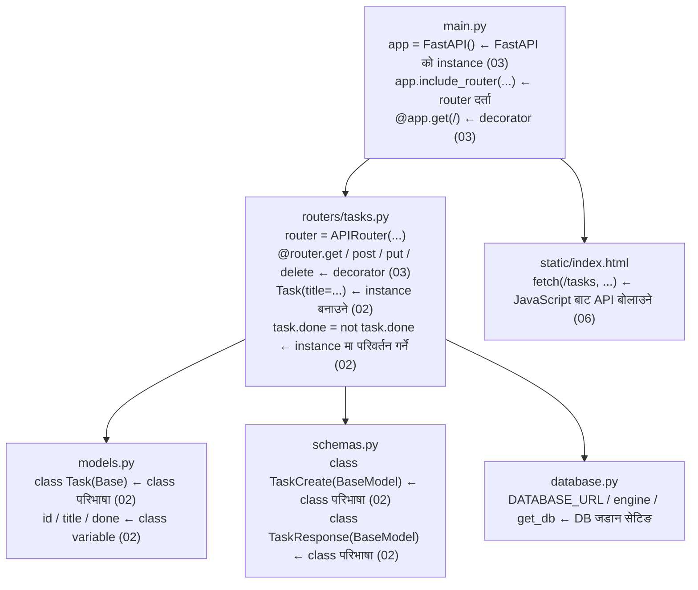

# कोड रिडिङ — परीक्षण गरिएको स्रोत कोडबाट सिकेको कुरा पक्का गरौँ

> 🇯🇵 मूल प्रति (जापानी भाषामा): [07_コードリーディング.md](<../../1年生_前期_ITシステム基礎/番外編/07_コードリーディング.md>) <!-- original-ja-link -->

## यस पटकको लक्ष्य
- `02_Python_OOP入門` मा सिकेको class वास्तविक कोडमा कहाँ प्रयोग भएको छ भनेर व्याख्या गर्न सक्नु
- `03_FastAPI入門` मा सिकेको decorator वास्तविक कोडमा कहाँ प्रयोग भएको छ भनेर व्याख्या गर्न सक्नु
- ५ वटा फाइल एकअर्कासँग कसरी जोडिएका छन् भनेर बुझ्नु

---

## फाइल पढ्ने क्रम

```
① models.py     ← OOP (class) मा सिकेका कुराको समग्र प्रयोग
② schemas.py    ← OOP (class) मा सिकेका कुराको समग्र प्रयोग
③ main.py       ← FastAPI (decorator) मा सिकेका कुराको समग्र प्रयोग
④ routers/tasks.py ← OOP + FastAPI दुवै देखिन्छन्
⑤ database.py   ← जडान सेटिङ (सन्दर्भका लागि)
```

---

## ① models.py पढौँ

```python
from sqlalchemy import Column, Integer, String, Boolean
from database import Base

class Task(Base):
    __tablename__ = "tasks"

    id    = Column(Integer, primary_key=True, index=True)
    title = Column(String(200), nullable=False)
    done  = Column(Boolean, default=False)
```

### 02_OOP入門 सँगको सम्बन्ध

**`class Task` → class को परिभाषा (02 को स्टेप १ मा सिकेको)**

```
02 मा सिकेको लेखाइ           वास्तविक कोड
─────────────────────    ──────────────────────
class Task:              class Task(Base):
    pass                     __tablename__ = "tasks"
```

`(Base)` लाई **inheritance (वंशानुक्रम)** भनिन्छ। `Base` भन्ने class का सुविधाहरू लिएर `Task` class बनाइएको छ।
"SQLAlchemy का सबै सुविधा प्रयोग गर्न मिल्ने बनाउने सेटिङ" भनेर बुझे पुग्छ।

---

**`id / title / done` → class variable (instance ले राख्ने डेटा)**

02 को `Task` class मा हामीले `self.title` र `self.done` लाई constructor भित्र परिभाषित गरेका थियौँ।
`models.py` मा SQLAlchemy को `Column()` प्रयोग गरेर त्यही काम गरिएको छ।

```
02 मा सिकेको लेखाइ                 वास्तविक कोड (models.py)
─────────────────────────    ──────────────────────────────────
class Task:                  class Task(Base):
    def __init__(self):
        self.title = ...         title = Column(String(200))
        self.done = False        done  = Column(Boolean, default=False)
```

लेख्ने तरिका फरक छ, तर "**class ले कस्तो डेटा राख्छ**" भनेर परिभाषित गर्ने कुरा उही हो।

---

**instance बनाउने ठाउँ (routers/tasks.py बाट)**

```python
# Task class बाट instance बनाउने (02 को स्टेप २ जस्तै!)
new_task = Task(title=task_in.title)
#          ↑ Task class   ↑ title मा मान पठाउने
```

02 को अभ्याससँग तुलना:
```python
# 02 को अभ्यास                    वास्तविक कोड
task1 = Task("買い物に行く")   new_task = Task(title="買い物に行く")
```

गरिरहेको काम ठ्याक्कै उही हो।

---

## ② schemas.py पढौँ

```python
from pydantic import BaseModel

class TaskCreate(BaseModel):
    title: str

class TaskResponse(BaseModel):
    id: int
    title: str
    done: bool

    class Config:
        from_attributes = True
```

### 02_OOP入門 सँगको सम्बन्ध

**२ वटा class परिभाषित छन् → प्रयोजन फरक छ**

```
class को नाम      भूमिका                     instance बन्ने समय
────────────    ─────────────────────    ──────────────────────────────
TaskCreate      POST request लिन्छ          ब्राउजरमा "追加" (थप्ने) थिच्दा
TaskResponse    response फर्काउँछ           API ले नतिजा फर्काउँदा
```

**`title: str` → type annotation सहितको class variable**

02 मा हामीले `self.title = title` जस्तो लेखेका थियौँ,
तर Pydantic class मा `title: str` मात्र लेखे पुग्छ, "title string हो" भनेर परिभाषित हुन्छ।

```python
# 02 को लेखाइ (साधारण class)       schemas.py को लेखाइ (Pydantic class)
def __init__(self, title):         class TaskCreate(BaseModel):
    self.title = title                 title: str   ← १ लाइनमै लेख्न सकिन्छ!
```

**`class Config` → class भित्र class**

class भित्र अर्को class लेख्न सकिन्छ।
यहाँ SQLAlchemy को model object लाई जस्ताको तस्तै दिन मिल्ने बनाउने सेटिङ लेखिएको छ।

---

## ③ main.py पढौँ

```python
from fastapi import FastAPI
from fastapi.staticfiles import StaticFiles
from fastapi.responses import FileResponse
from database import engine, Base
import models
from routers import tasks

Base.metadata.create_all(bind=engine)

app = FastAPI()

app.include_router(tasks.router)

app.mount("/static", StaticFiles(directory="static"), name="static")

@app.get("/")
def read_index():
    return FileResponse("static/index.html")
```

### 03_FastAPI入門 सँगको सम्बन्ध

**`app = FastAPI()` → FastAPI को instance बनाउने (03 मा सिकेको)**

```
03 मा सिकेको                वास्तविक कोड
─────────────────────    ──────────────────────
app = FastAPI()           app = FastAPI()   ← ठ्याक्कै उही!
```

---

**`@app.get("/")` → decorator (03 मा सिकेको)**

```python
@app.get("/")          # ← "/ मा GET रिक्वेस्ट आयो भने यो function चलाउने"
def read_index():
    return FileResponse("static/index.html")
```

03 को Hello World सँग तुलना:
```
03 को अभ्यास                            वास्तविक कोड
─────────────────────────────────   ──────────────────────────────────
@app.get("/")                        @app.get("/")
def read_root():                     def read_index():
    return {"message": "Hello!"}         return FileResponse("static/index.html")
```

`return` मा के फर्काउने भन्ने मात्र फरक छ, decorator को प्रयोग ठ्याक्कै उही हो।

---

**`app.include_router(tasks.router)` → नयाँ कुरा: router**

03 मा हामीले सबै endpoint `main.py` मै लेखेका थियौँ।
वास्तविक सिस्टममा, task सम्बन्धी API हरू `routers/tasks.py` मा एकै ठाउँ लेखिन्छन्,
र `main.py` मा "यो router प्रयोग गर्छु" भनेर दर्ता गरिन्छ।

```
03 को ढाँचा (सबै main.py मा लेख्ने)       वास्तविक सिस्टम (फाइल छुट्याउने)
─────────────────────────────────   ──────────────────────────────────
@app.get("/tasks")                   routers/tasks.py मा लेख्ने
@app.post("/tasks")                       ↓
@app.put("/tasks/{id}")              main.py मा दर्ता गर्ने
@app.delete("/tasks/{id}")           app.include_router(tasks.router)
```

**किन फाइल छुट्याउने?**
→ task, user, product जस्ता सुविधा बढ्दै जाँदा सबै १ वटै फाइलमा राख्दा पढ्न गाह्रो हुन्छ।

---

**`Base.metadata.create_all(bind=engine)` → table स्वचालित रूपमा बनाउने**

एप सुरु हुने हरेक पटक "tasks table छैन भने बनाउने" काम आफैँ हुन्छ।
`models.py` को `Task` class को आधारमा table बनाइन्छ।

---

## ④ routers/tasks.py पढौँ

OOP (02) र FastAPI (03) दुवै देखिने सबैभन्दा महत्त्वपूर्ण फाइल हो।

```python
from fastapi import APIRouter, Depends, HTTPException
from sqlalchemy.orm import Session
from database import get_db
from models import Task
from schemas import TaskCreate, TaskResponse

router = APIRouter(prefix="/tasks", tags=["tasks"])
```

**`router = APIRouter(...)` → app जस्तै, router का लागि मात्र बनाइएको instance**

```
main.py             routers/tasks.py
────────────────    ──────────────────────────────
app = FastAPI()     router = APIRouter(prefix="/tasks")
@app.get("/")       @router.get("")
```

`prefix="/tasks"` को अर्थ: यो router को decorator मा लेखिने URL को अगाडि `/tasks` आफैँ जोडिन्छ।

```
@router.get("")   →  वास्तविक URL /tasks हो
@router.get("/{task_id}")  →  वास्तविक URL /tasks/{task_id} हो
```

---

### GET /tasks — सूची प्राप्त गर्ने

```python
@router.get("", response_model=list[TaskResponse])
def get_tasks(db: Session = Depends(get_db)):
    return db.query(Task).all()
```

**`@router.get("")` → decorator (03 मा सिकेको)**
`router` मा लगाएकाले `/tasks` मा आउने GET रिक्वेस्ट लाई सम्हाल्छ।

**`response_model=list[TaskResponse]` → response को संरचना तोक्ने**
`schemas.py` को `TaskResponse` class को list फर्काउँछ भनेर घोषणा गरिएको छ।

**`Depends(get_db)` → नयाँ कुरा: dependency injection**
"`get_db` function को नतिजा (DB सँगको जडान) लाई `db` मा दिनुहोस्" भन्ने FastAPI को व्यवस्था हो।
API बोलाइने हरेक पटक DB सँगको जडान आफैँ तयार गरिदिन्छ।

**`db.query(Task).all()` → Task class का सबै instance प्राप्त गर्ने**
```
db.query(Task).all()
             ↑
         OOP को Task class तोकिएको
         → tasks table का सबै row लाई Task instance को list को रूपमा प्राप्त गर्छ
```

---

### POST /tasks — task बनाउने

```python
@router.post("", response_model=TaskResponse)
def create_task(task_in: TaskCreate, db: Session = Depends(get_db)):
    new_task = Task(title=task_in.title)  # ← OOP! instance बनाउने
    db.add(new_task)
    db.commit()
    db.refresh(new_task)
    return new_task
```

**`task_in: TaskCreate` → schemas.py को class यहाँ देखिन्छ**
ब्राउजरबाट पठाइएको JSON आफैँ `TaskCreate` instance मा बदलिन्छ।

```
ब्राउजरले पठाउने डेटा        FastAPI ले आफैँ बदल्छ
────────────────────    ──────────────────────────────
{"title": "買い物"}  →  task_in = TaskCreate(title="買い物")
                                             ↑ task_in.title बाट निकाल्न सकिन्छ
```

**`new_task = Task(title=task_in.title)` → OOP (02 को स्टेप २ जस्तै)**

```
02 को अभ्यास                         वास्तविक कोड
─────────────────────────────    ──────────────────────────────
task1 = Task("買い物に行く")       new_task = Task(title=task_in.title)
```

instance बनाएर त्यसमा डेटा राख्ने, यही नै OOP हो।

---

### PUT /tasks/{task_id} — सम्पन्न/असम्पन्न बदल्ने

```python
@router.put("/{task_id}", response_model=TaskResponse)
def toggle_task(task_id: int, db: Session = Depends(get_db)):
    task = db.query(Task).filter(Task.id == task_id).first()

    if task is None:
        raise HTTPException(status_code=404, detail="タスクが見つかりません")

    task.done = not task.done   # ← OOP! instance को डेटा बदल्ने
    db.commit()
    db.refresh(task)
    return task
```

**`/{task_id}` → path parameter (03 मा सिकेको)**

```
03 को अभ्यास                          वास्तविक कोड
─────────────────────────────     ──────────────────────────────
@app.get("/tasks/{task_id}")       @router.put("/{task_id}")
def get_task(task_id: int):        def toggle_task(task_id: int, ...):
```

URL मा भएको सङ्ख्या (उदाहरण: `/tasks/3`) `task_id = 3` को रूपमा प्राप्त हुन्छ।

**`task.done = not task.done` → instance को डेटा सिधै बदल्ने**

```
प्राप्त गरेको task instance को done लाई उल्टाउने
task.done False छ → not False → True  (असम्पन्न → सम्पन्न)
task.done True छ  → not True  → False (सम्पन्न → असम्पन्न)
```

---

### DELETE /tasks/{task_id} — मेटाउने

```python
@router.delete("/{task_id}")
def delete_task(task_id: int, db: Session = Depends(get_db)):
    task = db.query(Task).filter(Task.id == task_id).first()

    if task is None:
        raise HTTPException(status_code=404, detail="タスクが見つかりません")

    db.delete(task)
    db.commit()
    return {"message": f"タスク '{task.title}' を削除しました"}
```

**`raise HTTPException(status_code=404, ...)` → error फर्काउने**

`task` भेटिएन भने (`is None`), ब्राउजरलाई 404 error फर्काउँछ।
`raise` भनेको "यो error अहिले नै उत्पन्न गराउने" भन्ने Python को syntax हो।

---

## ⑤ समग्र सम्बन्ध



---

## सारांश: 02/03 मा सिकेका कुराहरू कसरी प्रयोग भएका छन्

| सिकेको कुरा | सामग्री | वास्तविक कोड |
|-----------|------|-------------|
| `class ClassName:` ले class परिभाषित गर्ने | 02 | `models.py` को `Task`, `schemas.py` को `TaskCreate` आदि |
| `instance = ClassName(argument)` | 02 | `new_task = Task(title=...)` |
| instance को डेटा बदल्ने | 02 | `task.done = not task.done` |
| `app = FastAPI()` | 03 | `main.py` को पहिलो लाइन |
| `@app.get(...)` decorator | 03 | `@router.get("") / @router.post("") आदि` |
| `/{parameter}` path parameter | 03 | `@router.put("/{task_id}")` |

---

> अघिल्लो चरण → [06_フロントエンド連携.md](./06_フロントエンド連携.md)
> परीक्षण गरिएको स्रोत कोड → [検証/todo_app/](./検証/todo_app/)
