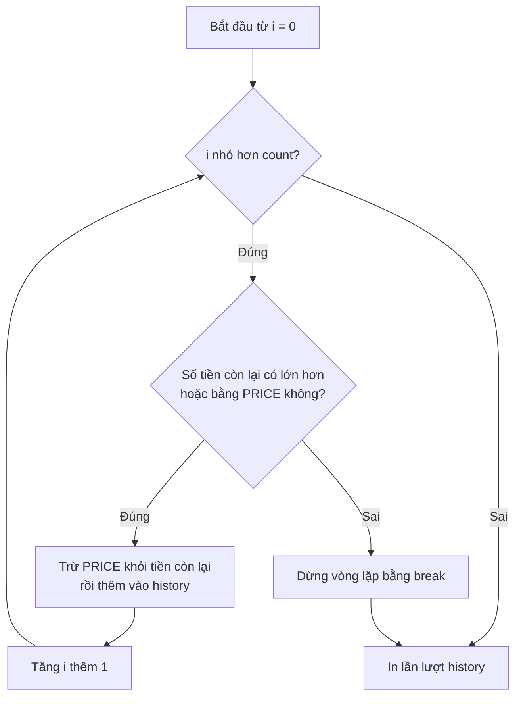
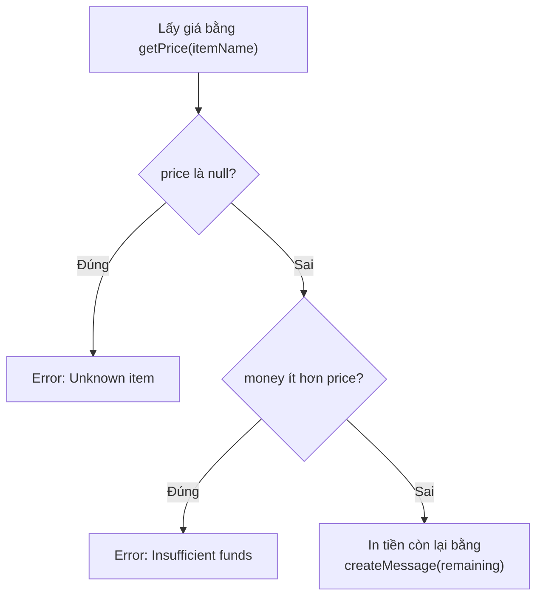

> 🇯🇵 Bản gốc (tiếng Nhật): [2026_04_21_演習.md](<../../1年生_前期_ITシステム基礎/2026_04_21/2026_04_21_演習.md>) <!-- original-ja-link -->


---

## Bài tập tổng hợp: Phát triển chương trình máy bán hàng tự động

### 【STEP 1】Cơ bản về biến và hằng số

**Yêu cầu:**
- Định nghĩa giá sản phẩm bằng hằng số `PRICE` (150).
- Nhận "số tiền bỏ vào" dưới dạng số từ đầu vào chuẩn (standard input).
- Tính "số tiền còn lại" bằng cách lấy số tiền bỏ vào trừ đi giá, rồi in ra `Remaining: [số]`.

JavaScript

```
const reader = require('readline').createInterface({
  input: process.stdin,
  output: process.stdout
});

const lines = [];
reader.on('line', (line) => {
  lines.push(line);
});

reader.on('close', () => {
  const PRICE = 150;
  let money = Number(lines[0]); // Dữ liệu nhập ở dòng 1
  
  let remaining = money - PRICE;
  console.log(`Remaining: ${remaining}`);
});
```

---

### 【STEP 2】Rẽ nhánh điều kiện bằng câu lệnh if

**Yêu cầu:**
- Nếu số tiền bỏ vào nhỏ hơn `PRICE`, in ra `Error: Insufficient funds` rồi kết thúc.
- Chỉ khi đủ tiền thì mới in ra tiền thối lại.

JavaScript

```
reader.on('close', () => {
  const PRICE = 150;
  let money = Number(lines[0]);

  if (money < PRICE) {
    console.log("Error: Insufficient funds");
  } else {
    let remaining = money - PRICE;
    console.log(`Remaining: ${remaining}`);
  }
});
```

---

### 【STEP 3】Mảng và vòng lặp for (mua nhiều chai)

**Yêu cầu:**
- Dòng 1 của đầu vào là "số tiền bỏ vào", dòng 2 là "số chai muốn mua".
- Mỗi lần mua 1 chai, tính số tiền còn lại và thêm số tiền đó vào mảng `history` để lưu lịch sử.
- Nếu giữa chừng không còn đủ tiền thì dừng vòng lặp tại đó.
- Cuối cùng, dùng vòng lặp để in lần lượt nội dung của mảng.

Luồng xử lý của vòng lặp mua hàng như sau.



JavaScript

```
reader.on('close', () => {
  let money = Number(lines[0]);
  const count = Number(lines[1]);
  const PRICE = 150;
  const history = [];

  // Vòng lặp xử lý mua hàng
  for (let i = 0; i < count; i++) {
    if (money >= PRICE) {
      money -= PRICE;
      history.push(money);
    } else {
      break;
    }
  }

  // In nội dung mảng bằng vòng lặp (phiên bản dùng for)
  for (let i = 0; i < history.length; i++) {
    // Truy cập từng phần tử của mảng bằng history[i]
    console.log(`Step ${i + 1}: ${history[i]}`);
  }
});
```


```
reader.on('close', () => {
  let money = Number(lines[0]);
  const count = Number(lines[1]);
  const PRICE = 150;
  const history = [];

  for (let i = 0; i < count; i++) {
    if (money >= PRICE) {
      money -= PRICE;
      history.push(money);
    } else {
      break;
    }
  }

  // In nội dung mảng bằng vòng lặp
  history.forEach((rem, index) => {
    console.log(`Step ${index + 1}: ${rem}`);
  });
});
```

---

### 【STEP 4】Refactoring: rẽ nhiều nhánh bằng câu lệnh switch

**Yêu cầu:**

- Dòng 1 của đầu vào là "số tiền bỏ vào", dòng 2 là "tên sản phẩm (Coke, Water, Coffee)".
- Dùng câu lệnh `switch` để đổi giá tùy theo tên sản phẩm.
    - Coke: 150, Water: 100, Coffee: 120
    - Trường hợp khác: in ra `Error: Unknown item`.

JavaScript

```
reader.on('close', () => {
  let money = Number(lines[0]);
  const itemName = lines[1]; // Tên sản phẩm
  let price = 0;

  // Rẽ nhiều nhánh bằng if / else if
  if (itemName === "Coke") {
    price = 150;
  } else if (itemName === "Water") {
    price = 100;
  } else if (itemName === "Coffee") {
    price = 120;
  } else {
    // Trường hợp không khớp với điều kiện nào (tương đương default của switch)
    console.log("Error: Unknown item");
    return; 
  }

  // Kiểm tra có mua được không
  if (money >= price) {
    console.log(`Remaining: ${money - price}`);
  } else {
    console.log("Error: Insufficient funds");
  }
});
```

```
reader.on('close', () => {
  let money = Number(lines[0]);
  const itemName = lines[1]; // Dòng 2: tên sản phẩm
  let price = 0;

  switch (itemName) {
    case "Coke":
      price = 150;
      break;
    case "Water":
      price = 100;
      break;
    case "Coffee":
      price = 120;
      break;
    default:
      console.log("Error: Unknown item");
      return; // Kết thúc xử lý
  }

  if (money >= price) {
    console.log(`Remaining: ${money - price}`);
  } else {
    console.log("Error: Insufficient funds");
  }
});
```

---

### 【STEP 5】Refactoring cuối cùng: tách thành hàm

### 【STEP 5】Refactoring: tách thành hàm và template literal

**Yêu cầu:**
- Tạo hàm `getPrice(name)` trả về giá từ tên sản phẩm.
- Tạo hàm `createMessage(remaining)` tính số tiền còn lại sau khi mua và trả về một chuỗi.
- Dùng các hàm này để sắp xếp lại phần xử lý chính.

Luồng kiểm tra của phần xử lý chính như sau.



JavaScript

```
// Hàm xác định giá
const getPrice = (name) => {
  switch (name) {
    case "Coke":   return 150;
    case "Water":  return 100;
    case "Coffee": return 120;
    default:       return null;
  }
};

// Hàm tạo thông báo (template literal)
const createMessage = (remaining) => `Result: Remaining balance is ${remaining} yen.`;

reader.on('close', () => {
  const money = Number(lines[0]);
  const itemName = lines[1];
  
  const price = getPrice(itemName);

  if (price === null) {
    console.log("Error: Unknown item");
  } else if (money < price) {
    console.log("Error: Insufficient funds");
  } else {
    const remaining = money - price;
    console.log(createMessage(remaining));
  }
});
```

---

### 💡 Điểm cần lưu ý khi giảng dạy

- **Ý thức về xử lý bất đồng bộ:** Hãy nhắc học sinh rằng nếu viết xử lý bên ngoài `reader.on('close', ...)`, nó sẽ chạy trước khi nhập xong dữ liệu và gây ra lỗi.
    
- **Chỉ số của mảng:** Điều quan trọng là giúp học sinh hiểu thứ tự lưu dữ liệu nhập vào, chẳng hạn qua `lines[0]` và `lines[1]`.
    
- **Sự cần thiết của trim():** Đoạn code lần này chưa sử dụng phương thức này, nhưng dữ liệu nhập có thể chứa khoảng trắng thừa, nên sẽ chu đáo hơn nếu hướng dẫn học sinh rằng trong thực tế nên viết `lines.push(line.trim());`.