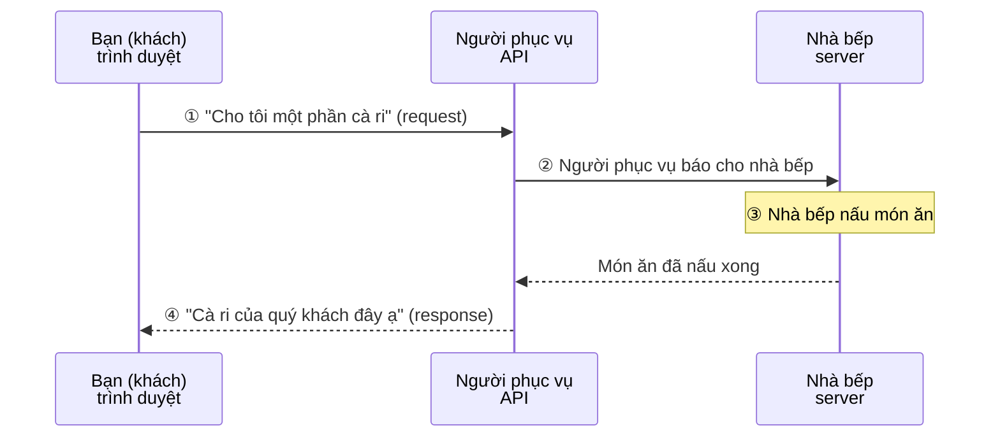
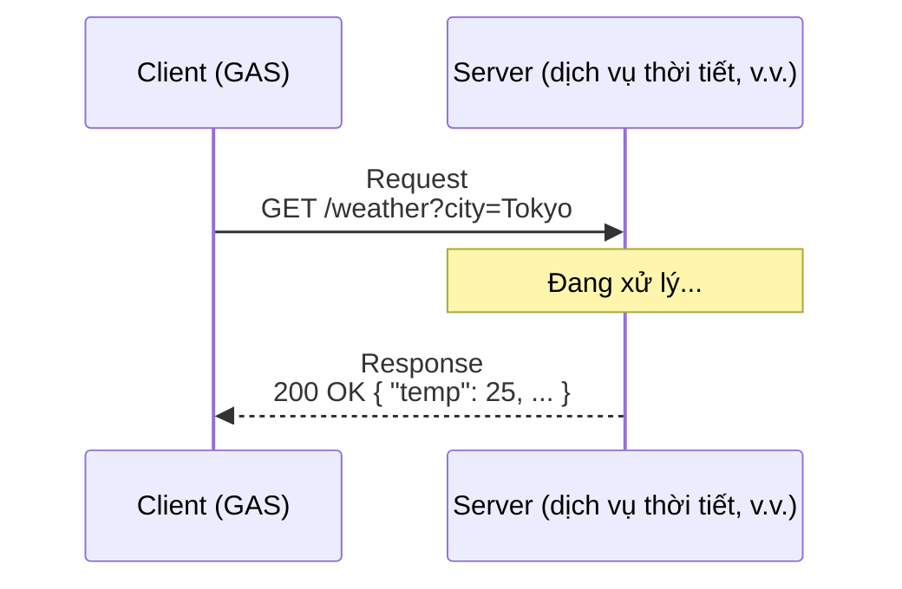
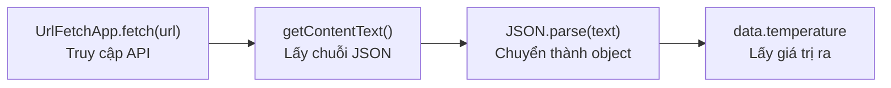

# API là gì — Request, response và JSON

> 🇯🇵 Bản gốc (tiếng Nhật): [20260512_API説明資料.md](<../../1年生_前期_ITシステム基礎/2026_05_12/20260512_API説明資料.md>) <!-- original-ja-link -->

## Mục tiêu hôm nay
- Giải thích được API là gì bằng lời của chính mình
- Hiểu được khái niệm "request và response" của HTTP
- Đọc hiểu được dữ liệu JSON
- Gọi được API bên ngoài bằng `UrlFetchApp` của GAS

---

## 1. API là gì?

**API (Application Programming Interface) = đầu mối giao tiếp giữa các ứng dụng**

### Tìm hiểu qua một ví dụ quen thuộc

Nếu lấy ví dụ một nhà hàng, ta có thể hình dung như sau.



Bạn không cần biết cấu trúc bên trong của nhà bếp (server).  
Bạn chỉ cần gọi món thông qua người phục vụ (API).

---

## 2. HTTP request và response



**Các loại request:**
| Phương thức | Ý nghĩa | Ví dụ |
|---------|------|-----|
| GET | Muốn lấy dữ liệu | Lấy thông tin thời tiết |
| POST | Muốn gửi hoặc tạo dữ liệu | Gửi form |
| PUT | Muốn cập nhật dữ liệu | Thay đổi hồ sơ cá nhân |
| DELETE | Muốn xóa dữ liệu | Xóa bài đăng |

**Mã trạng thái của response:**
| Mã | Ý nghĩa |
|--------|------|
| 200 | OK (thành công) |
| 404 | Not Found (không tìm thấy) |
| 500 | Internal Server Error (lỗi server) |

---

## 3. JSON — định dạng trao đổi dữ liệu

Dữ liệu của API chủ yếu được gửi về theo định dạng **JSON (JavaScript Object Notation)**.

```json
{
  "city": "Tokyo",
  "weather": "晴れ",
  "temperature": 25.5,
  "humidity": 60,
  "forecast": [
    { "date": "2024-01-15", "temp": 24 },
    { "date": "2024-01-16", "temp": 22 },
    { "date": "2024-01-17", "temp": 27 }
  ]
}
```

Cách viết gần như giống hệt object của JavaScript. Kiến thức đã học ở tiết 08 có thể dùng ngay!

---

## 4. Gọi API bên ngoài bằng GAS

Quy trình để lấy được dữ liệu gồm 4 bước như sau.



```javascript
function callApi() {
  // UrlFetchApp.fetch(URL) = truy cập URL đã chỉ định và lấy dữ liệu về
  const url = "https://api.example.com/data";
  
  const response = UrlFetchApp.fetch(url);
  
  // Lấy nội dung response dưới dạng chuỗi
  const text = response.getContentText();
  console.log(text);  // Chuỗi JSON sẽ được hiển thị
  
  // Chuyển chuỗi JSON thành object (đã học ở tiết 08!)
  const data = JSON.parse(text);
  console.log(data.temperature);  // → 25.5
}
```

---

## 5. Thực hành sử dụng API công khai

### Ví dụ: Open-Meteo (API thời tiết miễn phí, không cần API key)

```javascript
function getWeather() {
  // Chỉ định vĩ độ, kinh độ của Tokyo để lấy dữ liệu thời tiết
  const url = "https://api.open-meteo.com/v1/forecast?latitude=35.6762&longitude=139.6503&current_weather=true";
  
  // Gửi request đến API
  const response = UrlFetchApp.fetch(url);
  
  // Lấy response dưới dạng JSON
  const json = JSON.parse(response.getContentText());
  
  // Dữ liệu thời tiết hiện tại nằm trong current_weather
  const weather = json.current_weather;
  
  console.log("気温: " + weather.temperature + "℃");
  console.log("風速: " + weather.windspeed + " km/h");
  
  // Chuyển mã thời tiết sang tiếng Nhật (một phần)
  const weatherCodes = {
    0: "快晴",
    1: "晴れ",
    2: "一部曇り",
    3: "曇り",
    61: "弱い雨",
    63: "適度な雨",
    65: "強い雨",
  };
  
  const weatherText = weatherCodes[weather.weathercode] || "不明";
  console.log("天気: " + weatherText);
}
```

---

## 6. Ghi response của API vào sheet

```javascript
function weatherToSheet() {
  const sheet = SpreadsheetApp.getActiveSpreadsheet().getActiveSheet();
  
  // Lấy dữ liệu thời tiết từ API
  const url = "https://api.open-meteo.com/v1/forecast?latitude=35.6762&longitude=139.6503&current_weather=true";
  const response = UrlFetchApp.fetch(url);
  const data = JSON.parse(response.getContentText());
  const weather = data.current_weather;
  
  // Lấy thời gian hiện tại
  const now = new Date();
  const timeStr = Utilities.formatDate(now, "Asia/Tokyo", "yyyy/MM/dd HH:mm");
  
  // Ghi vào dòng tiếp theo sau dòng cuối cùng
  const nextRow = sheet.getLastRow() + 1;
  sheet.getRange(nextRow, 1).setValue(timeStr);
  sheet.getRange(nextRow, 2).setValue(weather.temperature);
  sheet.getRange(nextRow, 3).setValue(weather.windspeed);
  
  console.log("天気データを記録しました！");
}
```

---

## Tổng kết

| Thuật ngữ                       | Ý nghĩa                |
| ------------------------ | ----------------- |
| API                      | Đầu mối giao tiếp giữa các ứng dụng      |
| Request                    | Yêu cầu từ client gửi đến server  |
| Response                    | Câu trả lời từ server gửi về client  |
| JSON                     | Định dạng dùng để trao đổi dữ liệu     |
| `UrlFetchApp.fetch(url)` | Truy cập URL bằng GAS |
| `JSON.parse(str)`        | Chuyển chuỗi JSON thành object |

---

## Giới thiệu nội dung buổi sau (tiết 14)

Chúng ta sẽ thực hành sử dụng các API công khai cung cấp dữ liệu thời tiết, tỷ giá hối đoái, v.v. để tự động ghi dữ liệu vào spreadsheet.
