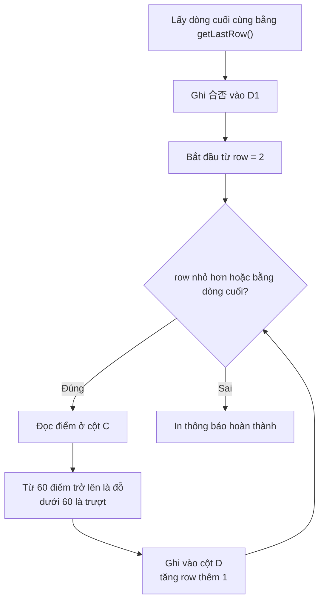

# Bài tập thực hành

> 🇯🇵 Bản gốc (tiếng Nhật): [20260512_演習回答.md](<../../1年生_前期_ITシステム基礎/2026_05_12/20260512_演習回答.md>) <!-- original-ja-link -->

## Chuẩn bị: Tạo spreadsheet

1. Tạo mới một Google Spreadsheet (Google Trang tính)
2. Đặt tên spreadsheet là "GAS演習"
3. Mở "Tiện ích mở rộng" (Extensions) → "Apps Script"

---

## Bài tập 1: Ghi thông tin vào ô

### Đề bài

> **Thời gian dự kiến: 10〜15 phút**

Hãy dùng GAS để tạo một hàm ghi phần tự giới thiệu của bản thân vào spreadsheet.

**Việc cần làm:**

1. Tạo một hàm tên là `jikoshokaSheet`
2. Lấy sheet hiện tại vào biến `sheet` (tham khảo chương 3 của tài liệu)
3. Ghi giá trị vào từng ô theo bảng dưới đây

| Ô | Nội dung cần ghi |
|------|------------|
| A1 | Chuỗi `"自己紹介"` (tự giới thiệu) |
| B1 | **Tên của bạn** (ví dụ: `"田中太郎"`) |
| A2 | Chuỗi `"年齢"` (tuổi) |
| B2 | **Tuổi của bạn** (là số, không có dấu nháy) |

4. **Ngoài ra**, hãy tự thêm thông tin tùy chọn (như sở thích, quê quán) vào các ô A3〜B4

> **Gợi ý:** Để ghi vào ô, dùng `getRange("A1").setValue(giá trị)` (chương 3 của tài liệu)

**Hãy chạy thử và kiểm tra xem dữ liệu đã được ghi vào sheet chưa**

### Đáp án

```javascript
function jikoshokaSheet() {
  const sheet = SpreadsheetApp.getActiveSpreadsheet().getActiveSheet();
  
  // Ghi "自己紹介" vào A1
  sheet.getRange("A1").setValue("自己紹介");
  
  // Ghi tên của bạn vào B1 (← hãy thay đổi)
  sheet.getRange("B1").setValue("田中太郎");
  
  // Ghi "年齢" vào A2, ghi số tuổi vào B2
  sheet.getRange("A2").setValue("年齢");
  sheet.getRange("B2").setValue(18);
  
  // Hãy tự thêm cả A3, B3, A4, B4 nhé
}
```

---

## Bài tập 2: Ghi toàn bộ bảng điểm cùng lúc

### Đề bài

> **Thời gian dự kiến: 20〜30 phút**

Ghi từng ô một thì rất mất công. Lần này, hãy dùng **mảng 2 chiều và `setValues()`** để tạo một hàm ghi toàn bộ bảng điểm cùng lúc.

**Việc cần làm:**

1. Tạo một hàm tên là `seisekiTable`
2. Đầu tiên, **xóa sạch** sheet (dùng `clearContents()`)
3. Ghi tiêu đề `"番号"`, `"名前"`, `"点数"` (số thứ tự, tên, điểm) vào dòng 1
   - Ghi **mảng 2 chiều** `[["番号", "名前", "点数"]]` bằng `setValues()`
   - Chỉ định "bắt đầu từ dòng 1, cột 1, kích thước 1 dòng × 3 cột" bằng `getRange(1, 1, 1, 3)` (chương 5 của tài liệu)
4. Từ dòng 2 trở đi, ghi dữ liệu của 5 người dưới đây

| Số thứ tự | Tên | Điểm |
|------|------|------|
| 1 | 田中太郎 | 85 |
| 2 | 鈴木花子 | 72 |
| 3 | 山田次郎 | 91 |
| 4 | 佐藤三郎 | 68 |
| 5 | 伊藤美咲 | 78 |

   - Chuẩn bị dữ liệu dưới dạng mảng 2 chiều, rồi ghi bằng `getRange(2, 1, số dòng của dữ liệu, số cột của dữ liệu)`
5. Làm cho dòng tiêu đề (dòng 1) **in đậm** và có **màu nền xám** (`"#CCCCCC"`) (chương 7 của tài liệu)

> **Gợi ý:** Có thể lấy số dòng bằng `data.length` và số cột bằng `data[0].length`

### Đáp án

```javascript
function seisekiTable() {
  const sheet = SpreadsheetApp.getActiveSpreadsheet().getActiveSheet();
  
  // Xóa sạch sheet (xóa dữ liệu cũ)
  sheet.clearContents();
  
  // Dòng tiêu đề
  const header = [["番号", "名前", "点数"]];
  sheet.getRange(1, 1, 1, 3).setValues(header);
  
  // Các dòng dữ liệu (5 người)
  const data = [
    [1, "田中太郎", 85],
    [2, "鈴木花子", 72],
    [3, "山田次郎", 91],
    [4, "佐藤三郎", 68],
    [5, "伊藤美咲", 78],
  ];
  
  // Ghi từ dòng 2
  sheet.getRange(2, 1, data.length, data[0].length).setValues(data);
  
  // Làm tiêu đề in đậm
  sheet.getRange(1, 1, 1, 3).setFontWeight("bold");
  sheet.getRange(1, 1, 1, 3).setBackground("#CCCCCC");
}
```

---

## Bài tập 3: Đọc ô và xử lý dữ liệu

### Đề bài

> **Thời gian dự kiến: 30〜40 phút**

**Hãy làm bài này sau khi đã chạy Bài tập 2.**

Hãy tạo một hàm đọc điểm trong bảng điểm đã làm ở Bài tập 2, tự động xét "đỗ/trượt" và ghi kết quả vào cột D.

**Việc cần làm:**

1. Tạo một hàm tên là `readAndProcess`

2. Lấy số thứ tự của dòng cuối cùng có dữ liệu bằng `getLastRow()` (chương 6 của tài liệu)

3. Ghi tiêu đề `"合否"` (đỗ/trượt) vào dòng 1 của cột D (cột thứ 4)
   - Chỉ định "dòng 1, cột 4" bằng `getRange(1, 4)`

4. Dùng vòng lặp `for` lặp từ dòng 2 đến dòng cuối cùng
   - Đọc điểm ở cột C (cột thứ 3) của mỗi dòng bằng `getValue()`
   - Xét: nếu điểm **từ 60 trở lên thì là `"合格"`** (đỗ), **dưới 60 thì là `"不合格"`** (trượt)
     - Dùng toán tử ba ngôi `score >= 60 ? "合格" : "不合格"`
   - Ghi kết quả xét vào cột D (cột thứ 4) bằng `setValue()`

5. Khi vòng lặp kết thúc, in ra `console.log("合否判定が完了しました！")`

> **Gợi ý:** Có thể chỉ định dòng và cột bằng số với `getRange(số dòng, số cột)` (chương 4 của tài liệu)

Nếu vẽ luồng xử lý thành sơ đồ thì sẽ như sau.



**Sau khi chạy, hãy kiểm tra xem kết quả đỗ/trượt đã hiện ở cột D chưa**

### Đáp án

```javascript
function readAndProcess() {
  const sheet = SpreadsheetApp.getActiveSpreadsheet().getActiveSheet();
  
  // Hãy chạy code này sau khi đã chạy Bài tập 2
  
  // Đọc dữ liệu từ dòng 2 đến dòng cuối cùng
  const lastRow = sheet.getLastRow();
  
  // Ghi "合否" vào cột D (cột thứ 4)
  // Tiêu đề
  sheet.getRange(1, 4).setValue("合否");
  
  for (let row = 2; row <= lastRow; row++) {
    // Đọc điểm ở cột C (cột thứ 3)
    const score = sheet.getRange(row, 3).getValue();
    
    // Từ 60 điểm trở lên là đỗ, dưới 60 là trượt
    const result = score >= 60 ? "合格" : "不合格";
    
    // Ghi vào cột D
    sheet.getRange(row, 4).setValue(result);
  }
  
  console.log("合否判定が完了しました！");
}
```

---

## Bài tập 4: Định dạng cho đẹp

### Đề bài

> **Thời gian dự kiến: 15〜20 phút**

**Hãy làm bài này sau khi đã chạy Bài tập 3.**

Hãy đọc cột "合否" (đỗ/trượt) đã ghi ở Bài tập 3, rồi tô **màu nền** cho các dòng đỗ và trượt, để hoàn thiện một bảng điểm nhìn vào là biết ngay kết quả.

**Việc cần làm:**

1. Tạo một hàm tên là `colorFormat`
2. Lấy số thứ tự của dòng cuối cùng bằng `getLastRow()`
3. Dùng vòng lặp `for` lặp từ dòng 2 đến dòng cuối cùng
   - Đọc giá trị ở cột D (cột thứ 4) bằng `getValue()`
   - Nếu giá trị là `"合格"` (đỗ), đổi màu nền của dòng đó (cột 1〜4) thành **xanh dương nhạt** `"#CCE5FF"`
   - Nếu giá trị là `"不合格"` (trượt), đổi màu nền của dòng đó thành **cam nhạt** `"#FFE5CC"`
   - Để chỉ định phạm vi có chiều rộng bằng một dòng, dùng `getRange(số dòng, 1, 1, 4)` ("bắt đầu từ dòng được chỉ định, cột 1, kích thước 1 dòng × 4 cột")

> **Điểm kiểm tra:** Sau khi chạy, nếu dòng đỗ có màu xanh dương và dòng trượt có màu cam là thành công

### Đáp án

```javascript
function colorFormat() {
  const sheet = SpreadsheetApp.getActiveSpreadsheet().getActiveSheet();
  const lastRow = sheet.getLastRow();
  
  for (let row = 2; row <= lastRow; row++) {
    const result = sheet.getRange(row, 4).getValue();
    
    if (result === "合格") {
      // Tô dòng đỗ màu xanh dương nhạt
      sheet.getRange(row, 1, 1, 4).setBackground("#CCE5FF");
    } else {
      // Tô dòng trượt màu cam nhạt
      sheet.getRange(row, 1, 1, 4).setBackground("#FFE5CC");
    }
  }
}
```
