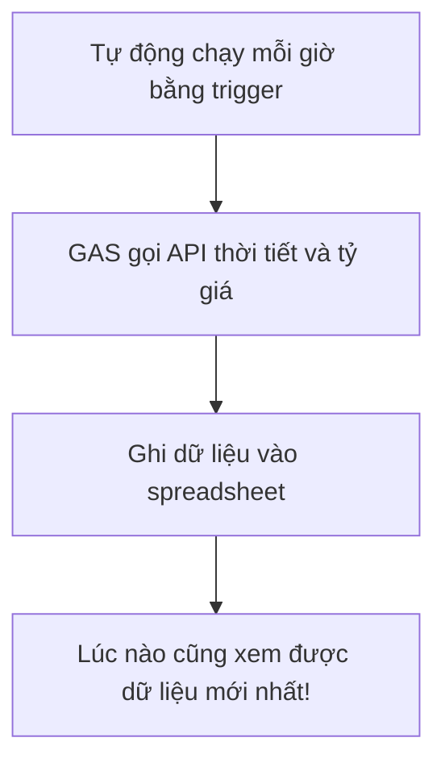

# Bài tập GAS + API — Tự động đưa dữ liệu thời tiết và tỷ giá vào sheet

> 🇯🇵 Bản gốc (tiếng Nhật): [20260519.md](<../../1年生_前期_ITシステム基礎/2026_05_19/20260519.md>) <!-- original-ja-link -->

## Mục tiêu hôm nay
- Gọi được API công khai để lấy dữ liệu
- Tự động ghi dữ liệu đã lấy vào spreadsheet
- Hoàn thành một công cụ tự động hóa kết hợp với trigger

---

## 1. Hôm nay chúng ta làm gì



---

## 2. API tỷ giá hối đoái (ExchangeRate-API)

Đây là API tỷ giá hối đoái có thể dùng miễn phí.

```javascript
function getExchangeRate() {
  // Lấy tỷ giá từ đô la sang các loại tiền tệ
  // base=USD → 1 đô la bằng bao nhiêu yên, bao nhiêu euro, v.v.
  const url = "https://open.er-api.com/v6/latest/USD";
  
  const response = UrlFetchApp.fetch(url);
  const data = JSON.parse(response.getContentText());
  
  // Tỷ giá của từng loại tiền tệ nằm trong data.rates
  const jpyRate = data.rates.JPY;   // Đô la → yên
  const eurRate = data.rates.EUR;   // Đô la → euro
  const gbpRate = data.rates.GBP;   // Đô la → bảng Anh
  
  console.log(`1ドル = ${jpyRate}円`);
  console.log(`1ドル = ${eurRate}ユーロ`);
  console.log(`1ドル = ${gbpRate}ポンド`);
  
  return { JPY: jpyRate, EUR: eurRate, GBP: gbpRate };
}
```

---

## 3. API thời tiết (Open-Meteo)

```javascript
function getWeatherData() {
  // Thời tiết Tokyo (ôn lại tiết 13)
  const url = "https://api.open-meteo.com/v1/forecast"
    + "?latitude=35.6762"
    + "&longitude=139.6503"
    + "&current_weather=true"
    + "&hourly=temperature_2m,precipitation_probability";
  
  const response = UrlFetchApp.fetch(url);
  const data = JSON.parse(response.getContentText());
  
  const current = data.current_weather;
  return {
    temperature: current.temperature,
    windspeed: current.windspeed,
    weathercode: current.weathercode
  };
}
```

---

## 4. Tổng hợp: Hệ thống tự động ghi vào spreadsheet

```javascript
// Ghi tiêu đề vào dòng 1 của sheet (chỉ chạy 1 lần đầu tiên)
function setupHeader() {
  const sheet = SpreadsheetApp.getActiveSpreadsheet().getActiveSheet();
  sheet.clearContents();
  
  const headers = [["記録日時", "気温(℃)", "風速(km/h)", "1ドル(円)", "1ドル(ユーロ)"]];
  sheet.getRange(1, 1, 1, headers[0].length).setValues(headers);
  sheet.getRange(1, 1, 1, headers[0].length).setFontWeight("bold");
  sheet.getRange(1, 1, 1, headers[0].length).setBackground("#4A90D9");
  sheet.getRange(1, 1, 1, headers[0].length).setFontColor("#FFFFFF");
  
  console.log("ヘッダーを設定しました");
}

// Hàm chính chạy định kỳ (cài đặt vào trigger)
function recordData() {
  const sheet = SpreadsheetApp.getActiveSpreadsheet().getActiveSheet();
  
  // Thời gian hiện tại
  const now = new Date();
  const timeStr = Utilities.formatDate(now, "Asia/Tokyo", "yyyy/MM/dd HH:mm");
  
  // Lấy dữ liệu thời tiết
  let temperature = "取得失敗";
  let windspeed = "取得失敗";
  
  try {
    const weatherUrl = "https://api.open-meteo.com/v1/forecast?latitude=35.6762&longitude=139.6503&current_weather=true";
    const weatherRes = UrlFetchApp.fetch(weatherUrl);
    const weatherData = JSON.parse(weatherRes.getContentText());
    temperature = weatherData.current_weather.temperature;
    windspeed = weatherData.current_weather.windspeed;
  } catch (e) {
    // Dù có lỗi xảy ra cũng không dừng chương trình
    console.log("天気取得エラー: " + e.message);
  }
  
  // Lấy dữ liệu tỷ giá
  let jpyRate = "取得失敗";
  let eurRate = "取得失敗";
  
  try {
    const fxUrl = "https://open.er-api.com/v6/latest/USD";
    const fxRes = UrlFetchApp.fetch(fxUrl);
    const fxData = JSON.parse(fxRes.getContentText());
    jpyRate = Math.round(fxData.rates.JPY * 100) / 100;  // Làm tròn đến 2 chữ số thập phân
    eurRate = Math.round(fxData.rates.EUR * 10000) / 10000;
  } catch (e) {
    console.log("為替取得エラー: " + e.message);
  }
  
  // Ghi thêm vào sau dòng cuối cùng
  const nextRow = sheet.getLastRow() + 1;
  const newData = [[timeStr, temperature, windspeed, jpyRate, eurRate]];
  sheet.getRange(nextRow, 1, 1, newData[0].length).setValues(newData);
  
  console.log(`データを記録しました: ${timeStr}`);
}
```

---

## 5. Tóm tắt cách dùng

**Thiết lập lần đầu:**
1. Chạy `setupHeader()` 1 lần
2. Cài đặt trigger
3. Sau đó dữ liệu sẽ tự động được tích lũy!

**Kiểm tra hoạt động:**
- Chạy thủ công `recordData()` vài lần và kiểm tra xem có thêm dữ liệu được ghi vào spreadsheet không

---

## Tổng kết — Kết thúc giai đoạn 3!

| Những gì đã học | Tóm tắt |
|-----------|-------|
| SpreadsheetApp | Đọc và ghi dữ liệu trong ô |
| Vòng lặp for | Tự động xử lý tất cả các dòng |
| Trigger | Tự động chạy theo thời gian hoặc sự kiện |
| GmailApp | Tự động gửi email |
| UrlFetchApp | Lấy dữ liệu từ API bên ngoài |
| JSON.parse | Chuyển chuỗi JSON thành object |

---