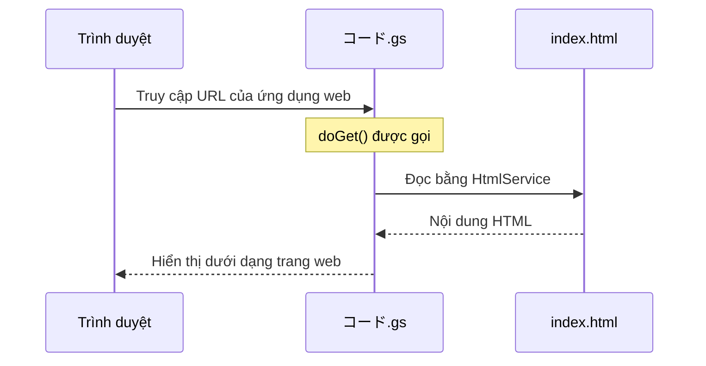

# HTML cơ bản — Thẻ, cấu trúc, form

> 🇯🇵 Bản gốc (tiếng Nhật): [20260519_html.md](<../../1年生_前期_ITシステム基礎/2026_05_19/20260519_html.md>) <!-- original-ja-link -->

## Mục tiêu hôm nay
- Viết được cấu trúc cơ bản của HTML
- Sử dụng thành thạo các thẻ hay dùng
- Tạo được form
- Hiển thị được trang web bằng HTML Service của GAS

---

## 1. HTML là gì

**HTML (HyperText Markup Language) = ngôn ngữ tạo ra "bộ khung" của trang web**

```
Các thành phần của trang web:
├── HTML → cấu trúc, nội dung (xương, thịt)
├── CSS  → giao diện (quần áo, trang điểm)
└── JS   → chuyển động (cơ bắp)
```

---

## 2. Cấu trúc cơ bản

```html
<!DOCTYPE html>
<html lang="ja">
<head>
  <!-- Bên trong head là thông tin thiết lập cho trình duyệt. Không hiển thị trên màn hình -->
  <meta charset="UTF-8">
  <title>ページタイトル</title>  <!-- Hiển thị trên tab -->
</head>
<body>
  <!-- Những gì viết trong body sẽ hiển thị trên màn hình -->
  <h1>見出し1</h1>
  <p>段落テキスト</p>
</body>
</html>
```

---

## 3. Các thẻ hay dùng

### Tiêu đề, đoạn văn

```html
<h1>大見出し（一番大きい）</h1>
<h2>中見出し</h2>
<h3>小見出し</h3>
<p>段落テキスト。改行は自動。</p>
<br>  <!-- Xuống dòng bắt buộc -->
<hr>  <!-- Đường kẻ ngang -->
```

### Link và hình ảnh

```html
<!-- Link -->
<a href="https://google.com">Google へ</a>
<a href="page2.html">次のページ</a>          <!-- Trong cùng một website -->
<a href="https://google.com" target="_blank">新しいタブで開く</a>

<!-- Hình ảnh -->

<!-- alt = văn bản thay thế khi không hiển thị được hình ảnh -->
```

### Danh sách

```html
<!-- Danh sách không đánh số (ul = unordered list) -->
<ul>
  <li>りんご</li>
  <li>みかん</li>
  <li>ぶどう</li>
</ul>

<!-- Danh sách có đánh số (ol = ordered list) -->
<ol>
  <li>手を洗う</li>
  <li>野菜を切る</li>
  <li>炒める</li>
</ol>
```

### Bảng (table)

```html
<table border="1">
  <thead>
    <tr>
      <th>名前</th>   <!-- th = ô tiêu đề (chữ đậm, căn giữa) -->
      <th>点数</th>
    </tr>
  </thead>
  <tbody>
    <tr>
      <td>田中太郎</td>   <!-- td = ô dữ liệu -->
      <td>85</td>
    </tr>
    <tr>
      <td>鈴木花子</td>
      <td>72</td>
    </tr>
  </tbody>
</table>
```

### div và span (nhóm phần tử)

```html
<!-- div = nhóm phần tử dạng block (xếp theo chiều dọc) -->
<div class="box">
  <h2>タイトル</h2>
  <p>内容</p>
</div>

<!-- span = nhóm phần tử dạng inline (xếp theo chiều ngang) -->
<p>テキストの<span style="color: red;">一部だけ</span>を変える</p>
```

---

## 4. Form

Form là thành phần dùng để nhận dữ liệu nhập vào từ người dùng.

```html
<form action="" method="post">
  <!-- Nhập văn bản -->
  <label for="namae">名前：</label>
  <input type="text" id="namae" name="namae" placeholder="名前を入力">
  
  <br>
  
  <!-- Nhập email -->
  <label for="email">メール：</label>
  <input type="email" id="email" name="email">
  
  <br>
  
  <!-- Nhập số -->
  <label for="age">年齢：</label>
  <input type="number" id="age" name="age" min="0" max="150">
  
  <br>
  
  <!-- Hộp chọn (select box) -->
  <label for="grade">学年：</label>
  <select id="grade" name="grade">
    <option value="1">1年生</option>
    <option value="2">2年生</option>
    <option value="3">3年生</option>
  </select>
  
  <br>
  
  <!-- Vùng nhập văn bản (nhiều dòng) -->
  <label for="comment">コメント：</label>
  <textarea id="comment" name="comment" rows="4" cols="40"></textarea>
  
  <br>
  
  <!-- Nút gửi -->
  <button type="submit">送信する</button>
</form>
```

---

## 5. Hiển thị trang web bằng HTML Service của GAS

Có thể dùng GAS để công khai trang web!

**Cấu trúc file (tạo trong trình soạn thảo GAS):**
- `コード.gs` (file chính của GAS)
- `index.html` (file HTML để hiển thị)

**コード.gs:**
```javascript
// Hàm để công khai dưới dạng ứng dụng web
// Được gọi khi có người truy cập vào URL
function doGet() {
  // Đọc index.html và hiển thị
  return HtmlService.createHtmlOutputFromFile("index")
    .setTitle("私のWebページ");
}
```

**index.html:**
```html
<!DOCTYPE html>
<html lang="ja">
<head>
  <meta charset="UTF-8">
  <title>GASのWebページ</title>
</head>
<body>
  <h1>こんにちは！GAS HTML サービス</h1>
  <p>これはGASで表示したWebページです。</p>
  
  <ul>
    <li>スプレッドシートのデータを表示できる</li>
    <li>フォームの送信を受け取れる</li>
    <li>インターネットで公開できる</li>
  </ul>
</body>
</html>
```

Khi truy cập vào URL đã công khai, trang sẽ được hiển thị theo thứ tự sau.



**Cách công khai dưới dạng ứng dụng web:**
1. 「デプロイ」(Triển khai) →「新しいデプロイ」(Bản triển khai mới)
2. Loại: chọn 「Webアプリ」(Ứng dụng web)
3. Người có quyền truy cập: 「全員」(Mọi người)
4. 「デプロイ」(Triển khai) → URL sẽ được cấp!

---

## Tổng kết

| Thẻ | Công dụng |
|------|------|
| `<h1>`〜`<h6>` | Tiêu đề |
| `<p>` | Đoạn văn |
| `<a href="">` | Link |
| `` | Hình ảnh |
| `<ul>` / `<ol>` / `<li>` | Danh sách |
| `<table>` / `<tr>` / `<td>` | Bảng |
| `<form>` | Form (nhận dữ liệu nhập) |
| `<input>` / `<button>` | Phần tử nhập liệu, nút bấm |
| `<div>` / `<span>` | Nhóm phần tử |

---
