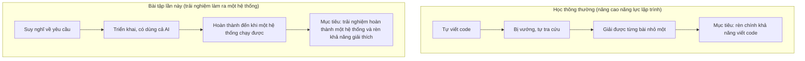
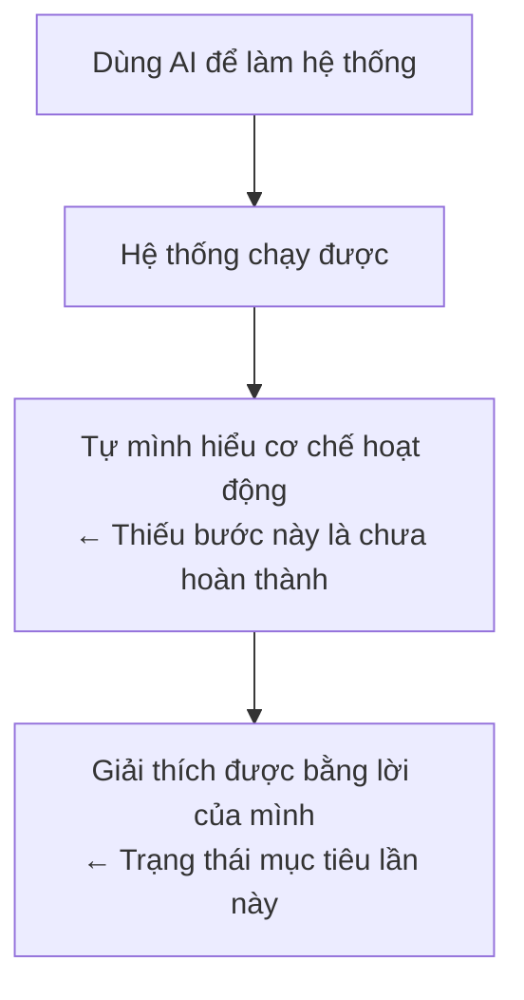

# Tổng kết mục đích của môn học — Nhìn lại bài tập cuối kỳ

> 🇯🇵 Bản gốc (tiếng Nhật): [授業の趣旨_まとめ.md](<../1年生_前期_ITシステム基礎/授業の趣旨_まとめ.md>) <!-- original-ja-link -->

Phần thuyết trình đã kết thúc, nhưng thầy/cô muốn làm rõ lại mục đích của bài tập lần này.
Chắc hẳn có bạn khi nghe thuyết trình đã băn khoăn "Được dùng AI à?", "Không cần tự viết code sao?", nên ở đây cũng có câu trả lời cho những thắc mắc đó.

---

## 1. Điều quan trọng nhất môn học này muốn truyền đạt

Thầy/cô cho rằng lập trình không thể thành thạo chỉ bằng cách đọc hay nghe giải thích, mà **cách học duy nhất là tự mình bắt tay vào viết code**.

Để làm điều đó, phương pháp học cụ thể được khuyến khích là dùng phần kiểm tra kỹ năng (skill check) trên trang học tập **paiza**, và đi theo thứ tự

```
[ Bài D ]  ──── Làm thật nhiều ────▶ [ Bài C ]
 Ghi nhớ cú pháp và cách tư duy       Thử sức với bài khó hơn
 cơ bản qua việc tự thực hành       để rèn khả năng ứng dụng
```

Đây vẫn là phương pháp học hiệu quả và phổ biến dành cho những ai muốn nâng cao năng lực lập trình, kể cả sau khi bài tập lần này đã kết thúc.

---

## 2. Vai trò của bài tập lần này

Bài tập cuối kỳ lần này có mục tiêu hơi khác so với phương pháp học ở trên.



- **Cho phép sử dụng AI**
- Trọng tâm không phải là "có tự tay viết được code đúng hay không", mà là **chính trải nghiệm "thực sự làm ra một hệ thống từ con số 0"**

Nói cách khác, lần này không phải là bài luyện tự viết từng dòng code, mà là bài tập ưu tiên trải nghiệm sắp xếp yêu cầu, rồi vừa dùng AI vừa biến ý tưởng thành thứ chạy được.

---

## 3. Lý do bắt buộc phải giải thích khi thuyết trình

"Yêu cầu giải thích khi thuyết trình" trong quy định nộp bài là phần quan trọng nhất của bài tập lần này.



Kể cả khi hệ thống được làm bằng AI, các bạn vẫn cần **giải thích được bằng lời của chính mình**:

- Làm ra để làm gì
- Hoạt động theo cơ chế nào
- Đã tự mình cải tiến, điều chỉnh chỗ nào trong code

Mục đích của yêu cầu này là các bạn không chỉ nhờ AI làm xong rồi dừng lại, mà còn phải hiểu rõ cơ chế hoạt động của sản phẩm và có thể tự mình giải thích.

---

## 4. Gửi những bạn "muốn tự viết code"

Vì lần này cho phép dùng AI, có vẻ một số bạn đã băn khoăn "Vậy là bắt buộc phải dùng AI sao?".

Không phải vậy. **Bạn nào muốn tự viết code bằng sức mình thì cứ viết.** Việc đánh giá dựa trên "bạn làm được gì", nên dù là code tự viết hay code dùng AI, chỉ cần đáp ứng yêu cầu và tự giải thích được thì đều được đánh giá như nhau.

Hơn nữa, nếu thực sự muốn nâng cao năng lực lập trình, các bạn vẫn cần trải qua quá trình tự viết, gặp vướng mắc rồi tự tra cứu, chẳng hạn như khi luyện bài D→C trên paiza đã nói ở mục 1. Việc cho phép dùng AI lần này không có nghĩa là các bạn có thể bỏ phương pháp học đó.

---

## 5. AI và thực tế phát triển phần mềm

Cách làm bài tập lần này cũng được thiết kế gần với cách phát triển phần mềm ở các công ty thực tế.

```
┌────────────────────────────┐
│ Triển khai sơ bộ ban đầu   │ ← Thường do AI đảm nhận
└──────────────┬─────────────┘
               ▼
┌────────────────────────────┐
│ Tìm lỗi, chỉnh sửa chi tiết│
│ Hiểu cơ chế, giải thích    │ ← Con người (bạn) đảm nhận
└────────────────────────────┘
```

Trong thực tế phát triển phần mềm hiện nay,

- Việc giao phần triển khai sơ bộ ban đầu cho AI đang dần trở nên phổ biến
- Mặt khác, con người đảm nhận việc tìm nguyên nhân lỗi, chỉnh sửa chi tiết, tìm hiểu và giải thích cơ chế hoạt động

đang là cách phân chia công việc ngày càng phổ biến. Việc thiết kế bài tập lần này theo hướng "dùng AI để tạo sản phẩm, sau đó tự mình giải thích" cũng nhằm giúp các bạn trải nghiệm cách phát triển phần mềm hiện nay.

---

## Tổng kết

- Phương pháp học hiệu quả và phổ biến để nâng cao năng lực lập trình là tự viết, gặp vướng mắc rồi tự tra cứu (paiza D→C)
- Bài tập lần này có mục tiêu khác với phương pháp học đó: "trải nghiệm hoàn thành một hệ thống, kể cả khi sử dụng AI"
- Dù làm bằng AI hay tự viết, đánh giá đều như nhau. Điều quan trọng là cuối cùng giải thích được bằng lời của mình
- Đây cũng là trải nghiệm gần với thực tế phát triển phần mềm hiện nay
