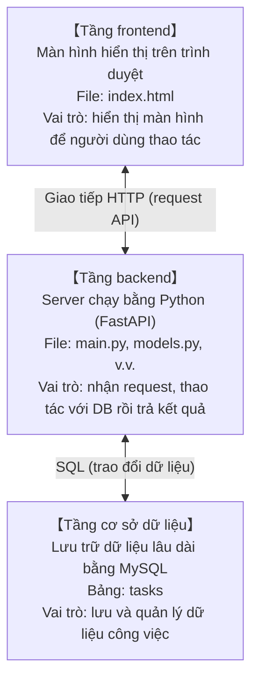
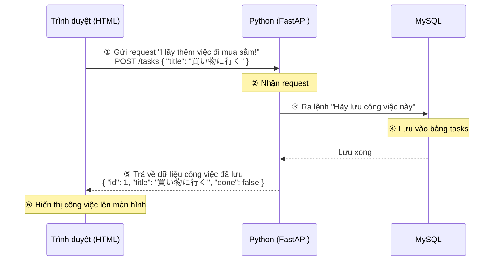

# Phần bổ sung: Cùng xây dựng hệ thống quản lý công việc

> 🇯🇵 Bản gốc (tiếng Nhật): [00_概要とシステム設計.md](<../../1年生_前期_ITシステム基礎/番外編/00_概要とシステム設計.md>) <!-- original-ja-link -->

## Mục tiêu lần này
- Hiểu hệ thống có cấu trúc 3 tầng gồm HTML + Python + MySQL
- Triển khai được backend bằng Python
- Hiểu cơ chế frontend (HTML) và backend (Python) liên kết với nhau qua API

---

## 1. Chúng ta sẽ làm gì

**Ứng dụng quản lý công việc (ứng dụng Todo)**

```
┌─────────────────────────────────────────┐
│       Ứng dụng quản lý công việc        │
│                                         │
│  [ Danh sách việc cần làm ]             │
│  □ 買い物に行く        [Xong] [Xóa]    │
│  ☑ 宿題を終わらせる   [Xong] [Xóa]    │
│  □ 部屋を掃除する      [Xong] [Xóa]    │
│                                         │
│  Công việc mới: [____________] [Thêm]   │
└─────────────────────────────────────────┘
```

Những việc có thể làm:
- Hiển thị danh sách công việc
- Thêm công việc mới
- Chuyển công việc giữa trạng thái hoàn thành/chưa hoàn thành
- Xóa công việc

---

## 2. Toàn cảnh hệ thống

Hệ thống lần này gồm **3 tầng**.



### Luồng giao tiếp (ví dụ: khi thêm công việc)



---

## 3. Công nghệ sử dụng

| Vai trò | Công nghệ | Giải thích |
|------|------|------|
| Frontend | HTML + JavaScript | Màn hình hiển thị trên trình duyệt |
| Backend | Python + FastAPI | Server API |
| Kết nối DB | SQLAlchemy | Thư viện để thao tác với MySQL từ Python |
| Cơ sở dữ liệu | MySQL | Phần mềm lưu trữ dữ liệu |

### Lý do chọn FastAPI

- Đơn giản, người mới bắt đầu cũng viết được code dễ đọc
- Chỉ cần mở `http://localhost:8000/docs` là có ngay màn hình test API được tạo tự động
- Được thiết kế để sử dụng class (OOP) của Python một cách tự nhiên

---

## 4. Cấu trúc thư mục

```
my_todo_app/
├── main.py          ← File khởi động ứng dụng (entry point)
├── database.py      ← Thiết lập kết nối tới MySQL
├── models.py        ← Định nghĩa bảng trong cơ sở dữ liệu (viết bằng class)
├── schemas.py       ← Định nghĩa định dạng dữ liệu của API (viết bằng class)
├── routers/
│   └── tasks.py     ← Định tuyến API liên quan đến công việc
└── static/
    └── index.html   ← File HTML của frontend
```

---

## 5. Cài đặt môi trường

### Chuẩn bị MySQL

Các bước cài đặt MySQL và tạo cơ sở dữ liệu sẽ khác nhau tùy hệ điều hành.
→ Hãy xem **[01_MySQL環境構築.md](./01_MySQL環境構築.md)**.

### Cài đặt package Python

#### Mac

Trên Mac, nếu chạy trực tiếp `pip3 install` sẽ gặp lỗi sau:
```
error: externally-managed-environment
```

Hãy tạo **môi trường ảo (venv)** trước rồi mới cài đặt.

```bash
# Chạy trong thư mục dự án
python3 -m venv venv

# Kích hoạt môi trường ảo (prompt có thêm (venv) là OK)
source venv/bin/activate

# Cài đặt sau khi đã kích hoạt
pip install fastapi uvicorn sqlalchemy pymysql
```

#### Windows

Trên Windows có thể cài đặt luôn.

```cmd
pip install fastapi uvicorn sqlalchemy pymysql
```

Nếu muốn dùng môi trường ảo (khuyến nghị):

```cmd
python -m venv venv
venv\Scripts\activate
pip install fastapi uvicorn sqlalchemy pymysql
```

| Package | Vai trò |
|-----------|------|
| `fastapi` | Framework Web API |
| `uvicorn` | Server để chạy FastAPI |
| `sqlalchemy` | Thư viện để thao tác với DB từ Python |
| `pymysql` | Driver để kết nối MySQL từ Python |

### Môi trường ảo là gì?

```
Môi trường ảo = nơi chứa Python dành riêng cho dự án

Python của toàn hệ thống        Python dành riêng cho dự án
(không được động vào)           (thoải mái cài package)
      │                              │
      │  python3 -m venv venv (Mac)  │
      │  python -m venv venv (Win)   │
      └──────────────────────────→  venv/
                                      ├── bin/      (Mac)
                                      ├── Scripts/  (Windows)
                                      └── lib/...
```

Sau khi tạo xong, **mỗi lần mở terminal đều phải kích hoạt lại**:

```bash
source venv/bin/activate   # Mac
```
```cmd
venv\Scripts\activate      # Windows
```

### Cách khởi động server

**Mac (kích hoạt môi trường ảo rồi mới khởi động):**
```bash
source venv/bin/activate
uvicorn main:app --reload
```

**Windows (trường hợp không dùng môi trường ảo):**
```cmd
uvicorn main:app --reload
```

Sau khi khởi động, mở các địa chỉ sau trên trình duyệt:
- Màn hình ứng dụng: `http://localhost:8000`
- Tài liệu API: `http://localhost:8000/docs`

---

## 6. Lộ trình học

| Bước | Tài liệu | Nội dung |
|---------|------|------|
| 1 | 01_MySQL環境構築 | Cài đặt MySQL và tạo DB |
| 2 | 02_Python_OOP入門 | Class là gì, tại sao lại dùng |
| 3 | 03_FastAPI入門 | Xây dựng server API cơ bản |
| 4 | 04_データベース連携 | Kết nối với MySQL và lưu dữ liệu |
| 5 | 05_CRUD_API実装 | Triển khai xem danh sách, thêm, cập nhật, xóa |
| 6 | 06_フロントエンド連携 | Gọi API từ màn hình HTML |

---

> Bước tiếp theo → [01_MySQL環境構築.md](./01_MySQL環境構築.md)
