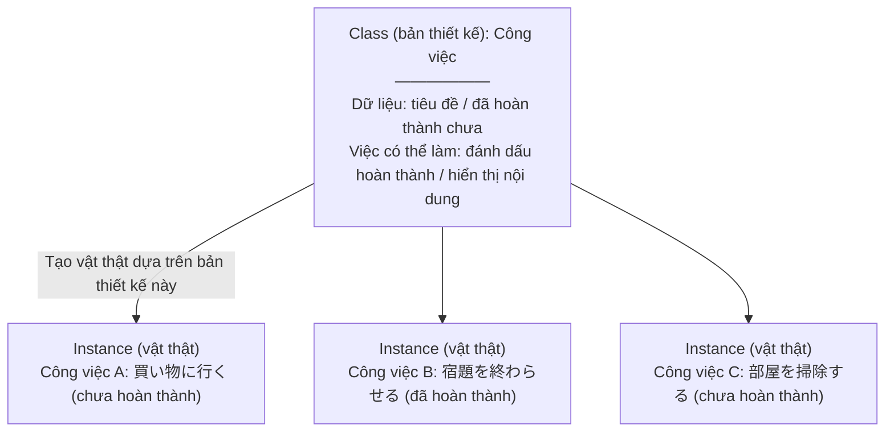

# Nhập môn lập trình hướng đối tượng với Python

> 🇯🇵 Bản gốc (tiếng Nhật): [02_Python_OOP入門.md](<../../1年生_前期_ITシステム基礎/番外編/02_Python_OOP入門.md>) <!-- original-ja-link -->

## Mục tiêu lần này
- Giải thích được sự khác nhau giữa "class" và "instance"
- Hiểu vai trò của phương thức `__init__`
- Dùng class để nhóm dữ liệu và các thao tác xử lý liên quan lại với nhau

---

## 1. Hướng đối tượng là gì?

Đây là cách tiếp cận khi viết chương trình: **nhóm dữ liệu và các thao tác xử lý liên quan lại với nhau**.

### Hiểu qua phép so sánh: "bản thiết kế" và "vật thật"



**Class** = bản thiết kế (chỉ có 1 cái)
**Instance** = vật thật được tạo ra từ bản thiết kế (tạo bao nhiêu cũng được)

---

## 2. Thử viết class

### Bước 1: Class đơn giản nhất

```python
# Định nghĩa class
class Task:
    pass  # Chưa có gì cả
```

```python
# Tạo instance
task1 = Task()  # Tạo instance từ class Task
task2 = Task()  # Có thể tạo thêm một cái nữa

print(task1)  # <__main__.Task object at 0x...>
print(task2)  # <__main__.Task object at 0x...> ← Là một instance khác
```

---

### Bước 2: Cho class chứa dữ liệu (`__init__`)

`__init__` là **phương thức đặc biệt được gọi tự động khi tạo instance**.
Nó còn được gọi là "constructor" (hàm khởi tạo).

```python
class Task:
    # Được gọi tự động khi tạo instance
    def __init__(self, title):
        # self = chỉ "chính instance này"
        self.title = title       # Lưu tiêu đề
        self.done = False        # Ban đầu là chưa hoàn thành

# Tạo instance (lúc này __init__ được gọi)
task1 = Task("買い物に行く")
task2 = Task("宿題を終わらせる")

# Truy cập dữ liệu của instance
print(task1.title)  # 買い物に行く
print(task1.done)   # False
print(task2.title)  # 宿題を終わらせる
```

**Điểm quan trọng: `self` là gì?**
```
task1 = Task("買い物に行く")
          ↑
    Instance này (task1) chính là self

self.title = title
→ có nghĩa giống như task1.title = "買い物に行く"
```

---

### Bước 3: Thêm phương thức

Phương thức (method) là **hàm được định nghĩa bên trong class**.

```python
class Task:
    def __init__(self, title):
        self.title = title
        self.done = False

    # Phương thức đánh dấu hoàn thành
    def complete(self):
        self.done = True
        print(f"「{self.title}」を完了にしました！")

    # Phương thức hiển thị nội dung
    def show(self):
        status = "☑" if self.done else "□"
        print(f"{status} {self.title}")
```

```python
# Thử sử dụng
task1 = Task("買い物に行く")
task2 = Task("宿題を終わらせる")

task1.show()      # □ 買い物に行く
task2.show()      # □ 宿題を終わらせる

task2.complete()  # 「宿題を終わらせる」を完了にしました！

task1.show()      # □ 買い物に行く
task2.show()      # ☑ 宿題を終わらせる
```

---

## 3. So sánh với trường hợp không dùng class

**Trường hợp không dùng class:**

```python
# Dữ liệu rời rạc, khó quản lý
title1 = "買い物に行く"
done1 = False

title2 = "宿題を終わらせる"
done2 = False

# Phần xử lý đánh dấu hoàn thành cũng phải viết riêng
done2 = True
print(f"「{title2}」を完了にしました！")

# Khi số công việc tăng lên... title3, done3, title4, done4... cứ thế kéo dài mãi
```

**Trường hợp dùng class:**

```python
# Dữ liệu và các thao tác xử lý được nhóm lại với nhau! Dễ quản lý ngay cả khi số công việc tăng lên
tasks = [
    Task("買い物に行く"),
    Task("宿題を終わらせる"),
    Task("部屋を掃除する"),
]

# Hiển thị tất cả
for task in tasks:
    task.show()
```

---

## 4. Những chỗ dùng OOP trong hệ thống lần này

OOP (lập trình hướng đối tượng) được dùng ở **2 chỗ quan trọng** trong hệ thống lần này.

### ① Định nghĩa bảng trong cơ sở dữ liệu (models.py)

```python
# Bảng = class, 1 dòng dữ liệu = instance
class Task(Base):
    __tablename__ = "tasks"

    id = Column(Integer, primary_key=True)
    title = Column(String(200))
    done = Column(Boolean, default=False)
```

### ② Định nghĩa định dạng dữ liệu của API (schemas.py)

```python
# Biểu diễn định dạng dữ liệu của request/response bằng class
class TaskCreate(BaseModel):
    title: str  # Dữ liệu nhận vào: chỉ có tiêu đề

class TaskResponse(BaseModel):
    id: int
    title: str
    done: bool  # Dữ liệu trả về: id, tiêu đề, cờ hoàn thành
```

Nhờ dùng class, chỉ cần nhìn qua code là có thể **biết ngay đang xử lý những dữ liệu nào**.

---

## 5. Cùng luyện tập

Hãy hoàn thành class dưới đây.

```python
class Task:
    def __init__(self, title):
        self.title = title
        self.done = False

    def complete(self):
        # Viết mã xử lý để đánh dấu hoàn thành vào đây
        pass

    def show(self):
        # Viết mã xử lý để hiển thị nội dung vào đây
        pass

# Kiểm tra
t = Task("テスト用タスク")
t.show()     # Phải hiển thị: □ テスト用タスク
t.complete()
t.show()     # Phải hiển thị: ☑ テスト用タスク
```

---

> Bước trước → [01_MySQL環境構築.md](./01_MySQL環境構築.md)
> Bước tiếp theo → [03_FastAPI入門.md](./03_FastAPI入門.md)
