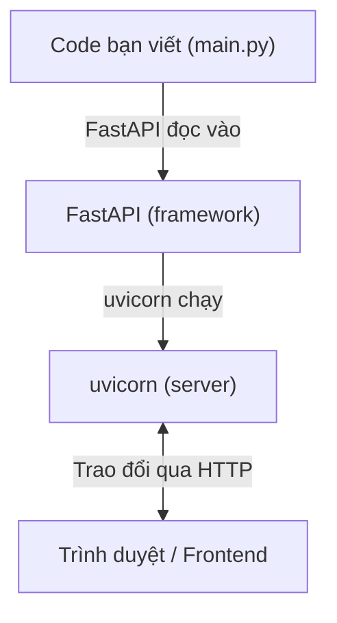
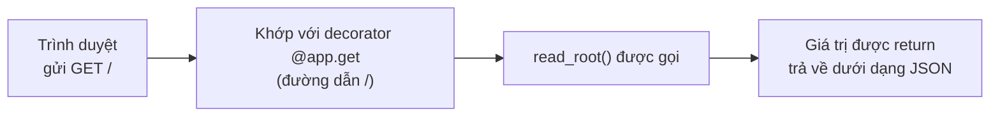

# Nhập môn FastAPI

> 🇯🇵 Bản gốc (tiếng Nhật): [03_FastAPI入門.md](<../../1年生_前期_ITシステム基礎/番外編/03_FastAPI入門.md>) <!-- original-ja-link -->

## Mục tiêu lần này
- Khởi động được một server API đơn giản bằng FastAPI
- Hiểu ý nghĩa của các decorator như `@app.get`
- Test được API trên trình duyệt bằng Swagger UI

---

## 1. FastAPI là gì?

**FastAPI = framework để xây dựng server API bằng Python**

Framework là "một hộp đồ nghề tiện lợi gom sẵn những chức năng hay dùng".



---

## 2. Tạo ứng dụng Hello World

Trước tiên, hãy thử tạo một server API thật đơn giản.

### main.py

```python
from fastapi import FastAPI

# Tạo instance của FastAPI (thành phần chính của ứng dụng)
app = FastAPI()

# Xử lý khi truy cập vào "/"
@app.get("/")
def read_root():
    return {"message": "Hello, World!"}
```

### Khởi động

**Chung cho Windows / Mac:**
```bash
uvicorn main:app --reload
```

```
INFO:     Uvicorn running on http://127.0.0.1:8000
INFO:     Application startup complete.
```

Mở `http://localhost:8000` trên trình duyệt sẽ thấy:
```json
{"message": "Hello, World!"}
```

---

## 3. Hiểu về decorator

`@app.get("/")` xuất hiện trong code được gọi là **decorator**.

```python
@app.get("/")          # ← Decorator
def read_root():       # ← Thiết lập cho hàm này: "gọi khi có request GET tới /"
    return {...}
```

Quá trình từ khi nhận request đến khi trả về response diễn ra như sau.



### Mối tương ứng giữa HTTP method và decorator

| Việc muốn làm | HTTP method | Decorator |
|------------|-------------|-----------|
| Lấy dữ liệu | GET | `@app.get(...)` |
| Tạo dữ liệu mới | POST | `@app.post(...)` |
| Cập nhật dữ liệu | PUT | `@app.put(...)` |
| Xóa dữ liệu | DELETE | `@app.delete(...)` |

---

## 4. Path parameter (đưa giá trị vào URL)

```python
@app.get("/tasks/{task_id}")
def get_task(task_id: int):  # {task_id} trong URL được truyền vào làm tham số
    return {"task_id": task_id, "title": "サンプルタスク"}
```

Truy cập `http://localhost:8000/tasks/3` sẽ thấy:
```json
{"task_id": 3, "title": "サンプルタスク"}
```

---

## 5. Swagger UI — màn hình test API

Một trong những chức năng tiện lợi của FastAPI là **Swagger UI**.
Chỉ cần viết code là **màn hình để test API trên trình duyệt sẽ được tạo tự động**.

Mở `http://localhost:8000/docs` sẽ thấy màn hình như sau:

```
┌────────────────────────────────────────────┐
│  FastAPI                                   │
│                                            │
│  GET  /        Trả về Hello World          │
│  ▼ Try it out                              │
│    [Execute]                               │
│                                            │
│  Response:                                 │
│  {"message": "Hello, World!"}              │
└────────────────────────────────────────────┘
```

**Trong lúc phát triển, kiểm tra hoạt động bằng Swagger UI rất tiện.**

---

## 6. Làm bộ khung cho API quản lý công việc

Để tiến tới xây dựng một hệ thống thực tế, chúng ta sẽ tạo bộ khung cho API quản lý công việc.

```python
# main.py
from fastapi import FastAPI
from fastapi.staticfiles import StaticFiles

app = FastAPI()

# Thiết lập để phân phối file HTML trong thư mục static
app.mount("/static", StaticFiles(directory="static"), name="static")

# Khi truy cập vào root (/) thì hiển thị index.html
from fastapi.responses import FileResponse

@app.get("/")
def read_index():
    return FileResponse("static/index.html")


# --- Các API liên quan đến công việc (sẽ hoàn thiện ở các bước sau) ---

@app.get("/tasks")
def get_tasks():
    # Trả về danh sách công việc (sau này sẽ liên kết với DB)
    return []

@app.post("/tasks")
def create_task():
    # Tạo công việc (sau này sẽ liên kết với DB)
    return {"message": "タスクを作成しました"}

@app.put("/tasks/{task_id}")
def toggle_task(task_id: int):
    # Chuyển đổi trạng thái hoàn thành/chưa hoàn thành của công việc (sau này sẽ liên kết với DB)
    return {"message": f"タスク {task_id} を更新しました"}

@app.delete("/tasks/{task_id}")
def delete_task(task_id: int):
    # Xóa công việc (sau này sẽ liên kết với DB)
    return {"message": f"タスク {task_id} を削除しました"}
```

### Khởi động và kiểm tra

**Chung cho Windows / Mac:**
```bash
uvicorn main:app --reload
```

Hãy mở `http://localhost:8000/docs` và kiểm tra xem 4 endpoint đã hiển thị chưa.

```
GET    /tasks      Lấy danh sách công việc
POST   /tasks      Tạo công việc
PUT    /tasks/{id} Chuyển trạng thái hoàn thành
DELETE /tasks/{id} Xóa công việc
```

---

## 7. Tóm tắt các điểm chính đã học

```
① Tạo instance của FastAPI
   app = FastAPI()

② Chỉ định URL và method bằng decorator
   @app.get("/tasks")

③ Hàm bên dưới chính là phần xử lý thực tế
   def get_tasks():
       return [...]

④ Giá trị mà hàm return sẽ trở thành response dưới dạng JSON
   return [{"id": 1, "title": "買い物"}]
   → Trình duyệt nhận được [{"id": 1, "title": "買い物"}]
```

---

> Bước trước → [02_Python_OOP入門.md](./02_Python_OOP入門.md)
> Bước tiếp theo → [04_データベース連携.md](./04_データベース連携.md)
