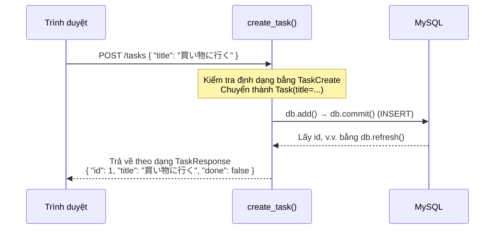

# Triển khai CRUD API

> 🇯🇵 Bản gốc (tiếng Nhật): [05_CRUD_API実装.md](<../../1年生_前期_ITシステム基礎/番外編/05_CRUD_API実装.md>) <!-- original-ja-link -->

## Mục tiêu lần này
- Định nghĩa được định dạng dữ liệu bằng lớp schema của Pydantic
- Triển khai được 4 API GET / POST / PUT / DELETE
- Kiểm tra được hoạt động của từng API bằng Swagger UI

---

## 1. CRUD là gì?

**CRUD** = chữ cái đầu của 4 thao tác dữ liệu cơ bản

| Chữ cái | Thao tác | SQL | HTTP method |
|------|------|-----|-------------|
| C | Create (tạo) | INSERT | POST |
| R | Read (lấy) | SELECT | GET |
| U | Update (cập nhật) | UPDATE | PUT |
| D | Delete (xóa) | DELETE | DELETE |

---

## 2. schemas.py — Định nghĩa định dạng dữ liệu của API

**Pydantic** là thư viện dùng class để định nghĩa định dạng dữ liệu.
Khi kết hợp với FastAPI, nó sẽ **tự động kiểm tra dữ liệu của request/response** giúp bạn.

```python
# schemas.py

from pydantic import BaseModel

# Dữ liệu nhận vào khi tạo công việc
class TaskCreate(BaseModel):
    title: str  # Chỉ nhận tiêu đề (id và done do server quyết định)

# Dữ liệu trả về trong response của API
class TaskResponse(BaseModel):
    id: int
    title: str
    done: bool

    # Thiết lập để có thể truyền trực tiếp đối tượng model của SQLAlchemy
    class Config:
        from_attributes = True
```

### Tại sao lại viết schema ra file riêng?

```
models.py  → cấu trúc cơ sở dữ liệu (lưu như thế nào)
schemas.py → cấu trúc dữ liệu của API (nhận/trả dữ liệu nào)

Ví dụ: khi tạo công việc
  Nhận vào (TaskCreate):      chỉ title
  Trả về (TaskResponse):      id + title + done
  Lưu trữ (model Task):       id + title + done (id được đánh số tự động)
```

---

## 3. routers/tasks.py — Triển khai 4 API

```python
# routers/tasks.py

from fastapi import APIRouter, Depends, HTTPException
from sqlalchemy.orm import Session
from database import get_db
from models import Task
from schemas import TaskCreate, TaskResponse

# Router = tập hợp các URL (ở đây gom các API liên quan đến /tasks)
router = APIRouter(prefix="/tasks", tags=["tasks"])
```

---

### R — Lấy danh sách công việc (GET /tasks)

```python
# ⚠️ Dùng "" chứ không phải "/" (nếu dùng "/" sẽ bị redirect từ /tasks → /tasks/)
@router.get("", response_model=list[TaskResponse])
def get_tasks(db: Session = Depends(get_db)):
    """Lấy toàn bộ công việc rồi trả về"""
    tasks = db.query(Task).all()  # SELECT * FROM tasks
    return tasks
```

**`Depends(get_db)` là gì?**
```
db: Session = Depends(get_db)
↑
Có nghĩa là "hãy truyền kết quả của hàm get_db (DB session) vào db".
Mỗi lần API được gọi, nó sẽ chuẩn bị kết nối tới DB giúp bạn.
```

---

### C — Tạo công việc (POST /tasks)

```python
@router.post("", response_model=TaskResponse)
def create_task(task_in: TaskCreate, db: Session = Depends(get_db)):
    """Tạo công việc mới"""
    # Chuyển dữ liệu nhận được (TaskCreate) thành instance của model Task
    new_task = Task(title=task_in.title)

    db.add(new_task)    # Chuẩn bị thêm vào DB
    db.commit()         # Lưu vào DB (thực thi INSERT)
    db.refresh(new_task)  # Lấy id và các giá trị DB đã tự động thiết lập
    return new_task
```

Luồng xử lý khi POST /tasks được gọi có thể được biểu diễn bằng sơ đồ sau.



---

### U — Chuyển trạng thái hoàn thành (PUT /tasks/{task_id})

```python
@router.put("/{task_id}", response_model=TaskResponse)
def toggle_task(task_id: int, db: Session = Depends(get_db)):
    """Chuyển đổi trạng thái hoàn thành/chưa hoàn thành của công việc"""
    # Lấy công việc cần xử lý
    task = db.query(Task).filter(Task.id == task_id).first()

    # Không tìm thấy công việc thì báo lỗi 404
    if task is None:
        raise HTTPException(status_code=404, detail="タスクが見つかりません")

    # Đảo ngược done (True → False, False → True)
    task.done = not task.done

    db.commit()         # Lưu vào DB (thực thi UPDATE)
    db.refresh(task)
    return task
```

---

### D — Xóa công việc (DELETE /tasks/{task_id})

```python
@router.delete("/{task_id}")
def delete_task(task_id: int, db: Session = Depends(get_db)):
    """Xóa công việc"""
    task = db.query(Task).filter(Task.id == task_id).first()

    if task is None:
        raise HTTPException(status_code=404, detail="タスクが見つかりません")

    db.delete(task)     # Chuẩn bị xóa
    db.commit()         # Xóa khỏi DB (thực thi DELETE)
    return {"message": f"タスク '{task.title}' を削除しました"}
```

---

## 4. Đăng ký router vào main.py

```python
# main.py (bản hoàn chỉnh)

from fastapi import FastAPI
from fastapi.staticfiles import StaticFiles
from fastapi.responses import FileResponse
from database import engine, Base
import models
from routers import tasks  # ← Thêm vào

# Tự động tạo bảng
Base.metadata.create_all(bind=engine)

app = FastAPI()

# Đăng ký router (các API dưới /tasks sẽ có hiệu lực)
app.include_router(tasks.router)  # ← Thêm vào

app.mount("/static", StaticFiles(directory="static"), name="static")

@app.get("/")
def read_index():
    return FileResponse("static/index.html")
```

---

## 5. Cấu trúc file (tại thời điểm hiện tại)

```
my_todo_app/
├── main.py         ← Đã thêm phần đăng ký router
├── database.py     ← Thiết lập kết nối DB
├── models.py       ← Định nghĩa bảng Task
├── schemas.py      ← ★ Tạo lần này: định nghĩa định dạng dữ liệu
├── routers/
│   ├── __init__.py ← File rỗng (để Python nhận thư mục này là một package)
│   └── tasks.py    ← ★ Tạo lần này: CRUD API
└── static/
    └── index.html  ← Sẽ tạo ở bước tiếp theo
```

`routers/__init__.py` chỉ cần là file rỗng:

**Windows:**
```cmd
type nul > routers\__init__.py
```

**Mac:**
```bash
touch routers/__init__.py
```

---

## 6. Kiểm tra hoạt động bằng Swagger UI

**Chung cho Windows / Mac:**
```bash
uvicorn main:app --reload
```

Mở `http://localhost:8000/docs` để kiểm tra.

**Các bước kiểm tra (theo thứ tự POST → GET → PUT → DELETE):**

1. Bấm vào **POST /tasks** → `Try it out` → nhập vào Request body:
   ```json
   {"title": "買い物に行く"}
   ```
   → `Execute` → Response phải trả về `{"id": 1, "title": "買い物に行く", "done": false}`

2. Bấm vào **GET /tasks** → `Try it out` → `Execute`
   → Công việc vừa tạo phải được trả về trong danh sách

3. Bấm vào **PUT /tasks/{task_id}** → nhập `1` vào `task_id` → `Execute`
   → Phải chuyển thành `"done": true`

4. Bấm vào **DELETE /tasks/{task_id}** → nhập `1` vào `task_id` → `Execute`
   → Phải trả về thông báo đã xóa

---

> Bước trước → [04_データベース連携.md](./04_データベース連携.md)
> Bước tiếp theo → [06_フロントエンド連携.md](./06_フロントエンド連携.md)
