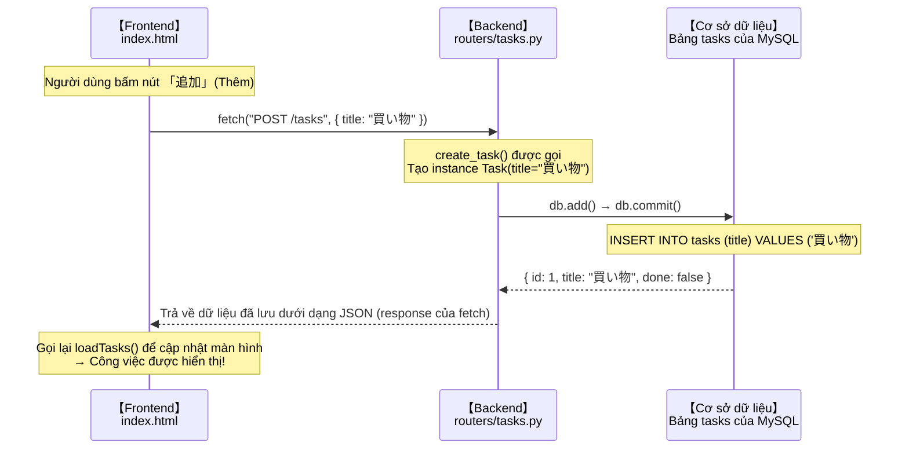

# Liên kết frontend (HTML + JavaScript)

> 🇯🇵 Bản gốc (tiếng Nhật): [06_フロントエンド連携.md](<../../1年生_前期_ITシステム基礎/番外編/06_フロントエンド連携.md>) <!-- original-ja-link -->

## Mục tiêu lần này
- Gọi được API Python bằng `fetch()`
- Hiển thị được response của API lên màn hình (thao tác DOM)
- Có thể thêm, chuyển đổi trạng thái hoàn thành và xóa công việc ngay trên màn hình

---

## 1. SPA (Single Page Application) là gì?

Frontend được xây dựng trong bài này theo mô hình **SPA**.

```
Trang web truyền thống (có chuyển trang)
  Mỗi lần thao tác là toàn bộ trang được tải lại
  Trang A → Trang B → Trang C ...

SPA (Single Page Application - ứng dụng một trang)
  Chỉ với 1 file HTML, JavaScript cập nhật màn hình một cách động
  Không tải lại trang → thao tác nhanh, mượt
```

Lần này chỉ cần **duy nhất 1 file index.html** là hoàn chỉnh.

---

## 2. Chuẩn bị thư mục

**Windows:**
```cmd
mkdir static
type nul > static\index.html
```

**Mac:**
```bash
mkdir static
touch static/index.html
```

---

## 3. index.html — Code hoàn chỉnh

```html
<!DOCTYPE html>
<html lang="ja">
<head>
  <meta charset="UTF-8">
  <meta name="viewport" content="width=device-width, initial-scale=1.0">
  <title>タスク管理アプリ</title>
  <style>
    body {
      font-family: Arial, sans-serif;
      max-width: 600px;
      margin: 40px auto;
      padding: 0 20px;
      background: #f5f5f5;
    }
    h1 { color: #333; }

    /* Form thêm công việc */
    .add-form {
      display: flex;
      gap: 8px;
      margin-bottom: 20px;
    }
    .add-form input {
      flex: 1;
      padding: 8px;
      font-size: 16px;
      border: 1px solid #ccc;
      border-radius: 4px;
    }
    .add-form button {
      padding: 8px 16px;
      background: #4CAF50;
      color: white;
      border: none;
      border-radius: 4px;
      cursor: pointer;
      font-size: 16px;
    }

    /* Danh sách công việc */
    .task-list { list-style: none; padding: 0; }
    .task-item {
      display: flex;
      align-items: center;
      gap: 8px;
      background: white;
      padding: 12px;
      margin-bottom: 8px;
      border-radius: 4px;
      box-shadow: 0 1px 3px rgba(0,0,0,0.1);
    }
    .task-title { flex: 1; font-size: 16px; }
    .task-title.done {
      text-decoration: line-through;
      color: #999;
    }
    .btn-done {
      padding: 4px 12px;
      background: #2196F3;
      color: white;
      border: none;
      border-radius: 4px;
      cursor: pointer;
    }
    .btn-delete {
      padding: 4px 12px;
      background: #f44336;
      color: white;
      border: none;
      border-radius: 4px;
      cursor: pointer;
    }
  </style>
</head>
<body>

  <h1>タスク管理アプリ</h1>

  <!-- Form thêm công việc -->
  <div class="add-form">
    <input type="text" id="newTaskInput" placeholder="新しいタスクを入力...">
    <button onclick="addTask()">追加</button>
  </div>

  <!-- Danh sách công việc (được viết lại bằng JavaScript) -->
  <ul class="task-list" id="taskList">
    <!-- Công việc sẽ hiển thị ở đây -->
  </ul>

  <script>
    // ============================================================
    // URL gốc của API (địa chỉ của server Python)
    // ============================================================
    const API_URL = "http://localhost:8000";

    // ============================================================
    // R — Lấy danh sách công việc và hiển thị lên màn hình
    // ============================================================
    async function loadTasks() {
      // Gửi request GET bằng fetch()
      const response = await fetch(`${API_URL}/tasks`);
      const tasks = await response.json();  // Chuyển response thành JSON

      // Tạm xóa sạch danh sách công việc
      const taskList = document.getElementById("taskList");
      taskList.innerHTML = "";

      // Tạo <li> cho từng công việc rồi thêm vào
      tasks.forEach(task => {
        const li = document.createElement("li");
        li.className = "task-item";
        li.innerHTML = `
          <span class="task-title ${task.done ? 'done' : ''}">${task.title}</span>
          <button class="btn-done" onclick="toggleTask(${task.id})">
            ${task.done ? '未完了に戻す' : '完了'}
          </button>
          <button class="btn-delete" onclick="deleteTask(${task.id})">削除</button>
        `;
        taskList.appendChild(li);
      });
    }

    // ============================================================
    // C — Thêm công việc
    // ============================================================
    async function addTask() {
      const input = document.getElementById("newTaskInput");
      const title = input.value.trim();

      // Nếu chưa nhập gì thì không làm gì cả
      if (!title) return;

      // Gửi request POST bằng fetch()
      await fetch(`${API_URL}/tasks`, {
        method: "POST",
        headers: {
          "Content-Type": "application/json"  // Báo cho server biết là gửi JSON
        },
        body: JSON.stringify({ title: title })  // Object JavaScript → chuỗi JSON
      });

      // Xóa nội dung ô nhập rồi tải lại danh sách
      input.value = "";
      loadTasks();
    }

    // ============================================================
    // U — Chuyển trạng thái hoàn thành/chưa hoàn thành của công việc
    // ============================================================
    async function toggleTask(taskId) {
      // Gửi request PUT bằng fetch()
      await fetch(`${API_URL}/tasks/${taskId}`, {
        method: "PUT"
      });

      loadTasks();  // Tải lại danh sách
    }

    // ============================================================
    // D — Xóa công việc
    // ============================================================
    async function deleteTask(taskId) {
      // Gửi request DELETE bằng fetch()
      await fetch(`${API_URL}/tasks/${taskId}`, {
        method: "DELETE"
      });

      loadTasks();  // Tải lại danh sách
    }

    // ============================================================
    // Cho phép thêm công việc bằng phím Enter
    // ============================================================
    document.getElementById("newTaskInput").addEventListener("keydown", function(e) {
      if (e.key === "Enter") {
        addTask();
      }
    });

    // Tải danh sách công việc khi mở trang
    loadTasks();
  </script>

</body>
</html>
```

---

## 4. Giải thích các điểm quan trọng trong code

### Mẫu cơ bản của `fetch()`

```javascript
// GET (lấy dữ liệu)
const response = await fetch("http://localhost:8000/tasks");
const data = await response.json();

// POST (gửi dữ liệu)
await fetch("http://localhost:8000/tasks", {
  method: "POST",
  headers: { "Content-Type": "application/json" },
  body: JSON.stringify({ title: "買い物" })
});

// PUT (cập nhật)
await fetch("http://localhost:8000/tasks/1", {
  method: "PUT"
});

// DELETE (xóa)
await fetch("http://localhost:8000/tasks/1", {
  method: "DELETE"
});
```

### `async / await` là gì?

```javascript
// Giao tiếp với API là "xử lý tốn thời gian",
// nên cần phải chờ cho đến khi nhận được kết quả

async function loadTasks() {         // async = hàm này có chứa xử lý bất đồng bộ
  const response = await fetch(...); // await = chờ tại đây cho đến khi có kết quả
  const tasks = await response.json();
  // ↑ response.json() cũng tốn thời gian nên cần await
}
```

### Thao tác DOM (viết lại màn hình)

```javascript
// DOM = cơ chế để thao tác các phần tử HTML bằng JavaScript

// Lấy phần tử có id="taskList"
const taskList = document.getElementById("taskList");

// Xóa sạch nội dung bên trong
taskList.innerHTML = "";

// Tạo phần tử mới rồi thêm vào
const li = document.createElement("li");
li.innerHTML = `<span>${task.title}</span>`;
taskList.appendChild(li);
```

---

## 5. Kiểm tra hoạt động

### Khởi động

**Chung cho Windows / Mac:**
```bash
uvicorn main:app --reload
```

Mở `http://localhost:8000` trên trình duyệt.

### Các bước kiểm tra

1. **Thêm công việc**
   - Nhập 「買い物に行く」(Đi mua sắm) vào ô nhập rồi bấm nút 「追加」(Thêm)
   - Công việc phải hiển thị trong danh sách

2. **Đánh dấu hoàn thành**
   - Bấm nút 「完了」(Hoàn thành)
   - Tiêu đề phải bị gạch ngang

3. **Xóa**
   - Bấm nút 「削除」(Xóa)
   - Công việc phải biến mất khỏi danh sách

4. **Tải lại trang (F5)**
   - Dữ liệu vẫn phải còn (vì đã được lưu trong MySQL)

---

## 6. Hệ thống hoàn thành! Tóm tắt toàn bộ luồng xử lý



---

> Bước trước → [05_CRUD_API実装.md](./05_CRUD_API実装.md)
> Bước tiếp theo → [07_コードリーディング.md](./07_コードリーディング.md)
> Xem lại từ đầu → [00_概要とシステム設計.md](./00_概要とシステム設計.md)
