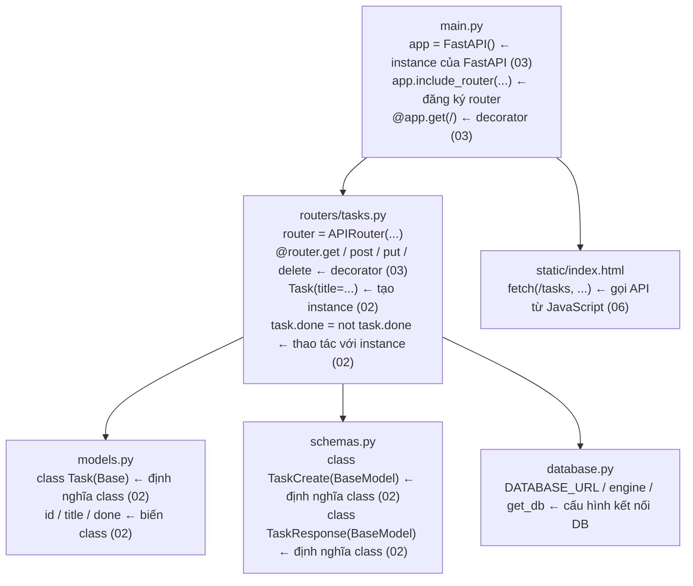

# Đọc code — Ôn lại kiến thức qua mã nguồn kiểm chứng

> 🇯🇵 Bản gốc (tiếng Nhật): [07_コードリーディング.md](<../../1年生_前期_ITシステム基礎/番外編/07_コードリーディング.md>) <!-- original-ja-link -->

## Mục tiêu buổi này
- Giải thích được class đã học ở `02_Python_OOP入門` được dùng ở đâu trong code thực tế
- Giải thích được decorator đã học ở `03_FastAPI入門` được dùng ở đâu trong code thực tế
- Hiểu 5 file liên kết với nhau như thế nào

---

## Thứ tự đọc các file

```
① models.py     ← Tổng hợp OOP (class)
② schemas.py    ← Tổng hợp OOP (class)
③ main.py       ← Tổng hợp FastAPI (decorator)
④ routers/tasks.py ← Có cả OOP lẫn FastAPI
⑤ database.py   ← Cấu hình kết nối (tham khảo)
```

---

## ① Đọc models.py

```python
from sqlalchemy import Column, Integer, String, Boolean
from database import Base

class Task(Base):
    __tablename__ = "tasks"

    id    = Column(Integer, primary_key=True, index=True)
    title = Column(String(200), nullable=False)
    done  = Column(Boolean, default=False)
```

### Đối chiếu với 02_OOP入門

**`class Task` → Định nghĩa class (đã học ở Bước 1 của bài 02)**

```
Cách viết đã học ở 02       Code thực tế
─────────────────────    ──────────────────────
class Task:              class Task(Base):
    pass                     __tablename__ = "tasks"
```

`(Base)` được gọi là **kế thừa**. Ta tạo class `Task` bằng cách kế thừa các chức năng của class `Base`.
Các em hãy hiểu đơn giản đây là "thiết lập để dùng được toàn bộ chức năng của SQLAlchemy".

---

**`id / title / done` → Biến class (dữ liệu mà instance có)**

Trong class `Task` ở bài 02, ta đã định nghĩa `self.title` và `self.done` trong constructor.
Trong `models.py`, ta làm điều tương tự bằng `Column()` của SQLAlchemy.

```
Cách viết đã học ở 02            Code thực tế (models.py)
─────────────────────────    ──────────────────────────────────
class Task:                  class Task(Base):
    def __init__(self):
        self.title = ...         title = Column(String(200))
        self.done = False        done  = Column(Boolean, default=False)
```

Cách viết khác nhau, nhưng điểm chung là đều định nghĩa "**class có những dữ liệu gì**".

---

**Chỗ tạo instance (trích từ routers/tasks.py)**

```python
# Tạo instance từ class Task (giống Bước 2 của bài 02!)
new_task = Task(title=task_in.title)
#          ↑ class Task   ↑ truyền giá trị cho title
```

So sánh với bài luyện tập ở 02:
```python
# Bài luyện tập ở 02            Code thực tế
task1 = Task("買い物に行く")   new_task = Task(title="買い物に行く")
```

Hai đoạn code thực hiện hoàn toàn cùng một việc.

---

## ② Đọc schemas.py

```python
from pydantic import BaseModel

class TaskCreate(BaseModel):
    title: str

class TaskResponse(BaseModel):
    id: int
    title: str
    done: bool

    class Config:
        from_attributes = True
```

### Đối chiếu với 02_OOP入門

**Có 2 class được định nghĩa → mỗi class có mục đích khác nhau**

```
Tên class        Vai trò                    Thời điểm instance được tạo
────────────    ─────────────────────    ──────────────────────────────
TaskCreate      Nhận request POST          Khi bấm "Thêm" trên trình duyệt
TaskResponse    Trả về response            Khi API trả kết quả
```

**`title: str` → Biến class có type annotation**

Ở bài 02 ta viết `self.title = title`,
còn trong class Pydantic, chỉ cần viết `title: str` là đã định nghĩa được "title là chuỗi".

```python
# Cách viết ở 02 (class thông thường)   Cách viết ở schemas.py (class Pydantic)
def __init__(self, title):         class TaskCreate(BaseModel):
    self.title = title                 title: str   ← Viết được trong 1 dòng!
```

**`class Config` → Class bên trong class**

Ta có thể viết một class khác bên trong một class.
Ở đây là thiết lập để có thể truyền thẳng đối tượng model của SQLAlchemy vào.

---

## ③ Đọc main.py

```python
from fastapi import FastAPI
from fastapi.staticfiles import StaticFiles
from fastapi.responses import FileResponse
from database import engine, Base
import models
from routers import tasks

Base.metadata.create_all(bind=engine)

app = FastAPI()

app.include_router(tasks.router)

app.mount("/static", StaticFiles(directory="static"), name="static")

@app.get("/")
def read_index():
    return FileResponse("static/index.html")
```

### Đối chiếu với 03_FastAPI入門

**`app = FastAPI()` → Tạo instance của FastAPI (đã học ở 03)**

```
Đã học ở 03                Code thực tế
─────────────────────    ──────────────────────
app = FastAPI()           app = FastAPI()   ← Giống hệt!
```

---

**`@app.get("/")` → Decorator (đã học ở 03)**

```python
@app.get("/")          # ← "Khi có request GET đến / thì gọi hàm này"
def read_index():
    return FileResponse("static/index.html")
```

So sánh với Hello World ở 03:
```
Bài luyện tập ở 03                   Code thực tế
─────────────────────────────────   ──────────────────────────────────
@app.get("/")                        @app.get("/")
def read_root():                     def read_index():
    return {"message": "Hello!"}         return FileResponse("static/index.html")
```

Chỉ khác nội dung của `return`, còn cách dùng decorator thì hoàn toàn giống nhau.

---

**`app.include_router(tasks.router)` → Mới: router**

Ở bài 03, ta viết tất cả endpoint trong `main.py`.
Trong hệ thống thực tế, các API liên quan đến task được viết gom lại trong `routers/tasks.py`,
sau đó đăng ký router này trong `main.py` để sử dụng.

```
Khung sườn ở 03 (viết hết vào main.py)   Hệ thống thực tế (tách file)
─────────────────────────────────   ──────────────────────────────────
@app.get("/tasks")                   Viết trong routers/tasks.py
@app.post("/tasks")                       ↓
@app.put("/tasks/{id}")              Đăng ký trong main.py
@app.delete("/tasks/{id}")           app.include_router(tasks.router)
```

**Tại sao phải tách file?**
→ Vì khi có thêm nhiều chức năng như task, người dùng, sản phẩm…, nếu gom hết vào 1 file thì sẽ rất khó đọc.

---

**`Base.metadata.create_all(bind=engine)` → Tự động tạo bảng**

Mỗi lần ứng dụng khởi động, bảng tasks sẽ tự động được tạo nếu chưa tồn tại.
Bảng được tạo dựa trên class `Task` trong `models.py`.

---

## ④ Đọc routers/tasks.py

Đây là file quan trọng nhất, có cả OOP (02) lẫn FastAPI (03).

```python
from fastapi import APIRouter, Depends, HTTPException
from sqlalchemy.orm import Session
from database import get_db
from models import Task
from schemas import TaskCreate, TaskResponse

router = APIRouter(prefix="/tasks", tags=["tasks"])
```

**`router = APIRouter(...)` → Giống app, nhưng là instance dành riêng cho router**

```
main.py             routers/tasks.py
────────────────    ──────────────────────────────
app = FastAPI()     router = APIRouter(prefix="/tasks")
@app.get("/")       @router.get("")
```

Ý nghĩa của `prefix="/tasks"`: `/tasks` sẽ tự động được thêm vào trước URL viết trong decorator của router này.

```
@router.get("")   →  URL thực tế là /tasks
@router.get("/{task_id}")  →  URL thực tế là /tasks/{task_id}
```

---

### GET /tasks — Lấy danh sách

```python
@router.get("", response_model=list[TaskResponse])
def get_tasks(db: Session = Depends(get_db)):
    return db.query(Task).all()
```

**`@router.get("")` → Decorator (đã học ở 03)**
Gắn vào `router` để xử lý request GET đến `/tasks`.

**`response_model=list[TaskResponse]` → Chỉ định dạng của response**
Khai báo rằng sẽ trả về danh sách các instance của class `TaskResponse` trong `schemas.py`.

**`Depends(get_db)` → Mới: dependency injection**
Đây là cơ chế của FastAPI với ý nghĩa "hãy truyền kết quả của hàm `get_db` (kết nối đến DB) vào `db`".
Mỗi lần API được gọi, nó sẽ tự động chuẩn bị kết nối với DB cho ta.

**`db.query(Task).all()` → Lấy toàn bộ instance của class Task**
```
db.query(Task).all()
             ↑
         Chỉ định class Task của OOP
         → Lấy tất cả các dòng của bảng tasks dưới dạng danh sách instance Task
```

---

### POST /tasks — Tạo task

```python
@router.post("", response_model=TaskResponse)
def create_task(task_in: TaskCreate, db: Session = Depends(get_db)):
    new_task = Task(title=task_in.title)  # ← OOP! Tạo instance
    db.add(new_task)
    db.commit()
    db.refresh(new_task)
    return new_task
```

**`task_in: TaskCreate` → Class của schemas.py xuất hiện ở đây**
JSON được gửi từ trình duyệt sẽ tự động được chuyển thành instance `TaskCreate`.

```
Dữ liệu trình duyệt gửi      FastAPI tự động chuyển đổi
────────────────────    ──────────────────────────────
{"title": "買い物"}  →  task_in = TaskCreate(title="買い物")
                                             ↑ Lấy ra được bằng task_in.title
```

**`new_task = Task(title=task_in.title)` → OOP (giống Bước 2 của bài 02)**

```
Bài luyện tập ở 02                Code thực tế
─────────────────────────────    ──────────────────────────────
task1 = Task("買い物に行く")       new_task = Task(title=task_in.title)
```

Tạo instance và cho nó giữ dữ liệu — đây chính là OOP.

---

### PUT /tasks/{task_id} — Chuyển trạng thái hoàn thành

```python
@router.put("/{task_id}", response_model=TaskResponse)
def toggle_task(task_id: int, db: Session = Depends(get_db)):
    task = db.query(Task).filter(Task.id == task_id).first()

    if task is None:
        raise HTTPException(status_code=404, detail="タスクが見つかりません")

    task.done = not task.done   # ← OOP! Thay đổi dữ liệu của instance
    db.commit()
    db.refresh(task)
    return task
```

**`/{task_id}` → Path parameter (đã học ở 03)**

```
Bài luyện tập ở 03                 Code thực tế
─────────────────────────────     ──────────────────────────────
@app.get("/tasks/{task_id}")       @router.put("/{task_id}")
def get_task(task_id: int):        def toggle_task(task_id: int, ...):
```

Con số có trong URL (ví dụ: `/tasks/3`) sẽ được truyền vào dưới dạng `task_id = 3`.

**`task.done = not task.done` → Thay đổi trực tiếp dữ liệu của instance**

```
Đảo ngược giá trị done của instance task vừa lấy được
task.done là False → not False → True  (chưa xong → đã xong)
task.done là True  → not True  → False (đã xong → chưa xong)
```

---

### DELETE /tasks/{task_id} — Xóa

```python
@router.delete("/{task_id}")
def delete_task(task_id: int, db: Session = Depends(get_db)):
    task = db.query(Task).filter(Task.id == task_id).first()

    if task is None:
        raise HTTPException(status_code=404, detail="タスクが見つかりません")

    db.delete(task)
    db.commit()
    return {"message": f"タスク '{task.title}' を削除しました"}
```

**`raise HTTPException(status_code=404, ...)` → Trả về lỗi**

Khi không tìm thấy `task` (`is None`), ta trả lỗi 404 về cho trình duyệt.
`raise` là cú pháp Python có nghĩa là "gây ra lỗi này ngay lập tức".

---

## ⑤ Sự liên kết tổng thể



---

## Tổng kết: Những gì học ở 02 và 03 được dùng như thế nào

| Nội dung đã học | Tài liệu | Code thực tế |
|-----------|------|-------------|
| Định nghĩa class bằng `class TênClass:` | 02 | `Task` trong `models.py`, `TaskCreate` trong `schemas.py`, v.v. |
| `instance = TênClass(đối_số)` | 02 | `new_task = Task(title=...)` |
| Thay đổi dữ liệu của instance | 02 | `task.done = not task.done` |
| `app = FastAPI()` | 03 | Dòng 1 của `main.py` |
| Decorator `@app.get(...)` | 03 | `@router.get("") / @router.post("")`, v.v. |
| Path parameter `/{tham_số}` | 03 | `@router.put("/{task_id}")` |

---

> Bước trước → [06_フロントエンド連携.md](./06_フロントエンド連携.md)
> Mã nguồn kiểm chứng → [検証/todo_app/](./検証/todo_app/)
