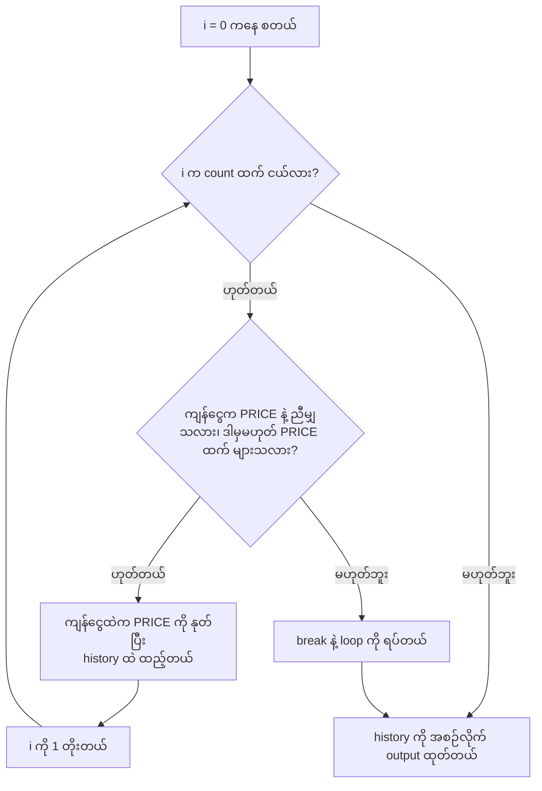
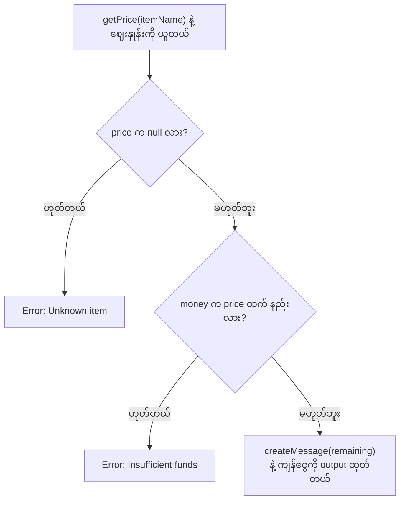

> 🇯🇵 မူရင်း (ဂျပန်ဘာသာဖြင့်): [2026_04_21_演習.md](<../../1年生_前期_ITシステム基礎/2026_04_21/2026_04_21_演習.md>) <!-- original-ja-link -->


---

## ပေါင်းစပ်လေ့ကျင့်ခန်း: အလိုအလျောက် အရောင်းစက် program ရေးသားခြင်း

### 【STEP 1】Variable နဲ့ constant ရဲ့ အခြေခံ

**လိုအပ်ချက်များ:**
- ပစ္စည်းဈေးနှုန်းကို constant `PRICE` (150) အဖြစ် သတ်မှတ်ပါ။
- Standard input ကနေ "ထည့်လိုက်တဲ့ ငွေပမာဏ" ကို ကိန်းဂဏန်းအဖြစ် လက်ခံယူပါ။
- ထည့်လိုက်တဲ့ ငွေပမာဏထဲကနေ ဈေးနှုန်းကို နုတ်ပြီး "ကျန်ငွေ" ကို တွက်ကာ `Remaining: [ကိန်းဂဏန်း]` လို့ output ထုတ်ပါ။

JavaScript

```
const reader = require('readline').createInterface({
  input: process.stdin,
  output: process.stdout
});

const lines = [];
reader.on('line', (line) => {
  lines.push(line);
});

reader.on('close', () => {
  const PRICE = 150;
  let money = Number(lines[0]); // ပထမစာကြောင်းရဲ့ input
  
  let remaining = money - PRICE;
  console.log(`Remaining: ${remaining}`);
});
```

---

### 【STEP 2】if statement နဲ့ condition ခွဲခြင်း

**လိုအပ်ချက်များ:**
- ထည့်လိုက်တဲ့ ငွေပမာဏက `PRICE` ထက် နည်းရင် `Error: Insufficient funds` လို့ output ထုတ်ပြီး program ကို အဆုံးသတ်ပါ။
- ငွေလုံလောက်တဲ့ အခါမှသာ ပြန်အမ်းငွေကို output ထုတ်ပါ။

JavaScript

```
reader.on('close', () => {
  const PRICE = 150;
  let money = Number(lines[0]);

  if (money < PRICE) {
    console.log("Error: Insufficient funds");
  } else {
    let remaining = money - PRICE;
    console.log(`Remaining: ${remaining}`);
  }
});
```

---

### 【STEP 3】Array နဲ့ for statement (အများအပြား ဝယ်ခြင်း)

**လိုအပ်ချက်များ:**
- Input ရဲ့ ပထမစာကြောင်းမှာ "ထည့်လိုက်တဲ့ ငွေပမာဏ"၊ ဒုတိယစာကြောင်းမှာ "ဝယ်ချင်တဲ့ ဘူးအရေအတွက်" ကို ပေးပါမယ်။
- 1 ဘူး ဝယ်တိုင်း ကျန်ငွေကို တွက်ပြီး အဲဒီမှတ်တမ်းကို array `history` ထဲ ထပ်ထည့်သွားပါ။
- ဝယ်နေရင်းနဲ့ ကျန်ငွေ မလုံလောက်တော့ရင် အဲဒီနေရာမှာ loop ကို ရပ်လိုက်ပါ။
- နောက်ဆုံးမှာ array ထဲက အရာတွေကို loop နဲ့ အစဉ်လိုက် output ထုတ်ပါ။

ဝယ်ယူမှု လုပ်ဆောင်ချက် loop ရဲ့ စီးဆင်းပုံက အောက်ပါအတိုင်း ဖြစ်ပါတယ်။



JavaScript

```
reader.on('close', () => {
  let money = Number(lines[0]);
  const count = Number(lines[1]);
  const PRICE = 150;
  const history = [];

  // ဝယ်ယူမှု လုပ်ဆောင်ချက် loop
  for (let i = 0; i < count; i++) {
    if (money >= PRICE) {
      money -= PRICE;
      history.push(money);
    } else {
      break;
    }
  }

  // Array ထဲက အရာတွေကို loop နဲ့ output ထုတ်မယ် (for statement version)
  for (let i = 0; i < history.length; i++) {
    // history[i] နဲ့ array ရဲ့ element တစ်ခုချင်းစီကို access လုပ်ပါတယ်
    console.log(`Step ${i + 1}: ${history[i]}`);
  }
});
```


```
reader.on('close', () => {
  let money = Number(lines[0]);
  const count = Number(lines[1]);
  const PRICE = 150;
  const history = [];

  for (let i = 0; i < count; i++) {
    if (money >= PRICE) {
      money -= PRICE;
      history.push(money);
    } else {
      break;
    }
  }

  // Array ထဲက အရာတွေကို loop နဲ့ output ထုတ်မယ်
  history.forEach((rem, index) => {
    console.log(`Step ${index + 1}: ${rem}`);
  });
});
```

---

### 【STEP 4】Refactoring: switch statement နဲ့ အခြေအနေအလိုက် လမ်းကြောင်းများ ခွဲခြင်း

**လိုအပ်ချက်များ:**

- Input ရဲ့ ပထမစာကြောင်းမှာ "ထည့်လိုက်တဲ့ ငွေပမာဏ"၊ ဒုတိယစာကြောင်းမှာ "ပစ္စည်းအမည် (Coke, Water, Coffee)" ကို ပေးပါမယ်။
- `switch` statement ကို သုံးပြီး ပစ္စည်းအမည်ပေါ် မူတည်ပြီး ဈေးနှုန်းကို ပြောင်းပါ။
    - Coke: 150, Water: 100, Coffee: 120
    - တခြားဟာ ဆိုရင်: `Error: Unknown item` လို့ output ထုတ်ပါ။

JavaScript

```
reader.on('close', () => {
  let money = Number(lines[0]);
  const itemName = lines[1]; // ပစ္စည်းအမည်
  let price = 0;

  // if / else if ကို သုံးပြီး အခြေအနေအလိုက် လမ်းကြောင်းများ ခွဲခြင်း
  if (itemName === "Coke") {
    price = 150;
  } else if (itemName === "Water") {
    price = 100;
  } else if (itemName === "Coffee") {
    price = 120;
  } else {
    // ဘယ် condition နဲ့မှ မကိုက်တဲ့အခါ (switch ရဲ့ default နဲ့ တူတယ်)
    console.log("Error: Unknown item");
    return; 
  }

  // ဝယ်လို့ရမရ ဆုံးဖြတ်ခြင်း
  if (money >= price) {
    console.log(`Remaining: ${money - price}`);
  } else {
    console.log("Error: Insufficient funds");
  }
});
```

```
reader.on('close', () => {
  let money = Number(lines[0]);
  const itemName = lines[1]; // ဒုတိယစာကြောင်း: ပစ္စည်းအမည်
  let price = 0;

  switch (itemName) {
    case "Coke":
      price = 150;
      break;
    case "Water":
      price = 100;
      break;
    case "Coffee":
      price = 120;
      break;
    default:
      console.log("Error: Unknown item");
      return; // လုပ်ဆောင်ချက်ကို ရပ်မယ်
  }

  if (money >= price) {
    console.log(`Remaining: ${money - price}`);
  } else {
    console.log("Error: Insufficient funds");
  }
});
```

---

### 【STEP 5】နောက်ဆုံး Refactoring: Function အဖြစ် ခွဲထုတ်ခြင်း

### 【STEP 5】Refactoring: Function အဖြစ် ခွဲထုတ်ခြင်းနဲ့ Template literal

**လိုအပ်ချက်များ:**
- ပစ္စည်းအမည်ကနေ ဈေးနှုန်းကို ပြန်ပေးတဲ့ function `getPrice(name)` ကို ဖန်တီးပါ။
- ဝယ်ပြီးနောက် ကျန်ငွေကို တွက်ပြီး string ကို ပြန်ပေးတဲ့ function `createMessage(remaining)` ကို ဖန်တီးပါ။
- Main လုပ်ဆောင်ချက်ကို ဒီ function တွေ သုံးပြီး သပ်သပ်ရပ်ရပ် ပြန်စီပါ။

Main လုပ်ဆောင်ချက်ရဲ့ ဆုံးဖြတ်ပုံ စီးဆင်းမှုက အောက်ပါအတိုင်း ဖြစ်ပါတယ်။



JavaScript

```
// ဈေးနှုန်းကို ဆုံးဖြတ်တဲ့ function
const getPrice = (name) => {
  switch (name) {
    case "Coke":   return 150;
    case "Water":  return 100;
    case "Coffee": return 120;
    default:       return null;
  }
};

// Message ဖန်တီးတဲ့ function (template literal)
const createMessage = (remaining) => `Result: Remaining balance is ${remaining} yen.`;

reader.on('close', () => {
  const money = Number(lines[0]);
  const itemName = lines[1];
  
  const price = getPrice(itemName);

  if (price === null) {
    console.log("Error: Unknown item");
  } else if (money < price) {
    console.log("Error: Insufficient funds");
  } else {
    const remaining = money - price;
    console.log(createMessage(remaining));
  }
});
```

---

### 💡 စာသင်ချိန်မှာ သင်ပြရမယ့် အချက်များ

- **Asynchronous processing ကို သတိထားခြင်း:** `reader.on('close', ...)` ရဲ့ အပြင်ဘက်မှာ လုပ်ဆောင်ချက်ကို ရေးရင် input မပြီးခင် run သွားပြီး error ဖြစ်တတ်တယ်ဆိုတာ ပြောပြပေးပါ။
    
- **Array ရဲ့ index:** `lines[0]` နဲ့ `lines[1]` လိုမျိုး input က ဘယ်အစီအစဉ်နဲ့ ဝင်လာသလဲဆိုတာကို သတိထားမိအောင် လုပ်ပေးဖို့ အရေးကြီးပါတယ်။
    
- **trim() ရဲ့ လိုအပ်ချက်:** ဒီတစ်ခါ code ထဲမှာ မထည့်ထားပေမဲ့ input ထဲမှာ မလိုအပ်တဲ့ space တွေ ပါလာနိုင်တဲ့အတွက် လက်တွေ့မှာ `lines.push(line.trim());` လို့ ရေးဖို့ သင်ပေးရင် ပိုအဆင်ပြေပါတယ်။
