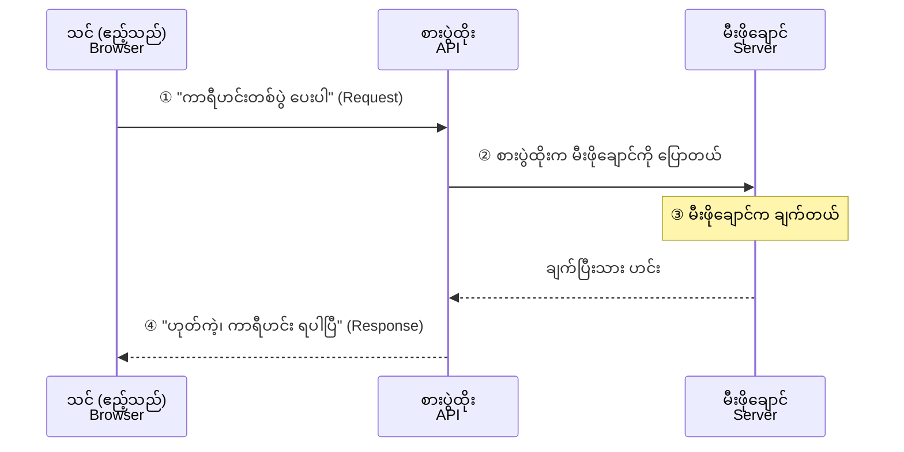
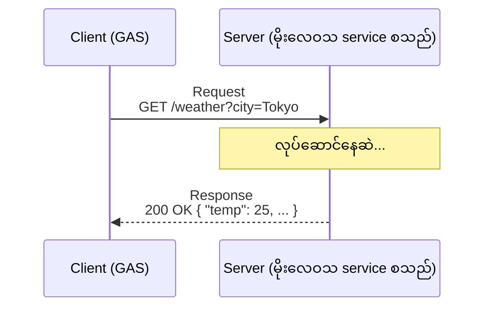
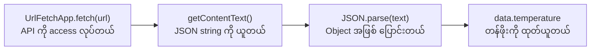

# API ဆိုတာ ဘာလဲ — Request・Response・JSON

> 🇯🇵 မူရင်း (ဂျပန်ဘာသာဖြင့်): [20260512_API説明資料.md](<../../1年生_前期_ITシステム基礎/2026_05_12/20260512_API説明資料.md>) <!-- original-ja-link -->

## ဒီနေ့ရဲ့ ပန်းတိုင်
- API ဆိုတာ ဘာလဲဆိုတာကို ကိုယ့်စကားနဲ့ကိုယ် ရှင်းပြနိုင်ရမယ်
- HTTP ရဲ့ "Request・Response" သဘောတရားကို နားလည်ရမယ်
- JSON data ကို ဖတ်ပြီး နားလည်နိုင်ရမယ်
- GAS ရဲ့ `UrlFetchApp` နဲ့ ပြင်ပ API ကို ခေါ်သုံးနိုင်ရမယ်

---

## 1. API ဆိုတာ ဘာလဲ?

**API (Application Programming Interface) = App အချင်းချင်း ဆက်သွယ်နိုင်ဖို့ အသုံးပြုတဲ့ ကြားခံစနစ်**

### နေ့စဉ်ဘဝက ဥပမာနဲ့ စဉ်းစားကြည့်မယ်

စားသောက်ဆိုင် ဥပမာနဲ့ စဉ်းစားကြည့်ရင် အောက်ပါအတိုင်း ဖြစ်ပါတယ်။



သင်က မီးဖိုချောင် (server) ရဲ့ အတွင်းပိုင်းဖွဲ့စည်းပုံကို မသိလည်း ရပါတယ်။  
စားပွဲထိုး (API) ကနေတစ်ဆင့် မှာယူရုံပါပဲ။

---

## 2. HTTP Request နဲ့ Response



**Request အမျိုးအစားများ:**
| Method | အဓိပ္ပာယ် | ဥပမာ |
|---------|------|-----|
| GET | Data ကို ယူချင်တယ် | မိုးလေဝသ အချက်အလက်ကို ယူလာတယ် |
| POST | Data ကို ပို့ချင်တယ်・ဖန်တီးချင်တယ် | Form ကို submit လုပ်တယ် |
| PUT | Data ကို update လုပ်ချင်တယ် | Profile ကို ပြောင်းတယ် |
| DELETE | Data ကို ဖျက်ချင်တယ် | Post ကို ဖျက်တယ် |

**Response ရဲ့ status code များ:**
| Code | အဓိပ္ပာယ် |
|--------|------|
| 200 | OK (အောင်မြင်တယ်) |
| 404 | Not Found (ရှာမတွေ့ဘူး) |
| 500 | Internal Server Error (Server error) |

---

## 3. JSON — Data အပြန်အလှန် ပို့ဖို့ ပုံစံ

API ရဲ့ data တွေက အဓိကအားဖြင့် **JSON (JavaScript Object Notation)** ပုံစံနဲ့ ရောက်လာပါတယ်။

```json
{
  "city": "Tokyo",
  "weather": "晴れ",
  "temperature": 25.5,
  "humidity": 60,
  "forecast": [
    { "date": "2024-01-15", "temp": 24 },
    { "date": "2024-01-16", "temp": 22 },
    { "date": "2024-01-17", "temp": 27 }
  ]
}
```

ဒီဥပမာမှာ `晴れ` က “နေသာတယ်” လို့ အဓိပ္ပာယ်ရပါတယ်။

JavaScript object ရေးပုံနဲ့ အတော်လေး တူပါတယ်။ သင်ခန်းစာ 08 မှာ သင်ခဲ့တာတွေကို ဒီအတိုင်း သုံးလို့ရပါတယ်!

---

## 4. GAS နဲ့ ပြင်ပ API ကို ခေါ်သုံးခြင်း

Data ကို ထုတ်ယူတဲ့အထိ လုပ်ဆောင်ရမယ့် အဆင့် 4 ဆင့်က အောက်ပါအတိုင်း ဖြစ်ပါတယ်။



```javascript
function callApi() {
  // UrlFetchApp.fetch(URL) = သတ်မှတ်ထားတဲ့ URL ကို access လုပ်ပြီး data ကို ယူတယ်
  const url = "https://api.example.com/data";
  
  const response = UrlFetchApp.fetch(url);
  
  // Response ရဲ့ အကြောင်းအရာကို string အဖြစ် ယူတယ်
  const text = response.getContentText();
  console.log(text);  // JSON string ကို ပြပေးတယ်
  
  // JSON string ကို object အဖြစ် ပြောင်းတယ် (သင်ခန်းစာ 08 မှာ သင်ခဲ့တယ်!)
  const data = JSON.parse(text);
  console.log(data.temperature);  // → 25.5
}
```

---

## 5. Public API ကို လက်တွေ့ သုံးကြည့်ကြမယ်

### ဥပမာ: Open-Meteo (အခမဲ့ မိုးလေဝသ API၊ API key မလိုပါ)

```javascript
function getWeather() {
  // Tokyo ရဲ့ latitude・longitude ကို သတ်မှတ်ပြီး မိုးလေဝသ data ကို ယူတယ်
  const url = "https://api.open-meteo.com/v1/forecast?latitude=35.6762&longitude=139.6503&current_weather=true";
  
  // API ဆီ request ပို့တယ်
  const response = UrlFetchApp.fetch(url);
  
  // Response ကို JSON ပုံစံနဲ့ ယူတယ်
  const json = JSON.parse(response.getContentText());
  
  // current_weather ထဲမှာ လက်ရှိ မိုးလေဝသ data တွေ ပါတယ်
  const weather = json.current_weather;
  
  console.log("気温: " + weather.temperature + "℃");
  console.log("風速: " + weather.windspeed + " km/h");
  
  // မိုးလေဝသ code ကို ဂျပန်စာအဖြစ် ပြောင်းတယ် (တစ်စိတ်တစ်ပိုင်း)
  const weatherCodes = {
    0: "快晴",
    1: "晴れ",
    2: "一部曇り",
    3: "曇り",
    61: "弱い雨",
    63: "適度な雨",
    65: "強い雨",
  };
  
  const weatherText = weatherCodes[weather.weathercode] || "不明";
  console.log("天気: " + weatherText);
}
```

ရလဒ်မှာ `気温` က အပူချိန်၊ `風速` က လေတိုက်နှုန်း၊ `天気` က ရာသီဥတု ဖြစ်ပါတယ်။ ရာသီဥတု ဖော်ပြချက်တွေက `快晴` — ကောင်းကင်ကြည်လင်တယ်၊ `晴れ` — နေသာတယ်၊ `一部曇り` — တိမ်အနည်းငယ်ရှိတယ်၊ `曇り` — တိမ်ထူတယ်၊ `弱い雨` — မိုးဖွဲဖွဲရွာတယ်၊ `適度な雨` — မိုးအသင့်အတင့်ရွာတယ်၊ `強い雨` — မိုးသည်းထန်စွာရွာတယ်၊ `不明` — မသိရ လို့ အဓိပ္ပာယ်ရပါတယ်။

---

## 6. API ရဲ့ Response ကို Sheet ထဲ ရေးထည့်ခြင်း

```javascript
function weatherToSheet() {
  const sheet = SpreadsheetApp.getActiveSpreadsheet().getActiveSheet();
  
  // API ကနေ မိုးလေဝသ data ကို ယူတယ်
  const url = "https://api.open-meteo.com/v1/forecast?latitude=35.6762&longitude=139.6503&current_weather=true";
  const response = UrlFetchApp.fetch(url);
  const data = JSON.parse(response.getContentText());
  const weather = data.current_weather;
  
  // လက်ရှိအချိန်ကို ယူတယ်
  const now = new Date();
  const timeStr = Utilities.formatDate(now, "Asia/Tokyo", "yyyy/MM/dd HH:mm");
  
  // နောက်ဆုံး row ရဲ့ နောက်မှာ ရေးတယ်
  const nextRow = sheet.getLastRow() + 1;
  sheet.getRange(nextRow, 1).setValue(timeStr);
  sheet.getRange(nextRow, 2).setValue(weather.temperature);
  sheet.getRange(nextRow, 3).setValue(weather.windspeed);
  
  console.log("天気データを記録しました！");
}
```

`天気データを記録しました！` က “ရာသီဥတု data ကို မှတ်တမ်းတင်ပြီးပါပြီ!” လို့ အဓိပ္ပာယ်ရပါတယ်။

---

## အနှစ်ချုပ်

| ဝေါဟာရ                       | အဓိပ္ပာယ်                |
| ------------------------ | ----------------- |
| API                      | App အချင်းချင်း ဆက်သွယ်နိုင်ဖို့ အသုံးပြုတဲ့ ကြားခံစနစ် |
| Request                    | Client ကနေ server ဆီ ပို့တဲ့ တောင်းဆိုချက်  |
| Response                    | Server ကနေ client ဆီ ပြန်ပို့တဲ့ အဖြေ  |
| JSON                     | Data အပြန်အလှန် ပို့ဖို့ သုံးတဲ့ ပုံစံ     |
| `UrlFetchApp.fetch(url)` | GAS နဲ့ URL ကို access လုပ်တယ် |
| `JSON.parse(str)`        | JSON string ကို object အဖြစ် ပြောင်းတယ် |

---

## နောက်တစ်ကြိမ် (သင်ခန်းစာ 14) ကြိုတင်အသိပေးချက်

မိုးလေဝသ・ငွေလဲနှုန်း စတဲ့ public API တွေကို သုံးပြီး data ကို spreadsheet ထဲ အလိုအလျောက် မှတ်တမ်းတင်တဲ့ လေ့ကျင့်ခန်းကို လုပ်ပါမယ်။
