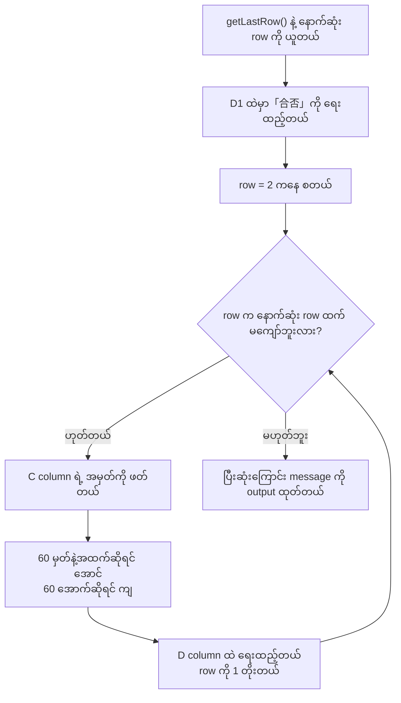

# လေ့ကျင့်ခန်း ပုစ္ဆာများ

> 🇯🇵 မူရင်း (ဂျပန်ဘာသာဖြင့်): [20260512_演習回答.md](<../../1年生_前期_ITシステム基礎/2026_05_12/20260512_演習回答.md>) <!-- original-ja-link -->

## ပြင်ဆင်ခြင်း: Spreadsheet ဖန်တီးခြင်း

1. Google Spreadsheet အသစ်တစ်ခု ဖန်တီးပါ
2. Spreadsheet နာမည်ကို「GAS演習」(GAS လေ့ကျင့်ခန်း) လို့ ပေးပါ
3. 「拡張機能」(Extensions) →「Apps Script」ကို ဖွင့်ပါ

---

## လေ့ကျင့်ခန်း 1: Cell ထဲကို အချက်အလက် ရေးထည့်ခြင်း

### ပုစ္ဆာ

> **ခန့်မှန်းကြာချိန်: 10〜15 မိနစ်**

GAS ကို သုံးပြီး ကိုယ့်ကိုယ်ကိုယ် မိတ်ဆက်တဲ့ အချက်အလက်တွေကို spreadsheet ထဲ ရေးထည့်တဲ့ function ကို ဖန်တီးကြည့်ကြမယ်။

**လုပ်ရမယ့်အရာ:**

1. `jikoshokaSheet` ဆိုတဲ့ နာမည်နဲ့ function ကို ဖန်တီးပါ
2. လက်ရှိ sheet ကို `sheet` ဆိုတဲ့ variable ထဲ ယူထားပါ (သင်ခန်းစာရဲ့ အခန်း 3 ကို ကိုးကားပါ)
3. အောက်က ဇယားအတိုင်း cell တစ်ခုချင်းစီထဲ တန်ဖိုး ရေးထည့်ပါ

| Cell | ရေးထည့်မယ့် အကြောင်းအရာ |
|------|------------|
| A1 | `"自己紹介"` (ကိုယ်တိုင်မိတ်ဆက်) ဆိုတဲ့ string |
| B1 | **ကိုယ့်နာမည်** (ဥပမာ: `"田中太郎"`) |
| A2 | `"年齢"` (အသက်) ဆိုတဲ့ string |
| B2 | **ကိုယ့်အသက်** (ကိန်းဂဏန်း။ quote မပါ) |

4. **ထို့အပြင်** A3〜B4 ကို သုံးပြီး ကိုယ်ကြိုက်တဲ့ အချက်အလက် (ဝါသနာ・မွေးရပ်မြေ စသည်) ကို ကိုယ်တိုင် ထပ်ထည့်ကြည့်ပါ

> **Hint:** Cell ထဲ ရေးထည့်ဖို့ `getRange("A1").setValue(တန်ဖိုး)` ကို သုံးပါ (သင်ခန်းစာ အခန်း 3)

**Run ပြီး sheet ထဲ ရေးထည့်ပြီးသွားလား စစ်ကြည့်ပါ**

### အဖြေ

```javascript
function jikoshokaSheet() {
  const sheet = SpreadsheetApp.getActiveSpreadsheet().getActiveSheet();
  
  // A1 ထဲမှာ「自己紹介」လို့ ရေးမယ်
  sheet.getRange("A1").setValue("自己紹介");
  
  // B1 ထဲမှာ ကိုယ့်နာမည်ကို ရေးမယ် (← ပြောင်းပါ)
  sheet.getRange("B1").setValue("田中太郎");
  
  // A2 ထဲမှာ「年齢」၊ B2 ထဲမှာ အသက်ရဲ့ ကိန်းဂဏန်းကို ရေးမယ်
  sheet.getRange("A2").setValue("年齢");
  sheet.getRange("B2").setValue(18);
  
  // A3၊ B3၊ A4၊ B4 ကိုလည်း ကိုယ်တိုင် ထပ်ထည့်ကြည့်ပါ
}
```

---

## လေ့ကျင့်ခန်း 2: အမှတ်စာရင်းကို တစ်ခါတည်း ရေးထည့်ခြင်း

### ပုစ္ဆာ

> **ခန့်မှန်းကြာချိန်: 20〜30 မိနစ်**

Cell တစ်ခုချင်းစီ ရေးရတာ အလုပ်များပါတယ်။ ဒီတစ်ခါတော့ **2-dimensional array နဲ့ `setValues()`** ကို သုံးပြီး အမှတ်စာရင်းကို တစ်ခါတည်း ရေးထည့်တဲ့ function ကို ဖန်တီးကြည့်ကြမယ်။

**လုပ်ရမယ့်အရာ:**

1. `seisekiTable` ဆိုတဲ့ နာမည်နဲ့ function ကို ဖန်တီးပါ
2. အရင်ဆုံး sheet ကို **အားလုံး ရှင်းလင်း** ပါ (`clearContents()` ကို သုံးပါ)
3. ပထမ row မှာ `"番号"` (နံပါတ်), `"名前"` (နာမည်), `"点数"` (အမှတ်) ဆိုတဲ့ header တွေကို ရေးထည့်ပါ
   - **2-dimensional array** `[["番号", "名前", "点数"]]` ကို `setValues()` နဲ့ ရေးထည့်ပါ
   - `getRange(1, 1, 1, 3)` နဲ့ "ပထမ row・ပထမ column ကနေ 1 row×3 column" ကို သတ်မှတ်ပါ (သင်ခန်းစာ အခန်း 5)
4. ဒုတိယ row ကစပြီး အောက်ပါ လူ 5 ယောက်စာ data ကို ရေးထည့်ပါ

| 番号 | 名前 | 点数 |
|------|------|------|
| 1 | 田中太郎 | 85 |
| 2 | 鈴木花子 | 72 |
| 3 | 山田次郎 | 91 |
| 4 | 佐藤三郎 | 68 |
| 5 | 伊藤美咲 | 78 |

   - Data ကို 2-dimensional array အဖြစ် ပြင်ဆင်ပြီး `getRange(2, 1, data ရဲ့ row အရေအတွက်, data ရဲ့ column အရေအတွက်)` နဲ့ ရေးထည့်ပါ
5. Header row (ပထမ row) ကို **စာလုံးထူ (bold)** လုပ်ပြီး **မီးခိုးရောင် နောက်ခံအရောင်** (`"#CCCCCC"`) ထားပါ (သင်ခန်းစာ အခန်း 7)

> **Hint:** `data.length` နဲ့ row အရေအတွက်၊ `data[0].length` နဲ့ column အရေအတွက်ကို ယူလို့ရပါတယ်

### အဖြေ

```javascript
function seisekiTable() {
  const sheet = SpreadsheetApp.getActiveSpreadsheet().getActiveSheet();
  
  // Sheet ကို ရှင်းလင်းမယ် (အရင် data တွေကို ဖျက်မယ်)
  sheet.clearContents();
  
  // Header row
  const header = [["番号", "名前", "点数"]];
  sheet.getRange(1, 1, 1, 3).setValues(header);
  
  // Data row များ (လူ 5 ယောက်စာ)
  const data = [
    [1, "田中太郎", 85],
    [2, "鈴木花子", 72],
    [3, "山田次郎", 91],
    [4, "佐藤三郎", 68],
    [5, "伊藤美咲", 78],
  ];
  
  // ဒုတိယ row ကနေ ရေးထည့်မယ်
  sheet.getRange(2, 1, data.length, data[0].length).setValues(data);
  
  // Header ကို စာလုံးထူ လုပ်မယ်
  sheet.getRange(1, 1, 1, 3).setFontWeight("bold");
  sheet.getRange(1, 1, 1, 3).setBackground("#CCCCCC");
}
```

---

## လေ့ကျင့်ခန်း 3: Cell ကို ဖတ်ပြီး ပြုပြင်ခြင်း

### ပုစ္ဆာ

> **ခန့်မှန်းကြာချိန်: 30〜40 မိနစ်**

**လေ့ကျင့်ခန်း 2 ကို run ပြီးမှ လုပ်ပါ။**

လေ့ကျင့်ခန်း 2 မှာ ဖန်တီးခဲ့တဲ့ အမှတ်စာရင်းထဲက အမှတ်တွေကို ဖတ်ပြီး D column ထဲမှာ「合否」(အောင်/ကျ) ကို အလိုအလျောက် ဆုံးဖြတ်ပြီး ရေးထည့်တဲ့ function ကို ဖန်တီးကြည့်ကြမယ်။

**လုပ်ရမယ့်အရာ:**

1. `readAndProcess` ဆိုတဲ့ နာမည်နဲ့ function ကို ဖန်တီးပါ

2. `getLastRow()` နဲ့ data ပါတဲ့ နောက်ဆုံး row နံပါတ်ကို ယူပါ (သင်ခန်းစာ အခန်း 6)

3. D column (4 ခုမြောက် column) ရဲ့ ပထမ row မှာ header `"合否"` (အောင်/ကျ) ကို ရေးထည့်ပါ
   - `getRange(1, 4)` နဲ့ "ပထမ row・4 ခုမြောက် column" ကို သတ်မှတ်ပါ

4. `for` loop နဲ့ ဒုတိယ row〜နောက်ဆုံး row အထိ ထပ်ခါထပ်ခါ လုပ်ပါ
   - Row တစ်ခုချင်းစီရဲ့ C column (3 ခုမြောက် column) က အမှတ်ကို `getValue()` နဲ့ ဖတ်ပါ
   - အမှတ်က **60 မှတ်နဲ့အထက်ဆိုရင် `"合格"` (အောင်)**၊ **60 အောက်ဆိုရင် `"不合格"` (ကျ)** လို့ ဆုံးဖြတ်ပါ
     - Ternary operator `score >= 60 ? "合格" : "不合格"` ကို သုံးပါ
   - ဆုံးဖြတ်ချက် ရလဒ်ကို D column (4 ခုမြောက် column) ထဲ `setValue()` နဲ့ ရေးထည့်ပါ

5. Loop ပြီးသွားရင် `console.log("合否判定が完了しました！")` နဲ့ “အောင်/ကျ ဆုံးဖြတ်ခြင်း ပြီးပါပြီ!” ဆိုတဲ့ message ကို output ထုတ်ပါ

> **Hint:** `getRange(row နံပါတ်, column နံပါတ်)` နဲ့ row・column ကို ကိန်းဂဏန်းနဲ့ သတ်မှတ်လို့ရပါတယ် (သင်ခန်းစာ အခန်း 4)

လုပ်ဆောင်ချက် စီးဆင်းပုံကို ပုံနဲ့ ပြရရင် အောက်ပါအတိုင်း ဖြစ်ပါတယ်။



**Run ပြီးနောက် D column မှာ အောင်/ကျ ပေါ်လာလား စစ်ကြည့်ပါ**

### အဖြေ

```javascript
function readAndProcess() {
  const sheet = SpreadsheetApp.getActiveSpreadsheet().getActiveSheet();
  
  // လေ့ကျင့်ခန်း 2 ကို run ပြီးမှ ဒီ code ကို run လုပ်ပါ
  
  // ဒုတိယ row ကနေ နောက်ဆုံး row အထိ data ကို ဖတ်မယ်
  const lastRow = sheet.getLastRow();
  
  // D column (4 ခုမြောက် column) ထဲမှာ「合否」ကို ရေးထည့်မယ်
  // Header
  sheet.getRange(1, 4).setValue("合否");
  
  for (let row = 2; row <= lastRow; row++) {
    // C column (3 ခုမြောက် column) ရဲ့ အမှတ်ကို ဖတ်မယ်
    const score = sheet.getRange(row, 3).getValue();
    
    // 60 မှတ်နဲ့အထက်ဆိုရင် အောင်၊ 60 အောက်ဆိုရင် ကျ
    const result = score >= 60 ? "合格" : "不合格";
    
    // D column ထဲ ရေးထည့်မယ်
    sheet.getRange(row, 4).setValue(result);
  }
  
  console.log("合否判定が完了しました！");
}
```

---

## လေ့ကျင့်ခန်း 4: Format ကို သပ်ရပ်အောင် လုပ်ကြမယ်

### ပုစ္ဆာ

> **ခန့်မှန်းကြာချိန်: 15〜20 မိနစ်**

**လေ့ကျင့်ခန်း 3 ကို run ပြီးမှ လုပ်ပါ။**

လေ့ကျင့်ခန်း 3 မှာ ရေးထည့်ခဲ့တဲ့「合否」(အောင်/ကျ) column ကို ဖတ်ပြီး အောင်တဲ့ row နဲ့ ကျတဲ့ row တွေမှာ **နောက်ခံအရောင်** ထည့်ကာ ရလဒ်ကို တစ်ချက်ကြည့်ရုံနဲ့ သိနိုင်တဲ့ အမှတ်စာရင်းတစ်ခုအဖြစ် ပြင်ဆင်ကြမယ်။

**လုပ်ရမယ့်အရာ:**

1. `colorFormat` ဆိုတဲ့ နာမည်နဲ့ function ကို ဖန်တီးပါ
2. `getLastRow()` နဲ့ နောက်ဆုံး row နံပါတ်ကို ယူပါ
3. `for` loop နဲ့ ဒုတိယ row〜နောက်ဆုံး row အထိ ထပ်ခါထပ်ခါ လုပ်ပါ
   - D column (4 ခုမြောက် column) ရဲ့ တန်ဖိုးကို `getValue()` နဲ့ ဖတ်ပါ
   - တန်ဖိုးက `"合格"` (အောင်) ဆိုရင် အဲ့ဒီ row (column 1〜4) ရဲ့ နောက်ခံအရောင်ကို **အပြာနု** `"#CCE5FF"` ထားပါ
   - တန်ဖိုးက `"不合格"` (ကျ) ဆိုရင် အဲ့ဒီ row ရဲ့ နောက်ခံအရောင်ကို **လိမ္မော်ရောင်နု** `"#FFE5CC"` ထားပါ
   - Row တစ်ကြောင်းစာ အကျယ်ကို သတ်မှတ်ဖို့ `getRange(row နံပါတ်, 1, 1, 4)` ကို သုံးပါ ("row နံပါတ် row・ပထမ column ကနေ 1 row×4 column")

> **စစ်ဆေးရမယ့်အချက်:** Run ပြီးနောက် အောင်တဲ့ row တွေက အပြာ၊ ကျတဲ့ row တွေက လိမ္မော်ရောင် ဖြစ်နေရင် အောင်မြင်ပါပြီ

### အဖြေ

```javascript
function colorFormat() {
  const sheet = SpreadsheetApp.getActiveSpreadsheet().getActiveSheet();
  const lastRow = sheet.getLastRow();
  
  for (let row = 2; row <= lastRow; row++) {
    const result = sheet.getRange(row, 4).getValue();
    
    if (result === "合格") {
      // အောင်တဲ့ row ကို အပြာနု ထားမယ်
      sheet.getRange(row, 1, 1, 4).setBackground("#CCE5FF");
    } else {
      // ကျတဲ့ row ကို လိမ္မော်ရောင်နု ထားမယ်
      sheet.getRange(row, 1, 1, 4).setBackground("#FFE5CC");
    }
  }
}
```
