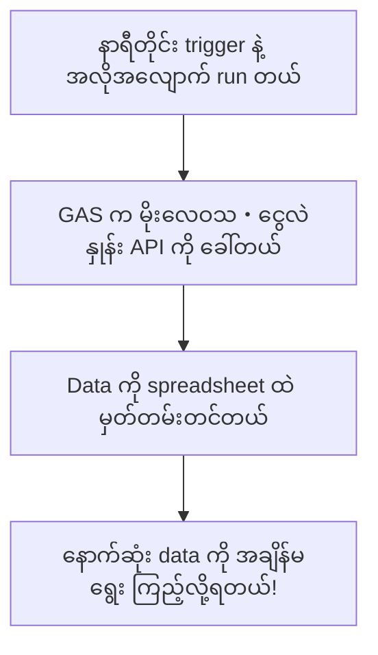

# GAS + API လေ့ကျင့်ခန်း — မိုးလေဝသ・ငွေလဲနှုန်း data ကို Sheet ထဲ အလိုအလျောက် ထည့်ခြင်း

> 🇯🇵 မူရင်း (ဂျပန်ဘာသာဖြင့်): [20260519.md](<../../1年生_前期_ITシステム基礎/2026_05_19/20260519.md>) <!-- original-ja-link -->

## ဒီနေ့ရဲ့ ပန်းတိုင်
- Public API ကို ခေါ်ပြီး data ကို ယူနိုင်ရမယ်
- ယူလာတဲ့ data ကို spreadsheet ထဲ အလိုအလျောက် မှတ်တမ်းတင်နိုင်ရမယ်
- Trigger နဲ့ ပေါင်းစပ်ထားတဲ့ automation tool ကို အပြီးသတ် ဖန်တီးနိုင်ရမယ်

---

## 1. ဒီနေ့ ဖန်တီးမယ့်အရာ



---

## 2. ငွေလဲနှုန်း API (ExchangeRate-API)

အခမဲ့ သုံးလို့ရတဲ့ ငွေလဲနှုန်း API ဖြစ်ပါတယ်။

```javascript
function getExchangeRate() {
  // ဒေါ်လာကနေ ငွေကြေးအမျိုးမျိုးဆီ ငွေလဲနှုန်းကို ယူတယ်
  // base=USD → 1 ဒေါ်လာက ယန်း ဘယ်လောက်၊ ယူရို ဘယ်လောက် စသည်
  const url = "https://open.er-api.com/v6/latest/USD";
  
  const response = UrlFetchApp.fetch(url);
  const data = JSON.parse(response.getContentText());
  
  // data.rates ထဲမှာ ငွေကြေးတစ်ခုချင်းစီရဲ့ နှုန်းတွေ ပါတယ်
  const jpyRate = data.rates.JPY;   // ဒေါ်လာ→ယန်း
  const eurRate = data.rates.EUR;   // ဒေါ်လာ→ယူရို
  const gbpRate = data.rates.GBP;   // ဒေါ်လာ→ပေါင်
  
  console.log(`1ドル = ${jpyRate}円`);
  console.log(`1ドル = ${eurRate}ユーロ`);
  console.log(`1ドル = ${gbpRate}ポンド`);
  
  return { JPY: jpyRate, EUR: eurRate, GBP: gbpRate };
}
```

Output မှာ「1ドル」က ၁ ဒေါ်လာ、「円」က ယန်း、「ユーロ」က ယူရို、「ポンド」က ပေါင် ကို ဆိုလိုပါတယ်။

---

## 3. မိုးလေဝသ API (Open-Meteo)

```javascript
function getWeatherData() {
  // Tokyo ရဲ့ မိုးလေဝသ (သင်ခန်းစာ 13 ပြန်လေ့လာခြင်း)
  const url = "https://api.open-meteo.com/v1/forecast"
    + "?latitude=35.6762"
    + "&longitude=139.6503"
    + "&current_weather=true"
    + "&hourly=temperature_2m,precipitation_probability";
  
  const response = UrlFetchApp.fetch(url);
  const data = JSON.parse(response.getContentText());
  
  const current = data.current_weather;
  return {
    temperature: current.temperature,
    windspeed: current.windspeed,
    weathercode: current.weathercode
  };
}
```

---

## 4. ပေါင်းစပ်: Spreadsheet ထဲ အလိုအလျောက် မှတ်တမ်းတင်တဲ့ စနစ်

```javascript
// Sheet ရဲ့ ပထမ row မှာ header ရေးမယ် (ပထမဆုံး 1 ကြိမ်ပဲ run လုပ်ပါ)
function setupHeader() {
  const sheet = SpreadsheetApp.getActiveSpreadsheet().getActiveSheet();
  sheet.clearContents();
  
  const headers = [["記録日時", "気温(℃)", "風速(km/h)", "1ドル(円)", "1ドル(ユーロ)"]];
  sheet.getRange(1, 1, 1, headers[0].length).setValues(headers);
  sheet.getRange(1, 1, 1, headers[0].length).setFontWeight("bold");
  sheet.getRange(1, 1, 1, headers[0].length).setBackground("#4A90D9");
  sheet.getRange(1, 1, 1, headers[0].length).setFontColor("#FFFFFF");
  
  console.log("ヘッダーを設定しました");
}

// ပုံမှန် အချိန်အလိုက် run မယ့် main function (trigger မှာ သတ်မှတ်ပါ)
function recordData() {
  const sheet = SpreadsheetApp.getActiveSpreadsheet().getActiveSheet();
  
  // လက်ရှိအချိန်
  const now = new Date();
  const timeStr = Utilities.formatDate(now, "Asia/Tokyo", "yyyy/MM/dd HH:mm");
  
  // မိုးလေဝသ data ကို ယူမယ်
  let temperature = "取得失敗";
  let windspeed = "取得失敗";
  
  try {
    const weatherUrl = "https://api.open-meteo.com/v1/forecast?latitude=35.6762&longitude=139.6503&current_weather=true";
    const weatherRes = UrlFetchApp.fetch(weatherUrl);
    const weatherData = JSON.parse(weatherRes.getContentText());
    temperature = weatherData.current_weather.temperature;
    windspeed = weatherData.current_weather.windspeed;
  } catch (e) {
    // Error ဖြစ်ရင်တောင် program ကို မရပ်စေဘူး
    console.log("天気取得エラー: " + e.message);
  }
  
  // ငွေလဲနှုန်း data ကို ယူမယ်
  let jpyRate = "取得失敗";
  let eurRate = "取得失敗";
  
  try {
    const fxUrl = "https://open.er-api.com/v6/latest/USD";
    const fxRes = UrlFetchApp.fetch(fxUrl);
    const fxData = JSON.parse(fxRes.getContentText());
    jpyRate = Math.round(fxData.rates.JPY * 100) / 100;  // ဒသမ 2 နေရာအထိ
    eurRate = Math.round(fxData.rates.EUR * 10000) / 10000;
  } catch (e) {
    console.log("為替取得エラー: " + e.message);
  }
  
  // နောက်ဆုံး row ရဲ့ နောက်မှာ row အသစ်တစ်ခု ထပ်ထည့်မယ်
  const nextRow = sheet.getLastRow() + 1;
  const newData = [[timeStr, temperature, windspeed, jpyRate, eurRate]];
  sheet.getRange(nextRow, 1, 1, newData[0].length).setValues(newData);
  
  console.log(`データを記録しました: ${timeStr}`);
}
```

Sheet header တွေမှာ「記録日時」က မှတ်တမ်းတင်တဲ့ ရက်စွဲနဲ့အချိန်、「気温(℃)」က အပူချိန်、「風速(km/h)」က လေတိုက်နှုန်း、「1ドル(円)」က ၁ ဒေါ်လာနဲ့ ညီမျှတဲ့ ယန်း、「1ドル(ユーロ)」က ၁ ဒေါ်လာနဲ့ ညီမျှတဲ့ ယူရို ကို ဆိုလိုပါတယ်။「取得失敗」က data ယူတာ မအောင်မြင်ခြင်း、「ヘッダーを設定しました」က header သတ်မှတ်ပြီးပါပြီ、「天気取得エラー」က မိုးလေဝသ data ယူရာမှာ error ဖြစ်ခြင်း、「為替取得エラー」က ငွေလဲနှုန်း ယူရာမှာ error ဖြစ်ခြင်း、「データを記録しました」က data ကို မှတ်တမ်းတင်ပြီးပါပြီ ကို ဆိုလိုပါတယ်။

---

## 5. သုံးပုံ အနှစ်ချုပ်

**ပထမအကြိမ် setup:**
1. `setupHeader()` ကို 1 ကြိမ် run လုပ်ပါ
2. Trigger ကို သတ်မှတ်ပါ
3. ကျန်တာကတော့ data တွေ အလိုအလျောက် စုဆောင်းသွားပါလိမ့်မယ်!

**အလုပ်လုပ်ပုံ စစ်ဆေးခြင်း:**
- `recordData()` ကို ကိုယ်တိုင် အကြိမ်အနည်းငယ် run ပြီး data တိုးလာလား စစ်ကြည့်ပါ

---

## အနှစ်ချုပ်・Phase 3 ပြီးဆုံးပါပြီ!

| သင်ယူခဲ့တဲ့အရာ | အနှစ်ချုပ် |
|-----------|-------|
| SpreadsheetApp | Cell ကို ဖတ်ခြင်း・ရေးခြင်း |
| for loop | Row အားလုံးကို အလိုအလျောက် လုပ်ဆောင်ခြင်း |
| Trigger | အချိန်・event နဲ့ အလိုအလျောက် run ခြင်း |
| GmailApp | Email ကို အလိုအလျောက် ပို့ခြင်း |
| UrlFetchApp | ပြင်ပ API ကနေ data ယူခြင်း |
| JSON.parse | JSON string ကို object အဖြစ် ပြောင်းခြင်း |

---