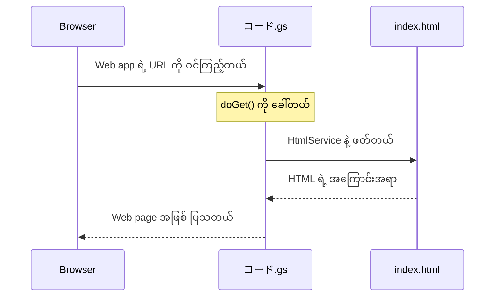

# HTML အခြေခံ — Tag・ဖွဲ့စည်းပုံ・Form

> 🇯🇵 မူရင်း (ဂျပန်ဘာသာဖြင့်): [20260519_html.md](<../../1年生_前期_ITシステム基礎/2026_05_19/20260519_html.md>) <!-- original-ja-link -->

## ဒီနေ့ရဲ့ ပန်းတိုင်
- HTML ရဲ့ အခြေခံဖွဲ့စည်းပုံကို ရေးနိုင်မယ်
- မကြာခဏသုံးတဲ့ tag တွေကို ကျွမ်းကျွမ်းကျင်ကျင် သုံးနိုင်မယ်
- Form တစ်ခု ဖန်တီးနိုင်မယ်
- GAS ရဲ့ HTML Service နဲ့ Web page ကို ပြသနိုင်မယ်

---

## 1. HTML ဆိုတာ ဘာလဲ

**HTML（HyperText Markup Language）= Web page ရဲ့ 「အရိုးစု」ကို တည်ဆောက်တဲ့ ဘာသာစကား**

```
Web page ကို ဖွဲ့စည်းထားတဲ့ အစိတ်အပိုင်းများ：
├── HTML → ဖွဲ့စည်းပုံ・အကြောင်းအရာ（အရိုး・အသား）
├── CSS  → အသွင်အပြင်（အဝတ်အစား・မိတ်ကပ်）
└── JS   → လှုပ်ရှားမှု（ကြွက်သား）
```

---

## 2. အခြေခံဖွဲ့စည်းပုံ

```html
<!DOCTYPE html>
<html lang="ja">
<head>
  <!-- head ထဲမှာ browser အတွက် setting အချက်အလက်တွေ ပါတယ်။ screen ပေါ်မှာ မပြဘူး -->
  <meta charset="UTF-8">
  <title>ページタイトル</title>  <!-- tab မှာ ပေါ်တယ် -->
</head>
<body>
  <!-- body ထဲမှာ ရေးထားတာတွေက screen ပေါ်မှာ ပေါ်တယ် -->
  <h1>見出し1</h1>
  <p>段落テキスト</p>
</body>
</html>
```

「ページタイトル」က「စာမျက်နှာခေါင်းစဉ်」、「見出し1」က「ခေါင်းစဉ် ၁」、「段落テキスト」က「စာပိုဒ်စာသား」ကို ဆိုလိုပါတယ်။

---

## 3. မကြာခဏ သုံးတဲ့ tag များ

### ခေါင်းစဉ်・စာပိုဒ်

```html
<h1>大見出し（一番大きい）</h1>
<h2>中見出し</h2>
<h3>小見出し</h3>
<p>段落テキスト。改行は自動。</p>
<br>  <!-- စာကြောင်းအသစ်ကို အတင်းဆင်းခြင်း -->
<hr>  <!-- အလျားလိုက်မျဉ်း -->
```

「大見出し（一番大きい）」က「ခေါင်းစဉ်ကြီး（အကြီးဆုံး）」、「中見出し」က「ခေါင်းစဉ်အလတ်」、「小見出し」က「ခေါင်းစဉ်ငယ်」、「段落テキスト。改行は自動。」က「စာပိုဒ်စာသား။ စာကြောင်းဆင်းခြင်းကို အလိုအလျောက် လုပ်ပေးတယ်။」ကို ဆိုလိုပါတယ်။

### Link နဲ့ ပုံ

```html
<!-- Link -->
<a href="https://google.com">Google へ</a>
<a href="page2.html">次のページ</a>          <!-- ဆိုက်တစ်ခုတည်းအတွင်း -->
<a href="https://google.com" target="_blank">新しいタブで開く</a>

<!-- ပုံ -->

<!-- alt = ပုံကို ပြလို့မရတဲ့အခါ အစားထိုးပြမယ့် စာသား -->
```

「Google へ」က「Google သို့」、「次のページ」က「နောက်စာမျက်နှာ」、「新しいタブで開く」က「tab အသစ်မှာ ဖွင့်မယ်」、「写真の説明」က「ဓာတ်ပုံအကြောင်း ရှင်းလင်းချက်」ကို ဆိုလိုပါတယ်။

### List

```html
<!-- နံပါတ်မပါတဲ့ list（ul = unordered list）-->
<ul>
  <li>りんご</li>
  <li>みかん</li>
  <li>ぶどう</li>
</ul>

<!-- နံပါတ်ပါတဲ့ list（ol = ordered list）-->
<ol>
  <li>手を洗う</li>
  <li>野菜を切る</li>
  <li>炒める</li>
</ol>
```

「りんご」「みかん」「ぶどう」က「ပန်းသီး」「လိမ္မော်သီး」「စပျစ်သီး」、「手を洗う」「野菜を切る」「炒める」က「လက်ဆေးမယ်」「ဟင်းသီးဟင်းရွက် လှီးမယ်」「ကြော်မယ်」ကို ဆိုလိုပါတယ်။

### Table（ဇယား）

```html
<table border="1">
  <thead>
    <tr>
      <th>名前</th>   <!-- th = header cell（စာလုံးထူ・အလယ်ညှိ） -->
      <th>点数</th>
    </tr>
  </thead>
  <tbody>
    <tr>
      <td>田中太郎</td>   <!-- td = data cell -->
      <td>85</td>
    </tr>
    <tr>
      <td>鈴木花子</td>
      <td>72</td>
    </tr>
  </tbody>
</table>
```

「名前」က「အမည်」、「点数」က「ရမှတ်」ကို ဆိုလိုပါတယ်။

### div နဲ့ span（အုပ်စုခွဲခြင်း）

```html
<!-- div = block element တွေကို အုပ်စုဖွဲ့တာ（ဒေါင်လိုက် တန်းစီတယ်） -->
<div class="box">
  <h2>タイトル</h2>
  <p>内容</p>
</div>

<!-- span = inline element တွေကို အုပ်စုဖွဲ့တာ（ဘေးတိုက် တန်းစီတယ်） -->
<p>テキストの<span style="color: red;">一部だけ</span>を変える</p>
```

「タイトル」က「ခေါင်းစဉ်」、「内容」က「အကြောင်းအရာ」、「テキストの一部だけを変える」က「စာသားရဲ့ တစ်စိတ်တစ်ပိုင်းကိုပဲ ပြောင်းမယ်」ကို ဆိုလိုပါတယ်။

---

## 4. Form

User ဆီက input ကို လက်ခံတဲ့ အစိတ်အပိုင်းပါ။

```html
<form action="" method="post">
  <!-- စာသား input -->
  <label for="namae">名前：</label>
  <input type="text" id="namae" name="namae" placeholder="名前を入力">
  
  <br>
  
  <!-- Email input -->
  <label for="email">メール：</label>
  <input type="email" id="email" name="email">
  
  <br>
  
  <!-- ဂဏန်း input -->
  <label for="age">年齢：</label>
  <input type="number" id="age" name="age" min="0" max="150">
  
  <br>
  
  <!-- Select box -->
  <label for="grade">学年：</label>
  <select id="grade" name="grade">
    <option value="1">1年生</option>
    <option value="2">2年生</option>
    <option value="3">3年生</option>
  </select>
  
  <br>
  
  <!-- Textarea（စာကြောင်းအများကြီး） -->
  <label for="comment">コメント：</label>
  <textarea id="comment" name="comment" rows="4" cols="40"></textarea>
  
  <br>
  
  <!-- ပေးပို့ခလုတ် -->
  <button type="submit">送信する</button>
</form>
```

「名前」က「အမည်」、「名前を入力」က「အမည်ထည့်ပါ」、「メール」က「အီးမေးလ်」、「年齢」က「အသက်」、「学年」က「နှစ်」、「1年生」「2年生」「3年生」က「ပထမနှစ်」「ဒုတိယနှစ်」「တတိယနှစ်」、「コメント」က「မှတ်ချက်」、「送信する」က「ပေးပို့မယ်」ကို ဆိုလိုပါတယ်။

---

## 5. GAS ရဲ့ HTML Service နဲ့ Web page ကို ပြသခြင်း

GAS ကို သုံးပြီး Web page ကို အများပြည်သူ ကြည့်နိုင်အောင် ထုတ်ဝေနိုင်တယ်！

**ဖိုင်ဖွဲ့စည်းပုံ（GAS editor မှာ ဖန်တီးတယ်）：**
- `コード.gs`（GAS ရဲ့ main ဖိုင်）
- `index.html`（ပြသမယ့် HTML ဖိုင်）

**コード.gs：**
```javascript
// Web app အဖြစ် ထုတ်ဝေဖို့အတွက် function
// URL ကို ဝင်ကြည့်တဲ့အခါ ခေါ်ခံရတယ်
function doGet() {
  // index.html ကို ဖတ်ပြီး ပြသတယ်
  return HtmlService.createHtmlOutputFromFile("index")
    .setTitle("私のWebページ");
}
```

「私のWebページ」က「ကျွန်ုပ်ရဲ့ Web စာမျက်နှာ」ကို ဆိုလိုပါတယ်။

**index.html：**
```html
<!DOCTYPE html>
<html lang="ja">
<head>
  <meta charset="UTF-8">
  <title>GASのWebページ</title>
</head>
<body>
  <h1>こんにちは！GAS HTML サービス</h1>
  <p>これはGASで表示したWebページです。</p>
  
  <ul>
    <li>スプレッドシートのデータを表示できる</li>
    <li>フォームの送信を受け取れる</li>
    <li>インターネットで公開できる</li>
  </ul>
</body>
</html>
```

「GASのWebページ」က「GAS ရဲ့ Web စာမျက်နှာ」、「こんにちは！GAS HTML サービス」က「မင်္ဂလာပါ！GAS HTML Service」ကို ဆိုလိုပါတယ်။ ကျန်တဲ့ စာကြောင်းတွေက「ဒါက GAS နဲ့ ပြသထားတဲ့ Web page ပါ」「spreadsheet ရဲ့ data ကို ပြနိုင်တယ်」「form က ပေးပို့တာကို လက်ခံနိုင်တယ်」「အင်တာနက်ပေါ်မှာ ထုတ်ဝေနိုင်တယ်」လို့ ဆိုလိုပါတယ်။

ထုတ်ဝေထားတဲ့ URL ကို ဝင်ကြည့်လိုက်ရင် အောက်ပါအစီအစဉ်အတိုင်း page ပေါ်လာတယ်။



**Web app အဖြစ် ထုတ်ဝေနည်း：**
1. 「デプロイ」（Deploy）→「新しいデプロイ」（New deployment）
2. 種類（အမျိုးအစား）：「Webアプリ」（Web app）ကို ရွေးပါ
3. アクセスできるユーザー（ဝင်ကြည့်ခွင့်ရှိသူ）：「全員」（လူတိုင်း）
4. 「デプロイ」（Deploy）→ URL ထုတ်ပေးလိမ့်မယ်！

---

## အနှစ်ချုပ်

| Tag | အသုံးပြုပုံ |
|------|------|
| `<h1>`〜`<h6>` | ခေါင်းစဉ် |
| `<p>` | စာပိုဒ် |
| `<a href="">` | Link |
| `` | ပုံ |
| `<ul>` / `<ol>` / `<li>` | List |
| `<table>` / `<tr>` / `<td>` | ဇယား |
| `<form>` | Form（input လက်ခံခြင်း） |
| `<input>` / `<button>` | Input အစိတ်အပိုင်း・ခလုတ် |
| `<div>` / `<span>` | အုပ်စုခွဲခြင်း |

---
