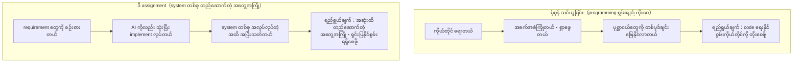
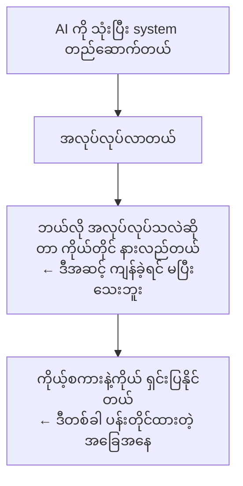

# သင်ခန်းစာရဲ့ ရည်ရွယ်ချက် အနှစ်ချုပ် — နောက်ဆုံး assignment ကို ပြန်လည်သုံးသပ်ခြင်း

> 🇯🇵 မူရင်း (ဂျပန်ဘာသာဖြင့်): [授業の趣旨_まとめ.md](<../1年生_前期_ITシステム基礎/授業の趣旨_まとめ.md>) <!-- original-ja-link -->

တင်ပြချက်တွေ ပြီးသွားပေမယ့် ဒီ assignment မှာ ဘာကို ရည်ရွယ်ခဲ့သလဲဆိုတာ ထပ်ပြီး စနစ်တကျ ရှင်းပြပါမယ်။
တင်ပြချက်တွေကို နားထောင်ပြီး 「AI သုံးလို့ ရလား？」「ကိုယ်တိုင် မရေးဘဲ နေလို့ရလား？」လို့ ဇဝေဇဝါ ဖြစ်သွားတဲ့သူတွေလည်း ရှိမယ်ထင်လို့ အဲဒီမေးခွန်းတွေရဲ့ အဖြေကိုပါ ထည့်ထားပါတယ်။

---

## 1. ဒီသင်ခန်းစာမှာ အဓိက ပြောချင်တာ

Programming ဆိုတာ ရှင်းလင်းချက်တွေကို ဖတ်ရုံ၊ နားထောင်ရုံနဲ့ တတ်မြောက်လာတာ မဟုတ်ဘဲ **ကိုယ်တိုင် လက်တွေ့ လုပ်ကြည့်ပြီး တည်ဆောက်သွားတာကလွဲလို့ တခြား သင်ယူနည်း မရှိဘူး** လို့ ယူဆပါတယ်။

အဲဒီအတွက် လက်တွေ့ သင်ယူနည်းအနေနဲ့ သင်ထောက်ကူ ဝဘ်ဆိုက် **paiza** ရဲ့ skill check ကို သုံးပြီး

```
[ D ပုစ္ဆာ ]  ──── အရေအတွက်များများ ဖြေ ────▶ [ C ပုစ္ဆာ ]
 အခြေခံ syntax・တွေးခေါ်ပုံကို            နည်းနည်းပိုရှုပ်တဲ့ ပုစ္ဆာတွေကို
 လက်နဲ့ ရေးပြီး မှတ်မိအောင်လုပ်            စိန်ခေါ်ပြီး အသုံးချနိုင်စွမ်း တိုးစေ
```

ဆိုတဲ့ အစီအစဉ်အတိုင်း လေ့ကျင့်ဖို့ အကြံပြုပါတယ်။ ဒါက ဒီ assignment ပြီးသွားတဲ့နောက်မှာလည်း programming စွမ်းရည်ကို တကယ် တိုးတက်စေချင်တဲ့သူတွေအတွက် မပြောင်းလဲတဲ့ အကောင်းဆုံး လမ်းကြောင်းပါ။

---

## 2. ဒီ assignment ရဲ့ ရည်ရွယ်ချက်နဲ့ အခန်းကဏ္ဍ

ဒီနောက်ဆုံး assignment မှာ အထက်က သင်ယူနည်းနဲ့ နည်းနည်း ကွဲပြားတဲ့ ရည်မှန်းချက်ကို ထားပါတယ်။



- **AI သုံးခွင့် ပြုထားတယ်**
- အဓိကက 「မှန်ကန်တဲ့ code ကို ကိုယ့်လက်နဲ့ချည်း ရေးနိုင်သလား」မဟုတ်ဘဲ **「system တစ်ခုကို သုညကနေ တကယ် တည်ဆောက်ကြည့်တယ်」ဆိုတဲ့ အတွေ့အကြုံကိုယ်တိုင်** ပါ

ဆိုလိုတာက ဒီတစ်ခါမှာ code ကို တစ်ကြောင်းချင်း ကိုယ်တိုင် ရေးလေ့ကျင့်တာထက် requirement တွေကို စီစစ်ပြီး AI ကိုလည်း သုံးရင်း အလုပ်လုပ်တဲ့ အရာတစ်ခုကို ပုံဖော်တဲ့ အတွေ့အကြုံကို ဦးစားပေးထားတဲ့ assignment ပါ။

---

## 3. တင်ပြချက်မှာ ရှင်းပြဖို့ မဖြစ်မနေ လိုအပ်ရတဲ့ အကြောင်းရင်း

Assignment တင်သွင်းမှု စည်းမျဉ်းထဲက 「တင်ပြချက်မှာ ရှင်းပြရမယ့် လိုအပ်ချက်」ဟာ ဒီ assignment ထဲမှာ အရေးကြီးဆုံး အပိုင်းပါ။



AI ကို သုံးပြီး တည်ဆောက်ထားတဲ့ system ဖြစ်ရင်တောင်

- ဘာအတွက် တည်ဆောက်ခဲ့သလဲ
- ဘယ်လို အလုပ်လုပ်တဲ့ ပုံစံ ဖြစ်နေသလဲ
- Code ရဲ့ ဘယ်နေရာကို ကိုယ်တိုင် စဉ်းစားပြင်ဆင်・ညှိခဲ့သလဲ

ဆိုတာကို **ကိုယ့်စကားနဲ့ကိုယ် ရှင်းပြနိုင်ဖို့** လိုအပ်ပါတယ်။ AI ကို ရေးခိုင်းပြီး အဲဒီမှာတင် ရပ်မနေဘဲ ထွက်လာတဲ့ system ရဲ့ အလုပ်လုပ်ပုံကို ကိုယ်တိုင် နားလည်ပြီး ရှင်းပြနိုင်တဲ့အထိ သေချာ လေ့လာစေချင်တာက ဒီလိုအပ်ချက်ရဲ့ ရည်ရွယ်ချက်ပါ။

---

## 4. 「ကိုယ်တိုင် code ရေးချင်တယ်」ဆိုတဲ့သူတွေအတွက်

ဒီတစ်ခါ AI သုံးခွင့်ပြုလိုက်တော့ 「AI သုံးဖို့ ပုံသေ လိုအပ်တာလား」လို့ ဇဝေဇဝါ ဖြစ်သွားတဲ့သူတွေလည်း ရှိခဲ့ပုံရတယ်။

အဲဒီလို မဟုတ်ပါဘူး။ **ကိုယ့်အစွမ်းနဲ့ကိုယ် code ရေးချင်တဲ့သူတွေ ရေးလို့ ရပါတယ်။** အကဲဖြတ်တာက 「ဘာလုပ်နိုင်သလဲ」ကို ကြည့်တာဖြစ်လို့ ကိုယ်တိုင်ရေးထားတဲ့ code ဖြစ်ဖြစ်၊ AI သုံးထားတဲ့ code ဖြစ်ဖြစ် requirement တွေနဲ့ ကိုက်ညီပြီး ကိုယ်တိုင် ရှင်းပြနိုင်ရင် အတူတူပဲ အကဲဖြတ်ပါတယ်။

တကယ်တော့ programming စွမ်းရည်ကို တကယ် တိုးတက်စေချင်ရင် အခန်း 1 မှာ ပြောခဲ့တဲ့ paiza ရဲ့ D→C ပုစ္ဆာ လေ့ကျင့်ခန်းလိုမျိုး ကိုယ်တိုင်ရေးပြီး အခက်အခဲကြုံတဲ့အခါ ရှာဖွေလေ့လာတဲ့ အတွေ့အကြုံကို နောင်လည်း ရှောင်လွှဲလို့ မရပါဘူး။ ဒီတစ်ခါ AI ကို ခွင့်ပြုခဲ့တာက အဲဒီ သင်ယူနည်းကို ရပ်လိုက်လို့ ရတယ်လို့ ဆိုလိုတာ မဟုတ်ပါဘူး။

---

## 5. AI နဲ့ development ရဲ့ လက်တွေ့အခြေအနေ

ဒီ assignment ရဲ့ လုပ်ဆောင်ပုံက လက်တွေ့ လုပ်ငန်းခွင်မှာ development လုပ်ပုံနဲ့ နီးစပ်အောင် စီစဉ်ထားတာလည်း ဖြစ်ပါတယ်။

```
┌────────────────────────────┐
│  အစပိုင်းမှာ အကြမ်းဖျင်း implement │ ← AI က တာဝန်ယူတာ များတယ်
└──────────────┬─────────────┘
               ▼
┌────────────────────────────┐
│  Bug စုံစမ်းခြင်း・အသေးစိတ် ပြင်ဆင်ခြင်း │
│  အလုပ်လုပ်ပုံ နားလည်ခြင်း・သူများကို ရှင်းပြခြင်း │ ← လူ（သင်）က တာဝန်ယူတယ်
└────────────────────────────┘
```

အခုခေတ် development လုပ်ငန်းခွင်မှာလည်း

- အစပိုင်းမှာ အကြမ်းဖျင်း implement လုပ်တဲ့အပိုင်းကို AI ကို တာဝန်ပေးတာ ပိုပြီး ပုံမှန်ဖြစ်လာနေတယ်
- တစ်ဖက်မှာ bug စုံစမ်းခြင်း၊ အသေးစိတ် ပြင်ဆင်ခြင်း၊ အလုပ်လုပ်ပုံကို နားလည်ပြီး ရှင်းပြခြင်းကိုတော့ လူက တာဝန်ယူတယ်

ဆိုတဲ့ တာဝန်ခွဲဝေမှု ကျယ်ပြန့်လာနေပါတယ်။ ဒီတစ်ခါ 「AI နဲ့ တည်ဆောက်ပြီး နောက်ဆုံးမှာ ကိုယ်တိုင် ရှင်းပြ」ဆိုတဲ့ လမ်းကြောင်းကို assignment အဖြစ် ထားခဲ့တာက အခုခေတ် development ပုံစံကို လက်တွေ့ ခံစားကြည့်စေချင်တဲ့ ရည်ရွယ်ချက်လည်း ပါပါတယ်။

---

## အနှစ်ချုပ်

- Programming စွမ်းရည် တိုးတက်စေတဲ့ အကောင်းဆုံးလမ်းက ကိုယ်တိုင်ရေးပြီး အခက်အခဲကြုံတဲ့အခါ ရှာဖွေလေ့လာတာပါ（paiza D→C）
- ဒီ assignment က အဲဒီလမ်းကြောင်းနဲ့ သီးခြားဖြစ်ပြီး 「AI ကို သုံးပြီးဖြစ်ဖြစ် system တစ်ခုကို အဆုံးထိ တည်ဆောက်တဲ့ အတွေ့အကြုံ」ကို ရည်ရွယ်ထားတာပါ
- AI နဲ့ တည်ဆောက်ဖြစ်ဖြစ်၊ ကိုယ်တိုင်ရေးဖြစ်ဖြစ် အကဲဖြတ်တာ အတူတူပါပဲ။ အရေးကြီးတာက နောက်ဆုံးမှာ ကိုယ့်စကားနဲ့ကိုယ် ရှင်းပြနိုင်ဖို့ပါ
- ဒါက အခုခေတ် လက်တွေ့ development လုပ်ငန်းခွင်မှာ အလုပ်လုပ်ပုံနဲ့ နီးစပ်တဲ့ အတွေ့အကြုံလည်း ဖြစ်ပါတယ်
