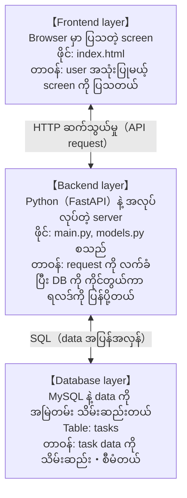
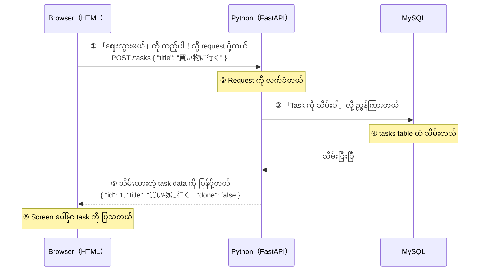

# အပိုသင်ခန်းစာ：Task စီမံခန့်ခွဲမှု system တစ်ခု တည်ဆောက်ကြစို့

> 🇯🇵 မူရင်း (ဂျပန်ဘာသာဖြင့်): [00_概要とシステム設計.md](<../../1年生_前期_ITシステム基礎/番外編/00_概要とシステム設計.md>) <!-- original-ja-link -->

## ဒီတစ်ခါရဲ့ ပန်းတိုင်
- HTML + Python + MySQL ပါဝင်တဲ့ 3 layer ဖွဲ့စည်းပုံ system ကို နားလည်မယ်
- Python နဲ့ backend ကို implement လုပ်နိုင်မယ်
- Frontend（HTML）နဲ့ backend（Python）က API နဲ့ ချိတ်ဆက်အလုပ်လုပ်ပုံကို နားလည်မယ်

---

## 1. ဘာကို တည်ဆောက်မှာလဲ

**Task စီမံခန့်ခွဲမှု app（Todo app）**

```
┌─────────────────────────────────────────┐
│           タスク管理アプリ               │
│                                         │
│  [ やること一覧 ]                        │
│  □ 買い物に行く        [完了] [削除]    │
│  ☑ 宿題を終わらせる   [完了] [削除]    │
│  □ 部屋を掃除する      [完了] [削除]    │
│                                         │
│  新しいタスク: [____________] [追加]    │
└─────────────────────────────────────────┘
```

Screen မှာ「タスク管理アプリ」(task စီမံခန့်ခွဲမှု app)、「やること一覧」(လုပ်စရာ စာရင်း)、「買い物に行く」(ဈေးသွားမယ်)、「宿題を終わらせる」(အိမ်စာ ပြီးအောင်လုပ်မယ်)、「部屋を掃除する」(အခန်း သန့်ရှင်းရေးလုပ်မယ်)、「新しいタスク」(task အသစ်) ကို ပြထားတယ်။ ခလုတ်တွေက「完了」(ပြီးပြီ)、「削除」(ဖျက်မယ်)、「追加」(ထည့်မယ်) ဖြစ်ပါတယ်။

လုပ်နိုင်တာတွေ：
- Task စာရင်းကို ပြသခြင်း
- Task အသစ် ထည့်ခြင်း
- Task ကို ပြီး/မပြီး အဖြစ် ပြောင်းခြင်း
- Task ကို ဖျက်ခြင်း

---

## 2. System တစ်ခုလုံးရဲ့ ခြုံငုံပုံ

ဒီတစ်ခါ တည်ဆောက်မယ့် system ကို **layer 3 ခု** နဲ့ ဖွဲ့စည်းထားတယ်။



### ဆက်သွယ်မှု စီးဆင်းပုံ（ဥပမာ：task ထည့်တဲ့အခါ）



---

## 3. အသုံးပြုမယ့် နည်းပညာ

| တာဝန် | နည်းပညာ | ရှင်းလင်းချက် |
|------|------|------|
| Frontend | HTML + JavaScript | Browser မှာ ပြသတဲ့ screen |
| Backend | Python + FastAPI | API server |
| DB ချိတ်ဆက်မှု | SQLAlchemy | Python ကနေ MySQL ကို ကိုင်တွယ်တဲ့ library |
| Database | MySQL | Data သိမ်းဆည်းတဲ့ software |

### FastAPI ကို ရွေးချယ်ရတဲ့ အကြောင်းရင်း

- ရိုးရှင်းပြီး စတင်လေ့လာသူတွေတောင် ဖတ်ရလွယ်တဲ့ code ကို ရေးနိုင်တယ်
- `http://localhost:8000/docs` ကို ဖွင့်လိုက်ရုံနဲ့ API စမ်းသပ်တဲ့ screen ကို အလိုအလျောက် ဖန်တီးပေးတယ်
- Python ရဲ့ class（OOP）ကို သဘာဝကျကျ သုံးတဲ့ design ဖြစ်တယ်

---

## 4. Folder ဖွဲ့စည်းပုံ

```
my_todo_app/
├── main.py          ← app ကို စတင်တဲ့ ဖိုင်（entry point）
├── database.py      ← MySQL ချိတ်ဆက်မှု setting
├── models.py        ← database table သတ်မှတ်ချက်（class နဲ့ ရေးတယ်）
├── schemas.py       ← API data ပုံစံ သတ်မှတ်ချက်（class နဲ့ ရေးတယ်）
├── routers/
│   └── tasks.py     ← task နဲ့ ဆိုင်တဲ့ API routing
└── static/
    └── index.html   ← frontend ရဲ့ HTML ဖိုင်
```

---

## 5. ပတ်ဝန်းကျင် တည်ဆောက်ခြင်း

### MySQL ပြင်ဆင်ခြင်း

MySQL install လုပ်တာ・database ဖန်တီးတဲ့ အဆင့်တွေက OS အလိုက် ကွာပါတယ်။
→ **[01_MySQL環境構築.md](./01_MySQL環境構築.md)** ကို ကြည့်ပါ။

### Python package များ install လုပ်ခြင်း

#### Mac

Mac မှာ `pip3 install` ကို တိုက်ရိုက် run ရင် အောက်ပါ error ပေါ်လာတယ်：
```
error: externally-managed-environment
```

**Virtual environment（venv）** ကို အရင် ဖန်တီးပြီးမှ install လုပ်ပါ။

```bash
# Project folder ထဲမှာ run လုပ်ပါ
python3 -m venv venv

# Virtual environment ကို activate လုပ်ပါ（prompt မှာ (venv) ပေါ်ရင် OK）
source venv/bin/activate

# Activate လုပ်ပြီးမှ install လုပ်ပါ
pip install fastapi uvicorn sqlalchemy pymysql
```

#### Windows

Windows မှာတော့ ဒီအတိုင်း install လုပ်လို့ ရတယ်။

```cmd
pip install fastapi uvicorn sqlalchemy pymysql
```

Virtual environment သုံးချင်ရင်（အကြံပြုပါတယ်）：

```cmd
python -m venv venv
venv\Scripts\activate
pip install fastapi uvicorn sqlalchemy pymysql
```

| Package | တာဝန် |
|-----------|------|
| `fastapi` | Web API framework |
| `uvicorn` | FastAPI ကို run ပေးတဲ့ server |
| `sqlalchemy` | Python ကနေ DB ကို ကိုင်တွယ်တဲ့ library |
| `pymysql` | Python ကနေ MySQL ကို ချိတ်ဆက်တဲ့ driver |

### Virtual environment ဆိုတာ ဘာလဲ？

```
Virtual environment = project တစ်ခုအတွက် သီးသန့် Python ပတ်ဝန်းကျင်

System တစ်ခုလုံးရဲ့ Python         Project သီးသန့် Python
（မထိရဘူး）                   （package တွေကို စိတ်ကြိုက် ထည့်လို့ရတယ်）
      │                              │
      │  python3 -m venv venv（Mac） │
      │  python -m venv venv（Win）  │
      └──────────────────────────→  venv/
                                      ├── bin/      （Mac）
                                      ├── Scripts/  （Windows）
                                      └── lib/...
```

တစ်ခါ ဖန်တီးပြီးရင် **terminal ဖွင့်တိုင်း activate လုပ်ဖို့** လိုတယ်：

```bash
source venv/bin/activate   # Mac
```
```cmd
venv\Scripts\activate      # Windows
```

### Server စတင်နည်း

**Mac（virtual environment ကို activate လုပ်ပြီးမှ စတင်ပါ）：**
```bash
source venv/bin/activate
uvicorn main:app --reload
```

**Windows（virtual environment မသုံးတဲ့အခါ）：**
```cmd
uvicorn main:app --reload
```

စတင်ပြီးရင် browser မှာ အောက်ပါတွေကို ဖွင့်ပါ：
- App screen: `http://localhost:8000`
- API document: `http://localhost:8000/docs`

---

## 6. လေ့လာပုံ အစီအစဉ်

| အဆင့် | သင်ထောက်ကူ | အကြောင်းအရာ |
|---------|------|------|
| 1 | 01_MySQL環境構築 | MySQL install လုပ်ခြင်းနဲ့ DB ဖန်တီးခြင်း |
| 2 | 02_Python_OOP入門 | Class ဆိုတာ ဘာလဲ၊ ဘာကြောင့် သုံးတာလဲ |
| 3 | 03_FastAPI入門 | API server ရဲ့ အခြေခံကို တည်ဆောက်မယ် |
| 4 | 04_データベース連携 | MySQL နဲ့ ချိတ်ပြီး data သိမ်းမယ် |
| 5 | 05_CRUD_API実装 | စာရင်းပြ・ထည့်・ပြင်・ဖျက် ကို implement လုပ်မယ် |
| 6 | 06_フロントエンド連携 | HTML screen ကနေ API ကို ခေါ်မယ် |

---

> နောက်တစ်ဆင့် → [01_MySQL環境構築.md](./01_MySQL環境構築.md)
