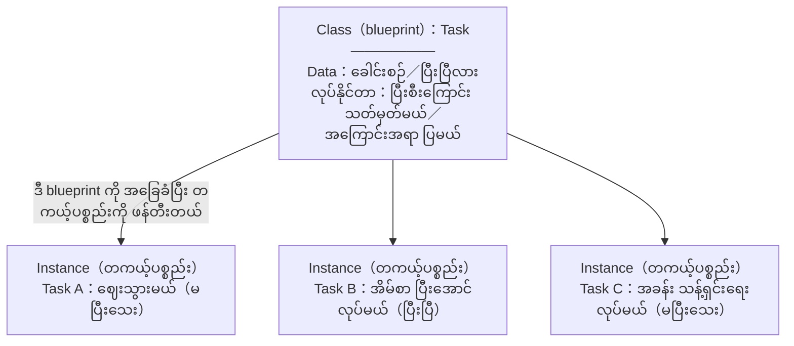

# Python Object-Oriented Programming မိတ်ဆက်

> 🇯🇵 မူရင်း (ဂျပန်ဘာသာဖြင့်): [02_Python_OOP入門.md](<../../1年生_前期_ITシステム基礎/番外編/02_Python_OOP入門.md>) <!-- original-ja-link -->

## ဒီတစ်ခါရဲ့ ပန်းတိုင်
- 「Class」နဲ့「Instance」ရဲ့ ကွာခြားချက်ကို ရှင်းပြနိုင်မယ်
- `__init__` method ရဲ့ တာဝန်ကို နားလည်မယ်
- Class ကို သုံးပြီး data နဲ့ လုပ်ဆောင်ချက်တွေကို တစ်စုတစ်စည်းတည်း ထားနိုင်မယ်

---

## 1. Object-oriented ဆိုတာ ဘာလဲ？

Program ရေးတဲ့အခါ **ဆက်စပ်နေတဲ့ data နဲ့ လုပ်ဆောင်ချက်တွေကို တစ်စုတစ်စည်းတည်း စုထားတဲ့** တွေးခေါ်ပုံ ဖြစ်ပါတယ်။

### ဥပမာနဲ့ နားလည်ကြစို့：「ဒီဇိုင်းပုံစံ（blueprint）」နဲ့「တကယ့်ပစ္စည်း」



**Class** = blueprint（တစ်ခုတည်းသာ ရှိတယ်）
**Instance** = blueprint ကနေ ဖန်တီးထားတဲ့ တကယ့်ပစ္စည်း（ကြိုက်သလောက် ဖန်တီးလို့ရတယ်）

---

## 2. Class ရေးကြည့်ကြစို့

### အဆင့် 1：အရိုးရှင်းဆုံး class

```python
# Class သတ်မှတ်ခြင်း
class Task:
    pass  # ဘာမှ မရှိသေးဘူး
```

```python
# Instance ဖန်တီးတယ်
task1 = Task()  # Task class ကနေ instance ဖန်တီးတယ်
task2 = Task()  # နောက်တစ်ခုလည်း ဖန်တီးလို့ရတယ်

print(task1)  # <__main__.Task object at 0x...>
print(task2)  # <__main__.Task object at 0x...> ← instance မတူဘူး
```

---

### အဆင့် 2：Data ထည့်ပေးခြင်း（`__init__`）

`__init__` က **instance ဖန်တီးတဲ့အခါ အလိုအလျောက် ခေါ်ခံရတဲ့ အထူး method** ဖြစ်တယ်။
「Constructor」လို့လည်း ခေါ်ပါတယ်။

```python
class Task:
    # Instance ဖန်တီးတဲ့အခါ အလိုအလျောက် ခေါ်ခံရတယ်
    def __init__(self, title):
        # self = 「ဒီ instance ကိုယ်တိုင်」ကို ညွှန်းတယ်
        self.title = title       # ခေါင်းစဉ်ကို သိမ်းတယ်
        self.done = False        # အစမှာ မပြီးသေး

# Instance ဖန်တီးတယ်（ဒီအချိန်မှာ __init__ ကို ခေါ်တယ်）
task1 = Task("買い物に行く")
task2 = Task("宿題を終わらせる")

# Instance ရဲ့ data ကို ရယူတယ်
print(task1.title)  # 買い物に行く
print(task1.done)   # False
print(task2.title)  # 宿題を終わらせる
```

ဒီ page ရဲ့ ဥပမာတွေမှာ「買い物に行く」က ဈေးသွားမယ်、「宿題を終わらせる」က အိမ်စာ ပြီးအောင်လုပ်မယ်、「部屋を掃除する」က အခန်း သန့်ရှင်းရေးလုပ်မယ်、「テスト用タスク」က စမ်းသပ်ဖို့ task ကို ဆိုလိုပါတယ်။「〜を完了にしました！」က「〜 ကို ပြီးစီးကြောင်း သတ်မှတ်လိုက်ပါပြီ！」လို့ ဆိုလိုပါတယ်။

**အချက်：`self` ဆိုတာ ဘာလဲ？**
```
task1 = Task("買い物に行く")
          ↑
    ဒီ instance（task1）က self ဖြစ်လာတယ်

self.title = title
→ task1.title = "買い物に行く" နဲ့ အဓိပ္ပာယ်တူတယ်
```

---

### အဆင့် 3：Method ထည့်ခြင်း

Method ဆိုတာ **class ထဲမှာ သတ်မှတ်ထားတဲ့ function** ကို ခေါ်တာပါ။

```python
class Task:
    def __init__(self, title):
        self.title = title
        self.done = False

    # ပြီးစီးကြောင်း သတ်မှတ်တဲ့ method
    def complete(self):
        self.done = True
        print(f"「{self.title}」を完了にしました！")

    # အကြောင်းအရာကို ပြတဲ့ method
    def show(self):
        status = "☑" if self.done else "□"
        print(f"{status} {self.title}")
```

```python
# သုံးကြည့်တယ်
task1 = Task("買い物に行く")
task2 = Task("宿題を終わらせる")

task1.show()      # □ 買い物に行く
task2.show()      # □ 宿題を終わらせる

task2.complete()  # 「宿題を終わらせる」を完了にしました！

task1.show()      # □ 買い物に行く
task2.show()      # ☑ 宿題を終わらせる
```

---

## 3. Class မသုံးတဲ့အခါနဲ့ နှိုင်းယှဉ်ခြင်း

**Class မသုံးတဲ့အခါ：**

```python
# Data တွေ ပြန့်ကျဲနေလို့ စီမံရခက်တယ်
title1 = "買い物に行く"
done1 = False

title2 = "宿題を終わらせる"
done2 = False

# ပြီးစီးကြောင်း သတ်မှတ်တဲ့ လုပ်ဆောင်ချက်ကိုလည်း သီးခြားစီ ရေးရတယ်
done2 = True
print(f"「{title2}」を完了にしました！")

# Task တွေ များလာရင်... title3, done3, title4, done4... အဆုံးမရှိဘူး
```

**Class သုံးတဲ့အခါ：**

```python
# Data နဲ့ လုပ်ဆောင်ချက် တစ်စုတစ်စည်းတည်း！Task တွေ များလာလည်း စီမံရလွယ်တယ်
tasks = [
    Task("買い物に行く"),
    Task("宿題を終わらせる"),
    Task("部屋を掃除する"),
]

# အားလုံးကို ပြတယ်
for task in tasks:
    task.show()
```

---

## 4. ဒီ system မှာ OOP ကို သုံးမယ့်နေရာ

OOP（Object-Oriented Programming）ကို ဒီ system ရဲ့ **အရေးကြီးတဲ့ နေရာ 2 ခု** မှာ သုံးပါတယ်။

### ① Database table သတ်မှတ်ချက်（models.py）

```python
# Table = class、data တစ်တန်း = instance
class Task(Base):
    __tablename__ = "tasks"

    id = Column(Integer, primary_key=True)
    title = Column(String(200))
    done = Column(Boolean, default=False)
```

### ② API data ပုံစံ သတ်မှတ်ချက်（schemas.py）

```python
# Request/response ရဲ့ data ပုံစံကို class နဲ့ ဖော်ပြတယ်
class TaskCreate(BaseModel):
    title: str  # လက်ခံမယ့် data：ခေါင်းစဉ်ပဲ

class TaskResponse(BaseModel):
    id: int
    title: str
    done: bool  # ပြန်ပို့မယ့် data：id・ခေါင်းစဉ်・ပြီးမပြီး flag
```

Class ကို သုံးလိုက်တာနဲ့ **ဘယ်လို data ကို ကိုင်တွယ်မလဲဆိုတာ တစ်ချက်ကြည့်ရုံနဲ့ သိနိုင်တဲ့** code ဖြစ်လာတယ်။

---

## 5. လေ့ကျင့်ကြည့်ကြစို့

အောက်ပါ class ကို ပြီးအောင် ရေးပါ။

```python
class Task:
    def __init__(self, title):
        self.title = title
        self.done = False

    def complete(self):
        # ဒီနေရာမှာ「ပြီးစီးကြောင်း သတ်မှတ်တဲ့」လုပ်ဆောင်ချက်ကို ရေးပါ
        pass

    def show(self):
        # ဒီနေရာမှာ「အကြောင်းအရာကို ပြတဲ့」လုပ်ဆောင်ချက်ကို ရေးပါ
        pass

# စမ်းသပ်ခြင်း
t = Task("テスト用タスク")
t.show()     # □ テスト用タスク  လို့ ပေါ်ရမယ်
t.complete()
t.show()     # ☑ テスト用タスク  လို့ ပေါ်ရမယ်
```

---

> ရှေ့တစ်ဆင့် → [01_MySQL環境構築.md](./01_MySQL環境構築.md)
> နောက်တစ်ဆင့် → [03_FastAPI入門.md](./03_FastAPI入門.md)
