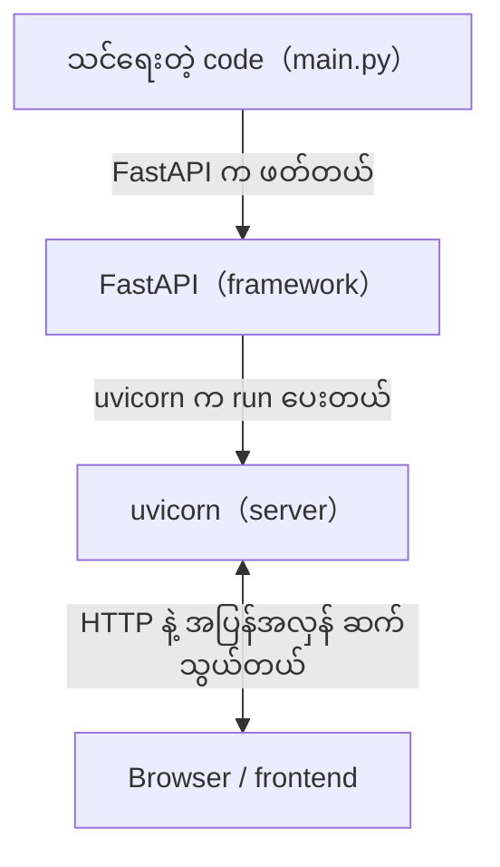
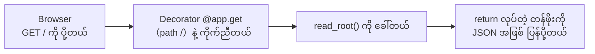

# FastAPI မိတ်ဆက်

> 🇯🇵 မူရင်း (ဂျပန်ဘာသာဖြင့်): [03_FastAPI入門.md](<../../1年生_前期_ITシステム基礎/番外編/03_FastAPI入門.md>) <!-- original-ja-link -->

## ဒီတစ်ခါရဲ့ ပန်းတိုင်
- FastAPI နဲ့ ရိုးရှင်းတဲ့ API server တစ်ခုကို စတင်နိုင်မယ်
- `@app.get` လို decorator တွေရဲ့ အဓိပ္ပာယ်ကို နားလည်မယ်
- Swagger UI နဲ့ browser ကနေ API ကို စမ်းသပ်နိုင်မယ်

---

## 1. FastAPI ဆိုတာ ဘာလဲ？

**FastAPI = Python နဲ့ API server တည်ဆောက်ဖို့အတွက် framework**

Framework ဆိုတာ 「မကြာခဏ သုံးတဲ့ လုပ်ဆောင်ချက်တွေကို စုစည်းထားတဲ့ အသုံးဝင်တဲ့ ကိရိယာသေတ္တာ」ပါ။



---

## 2. Hello World ဖန်တီးခြင်း

အရင်ဆုံး အရိုးရှင်းဆုံး API server တစ်ခုကို ဖန်တီးကြည့်ကြစို့။

### main.py

```python
from fastapi import FastAPI

# FastAPI ရဲ့ instance ကို ဖန်တီးတယ်（app ရဲ့ ပင်မအစိတ်အပိုင်း）
app = FastAPI()

# "/" ကို ဝင်ကြည့်တဲ့အခါ လုပ်မယ့် လုပ်ဆောင်ချက်
@app.get("/")
def read_root():
    return {"message": "Hello, World!"}
```

### စတင်ခြင်း

**Windows / Mac နှစ်မျိုးစလုံးအတွက်：**
```bash
uvicorn main:app --reload
```

```
INFO:     Uvicorn running on http://127.0.0.1:8000
INFO:     Application startup complete.
```

Browser မှာ `http://localhost:8000` ကို ဖွင့်လိုက်ရင်：
```json
{"message": "Hello, World!"}
```

---

## 3. Decorator ကို နားလည်ခြင်း

Code ထဲမှာ ပါတဲ့ `@app.get("/")` ကို **decorator** လို့ ခေါ်တယ်။

```python
@app.get("/")          # ← decorator
def read_root():       # ← ဒီ function ကို「/ ကို GET request ရောက်လာရင် ခေါ်မယ်」လို့ သတ်မှတ်ထားတယ်
    return {...}
```

Request ရောက်လာတဲ့အချိန်ကနေ response ပြန်ပို့တဲ့အထိ လုပ်ဆောင်ပုံက အောက်ပါအတိုင်းပါ။



### HTTP method နဲ့ decorator ရဲ့ ဆက်စပ်မှု

| လုပ်ချင်တာ | HTTP method | Decorator |
|------------|-------------|-----------|
| Data ကို ရယူမယ် | GET | `@app.get(...)` |
| Data အသစ် ဖန်တီးမယ် | POST | `@app.post(...)` |
| Data ကို update လုပ်မယ် | PUT | `@app.put(...)` |
| Data ကို ဖျက်မယ် | DELETE | `@app.delete(...)` |

---

## 4. Path parameter（URL ထဲမှာ တန်ဖိုး ထည့်ခြင်း）

```python
@app.get("/tasks/{task_id}")
def get_task(task_id: int):  # URL ထဲက {task_id} ကို argument အဖြစ် ပေးပို့လာတယ်
    return {"task_id": task_id, "title": "サンプルタスク"}
```

`http://localhost:8000/tasks/3` ကို ဝင်ကြည့်လိုက်ရင်：
```json
{"task_id": 3, "title": "サンプルタスク"}
```

「サンプルタスク」က “နမူနာ task” လို့ အဓိပ္ပာယ်ရပါတယ်။

---

## 5. Swagger UI — API စမ်းသပ်တဲ့ screen

FastAPI ရဲ့ အသုံးဝင်တဲ့ လုပ်ဆောင်ချက်တွေထဲက တစ်ခုက **Swagger UI** ပါ။
Code ရေးရုံနဲ့ **browser မှာ API ကို စမ်းသပ်နိုင်တဲ့ screen ကို အလိုအလျောက် ဖန်တီးပေးတယ်**။

`http://localhost:8000/docs` ကို ဖွင့်လိုက်ရင် အောက်ပါလို screen ပေါ်လာတယ်：

```
┌────────────────────────────────────────────┐
│  FastAPI                                   │
│                                            │
│  GET  /        Hello World ကို ပြန်ပို့တယ်      │
│  ▼ Try it out                              │
│    [Execute]                               │
│                                            │
│  Response:                                 │
│  {"message": "Hello, World!"}              │
└────────────────────────────────────────────┘
```

**Development လုပ်နေစဉ် Swagger UI နဲ့ အလုပ်လုပ်ပုံကို စစ်ဆေးရင် အဆင်ပြေတယ်။**

---

## 6. Task စီမံခန့်ခွဲမှု API ရဲ့ အရိုးစုကို တည်ဆောက်ခြင်း

တကယ့် system အတွက် task စီမံခန့်ခွဲမှု API ရဲ့ အရိုးစုကို တည်ဆောက်ပါမယ်။

```python
# main.py
from fastapi import FastAPI
from fastapi.staticfiles import StaticFiles

app = FastAPI()

# static folder ထဲက HTML ဖိုင်တွေကို ပေးပို့ဖို့ setting
app.mount("/static", StaticFiles(directory="static"), name="static")

# Root（/）ကို ဝင်ကြည့်ရင် index.html ကို ပြသတယ်
from fastapi.responses import FileResponse

@app.get("/")
def read_index():
    return FileResponse("static/index.html")


# --- Task နဲ့ ဆိုင်တဲ့ API（နောက်အဆင့်တွေမှာ ပြီးအောင်လုပ်မယ်） ---

@app.get("/tasks")
def get_tasks():
    # Task စာရင်းကို ပြန်ပို့တယ်（နောက်မှ DB နဲ့ ချိတ်မယ်）
    return []

@app.post("/tasks")
def create_task():
    # Task ကို ဖန်တီးတယ်（နောက်မှ DB နဲ့ ချိတ်မယ်）
    return {"message": "タスクを作成しました"}

@app.put("/tasks/{task_id}")
def toggle_task(task_id: int):
    # Task ရဲ့ ပြီး/မပြီး ကို ပြောင်းတယ်（နောက်မှ DB နဲ့ ချိတ်မယ်）
    return {"message": f"タスク {task_id} を更新しました"}

@app.delete("/tasks/{task_id}")
def delete_task(task_id: int):
    # Task ကို ဖျက်တယ်（နောက်မှ DB နဲ့ ချိတ်မယ်）
    return {"message": f"タスク {task_id} を削除しました"}
```

ပြန်ပို့တဲ့ message တွေမှာ「タスクを作成しました」က “Task ကို ဖန်တီးပြီးပါပြီ”、「タスク {task_id} を更新しました」က “Task {task_id} ကို update လုပ်ပြီးပါပြီ”、「タスク {task_id} を削除しました」က “Task {task_id} ကို ဖျက်ပြီးပါပြီ” လို့ အဓိပ္ပာယ်ရပါတယ်။

### စတင်ပြီး စစ်ဆေးခြင်း

**Windows / Mac နှစ်မျိုးစလုံးအတွက်：**
```bash
uvicorn main:app --reload
```

`http://localhost:8000/docs` ကို ဖွင့်ပြီး endpoint 4 ခု ပေါ်နေတာကို စစ်ဆေးကြည့်ပါ။

```
GET    /tasks      Task စာရင်း ရယူခြင်း
POST   /tasks      Task ဖန်တီးခြင်း
PUT    /tasks/{id} ပြီး/မပြီး ပြောင်းခြင်း
DELETE /tasks/{id} Task ဖျက်ခြင်း
```

---

## 7. ဒီအထိ သင်ခဲ့တဲ့ အဓိကအချက်များကို ပြန်စုစည်းခြင်း

```
① FastAPI ရဲ့ instance ကို ဖန်တီးတယ်
   app = FastAPI()

② Decorator နဲ့ URL နဲ့ method ကို သတ်မှတ်တယ်
   @app.get("/tasks")

③ အဲဒီအောက်က function က တကယ့် လုပ်ဆောင်ချက် ဖြစ်လာတယ်
   def get_tasks():
       return [...]

④ Function က return လုပ်တဲ့ တန်ဖိုးက JSON အဖြစ် response ဖြစ်လာတယ်
   return [{"id": 1, "title": "買い物"}]
   → Browser ဆီကို [{"id": 1, "title": "買い物"}] ပြန်ရောက်တယ်
```

「買い物」က “ဈေးဝယ်ခြင်း” လို့ အဓိပ္ပာယ်ရပါတယ်။

---

> ရှေ့တစ်ဆင့် → [02_Python_OOP入門.md](./02_Python_OOP入門.md)
> နောက်တစ်ဆင့် → [04_データベース連携.md](./04_データベース連携.md)
