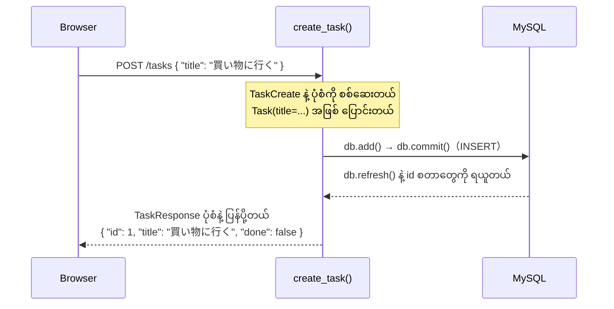

# CRUD API ကို implement လုပ်ခြင်း

> 🇯🇵 မူရင်း (ဂျပန်ဘာသာဖြင့်): [05_CRUD_API実装.md](<../../1年生_前期_ITシステム基礎/番外編/05_CRUD_API実装.md>) <!-- original-ja-link -->

## ဒီတစ်ခါရဲ့ ပန်းတိုင်
- Pydantic schema class နဲ့ data ပုံစံကို သတ်မှတ်နိုင်မယ်
- GET / POST / PUT / DELETE ဆိုတဲ့ API 4 ခုကို implement လုပ်နိုင်မယ်
- Swagger UI နဲ့ API တစ်ခုချင်းစီရဲ့ အလုပ်လုပ်ပုံကို စစ်ဆေးနိုင်မယ်

---

## 1. CRUD ဆိုတာ ဘာလဲ？

**CRUD** = data ကိုင်တွယ်မှုရဲ့ အခြေခံပုံစံ 4 မျိုးရဲ့ ရှေ့ဆုံးစာလုံးများ

| စာလုံး | လုပ်ဆောင်ချက် | SQL | HTTP method |
|------|------|-----|-------------|
| C | Create（ဖန်တီး） | INSERT | POST |
| R | Read（ရယူ） | SELECT | GET |
| U | Update（ပြင်ဆင်） | UPDATE | PUT |
| D | Delete（ဖျက်） | DELETE | DELETE |

---

## 2. schemas.py — API ရဲ့ data ပုံစံကို သတ်မှတ်ခြင်း

**Pydantic** ဆိုတာ class ကို သုံးပြီး data ပုံစံကို သတ်မှတ်ပေးတဲ့ library ပါ။
FastAPI နဲ့ တွဲသုံးရင် **request/response data ကို အလိုအလျောက် စစ်ဆေးပေး**တယ်။

```python
# schemas.py

from pydantic import BaseModel

# Task ဖန်တီးတဲ့အခါ လက်ခံမယ့် data
class TaskCreate(BaseModel):
    title: str  # ခေါင်းစဉ်ကိုပဲ လက်ခံတယ်（id နဲ့ done ကို server က ဆုံးဖြတ်တယ်）

# API response မှာ ပြန်ပို့မယ့် data
class TaskResponse(BaseModel):
    id: int
    title: str
    done: bool

    # SQLAlchemy model object ကို ဒီအတိုင်း ပေးပို့လို့ရအောင် လုပ်တဲ့ setting
    class Config:
        from_attributes = True
```

### Schema ကို ဘာကြောင့် သီးခြားဖိုင်မှာ ရေးတာလဲ？

```
models.py  → database ရဲ့ ပုံစံ（ဘယ်လို သိမ်းမလဲ）
schemas.py → API ရဲ့ ပုံစံ（ဘယ် data ကို လက်ခံ/ပြန်ပို့မလဲ）

ဥပမာ：task ဖန်တီးတဲ့အခါ
  လက်ခံ（TaskCreate）: title ပဲ
  ပြန်ပို့（TaskResponse）: id + title + done
  သိမ်း（Task model）:    id + title + done（id ကို အလိုအလျောက် နံပါတ်တပ်တယ်）
```

---

## 3. routers/tasks.py — API 4 ခုကို implement လုပ်ခြင်း

```python
# routers/tasks.py

from fastapi import APIRouter, Depends, HTTPException
from sqlalchemy.orm import Session
from database import get_db
from models import Task
from schemas import TaskCreate, TaskResponse

# Router = URL တွေရဲ့ အစုအဝေး（ဒီမှာ /tasks နဲ့ ဆိုင်တဲ့ API တွေကို စုထားတယ်）
router = APIRouter(prefix="/tasks", tags=["tasks"])
```

---

### R — Task စာရင်း ရယူခြင်း（GET /tasks）

```python
# ⚠️ "/" မဟုတ်ဘဲ "" လို့ ထားပါ（"/" ထားရင် /tasks → /tasks/ ကို redirect ဖြစ်သွားတယ်）
@router.get("", response_model=list[TaskResponse])
def get_tasks(db: Session = Depends(get_db)):
    """Task အားလုံးကို ရယူပြီး ပြန်ပို့တယ်"""
    tasks = db.query(Task).all()  # SELECT * FROM tasks
    return tasks
```

**`Depends(get_db)` ဆိုတာ ဘာလဲ？**
```
db: Session = Depends(get_db)
↑
「get_db function ရဲ့ ရလဒ်（DB session）ကို db ထဲ ထည့်ပေးပါ」
လို့ ဆိုလိုတာပါ။ API ကို ခေါ်တိုင်း DB ချိတ်ဆက်မှုကို ပြင်ဆင်ပေးတယ်။
```

---

### C — Task ဖန်တီးခြင်း（POST /tasks）

```python
@router.post("", response_model=TaskResponse)
def create_task(task_in: TaskCreate, db: Session = Depends(get_db)):
    """Task အသစ်ကို ဖန်တီးတယ်"""
    # လက်ခံရရှိတဲ့ data（TaskCreate）ကို Task model ရဲ့ instance အဖြစ် ပြောင်းတယ်
    new_task = Task(title=task_in.title)

    db.add(new_task)    # DB ထဲ ထည့်ဖို့ ပြင်ဆင်တယ်
    db.commit()         # DB ထဲ သိမ်းတယ်（INSERT လုပ်တယ်）
    db.refresh(new_task)  # DB က အလိုအလျောက် သတ်မှတ်ပေးတဲ့ id စတာတွေကို ရယူတယ်
    return new_task
```

POST /tasks ကို ခေါ်တဲ့အခါ လုပ်ဆောင်ပုံကို ပုံနဲ့ပြရင် အောက်ပါအတိုင်း ဖြစ်တယ်။ ဥပမာထဲက `買い物に行く` က “ဈေးသွားမယ်” လို့ အဓိပ္ပာယ်ရပါတယ်။



---

### U — ပြီး/မပြီး ပြောင်းခြင်း（PUT /tasks/{task_id}）

```python
@router.put("/{task_id}", response_model=TaskResponse)
def toggle_task(task_id: int, db: Session = Depends(get_db)):
    """Task ရဲ့ ပြီး/မပြီး ကို ပြောင်းတယ်"""
    # သက်ဆိုင်တဲ့ task ကို ရယူတယ်
    task = db.query(Task).filter(Task.id == task_id).first()

    # Task ရှာမတွေ့ရင် 404 error
    if task is None:
        raise HTTPException(status_code=404, detail="タスクが見つかりません")

    # done ကို ပြောင်းပြန်လုပ်တယ်（True → False、False → True）
    task.done = not task.done

    db.commit()         # DB ထဲ သိမ်းတယ်（UPDATE လုပ်တယ်）
    db.refresh(task)
    return task
```

`タスクが見つかりません` က “Task ကို ရှာမတွေ့ပါ” လို့ အဓိပ္ပာယ်ရပါတယ်။

---

### D — Task ဖျက်ခြင်း（DELETE /tasks/{task_id}）

```python
@router.delete("/{task_id}")
def delete_task(task_id: int, db: Session = Depends(get_db)):
    """Task ကို ဖျက်တယ်"""
    task = db.query(Task).filter(Task.id == task_id).first()

    if task is None:
        raise HTTPException(status_code=404, detail="タスクが見つかりません")

    db.delete(task)     # ဖျက်ဖို့ ပြင်ဆင်တယ်
    db.commit()         # DB ထဲကနေ ဖျက်တယ်（DELETE လုပ်တယ်）
    return {"message": f"タスク '{task.title}' を削除しました"}
```

`タスク '{task.title}' を削除しました` က “Task '{task.title}' ကို ဖျက်ပြီးပါပြီ” လို့ အဓိပ္ပာယ်ရပါတယ်။

---

## 4. main.py မှာ router ကို မှတ်ပုံတင်ခြင်း

```python
# main.py（ပြီးဆုံးဗားရှင်း）

from fastapi import FastAPI
from fastapi.staticfiles import StaticFiles
from fastapi.responses import FileResponse
from database import engine, Base
import models
from routers import tasks  # ← ထပ်ထည့်တယ်

# Table ကို အလိုအလျောက် ဖန်တီးတယ်
Base.metadata.create_all(bind=engine)

app = FastAPI()

# Router ကို မှတ်ပုံတင်တယ်（/tasks အောက်က API တွေ အသက်ဝင်လာတယ်）
app.include_router(tasks.router)  # ← ထပ်ထည့်တယ်

app.mount("/static", StaticFiles(directory="static"), name="static")

@app.get("/")
def read_index():
    return FileResponse("static/index.html")
```

---

## 5. ဖိုင်ဖွဲ့စည်းပုံ（လက်ရှိအခြေအနေ）

```
my_todo_app/
├── main.py         ← router မှတ်ပုံတင်ခြင်း ထည့်ပြီးသား
├── database.py     ← DB ချိတ်ဆက်မှု setting
├── models.py       ← Task table သတ်မှတ်ချက်
├── schemas.py      ← ★ ဒီတစ်ခါ ဖန်တီး：data ပုံစံ သတ်မှတ်ချက်
├── routers/
│   ├── __init__.py ← ဖိုင်အလွတ်（folder ကို Python package အဖြစ် အသိအမှတ်ပြုစေတယ်）
│   └── tasks.py    ← ★ ဒီတစ်ခါ ဖန်တီး：CRUD API
└── static/
    └── index.html  ← နောက်အဆင့်မှာ ဖန်တီးမယ်
```

`routers/__init__.py` က ဖိုင်အလွတ်ဆိုရင် OK ပါ：

**Windows:**
```cmd
type nul > routers\__init__.py
```

**Mac:**
```bash
touch routers/__init__.py
```

---

## 6. Swagger UI နဲ့ အလုပ်လုပ်ပုံ စစ်ဆေးခြင်း

**Windows / Mac နှစ်မျိုးစလုံးအတွက်：**
```bash
uvicorn main:app --reload
```

`http://localhost:8000/docs` ကို ဖွင့်ပြီး စစ်ဆေးပါ။

**စစ်ဆေးမယ့် အဆင့်များ（POST → GET → PUT → DELETE အစီအစဉ်အတိုင်း）：**

1. **POST /tasks** ကို click → `Try it out` → Request body မှာ ရိုက်ထည့်ပါ：
   ```json
   {"title": "買い物に行く"}
   ```
   → `Execute` → Response မှာ `{"id": 1, "title": "買い物に行く", "done": false}` ပြန်လာရမယ်

2. **GET /tasks** ကို click → `Try it out` → `Execute`
   → ဖန်တီးခဲ့တဲ့ task က စာရင်းထဲမှာ ပြန်လာရမယ်

3. **PUT /tasks/{task_id}** ကို click → `task_id` မှာ `1` ကို ရိုက်ထည့် → `Execute`
   → `"done": true` ဖြစ်သွားရမယ်

4. **DELETE /tasks/{task_id}** ကို click → `task_id` မှာ `1` ကို ရိုက်ထည့် → `Execute`
   → ဖျက်ပြီးကြောင်း message ပြန်လာရမယ်

---

> ရှေ့တစ်ဆင့် → [04_データベース連携.md](./04_データベース連携.md)
> နောက်တစ်ဆင့် → [06_フロントエンド連携.md](./06_フロントエンド連携.md)
