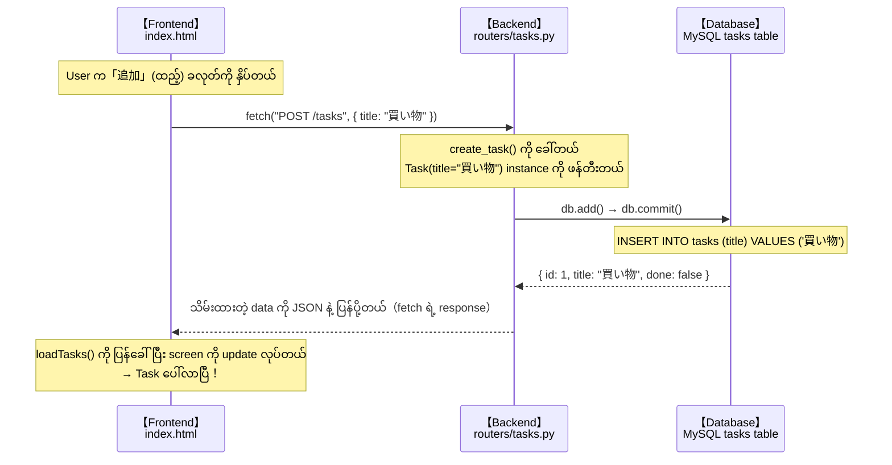

# Frontend ချိတ်ဆက်ခြင်း（HTML + JavaScript）

> 🇯🇵 မူရင်း (ဂျပန်ဘာသာဖြင့်): [06_フロントエンド連携.md](<../../1年生_前期_ITシステム基礎/番外編/06_フロントエンド連携.md>) <!-- original-ja-link -->

## ဒီတစ်ခါရဲ့ ပန်းတိုင်
- `fetch()` ကို သုံးပြီး Python API ကို ခေါ်နိုင်မယ်
- API ရဲ့ response ကို screen ပေါ်မှာ ပြသနိုင်မယ်（DOM ကို ကိုင်တွယ်ခြင်း）
- Task ထည့်ခြင်း・ပြီး/မပြီး ပြောင်းခြင်း・ဖျက်ခြင်းကို screen ကနေ လုပ်နိုင်မယ်

---

## 1. SPA（Single Page Application）ဆိုတာ ဘာလဲ？

ဒီတစ်ခါ တည်ဆောက်မယ့် frontend က **SPA** လို့ခေါ်တဲ့ ပုံစံပါ။

```
ရိုးရာ Web site（page ကူးပြောင်းမှု ရှိ）
  လုပ်ဆောင်တိုင်း page တစ်ခုလုံးကို ပြန် load လုပ်တယ်
  Page A → Page B → Page C ...

SPA（Single Page Application）
  HTML ဖိုင် 1 ခုတည်းကို သုံးပြီး JavaScript နဲ့ screen ကို အခြေအနေအလိုက် ပြောင်းလဲတယ်
  Page ကို ပြန် load လုပ်စရာမလိုဘူး → အသုံးပြုတဲ့အခါ မြန်ဆန်တယ်
```

ဒီတစ်ခါ **index.html ဖိုင် 1 ခုတည်း**နဲ့ အားလုံးကို တည်ဆောက်ပါမယ်။

---

## 2. Folder ပြင်ဆင်ခြင်း

**Windows:**
```cmd
mkdir static
type nul > static\index.html
```

**Mac:**
```bash
mkdir static
touch static/index.html
```

---

## 3. index.html — အပြီးသတ် code

```html
<!DOCTYPE html>
<html lang="ja">
<head>
  <meta charset="UTF-8">
  <meta name="viewport" content="width=device-width, initial-scale=1.0">
  <title>タスク管理アプリ</title>
  <style>
    body {
      font-family: Arial, sans-serif;
      max-width: 600px;
      margin: 40px auto;
      padding: 0 20px;
      background: #f5f5f5;
    }
    h1 { color: #333; }

    /* Task ထည့်တဲ့ form */
    .add-form {
      display: flex;
      gap: 8px;
      margin-bottom: 20px;
    }
    .add-form input {
      flex: 1;
      padding: 8px;
      font-size: 16px;
      border: 1px solid #ccc;
      border-radius: 4px;
    }
    .add-form button {
      padding: 8px 16px;
      background: #4CAF50;
      color: white;
      border: none;
      border-radius: 4px;
      cursor: pointer;
      font-size: 16px;
    }

    /* Task list */
    .task-list { list-style: none; padding: 0; }
    .task-item {
      display: flex;
      align-items: center;
      gap: 8px;
      background: white;
      padding: 12px;
      margin-bottom: 8px;
      border-radius: 4px;
      box-shadow: 0 1px 3px rgba(0,0,0,0.1);
    }
    .task-title { flex: 1; font-size: 16px; }
    .task-title.done {
      text-decoration: line-through;
      color: #999;
    }
    .btn-done {
      padding: 4px 12px;
      background: #2196F3;
      color: white;
      border: none;
      border-radius: 4px;
      cursor: pointer;
    }
    .btn-delete {
      padding: 4px 12px;
      background: #f44336;
      color: white;
      border: none;
      border-radius: 4px;
      cursor: pointer;
    }
  </style>
</head>
<body>

  <h1>タスク管理アプリ</h1>

  <!-- Task ထည့်တဲ့ form -->
  <div class="add-form">
    <input type="text" id="newTaskInput" placeholder="新しいタスクを入力...">
    <button onclick="addTask()">追加</button>
  </div>

  <!-- Task စာရင်း（JavaScript နဲ့ ပြန်ရေးတယ်） -->
  <ul class="task-list" id="taskList">
    <!-- ဒီနေရာမှာ task တွေ ပေါ်လာမယ် -->
  </ul>

  <script>
    // ============================================================
    // API ရဲ့ base URL（Python server ရဲ့ လိပ်စာ）
    // ============================================================
    const API_URL = "http://localhost:8000";

    // ============================================================
    // R — Task စာရင်းကို ရယူပြီး screen ပေါ်မှာ ပြသတယ်
    // ============================================================
    async function loadTasks() {
      // fetch() နဲ့ GET request ပို့တယ်
      const response = await fetch(`${API_URL}/tasks`);
      const tasks = await response.json();  // Response ကို JSON အဖြစ် ပြောင်းတယ်

      // Task list ကို အရင် ရှင်းလင်းတယ်
      const taskList = document.getElementById("taskList");
      taskList.innerHTML = "";

      // Task အရေအတွက်အတိုင်း <li> ဖန်တီးပြီး ထည့်တယ်
      tasks.forEach(task => {
        const li = document.createElement("li");
        li.className = "task-item";
        li.innerHTML = `
          <span class="task-title ${task.done ? 'done' : ''}">${task.title}</span>
          <button class="btn-done" onclick="toggleTask(${task.id})">
            ${task.done ? '未完了に戻す' : '完了'}
          </button>
          <button class="btn-delete" onclick="deleteTask(${task.id})">削除</button>
        `;
        taskList.appendChild(li);
      });
    }

    // ============================================================
    // C — Task ထည့်တယ်
    // ============================================================
    async function addTask() {
      const input = document.getElementById("newTaskInput");
      const title = input.value.trim();

      // ဘာမှ မရိုက်ထည့်ထားရင် ဘာမှ မလုပ်ဘူး
      if (!title) return;

      // fetch() နဲ့ POST request ပို့တယ်
      await fetch(`${API_URL}/tasks`, {
        method: "POST",
        headers: {
          "Content-Type": "application/json"  // JSON ပို့မယ်ဆိုတာ အသိပေးတယ်
        },
        body: JSON.stringify({ title: title })  // JavaScript object → JSON string
      });

      // Input ကွက်ကို ရှင်းပြီး စာရင်းကို ပြန် load လုပ်တယ်
      input.value = "";
      loadTasks();
    }

    // ============================================================
    // U — Task ရဲ့ ပြီးစီးမှု အခြေအနေကို ပြောင်းတယ်
    // ============================================================
    async function toggleTask(taskId) {
      // fetch() နဲ့ PUT request ပို့တယ်
      await fetch(`${API_URL}/tasks/${taskId}`, {
        method: "PUT"
      });

      loadTasks();  // စာရင်းကို ပြန် load လုပ်တယ်
    }

    // ============================================================
    // D — Task ကို ဖျက်တယ်
    // ============================================================
    async function deleteTask(taskId) {
      // fetch() နဲ့ DELETE request ပို့တယ်
      await fetch(`${API_URL}/tasks/${taskId}`, {
        method: "DELETE"
      });

      loadTasks();  // စာရင်းကို ပြန် load လုပ်တယ်
    }

    // ============================================================
    // Enter key နဲ့လည်း task ထည့်နိုင်အောင် လုပ်တယ်
    // ============================================================
    document.getElementById("newTaskInput").addEventListener("keydown", function(e) {
      if (e.key === "Enter") {
        addTask();
      }
    });

    // Page ဖွင့်တဲ့အခါ task စာရင်းကို load လုပ်တယ်
    loadTasks();
  </script>

</body>
</html>
```

---

## 4. Code ရဲ့ အရေးကြီးတဲ့ အချက်များ ရှင်းလင်းချက်

### `fetch()` ရဲ့ အခြေခံပုံစံ

```javascript
// GET（data ကို ရယူတယ်）
const response = await fetch("http://localhost:8000/tasks");
const data = await response.json();

// POST（data ကို ပို့တယ်）
await fetch("http://localhost:8000/tasks", {
  method: "POST",
  headers: { "Content-Type": "application/json" },
  body: JSON.stringify({ title: "買い物" })
});

// PUT（update လုပ်တယ်）
await fetch("http://localhost:8000/tasks/1", {
  method: "PUT"
});

// DELETE（ဖျက်တယ်）
await fetch("http://localhost:8000/tasks/1", {
  method: "DELETE"
});
```

### `async / await` ဆိုတာ ဘာလဲ？

```javascript
// API ဆက်သွယ်မှုက「အချိန်ယူရတဲ့ လုပ်ဆောင်ချက်」ဖြစ်လို့
// ရလဒ် ရတဲ့အထိ စောင့်ဖို့ လိုတယ်

async function loadTasks() {         // async = ဒီ function ထဲမှာ asynchronous လုပ်ဆောင်ချက် ပါတယ်
  const response = await fetch(...); // await = ဒီနေရာမှာ ရလဒ်ရောက်လာတဲ့အထိ စောင့်တယ်
  const tasks = await response.json();
  // ↑ response.json() လည်း အချိန်ယူရလို့ await လိုတယ်
}
```

### DOM ကိုင်တွယ်ခြင်း（screen ကို ပြန်ရေးခြင်း）

```javascript
// DOM = HTML element တွေကို JavaScript နဲ့ ကိုင်တွယ်တဲ့ စနစ်

// id="taskList" ရှိတဲ့ element ကို ရယူတယ်
const taskList = document.getElementById("taskList");

// အထဲက အကြောင်းအရာကို ရှင်းတယ်
taskList.innerHTML = "";

// Element အသစ် ဖန်တီးပြီး ထည့်တယ်
const li = document.createElement("li");
li.innerHTML = `<span>${task.title}</span>`;
taskList.appendChild(li);
```

---

## 5. အလုပ်လုပ်ပုံ စစ်ဆေးခြင်း

### စတင်ခြင်း

**Windows / Mac နှစ်မျိုးစလုံးအတွက်：**
```bash
uvicorn main:app --reload
```

`http://localhost:8000` ကို browser မှာ ဖွင့်ပါ။ 「タスク管理アプリ」က task စီမံခန့်ခွဲမှု app、「新しいタスクを入力...」က task အသစ် ထည့်ပါ、「買い物」က ဈေးဝယ်ခြင်း、「未完了に戻す」က မပြီးသေးတဲ့ အခြေအနေကို ပြန်ပြောင်းမယ် ကို ဆိုလိုပါတယ်။

### စစ်ဆေးမယ့် အဆင့်များ

1. **Task ထည့်ကြည့်ပါ**
   - Input ကွက်မှာ「買い物に行く」(ဈေးသွားမယ်) လို့ ရိုက်ထည့်ပြီး「追加」(ထည့်) ခလုတ်ကို click လုပ်ပါ
   - စာရင်းထဲမှာ ပေါ်လာရမယ်

2. **ပြီးစီးကြောင်း သတ်မှတ်ကြည့်ပါ**
   - 「完了」(ပြီး) ခလုတ်ကို click လုပ်ပါ
   - ခေါင်းစဉ်မှာ ဖြတ်မျဉ်း ပေါ်လာရမယ်

3. **ဖျက်ကြည့်ပါ**
   - 「削除」(ဖျက်) ခလုတ်ကို click လုပ်ပါ
   - စာရင်းထဲကနေ ပျောက်သွားရမယ်

4. **Page ကို ပြန် load လုပ်ပါ（F5）**
   - Data တွေ ကျန်နေရမယ်（MySQL ထဲမှာ သိမ်းထားလို့）

---

## 6. System ပြီးပါပြီ！တစ်ခုလုံးရဲ့ စီးဆင်းပုံ အနှစ်ချုပ်



---

> ရှေ့တစ်ဆင့် → [05_CRUD_API実装.md](./05_CRUD_API実装.md)
> နောက်တစ်ဆင့် → [07_コードリーディング.md](./07_コードリーディング.md)
> အစကနေ ကြည့်ရန် → [00_概要とシステム設計.md](./00_概要とシステム設計.md)
