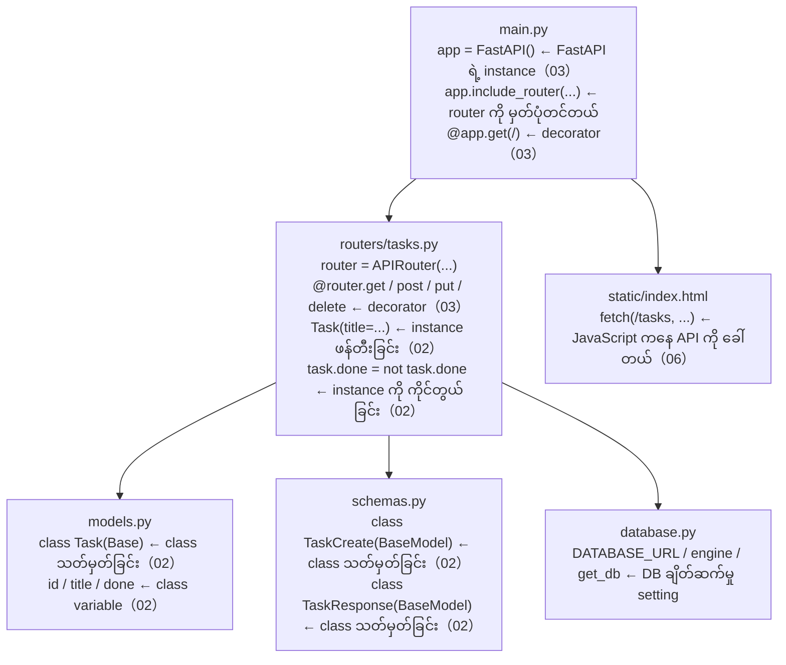

# Code Reading — စစ်ဆေးရေး source code ဖြင့် သင်ယူခဲ့သည်များကို ပြန်စစ်ကြည့်ခြင်း

> 🇯🇵 မူရင်း (ဂျပန်ဘာသာဖြင့်): [07_コードリーディング.md](<../../1年生_前期_ITシステム基礎/番外編/07_コードリーディング.md>) <!-- original-ja-link -->

## ဒီတစ်ခါရဲ့ ရည်မှန်းချက်
- `02_Python_OOP入門` မှာ သင်ခဲ့တဲ့ class တွေကို တကယ့် code ရဲ့ ဘယ်နေရာမှာ သုံးထားလဲ ရှင်းပြနိုင်ရမယ်
- `03_FastAPI入門` မှာ သင်ခဲ့တဲ့ decorator တွေကို တကယ့် code ရဲ့ ဘယ်နေရာမှာ သုံးထားလဲ ရှင်းပြနိုင်ရမယ်
- ဖိုင် 5 ခု ဘယ်လို ချိတ်ဆက်နေလဲဆိုတာ နားလည်ရမယ်

---

## ဖတ်ရမယ့် ဖိုင်တွေရဲ့ အစီအစဉ်

```
① models.py     ← OOP（class）ရဲ့ အနှစ်ချုပ်
② schemas.py    ← OOP（class）ရဲ့ အနှစ်ချုပ်
③ main.py       ← FastAPI（decorator）ရဲ့ အနှစ်ချုပ်
④ routers/tasks.py ← OOP + FastAPI နှစ်ခုလုံး ပါဝင်
⑤ database.py   ← ချိတ်ဆက်မှု setting（ကိုးကားရန်）
```

---

## ① models.py ကို ဖတ်မယ်

```python
from sqlalchemy import Column, Integer, String, Boolean
from database import Base

class Task(Base):
    __tablename__ = "tasks"

    id    = Column(Integer, primary_key=True, index=True)
    title = Column(String(200), nullable=False)
    done  = Column(Boolean, default=False)
```

### 02_OOP入門 နဲ့ ဆက်စပ်ပုံ

**`class Task` → class ကို သတ်မှတ်ခြင်း（02 အဆင့် 1 မှာ သင်ခဲ့တယ်）**

```
02 မှာ သင်ခဲ့တဲ့ ရေးပုံ         တကယ့် code
─────────────────────    ──────────────────────
class Task:              class Task(Base):
    pass                     __tablename__ = "tasks"
```

`(Base)` ကို **inheritance（အမွေဆက်ခံခြင်း）** လို့ ခေါ်ပါတယ်။ `Base` ဆိုတဲ့ class ရဲ့ လုပ်ဆောင်ချက်တွေကို ဆက်ခံပြီး `Task` class ကို ဖန်တီးထားတာပါ။
「SQLAlchemy ရဲ့ လုပ်ဆောင်ချက်အားလုံးကို သုံးနိုင်အောင် လုပ်ထားတဲ့ setting」လို့ နားလည်ထားပါ။

---

**`id / title / done` → class variable（instance တစ်ခုစီမှာ ရှိမယ့် data）**

02 ရဲ့ `Task` class မှာ `self.title` နဲ့ `self.done` ကို constructor ထဲမှာ သတ်မှတ်ခဲ့ပါတယ်။
`models.py` မှာတော့ SQLAlchemy ရဲ့ `Column()` ကို သုံးပြီး အတူတူပဲ လုပ်ထားပါတယ်။

```
02 မှာ သင်ခဲ့တဲ့ ရေးပုံ               တကယ့် code（models.py）
─────────────────────────    ──────────────────────────────────
class Task:                  class Task(Base):
    def __init__(self):
        self.title = ...         title = Column(String(200))
        self.done = False        done  = Column(Boolean, default=False)
```

ရေးပုံက မတူပေမယ့် 「**class မှာ ဘယ်လို data တွေ ရှိမလဲ**」ဆိုတာကို သတ်မှတ်နေတာကတော့ အတူတူပါပဲ။

---

**Instance ဖန်တီးတဲ့ နေရာ（routers/tasks.py ထဲမှ）**

```python
# Task class ကနေ instance ကို ဖန်တီးတယ်（02 ရဲ့ အဆင့် 2 နဲ့ အတူတူပဲ！）
new_task = Task(title=task_in.title)
#          ↑ Task class   ↑ title ကို တန်ဖိုး ပေးပို့တယ်
```

02 ရဲ့ လေ့ကျင့်ခန်းနဲ့ နှိုင်းယှဉ်ကြည့်ရင်（「買い物に行く」က “ဈေးသွားမယ်” လို့ အဓိပ္ပာယ်ရပါတယ်）：
```python
# 02 ရဲ့ လေ့ကျင့်ခန်း                    တကယ့် code
task1 = Task("買い物に行く")   new_task = Task(title="買い物に行く")
```

လုပ်နေတာက လုံးဝ အတူတူပါပဲ။

---

## ② schemas.py ကို ဖတ်မယ်

```python
from pydantic import BaseModel

class TaskCreate(BaseModel):
    title: str

class TaskResponse(BaseModel):
    id: int
    title: str
    done: bool

    class Config:
        from_attributes = True
```

### 02_OOP入門 နဲ့ ဆက်စပ်ပုံ

**Class 2 ခု သတ်မှတ်ထားတယ် → အသုံးပြုပုံ မတူဘူး**

```
class အမည်         အခန်းကဏ္ဍ                     instance ဖန်တီးတဲ့ အချိန်
────────────    ─────────────────────    ──────────────────────────────
TaskCreate      POST request ကို လက်ခံတယ်  browser ကနေ「追加」(ထည့်မယ်) ကို နှိပ်တဲ့အခါ
TaskResponse    response ကို ပြန်ပို့တယ်    API က ရလဒ်ကို ပြန်ပို့တဲ့အခါ
```

**`title: str` → type annotation ပါတဲ့ class variable**

02 မှာတော့ `self.title = title` လို့ ရေးခဲ့ပေမယ့်
Pydantic class မှာ `title: str` လို့ ရေးလိုက်ရုံနဲ့ 「title က string ဖြစ်တယ်」လို့ သတ်မှတ်နိုင်ပါတယ်။

```python
# 02 ရဲ့ ရေးပုံ（သာမန် class）       schemas.py ရဲ့ ရေးပုံ（Pydantic class）
def __init__(self, title):         class TaskCreate(BaseModel):
    self.title = title                 title: str   ← 1 ကြောင်းတည်းနဲ့ ရေးနိုင်တယ်！
```

**`class Config` → class ထဲမှာ class**

Class တစ်ခုထဲမှာ နောက်ထပ် class တစ်ခုကို ရေးလို့ရပါတယ်။
ဒီမှာတော့ SQLAlchemy ရဲ့ model object ကို ဒီအတိုင်း တိုက်ရိုက် ပေးပို့နိုင်အောင် လုပ်တဲ့ setting ကို ရေးထားပါတယ်။

---

## ③ main.py ကို ဖတ်မယ်

```python
from fastapi import FastAPI
from fastapi.staticfiles import StaticFiles
from fastapi.responses import FileResponse
from database import engine, Base
import models
from routers import tasks

Base.metadata.create_all(bind=engine)

app = FastAPI()

app.include_router(tasks.router)

app.mount("/static", StaticFiles(directory="static"), name="static")

@app.get("/")
def read_index():
    return FileResponse("static/index.html")
```

### 03_FastAPI入門 နဲ့ ဆက်စပ်ပုံ

**`app = FastAPI()` → FastAPI ရဲ့ instance ကို ဖန်တီးတယ်（03 မှာ သင်ခဲ့တယ်）**

```
03 မှာ သင်ခဲ့တာ                တကယ့် code
─────────────────────    ──────────────────────
app = FastAPI()           app = FastAPI()   ← လုံးဝ အတူတူပဲ！
```

---

**`@app.get("/")` → decorator（03 မှာ သင်ခဲ့တယ်）**

```python
@app.get("/")          # ← 「/ ကို GET request ရောက်လာရင် ဒီ function ကို ခေါ်မယ်」
def read_index():
    return FileResponse("static/index.html")
```

03 ရဲ့ Hello World နဲ့ နှိုင်းယှဉ်ကြည့်ရင်：
```
03 ရဲ့ လေ့ကျင့်ခန်း                            တကယ့် code
─────────────────────────────────   ──────────────────────────────────
@app.get("/")                        @app.get("/")
def read_root():                     def read_index():
    return {"message": "Hello!"}         return FileResponse("static/index.html")
```

`return` ရဲ့ အကြောင်းအရာပဲ ကွာပြီး decorator သုံးပုံကတော့ လုံးဝ အတူတူပါပဲ။

---

**`app.include_router(tasks.router)` → အသစ်ပါလာတာ：router**

03 မှာ endpoint အားလုံးကို `main.py` ထဲမှာ ရေးခဲ့ပါတယ်။
တကယ့် system မှာတော့ task နဲ့ ဆိုင်တဲ့ API တွေကို `routers/tasks.py` ထဲမှာ စုရေးပြီး
`main.py` မှာ 「ဒီ router ကို သုံးမယ်」လို့ မှတ်ပုံတင်ပါတယ်။

```
03 ရဲ့ အခြေခံပုံစံ（main.py ထဲမှာ အားလုံးရေး）       တကယ့် system（ဖိုင်တွေ ခွဲရေး）
─────────────────────────────────   ──────────────────────────────────
@app.get("/tasks")                   routers/tasks.py ထဲမှာ ရေးတယ်
@app.post("/tasks")                       ↓
@app.put("/tasks/{id}")              main.py မှာ မှတ်ပုံတင်တယ်
@app.delete("/tasks/{id}")           app.include_router(tasks.router)
```

**ဘာလို့ ဖိုင်တွေ ခွဲရေးတာလဲ？**
→ task・user・ကုန်ပစ္စည်း စသဖြင့် လုပ်ဆောင်ချက်တွေ များလာတဲ့အခါ ဖိုင် 1 ခုတည်းမှာ စုရေးထားရင် ဖတ်ရခက်လာလို့ပါ။

---

**`Base.metadata.create_all(bind=engine)` → table ကို အလိုအလျောက် ဖန်တီးခြင်း**

App စတင်တိုင်း 「tasks table မရှိသေးရင် ဖန်တီးမယ်」ဆိုတာကို အလိုအလျောက် လုပ်ပေးပါတယ်။
`models.py` ထဲက `Task` class ကို အခြေခံပြီး table ကို ဖန်တီးပါတယ်။

---

## ④ routers/tasks.py ကို ဖတ်မယ်

OOP（02）နဲ့ FastAPI（03）နှစ်ခုလုံး ပါဝင်တဲ့ အရေးအကြီးဆုံး ဖိုင်ပါ။

```python
from fastapi import APIRouter, Depends, HTTPException
from sqlalchemy.orm import Session
from database import get_db
from models import Task
from schemas import TaskCreate, TaskResponse

router = APIRouter(prefix="/tasks", tags=["tasks"])
```

**`router = APIRouter(...)` → app လိုပဲ၊ router အတွက်သီးသန့် instance**

```
main.py             routers/tasks.py
────────────────    ──────────────────────────────
app = FastAPI()     router = APIRouter(prefix="/tasks")
@app.get("/")       @router.get("")
```

`prefix="/tasks"` ရဲ့ အဓိပ္ပာယ်：ဒီ router ရဲ့ decorator မှာ ရေးတဲ့ URL ရှေ့မှာ `/tasks` ကို အလိုအလျောက် ထည့်ပေးပါတယ်။

```
@router.get("")   →  တကယ့် URL က /tasks
@router.get("/{task_id}")  →  တကယ့် URL က /tasks/{task_id}
```

---

### GET /tasks — စာရင်း ရယူခြင်း

```python
@router.get("", response_model=list[TaskResponse])
def get_tasks(db: Session = Depends(get_db)):
    return db.query(Task).all()
```

**`@router.get("")` → decorator（03 မှာ သင်ခဲ့တယ်）**
`router` မှာ တပ်ထားတဲ့အတွက် `/tasks` ကို လာတဲ့ GET request ကို ကိုင်တွယ်ပါတယ်။

**`response_model=list[TaskResponse]` → response ရဲ့ ပုံစံကို သတ်မှတ်တယ်**
`schemas.py` ထဲက `TaskResponse` class ရဲ့ list ကို ပြန်ပို့မယ်လို့ ကြေညာထားပါတယ်။

**`Depends(get_db)` → အသစ်ပါလာတာ：dependency injection**
「`get_db` function ရဲ့ ရလဒ်（DB နဲ့ ချိတ်ဆက်မှု）ကို `db` ထဲ ထည့်ပေးပါ」ဆိုတဲ့ FastAPI ရဲ့ စနစ်ပါ။
API ကို ခေါ်တိုင်း DB နဲ့ ချိတ်ဆက်မှုကို အလိုအလျောက် ပြင်ဆင်ပေးပါတယ်။

**`db.query(Task).all()` → Task class ရဲ့ instance အားလုံးကို ရယူတယ်**
```
db.query(Task).all()
             ↑
         OOP ရဲ့ Task class ကို သတ်မှတ်တယ်
         → tasks table ရဲ့ row အားလုံးကို Task instance တွေရဲ့ list အဖြစ် ရယူတယ်
```

---

### POST /tasks — task ဖန်တီးခြင်း

```python
@router.post("", response_model=TaskResponse)
def create_task(task_in: TaskCreate, db: Session = Depends(get_db)):
    new_task = Task(title=task_in.title)  # ← OOP！instance ကို ဖန်တီးတယ်
    db.add(new_task)
    db.commit()
    db.refresh(new_task)
    return new_task
```

**`task_in: TaskCreate` → schemas.py ရဲ့ class က ဒီမှာ ပါလာတယ်**
Browser ကနေ ပို့လိုက်တဲ့ JSON ကို `TaskCreate` instance အဖြစ် အလိုအလျောက် ပြောင်းပေးပါတယ်။ ဥပမာထဲက「買い物」က “ဈေးဝယ်ခြင်း” လို့ အဓိပ္ပာယ်ရပါတယ်။

```
Browser က ပို့တဲ့ data        FastAPI က အလိုအလျောက် ပြောင်းပေးတယ်
────────────────────    ──────────────────────────────
{"title": "買い物"}  →  task_in = TaskCreate(title="買い物")
                                             ↑ task_in.title နဲ့ ထုတ်ယူနိုင်တယ်
```

**`new_task = Task(title=task_in.title)` → OOP（02 အဆင့် 2 နဲ့ အတူတူ）**

```
02 ရဲ့ လေ့ကျင့်ခန်း                         တကယ့် code
─────────────────────────────    ──────────────────────────────
task1 = Task("買い物に行く")       new_task = Task(title=task_in.title)
```

Instance ကို ဖန်တီးပြီး data ကို သိမ်းထားစေတာ၊ ဒါက OOP အစစ်ပါပဲ။

---

### PUT /tasks/{task_id} — ပြီးမပြီး အခြေအနေ ပြောင်းခြင်း

```python
@router.put("/{task_id}", response_model=TaskResponse)
def toggle_task(task_id: int, db: Session = Depends(get_db)):
    task = db.query(Task).filter(Task.id == task_id).first()

    if task is None:
        raise HTTPException(status_code=404, detail="タスクが見つかりません")

    task.done = not task.done   # ← OOP！instance ရဲ့ data ကို ပြောင်းတယ်
    db.commit()
    db.refresh(task)
    return task
```

**`/{task_id}` → path parameter（03 မှာ သင်ခဲ့တယ်）**

```
03 ရဲ့ လေ့ကျင့်ခန်း                          တကယ့် code
─────────────────────────────     ──────────────────────────────
@app.get("/tasks/{task_id}")       @router.put("/{task_id}")
def get_task(task_id: int):        def toggle_task(task_id: int, ...):
```

URL ထဲမှာ ပါတဲ့ ဂဏန်း（ဥပမာ：`/tasks/3`）ကို `task_id = 3` အဖြစ် ပေးပို့ပါတယ်။

**`task.done = not task.done` → instance ရဲ့ data ကို တိုက်ရိုက် ပြောင်းတယ်**

```
ရယူထားတဲ့ task instance ရဲ့ done ကို ပြောင်းပြန်လှန်တယ်
task.done က False → not False → True  （မပြီးသေး → ပြီးပြီ）
task.done က True  → not True  → False （ပြီးပြီ → မပြီးသေး）
```

---

### DELETE /tasks/{task_id} — ဖျက်ခြင်း

```python
@router.delete("/{task_id}")
def delete_task(task_id: int, db: Session = Depends(get_db)):
    task = db.query(Task).filter(Task.id == task_id).first()

    if task is None:
        raise HTTPException(status_code=404, detail="タスクが見つかりません")

    db.delete(task)
    db.commit()
    return {"message": f"タスク '{task.title}' を削除しました"}
```

**`raise HTTPException(status_code=404, ...)` → error ကို ပြန်ပို့တယ်**

`task` ကို ရှာမတွေ့တဲ့အခါ（`is None`）404 error ကို browser ဆီ ပြန်ပို့ပါတယ်။ `タスクが見つかりません` က “Task ကို ရှာမတွေ့ပါ”、`タスク '{task.title}' を削除しました` က “Task '{task.title}' ကို ဖျက်ပြီးပါပြီ” လို့ အဓိပ္ပာယ်ရပါတယ်။
`raise` ဆိုတာ 「ဒီ error ကို အခုချက်ချင်း ဖြစ်စေမယ်」ဆိုတဲ့ Python ရဲ့ syntax ပါ။

---

## ⑤ တစ်ခုလုံး ချိတ်ဆက်ပုံ



---

## အနှစ်ချုပ်：02・03 မှာ သင်ခဲ့တာတွေကို ဘယ်လို သုံးထားလဲ

| သင်ခဲ့တဲ့ အကြောင်းအရာ | သင်ခန်းစာ | တကယ့် code |
|-----------|------|-------------|
| `class <class အမည်>:` နဲ့ class ကို သတ်မှတ်တယ် | 02 | `models.py` ရဲ့ `Task`၊ `schemas.py` ရဲ့ `TaskCreate` စသည် |
| `instance = (class အမည်)(argument)` | 02 | `new_task = Task(title=...)` |
| Instance ရဲ့ data ကို ပြောင်းတယ် | 02 | `task.done = not task.done` |
| `app = FastAPI()` | 03 | `main.py` ရဲ့ ပထမ စာကြောင်း |
| `@app.get(...)` decorator | 03 | `@router.get("") / @router.post("") စသည်` |
| `/{parameter}` path parameter | 03 | `@router.put("/{task_id}")` |

---

> ရှေ့တစ်ဆင့် → [06_フロントエンド連携.md](./06_フロントエンド連携.md)
> စစ်ဆေးရေး source code → [検証/todo_app/](./検証/todo_app/)
