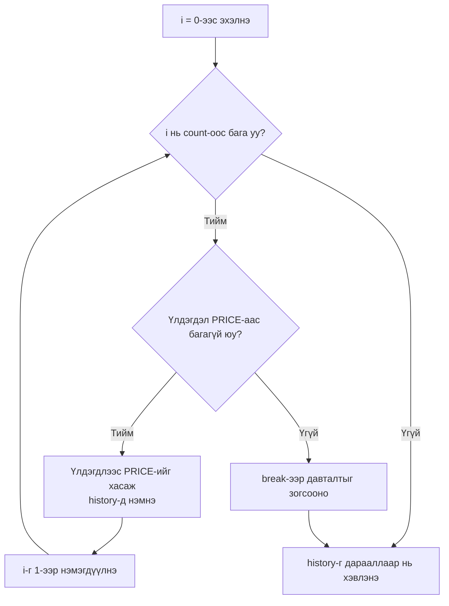
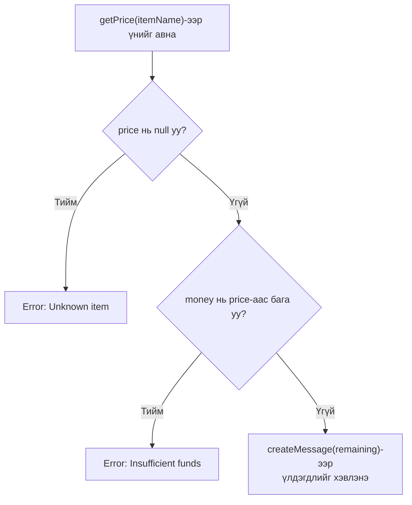

> 🇯🇵 Эх хувь (япон хэлээр): [2026_04_21_演習.md](<../../1年生_前期_ITシステム基礎/2026_04_21/2026_04_21_演習.md>) <!-- original-ja-link -->


---

## Нэгдсэн дасгал: Худалдааны автомат машины програм хөгжүүлэх

### 【STEP 1】Хувьсагч ба тогтмолын үндэс

**Шаардлага:**
- Барааны үнийг `PRICE` (150) тогтмолоор тодорхойлно.
- Стандарт оролтоос «оруулсан мөнгөн дүн»-г тоон утгаар авна.
- Оруулсан мөнгөн дүнгээс үнийг хасаж «үлдэгдэл»-ийг тооцоолоод `Remaining: [тоо]` гэж хэвлэнэ.

JavaScript

```
const reader = require('readline').createInterface({
  input: process.stdin,
  output: process.stdout
});

const lines = [];
reader.on('line', (line) => {
  lines.push(line);
});

reader.on('close', () => {
  const PRICE = 150;
  let money = Number(lines[0]); // 1-р мөрийн оролт
  
  let remaining = money - PRICE;
  console.log(`Remaining: ${remaining}`);
});
```

---

### 【STEP 2】if өгүүлбэрээр нөхцөлт салаалалт хийх

**Шаардлага:**
- Оруулсан мөнгөн дүн `PRICE`-аас бага бол `Error: Insufficient funds` гэж хэвлээд дуусгана.
- Мөнгө хүрэлцэж байгаа үед л хариулт мөнгийг хэвлэнэ.

JavaScript

```
reader.on('close', () => {
  const PRICE = 150;
  let money = Number(lines[0]);

  if (money < PRICE) {
    console.log("Error: Insufficient funds");
  } else {
    let remaining = money - PRICE;
    console.log(`Remaining: ${remaining}`);
  }
});
```

---

### 【STEP 3】Массив ба for өгүүлбэр (олон ширхэг худалдан авах)

**Шаардлага:**
- Оролтын 1-р мөрөнд «оруулсан мөнгөн дүн», 2-р мөрөнд «худалдан авах ширхэгийн тоо» өгөгдөнө.
- Нэг ширхэг авах бүрт үлдэгдлийг тооцоолж, түүхийг нь `history` массивт нэмж явна.
- Худалдан авах явцад үлдэгдэл хүрэлцэхгүй болбол тэр үед нь давталтыг зогсооно.
- Эцэст нь массивын агуулгыг давталтаар дарааллаар нь хэвлэнэ.

Худалдан авах үйлдлийн давталтын урсгал дараах байдалтай.



JavaScript

```
reader.on('close', () => {
  let money = Number(lines[0]);
  const count = Number(lines[1]);
  const PRICE = 150;
  const history = [];

  // Худалдан авах үйлдлийн давталт
  for (let i = 0; i < count; i++) {
    if (money >= PRICE) {
      money -= PRICE;
      history.push(money);
    } else {
      break;
    }
  }

  // Массивын агуулгыг давталтаар хэвлэнэ (for өгүүлбэрийн хувилбар)
  for (let i = 0; i < history.length; i++) {
    // history[i]-ээр массивын элемент бүрт хандана
    console.log(`Step ${i + 1}: ${history[i]}`);
  }
});
```


```
reader.on('close', () => {
  let money = Number(lines[0]);
  const count = Number(lines[1]);
  const PRICE = 150;
  const history = [];

  for (let i = 0; i < count; i++) {
    if (money >= PRICE) {
      money -= PRICE;
      history.push(money);
    } else {
      break;
    }
  }

  // Массивын агуулгыг давталтаар хэвлэнэ
  history.forEach((rem, index) => {
    console.log(`Step ${index + 1}: ${rem}`);
  });
});
```

---

### 【STEP 4】Рефакторинг: switch өгүүлбэрээр олон салаалалт хийх

**Шаардлага:**

- Оролтын 1-р мөрөнд «оруулсан мөнгөн дүн», 2-р мөрөнд «барааны нэр (Coke, Water, Coffee)» өгөгдөнө.
- `switch` өгүүлбэр ашиглан барааны нэрээс хамааруулж үнийг сольно.
    - Coke: 150, Water: 100, Coffee: 120
    - Бусад тохиолдолд: `Error: Unknown item` гэж хэвлэнэ.

JavaScript

```
reader.on('close', () => {
  let money = Number(lines[0]);
  const itemName = lines[1]; // Барааны нэр
  let price = 0;

  // if / else if ашигласан олон салаалалт
  if (itemName === "Coke") {
    price = 150;
  } else if (itemName === "Water") {
    price = 100;
  } else if (itemName === "Coffee") {
    price = 120;
  } else {
    // Аль ч нөхцөлд тохирохгүй үед (switch-ийн default-тэй адил)
    console.log("Error: Unknown item");
    return; 
  }

  // Худалдан авч болох эсэхийг шалгах
  if (money >= price) {
    console.log(`Remaining: ${money - price}`);
  } else {
    console.log("Error: Insufficient funds");
  }
});
```

```
reader.on('close', () => {
  let money = Number(lines[0]);
  const itemName = lines[1]; // 2-р мөр: барааны нэр
  let price = 0;

  switch (itemName) {
    case "Coke":
      price = 150;
      break;
    case "Water":
      price = 100;
      break;
    case "Coffee":
      price = 120;
      break;
    default:
      console.log("Error: Unknown item");
      return; // Боловсруулалтыг дуусгана
  }

  if (money >= price) {
    console.log(`Remaining: ${money - price}`);
  } else {
    console.log("Error: Insufficient funds");
  }
});
```

---

### 【STEP 5】Эцсийн рефакторинг: функц болгох

### 【STEP 5】Рефакторинг: функц болгох ба загвар литерал

**Шаардлага:**
- Барааны нэрээс үнийг буцаадаг `getPrice(name)` функц үүсгэнэ.
- Худалдан авсны дараах үлдэгдлийг тооцоолж, тэмдэгт мөр буцаадаг `createMessage(remaining)` функц үүсгэнэ.
- Үндсэн боловсруулалтыг эдгээр функцийг ашиглан цэгцэлнэ.

Үндсэн боловсруулалтын шалгалтын урсгал дараах байдалтай.



JavaScript

```
// Үнийг тодорхойлох функц
const getPrice = (name) => {
  switch (name) {
    case "Coke":   return 150;
    case "Water":  return 100;
    case "Coffee": return 120;
    default:       return null;
  }
};

// Мессеж үүсгэх функц (загвар литерал)
const createMessage = (remaining) => `Result: Remaining balance is ${remaining} yen.`;

reader.on('close', () => {
  const money = Number(lines[0]);
  const itemName = lines[1];
  
  const price = getPrice(itemName);

  if (price === null) {
    console.log("Error: Unknown item");
  } else if (money < price) {
    console.log("Error: Insufficient funds");
  } else {
    const remaining = money - price;
    console.log(createMessage(remaining));
  }
});
```

---

### 💡 Хичээл дээр зааварчлах гол санаанууд

- **Асинхрон боловсруулалтын тухай ойлголт:** `reader.on('close', ...)`-ийн гадна код бичвэл оролт дуусахаас өмнө ажиллаж алдаа гардаг гэдгийг тайлбарлаарай.
    
- **Массивын индекс:** `lines[0]`, `lines[1]` гэх мэтээр оролт ямар дарааллаар хадгалагддагийг ухамсарлуулах нь чухал.
    
- **trim() хэрэглэх шаардлага:** Энэ удаагийн кодонд оруулаагүй ч оролтод илүүдэл хоосон зай орсон байж болох тул бодит ажил дээр `lines.push(line.trim());` гэж бичихийг зааж өгвөл илүү тустай.
