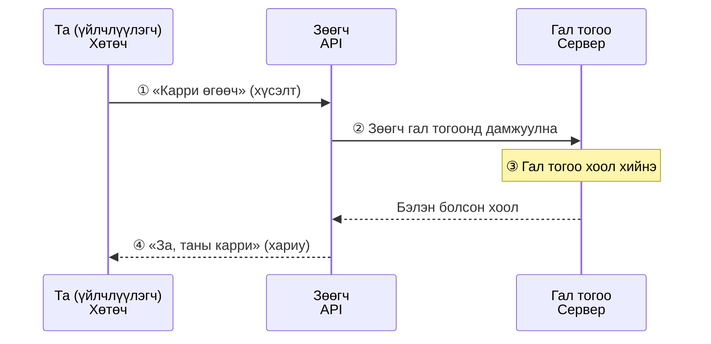
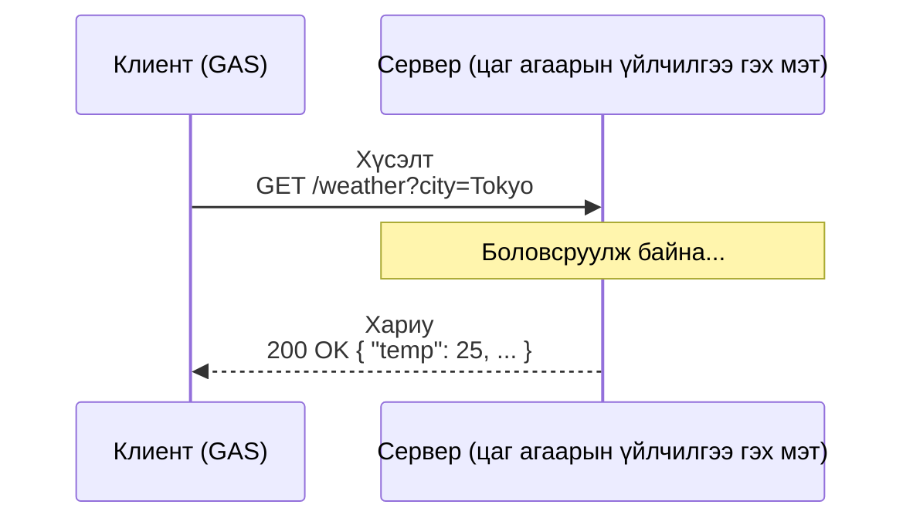
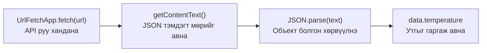

# API гэж юу вэ — Хүсэлт, хариу, JSON

> 🇯🇵 Эх хувь (япон хэлээр): [20260512_API説明資料.md](<../../1年生_前期_ITシステム基礎/2026_05_12/20260512_API説明資料.md>) <!-- original-ja-link -->

## Өнөөдрийн зорилго
- API гэж юу болохыг өөрийн үгээр тайлбарлаж чаддаг болох
- HTTP-ийн «хүсэлт, хариу» гэсэн ойлголтыг эзэмших
- JSON өгөгдлийг уншиж ойлгож чаддаг болох
- GAS-ийн `UrlFetchApp`-аар гадны API дуудаж чаддаг болох

---

## 1. API гэж юу вэ?

**API (Application Programming Interface) = Аппууд хоорондоо харилцах цонх**

### Өдөр тутмын жишээгээр бодож үзье

Рестораны жишээгээр авч үзвэл дараах байдалтай.



Та гал тогооны (серверийн) дотоод бүтцийг мэдэх шаардлагагүй.  
Зөөгчөөр (API-аар) дамжуулан захиалга өгөхөд л хангалттай.

---

## 2. HTTP хүсэлт ба хариу



**Хүсэлтийн төрлүүд:**
| Метод | Утга | Жишээ |
|---------|------|-----|
| GET | Өгөгдөл авахыг хүсэх | Цаг агаарын мэдээ авах |
| POST | Өгөгдөл илгээх, үүсгэхийг хүсэх | Маягт илгээх |
| PUT | Өгөгдөл шинэчлэхийг хүсэх | Профайлаа өөрчлөх |
| DELETE | Өгөгдөл устгахыг хүсэх | Нийтлэлээ устгах |

**Хариуны төлөвийн кодууд:**
| Код | Утга |
|--------|------|
| 200 | OK (амжилттай) |
| 404 | Not Found (олдсонгүй) |
| 500 | Internal Server Error (серверийн алдаа) |

---

## 3. JSON — Өгөгдөл солилцох формат

API-ийн өгөгдөл ихэвчлэн **JSON (JavaScript Object Notation)** форматаар ирдэг.

```json
{
  "city": "Tokyo",
  "weather": "晴れ",
  "temperature": 25.5,
  "humidity": 60,
  "forecast": [
    { "date": "2024-01-15", "temp": 24 },
    { "date": "2024-01-16", "temp": 22 },
    { "date": "2024-01-17", "temp": 27 }
  ]
}
```

JavaScript-ийн объекттой бараг ижил бичлэгтэй. 08-р хичээлээр сурсан мэдлэгээ шууд ашиглаж болно!

---

## 4. GAS-аар гадны API дуудах

Өгөгдлийг гаргаж авах хүртэлх урсгал нь дараах 4 үе шаттай.



```javascript
function callApi() {
  // UrlFetchApp.fetch(URL) = Заасан URL руу хандаж өгөгдөл авна
  const url = "https://api.example.com/data";
  
  const response = UrlFetchApp.fetch(url);
  
  // Хариуны агуулгыг тэмдэгт мөрөөр авна
  const text = response.getContentText();
  console.log(text);  // JSON тэмдэгт мөр харагдана
  
  // JSON тэмдэгт мөрийг объект болгон хөрвүүлнэ (08-р хичээлээр сурсан!)
  const data = JSON.parse(text);
  console.log(data.temperature);  // → 25.5
}
```

---

## 5. Нээлттэй API-г бодитоор ашиглаж үзэх

### Жишээ: Open-Meteo (үнэгүй цаг агаарын API, API түлхүүр шаардлагагүй)

```javascript
function getWeather() {
  // Токиогийн өргөрөг, уртрагийг зааж цаг агаарын өгөгдөл авна
  const url = "https://api.open-meteo.com/v1/forecast?latitude=35.6762&longitude=139.6503&current_weather=true";
  
  // API руу хүсэлт илгээнэ
  const response = UrlFetchApp.fetch(url);
  
  // Хариуг JSON хэлбэрээр авна
  const json = JSON.parse(response.getContentText());
  
  // current_weather дотор одоогийн цаг агаарын өгөгдөл байна
  const weather = json.current_weather;
  
  console.log("気温: " + weather.temperature + "℃");
  console.log("風速: " + weather.windspeed + " km/h");
  
  // Цаг агаарын кодыг япон хэл рүү хөрвүүлнэ (заримыг нь)
  const weatherCodes = {
    0: "快晴",
    1: "晴れ",
    2: "一部曇り",
    3: "曇り",
    61: "弱い雨",
    63: "適度な雨",
    65: "強い雨",
  };
  
  const weatherText = weatherCodes[weather.weathercode] || "不明";
  console.log("天気: " + weatherText);
}
```

---

## 6. API-ийн хариуг хүснэгтийн хуудсанд бичих

```javascript
function weatherToSheet() {
  const sheet = SpreadsheetApp.getActiveSpreadsheet().getActiveSheet();
  
  // API-аас цаг агаарын өгөгдөл авна
  const url = "https://api.open-meteo.com/v1/forecast?latitude=35.6762&longitude=139.6503&current_weather=true";
  const response = UrlFetchApp.fetch(url);
  const data = JSON.parse(response.getContentText());
  const weather = data.current_weather;
  
  // Одоогийн цагийг авна
  const now = new Date();
  const timeStr = Utilities.formatDate(now, "Asia/Tokyo", "yyyy/MM/dd HH:mm");
  
  // Сүүлийн мөрийн дараагийн мөрөнд бичнэ
  const nextRow = sheet.getLastRow() + 1;
  sheet.getRange(nextRow, 1).setValue(timeStr);
  sheet.getRange(nextRow, 2).setValue(weather.temperature);
  sheet.getRange(nextRow, 3).setValue(weather.windspeed);
  
  console.log("天気データを記録しました！");
}
```

---

## Дүгнэлт

| Нэр томьёо                       | Утга                |
| ------------------------ | ----------------- |
| API                      | Аппууд хоорондоо харилцах цонх      |
| Хүсэлт                    | Клиентээс сервер рүү илгээх хүсэлт  |
| Хариу                    | Серверээс клиент рүү буцаах хариу  |
| JSON                     | Өгөгдөл солилцоход ашигладаг формат     |
| `UrlFetchApp.fetch(url)` | GAS-аар URL руу хандана |
| `JSON.parse(str)`        | JSON тэмдэгт мөрийг объект болгон хөрвүүлнэ |

---

## Дараагийн хичээлийн (14-р хичээл) товч танилцуулга

Цаг агаар, валютын ханш зэрэг нээлттэй API ашиглан өгөгдлийг цахим хүснэгтэд автоматаар бүртгэх дасгал хийнэ.
