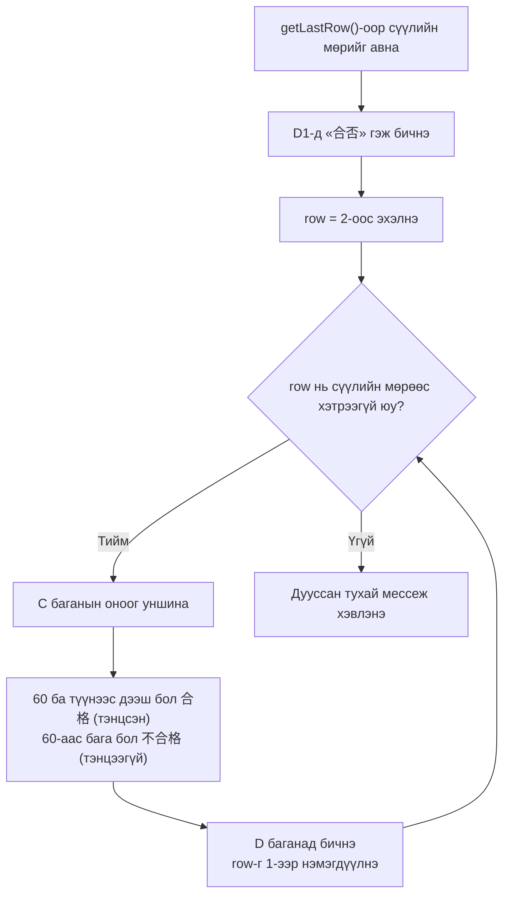

# Дасгал даалгавар

> 🇯🇵 Эх хувь (япон хэлээр): [20260512_演習回答.md](<../../1年生_前期_ITシステム基礎/2026_05_12/20260512_演習回答.md>) <!-- original-ja-link -->

## Бэлтгэл: Spreadsheet үүсгэх

1. Шинэ Google Spreadsheet үүсгэнэ
2. Spreadsheet-ийн нэрийг «GAS演習» (GAS дасгал) болгоно
3. «拡張機能» (Extensions) → «Apps Script»-ийг нээнэ

---

## Дасгал 1: Нүдэнд мэдээлэл бичих

### Даалгавар

> **Зарцуулах хугацаа: 10〜15 минут**

GAS ашиглан өөрийгөө танилцуулсан мэдээллээ хүснэгтэд бичдэг функц хийцгээе.

**Хийх зүйл:**

1. `jikoshokaSheet` нэртэй функц үүсгэнэ
2. Одоогийн хуудсыг `sheet` хувьсагчид авна (материалын 3-р бүлгийг харна уу)
3. Доорх хүснэгтэд заасны дагуу нүд бүрт утга бичнэ

| Нүд | Бичих агуулга |
|------|------------|
| A1 | `"自己紹介"` (Өөрийгөө танилцуулах) гэсэн тэмдэгт мөр |
| B1 | **Өөрийн нэр** (жишээ нь `"田中太郎"`) |
| A2 | `"年齢"` (Нас) гэсэн тэмдэгт мөр |
| B2 | **Өөрийн нас** (тоо. Хашилтгүй) |

4. **Үүнээс гадна** A3〜B4-ийг ашиглан хүссэн мэдээллээ (хобби, өссөн нутаг гэх мэт) өөрөө нэмж үзээрэй

> **Санамж:** Нүдэнд бичихдээ `getRange("A1").setValue(утга)`-г ашиглана (материалын 3-р бүлэг)

**Ажиллуулаад хуудсанд бичигдсэн эсэхийг шалгаарай**

### Хариулт

```javascript
function jikoshokaSheet() {
  const sheet = SpreadsheetApp.getActiveSpreadsheet().getActiveSheet();
  
  // A1-д «自己紹介» гэж бичнэ
  sheet.getRange("A1").setValue("自己紹介");
  
  // B1-д өөрийн нэрийг бичнэ (← өөрчилнө үү)
  sheet.getRange("B1").setValue("田中太郎");
  
  // A2-д «年齢», B2-д насны тоог бичнэ
  sheet.getRange("A2").setValue("年齢");
  sheet.getRange("B2").setValue(18);
  
  // A3, B3, A4, B4-ийг ч бас өөрөө нэмж үзээрэй
}
```

---

## Дасгал 2: Дүнгийн хүснэгтийг нэг дор бичих

### Даалгавар

> **Зарцуулах хугацаа: 20〜30 минут**

Нүд бүрт нэг нэгээр нь бичих нь төвөгтэй. Энэ удаа **2 хэмжээст массив болон `setValues()`** ашиглан дүнгийн хүснэгтийг нэг дор бичдэг функц хийцгээе.

**Хийх зүйл:**

1. `seisekiTable` нэртэй функц үүсгэнэ
2. Эхлээд хуудсыг **бүхэлд нь цэвэрлэнэ** (`clearContents()` ашиглана)
3. 1-р мөрөнд `"番号"` (Дугаар), `"名前"` (Нэр), `"点数"` (Оноо) гэсэн толгой мөрийг бичнэ
   - **2 хэмжээст массив** `[["番号", "名前", "点数"]]`-ийг `setValues()`-ээр бичнэ
   - `getRange(1, 1, 1, 3)`-аар «1-р мөр・1-р баганаас эхлэн 1 мөр×3 багана»-ыг заана (материалын 5-р бүлэг)
4. 2-р мөрөөс эхлэн доорх 5 хүний өгөгдлийг бичнэ

| Дугаар | Нэр | Оноо |
|------|------|------|
| 1 | 田中太郎 | 85 |
| 2 | 鈴木花子 | 72 |
| 3 | 山田次郎 | 91 |
| 4 | 佐藤三郎 | 68 |
| 5 | 伊藤美咲 | 78 |

   - Өгөгдлийг 2 хэмжээст массиваар бэлдэж, `getRange(2, 1, өгөгдлийн мөрийн тоо, өгөгдлийн баганын тоо)`-гоор бичнэ
5. Толгой мөрийг (1-р мөр) **тод** болгож, **саарал дэвсгэр өнгө** (`"#CCCCCC"`) өгнө (материалын 7-р бүлэг)

> **Санамж:** `data.length`-ээр мөрийн тоог, `data[0].length`-ээр баганын тоог авч болно

### Хариулт

```javascript
function seisekiTable() {
  const sheet = SpreadsheetApp.getActiveSpreadsheet().getActiveSheet();
  
  // Sheet-ийг цэвэрлэнэ (өмнөх өгөгдлийг устгана)
  sheet.clearContents();
  
  // Толгой мөр
  const header = [["番号", "名前", "点数"]];
  sheet.getRange(1, 1, 1, 3).setValues(header);
  
  // Өгөгдлийн мөрүүд (5 хүний)
  const data = [
    [1, "田中太郎", 85],
    [2, "鈴木花子", 72],
    [3, "山田次郎", 91],
    [4, "佐藤三郎", 68],
    [5, "伊藤美咲", 78],
  ];
  
  // 2-р мөрөөс эхэлж бичнэ
  sheet.getRange(2, 1, data.length, data[0].length).setValues(data);
  
  // Толгой мөрийг тод болгоно
  sheet.getRange(1, 1, 1, 3).setFontWeight("bold");
  sheet.getRange(1, 1, 1, 3).setBackground("#CCCCCC");
}
```

---

## Дасгал 3: Нүднээс уншаад боловсруулах

### Даалгавар

> **Зарцуулах хугацаа: 30〜40 минут**

**Дасгал 2-ыг ажиллуулсны дараа хийгээрэй.**

Дасгал 2-т хийсэн дүнгийн хүснэгтийн оноог уншиж, D баганад «тэнцсэн эсэх»-ийг автоматаар тодорхойлж бичдэг функц хийцгээе.

**Хийх зүйл:**

1. `readAndProcess` нэртэй функц үүсгэнэ

2. `getLastRow()`-оор өгөгдөл орсон сүүлийн мөрийн дугаарыг авна (материалын 6-р бүлэг)

3. D баганын (4-р багана) 1-р мөрөнд `"合否"` (Тэнцсэн эсэх) гэсэн толгойг бичнэ
   - `getRange(1, 4)`-өөр «1-р мөр・4-р багана»-ыг заана

4. `for` давталтаар 2-р мөрөөс сүүлийн мөр хүртэл давтана
   - Мөр бүрийн C баганын (3-р багана) оноог `getValue()`-ээр уншина
   - Оноо **60 ба түүнээс дээш бол `"合格"`** (Тэнцсэн), **60-аас бага бол `"不合格"`** (Тэнцээгүй) гэж тодорхойлно
     - Гурвалсан оператор `score >= 60 ? "合格" : "不合格"`-ийг ашиглана
   - Тодорхойлсон үр дүнг D баганад (4-р багана) `setValue()`-ээр бичнэ

5. Давталт дуусмагц `console.log("合否判定が完了しました！")` (Тэнцсэн эсэхийн шалгалт дууслаа!) гэж хэвлэнэ

> **Санамж:** `getRange(мөрийн дугаар, баганын дугаар)`-аар мөр・баганыг тоогоор зааж болно (материалын 4-р бүлэг)

Боловсруулалтын урсгалыг зургаар үзүүлбэл дараах байдалтай.



**Ажиллуулсны дараа D баганад тэнцсэн эсэх харагдаж байгааг шалгаарай**

### Хариулт

```javascript
function readAndProcess() {
  const sheet = SpreadsheetApp.getActiveSpreadsheet().getActiveSheet();
  
  // Дасгал 2-ыг ажиллуулсны дараа энэ кодыг ажиллуулна уу
  
  // 2-р мөрөөс сүүлийн мөр хүртэлх өгөгдлийг уншина
  const lastRow = sheet.getLastRow();
  
  // D баганад (4-р багана) «合否» гэж бичнэ
  // Толгой мөр
  sheet.getRange(1, 4).setValue("合否");
  
  for (let row = 2; row <= lastRow; row++) {
    // C баганын (3-р багана) оноог уншина
    const score = sheet.getRange(row, 3).getValue();
    
    // 60 ба түүнээс дээш бол тэнцсэн, 60-аас бага бол тэнцээгүй
    const result = score >= 60 ? "合格" : "不合格";
    
    // D баганад бичнэ
    sheet.getRange(row, 4).setValue(result);
  }
  
  console.log("合否判定が完了しました！");
}
```

---

## Дасгал 4: Хэлбэржүүлэлтийг цэгцэлье

### Даалгавар

> **Зарцуулах хугацаа: 15〜20 минут**

**Дасгал 3-ыг ажиллуулсны дараа хийгээрэй.**

Дасгал 3-т бичсэн «合否» (Тэнцсэн эсэх) баганыг уншиж, тэнцсэн・тэнцээгүй мөрүүдэд **дэвсгэр өнгө** өгч, үр дүн нь нэг харахад ойлгогдох дүнгийн хүснэгт болгоё.

**Хийх зүйл:**

1. `colorFormat` нэртэй функц үүсгэнэ
2. `getLastRow()`-оор сүүлийн мөрийн дугаарыг авна
3. `for` давталтаар 2-р мөрөөс сүүлийн мөр хүртэл давтана
   - D баганын (4-р багана) утгыг `getValue()`-ээр уншина
   - Утга нь `"合格"` (Тэнцсэн) бол тухайн мөрийн (1〜4-р багана) дэвсгэр өнгийг **цайвар цэнхэр** `"#CCE5FF"` болгоно
   - Утга нь `"不合格"` (Тэнцээгүй) бол тухайн мөрийн дэвсгэр өнгийг **цайвар улбар шар** `"#FFE5CC"` болгоно
   - Нэг мөрийн өргөнийг заахдаа `getRange(мөрийн дугаар, 1, 1, 4)`-ийг ашиглана («тухайн мөрийн 1-р баганаас эхлэн 1 мөр×4 багана»)

> **Шалгах зүйл:** Ажиллуулсны дараа тэнцсэн мөрүүд цэнхэр, тэнцээгүй мөрүүд улбар шар болсон бол амжилттай

### Хариулт

```javascript
function colorFormat() {
  const sheet = SpreadsheetApp.getActiveSpreadsheet().getActiveSheet();
  const lastRow = sheet.getLastRow();
  
  for (let row = 2; row <= lastRow; row++) {
    const result = sheet.getRange(row, 4).getValue();
    
    if (result === "合格") {
      // Тэнцсэн мөрийг цайвар цэнхэр болгоно
      sheet.getRange(row, 1, 1, 4).setBackground("#CCE5FF");
    } else {
      // Тэнцээгүй мөрийг цайвар улбар шар болгоно
      sheet.getRange(row, 1, 1, 4).setBackground("#FFE5CC");
    }
  }
}
```
