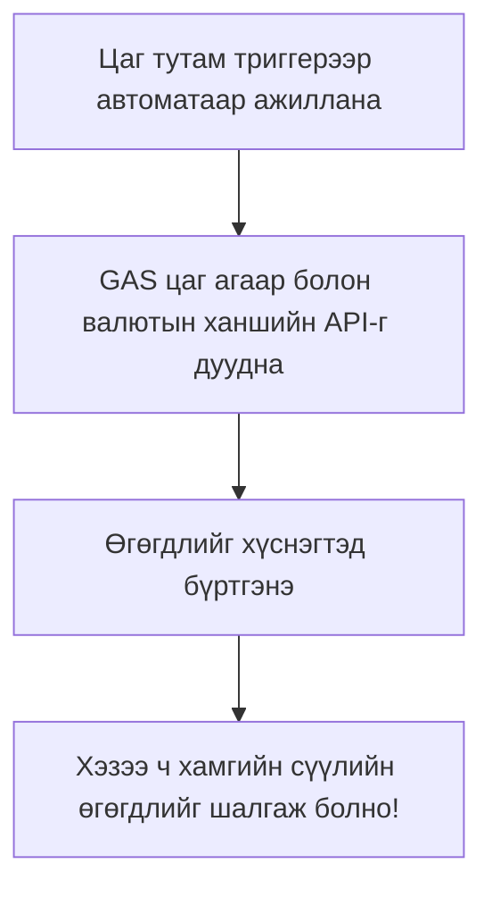

# GAS + API дасгал — Цаг агаар болон валютын ханшийн өгөгдлийг хүснэгтэд автоматаар тусгах

> 🇯🇵 Эх хувь (япон хэлээр): [20260519.md](<../../1年生_前期_ITシステム基礎/2026_05_19/20260519.md>) <!-- original-ja-link -->

## Өнөөдрийн зорилго
- Нээлттэй API дуудаж өгөгдөл авч чаддаг болох
- Авсан өгөгдлөө хүснэгтэд автоматаар бүртгэж чаддаг болох
- Триггертэй хослуулсан автоматжуулалтын хэрэгслийг бүрэн хийж дуусгах

---

## 1. Өнөөдөр хийх зүйл



---

## 2. Валютын ханшийн API (ExchangeRate-API)

Үнэгүй ашиглаж болох валютын ханшийн API юм.

```javascript
function getExchangeRate() {
  // Долларын бусад валюттай харьцах ханшийг авна
  // base=USD → 1 доллар хэдэн иен, хэдэн евро болох гэх мэт
  const url = "https://open.er-api.com/v6/latest/USD";
  
  const response = UrlFetchApp.fetch(url);
  const data = JSON.parse(response.getContentText());
  
  // data.rates дотор валют бүрийн ханш байна
  const jpyRate = data.rates.JPY;   // Доллар→иен
  const eurRate = data.rates.EUR;   // Доллар→евро
  const gbpRate = data.rates.GBP;   // Доллар→фунт
  
  console.log(`1ドル = ${jpyRate}円`);
  console.log(`1ドル = ${eurRate}ユーロ`);
  console.log(`1ドル = ${gbpRate}ポンド`);
  
  return { JPY: jpyRate, EUR: eurRate, GBP: gbpRate };
}
```

---

## 3. Цаг агаарын API (Open-Meteo)

```javascript
function getWeatherData() {
  // Токиогийн цаг агаар (13-р хичээлийн давтлага)
  const url = "https://api.open-meteo.com/v1/forecast"
    + "?latitude=35.6762"
    + "&longitude=139.6503"
    + "&current_weather=true"
    + "&hourly=temperature_2m,precipitation_probability";
  
  const response = UrlFetchApp.fetch(url);
  const data = JSON.parse(response.getContentText());
  
  const current = data.current_weather;
  return {
    temperature: current.temperature,
    windspeed: current.windspeed,
    weathercode: current.weathercode
  };
}
```

---

## 4. Нэгтгэл: Хүснэгтэд автоматаар бүртгэх систем

```javascript
// Хуудасны 1-р мөрөнд баганын гарчиг бичнэ (зөвхөн эхний удаа ажиллуулна)
function setupHeader() {
  const sheet = SpreadsheetApp.getActiveSpreadsheet().getActiveSheet();
  sheet.clearContents();
  
  const headers = [["記録日時", "気温(℃)", "風速(km/h)", "1ドル(円)", "1ドル(ユーロ)"]];
  sheet.getRange(1, 1, 1, headers[0].length).setValues(headers);
  sheet.getRange(1, 1, 1, headers[0].length).setFontWeight("bold");
  sheet.getRange(1, 1, 1, headers[0].length).setBackground("#4A90D9");
  sheet.getRange(1, 1, 1, headers[0].length).setFontColor("#FFFFFF");
  
  console.log("ヘッダーを設定しました");
}

// Тогтмол давтамжтай ажиллах үндсэн функц (триггерт тохируулна)
function recordData() {
  const sheet = SpreadsheetApp.getActiveSpreadsheet().getActiveSheet();
  
  // Одоогийн цаг
  const now = new Date();
  const timeStr = Utilities.formatDate(now, "Asia/Tokyo", "yyyy/MM/dd HH:mm");
  
  // Цаг агаарын өгөгдлийг авна
  let temperature = "取得失敗";
  let windspeed = "取得失敗";
  
  try {
    const weatherUrl = "https://api.open-meteo.com/v1/forecast?latitude=35.6762&longitude=139.6503&current_weather=true";
    const weatherRes = UrlFetchApp.fetch(weatherUrl);
    const weatherData = JSON.parse(weatherRes.getContentText());
    temperature = weatherData.current_weather.temperature;
    windspeed = weatherData.current_weather.windspeed;
  } catch (e) {
    // Алдаа гарсан ч програмыг зогсоохгүй
    console.log("天気取得エラー: " + e.message);
  }
  
  // Валютын ханшийн өгөгдлийг авна
  let jpyRate = "取得失敗";
  let eurRate = "取得失敗";
  
  try {
    const fxUrl = "https://open.er-api.com/v6/latest/USD";
    const fxRes = UrlFetchApp.fetch(fxUrl);
    const fxData = JSON.parse(fxRes.getContentText());
    jpyRate = Math.round(fxData.rates.JPY * 100) / 100;  // Аравтын бутархайн 2 орон хүртэл
    eurRate = Math.round(fxData.rates.EUR * 10000) / 10000;
  } catch (e) {
    console.log("為替取得エラー: " + e.message);
  }
  
  // Сүүлийн мөрийн дараа нэмж бичнэ
  const nextRow = sheet.getLastRow() + 1;
  const newData = [[timeStr, temperature, windspeed, jpyRate, eurRate]];
  sheet.getRange(nextRow, 1, 1, newData[0].length).setValues(newData);
  
  console.log(`データを記録しました: ${timeStr}`);
}
```

---

## 5. Хэрэглэх аргын дүгнэлт

**Анхны тохиргоо:**
1. `setupHeader()`-ийг 1 удаа ажиллуулна
2. Триггер тохируулна
3. Үүний дараа өгөгдөл автоматаар хуримтлагдана!

**Ажиллагааг шалгах:**
- `recordData()`-г гараар хэд хэдэн удаа ажиллуулж өгөгдөл нэмэгдэж байгаа эсэхийг шалгана

---

## Дүгнэлт: 3-р үе шат дууслаа!

| Сурсан зүйл | Дүгнэлт |
|-----------|-------|
| SpreadsheetApp | Нүдний өгөгдлийг унших, бичих |
| for давталт | Бүх мөрийг автоматаар боловсруулна |
| Триггер | Цагийн хуваарь эсвэл үйл явдлаар автоматаар ажиллана |
| GmailApp | И-мэйл автоматаар илгээнэ |
| UrlFetchApp | Гадны API-аас өгөгдөл авна |
| JSON.parse | JSON тэмдэгт мөрийг объект болгон хөрвүүлнэ |

---
