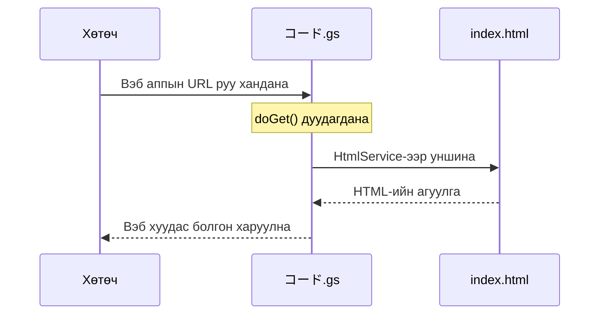

# HTML-ийн үндэс — Шошго, бүтэц, форм

> 🇯🇵 Эх хувь (япон хэлээр): [20260519_html.md](<../../1年生_前期_ITシステム基礎/2026_05_19/20260519_html.md>) <!-- original-ja-link -->

## Өнөөдрийн зорилго
- HTML-ийн үндсэн бүтцийг бичиж чаддаг болох
- Түгээмэл хэрэглэгддэг шошгуудыг чөлөөтэй ашиглах
- Форм хийж чаддаг болох
- GAS-ийн HTML үйлчилгээгээр вэб хуудас харуулж чаддаг болох

---

## 1. HTML гэж юу вэ

**HTML (HyperText Markup Language) = Вэб хуудасны "араг яс"-ыг бүтээдэг хэл**

```
Вэб хуудасны бүрэлдэхүүн хэсгүүд:
├── HTML → бүтэц, агуулга (яс, мах)
├── CSS  → харагдах байдал (хувцас, нүүр будалт)
└── JS   → хөдөлгөөн (булчин)
```

---

## 2. Үндсэн бүтэц

```html
<!DOCTYPE html>
<html lang="ja">
<head>
  <!-- head дотор хөтчид зориулсан тохиргооны мэдээлэл байна. Дэлгэц дээр харагдахгүй -->
  <meta charset="UTF-8">
  <title>ページタイトル</title>  <!-- таб дээр харагдана -->
</head>
<body>
  <!-- body дотор бичсэн зүйл дэлгэц дээр харагдана -->
  <h1>見出し1</h1>
  <p>段落テキスト</p>
</body>
</html>
```

---

## 3. Түгээмэл хэрэглэгддэг шошгууд

### Гарчиг, догол мөр

```html
<h1>大見出し（一番大きい）</h1>
<h2>中見出し</h2>
<h3>小見出し</h3>
<p>段落テキスト。改行は自動。</p>
<br>  <!-- албадан мөр шилжүүлэх -->
<hr>  <!-- хэвтээ зураас -->
```

### Холбоос ба зураг

```html
<!-- Холбоос -->
<a href="https://google.com">Google へ</a>
<a href="page2.html">次のページ</a>          <!-- нэг сайт дотор -->
<a href="https://google.com" target="_blank">新しいタブで開く</a>

<!-- Зураг -->

<!-- alt = зураг харагдахгүй үед гарах орлуулах текст -->
```

### Жагсаалт

```html
<!-- Дугааргүй жагсаалт (ul = unordered list)-->
<ul>
  <li>りんご</li>
  <li>みかん</li>
  <li>ぶどう</li>
</ul>

<!-- Дугаартай жагсаалт (ol = ordered list)-->
<ol>
  <li>手を洗う</li>
  <li>野菜を切る</li>
  <li>炒める</li>
</ol>
```

### Хүснэгт

```html
<table border="1">
  <thead>
    <tr>
      <th>名前</th>   <!-- th = гарчгийн нүд (тод үсэгтэй, голлуулсан) -->
      <th>点数</th>
    </tr>
  </thead>
  <tbody>
    <tr>
      <td>田中太郎</td>   <!-- td = өгөгдлийн нүд -->
      <td>85</td>
    </tr>
    <tr>
      <td>鈴木花子</td>
      <td>72</td>
    </tr>
  </tbody>
</table>
```

### div ба span (бүлэглэх)

```html
<!-- div = блок элементийн бүлэг (босоо чиглэлд дараалан байрлана) -->
<div class="box">
  <h2>タイトル</h2>
  <p>内容</p>
</div>

<!-- span = мөр доторх (inline) элементийн бүлэг (хэвтээ чиглэлд дараалан байрлана) -->
<p>テキストの<span style="color: red;">一部だけ</span>を変える</p>
```

---

## 4. Форм

Хэрэглэгчээс оруулсан мэдээллийг хүлээн авдаг хэсэг юм.

```html
<form action="" method="post">
  <!-- Текст оруулах -->
  <label for="namae">名前：</label>
  <input type="text" id="namae" name="namae" placeholder="名前を入力">
  
  <br>
  
  <!-- Имэйл оруулах -->
  <label for="email">メール：</label>
  <input type="email" id="email" name="email">
  
  <br>
  
  <!-- Тоо оруулах -->
  <label for="age">年齢：</label>
  <input type="number" id="age" name="age" min="0" max="150">
  
  <br>
  
  <!-- Сонгох жагсаалт (select box) -->
  <label for="grade">学年：</label>
  <select id="grade" name="grade">
    <option value="1">1年生</option>
    <option value="2">2年生</option>
    <option value="3">3年生</option>
  </select>
  
  <br>
  
  <!-- Текстийн талбар (олон мөр) -->
  <label for="comment">コメント：</label>
  <textarea id="comment" name="comment" rows="4" cols="40"></textarea>
  
  <br>
  
  <!-- Илгээх товч -->
  <button type="submit">送信する</button>
</form>
```

---

## 5. GAS-ийн HTML үйлчилгээгээр вэб хуудас харуулах

GAS ашиглан вэб хуудсаа нийтэд гаргаж болно!

**Файлын бүтэц (GAS засварлагч дээр үүсгэнэ):**
- `コード.gs` (GAS-ийн үндсэн файл)
- `index.html` (харуулах HTML файл)

**コード.gs:**
```javascript
// Вэб апп болгон нийтлэхэд зориулсан функц
// URL руу хандах үед дуудагдана
function doGet() {
  // index.html-ийг уншиж харуулна
  return HtmlService.createHtmlOutputFromFile("index")
    .setTitle("私のWebページ");
}
```

**index.html:**
```html
<!DOCTYPE html>
<html lang="ja">
<head>
  <meta charset="UTF-8">
  <title>GASのWebページ</title>
</head>
<body>
  <h1>こんにちは！GAS HTML サービス</h1>
  <p>これはGASで表示したWebページです。</p>
  
  <ul>
    <li>スプレッドシートのデータを表示できる</li>
    <li>フォームの送信を受け取れる</li>
    <li>インターネットで公開できる</li>
  </ul>
</body>
</html>
```

Нийтэлсэн URL руу хандахад хуудас дараах дарааллаар харагдана.



**Вэб апп болгон нийтлэх арга:**
1. 「デプロイ」(Deploy) →「新しいデプロイ」(New deployment)
2. Төрөл: 「Webアプリ」(Web app)-ыг сонгоно
3. Хандах эрхтэй хэрэглэгч: 「全員」(Anyone)
4. 「デプロイ」(Deploy) → URL үүснэ!

---

## Дүгнэлт

| Шошго | Зориулалт |
|------|------|
| `<h1>`〜`<h6>` | Гарчиг |
| `<p>` | Догол мөр |
| `<a href="">` | Холбоос |
| `` | Зураг |
| `<ul>` / `<ol>` / `<li>` | Жагсаалт |
| `<table>` / `<tr>` / `<td>` | Хүснэгт |
| `<form>` | Форм (мэдээлэл хүлээн авах) |
| `<input>` / `<button>` | Оруулах хэсэг, товч |
| `<div>` / `<span>` | Бүлэглэх |

---
