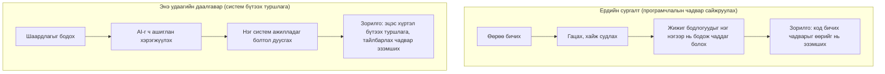
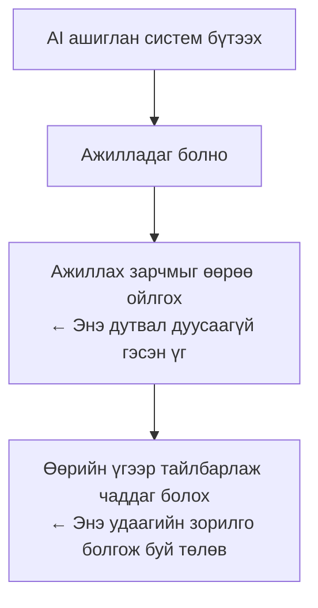

# Хичээлийн зорилгын тойм — Төгсгөлийн даалгаврыг эргэн харах

> 🇯🇵 Эх хувь (япон хэлээр): [授業の趣旨_まとめ.md](<../1年生_前期_ITシステム基礎/授業の趣旨_まとめ.md>) <!-- original-ja-link -->

Илтгэлүүд аль хэдийн дууссан ч энэ удаагийн даалгавраар юуг зорьж байсныг дахин цэгцэлье.
Илтгэлүүдийг сонсоод "AI ашиглаж болох юм уу?", "Өөрөө бичихгүй байж болох юм уу?" гэж эргэлзсэн хүмүүс байгаа байх гэж бодож байгаа тул тэр асуултын хариуг ч мөн оруулсан.

---

## 1. Энэ хичээлээр хамгийн их хэлэхийг хүссэн зүйл

Програмчлалыг зөвхөн тайлбар уншиж, сонсох замаар эзэмших боломжгүй, **өөрөө гараараа бодитоор код бичиж бүтээхээс өөр сурах арга байхгүй** гэж би үздэг.

Үүний тулд тодорхой сурах арга болгон сургалтын сайт **paiza**-гийн ур чадварын шалгалтыг (skill check) ашиглаж,

```
[ D бодлого ]  ──── олныг бодох ────▶ [ C бодлого ]
 Үндсэн синтакс, сэтгэлгээг          Арай төвөгтэй бодлогыг
 гараараа бичиж сурах                бодож, хэрэглэх чадвараа хөгжүүлэх
```

гэсэн дарааллаар явахыг зөвлөж байна. Энэ нь энэ удаагийн даалгавар дууссаны дараа ч програмчлалын чадвараа сайжруулахыг хүссэн хүмүүст хэвээрээ хамгийн зөв арга юм.

---

## 2. Энэ удаагийн даалгаврын зорилго

Энэ удаагийн төгсгөлийн даалгавар нь дээрх сурах аргаас арай өөр зорилготой.



- **AI ашиглахыг зөвшөөрсөн**
- Гол анхаарах зүйл нь "Зөв кодыг зөвхөн өөрийн гараар бичиж чадах уу" биш, **"Тэгээс эхлэн нэг системийг бодитоор бүтээж үзэх" туршлага өөрөө** юм

Өөрөөр хэлбэл, энэ удаад кодыг мөр мөрөөр өөрөө бичих дасгал биш, шаардлагаа цэгцэлж, AI-г ч ашиглан ажилладаг зүйлийг бий болгох туршлагыг тэргүүнд тавьсан даалгавар юм.

---

## 3. Илтгэлийн үеэр тайлбарлах шаардлагатай шалтгаан

Даалгавар хүлээлгэн өгөх журамд заасан "илтгэлийн үеэр тайлбарлах шаардлага" нь энэ удаагийн даалгаврын хамгийн чухал хэсэг юм.



AI ашиглан бүтээсэн систем байсан ч гэсэн,

- Юуны төлөө бүтээсэн
- Ямар зарчмаар ажилладаг
- Кодын аль хэсгийг өөрөө сайжруулж, тохируулсан

гэдгийг **өөрийн үгээр тайлбарлаж чадахыг** шаардаж байна. AI-аар хийлгээд л дуусгах биш, бүтээсэн зүйлийнхээ ажиллах зарчмыг ойлгож, тайлбарлаж чадах түвшинд өөртөө шингээгээрэй гэдэг нь энэ шаардлагын зорилго юм.

---

## 4. "Кодоо өөрөө бичмээр байна" гэсэн хүмүүст

Энэ удаад AI ашиглахыг зөвшөөрсөн болохоор "AI ашиглах нь заавал юм уу" гэж эргэлзсэн хүмүүс байсан бололтой.

Тийм биш ээ. **Өөрийн хүчээр код бичмээр байгаа хүн бичиж болно.** Үнэлгээг "юу хийж чадаж байна" гэдгээр нь харж байгаа тул өөрөө бичсэн код ч, AI ашигласан код ч шаардлагыг хангаж, өөрөө тайлбарлаж чадвал адилхан үнэлнэ.

Харин ч програмчлалын чадвараа жинхэнэ утгаар нь сайжруулмаар байгаа бол 1-р хэсэгт дурдсан paiza дээрх D→C бодлогын дасгал шиг өөрөө бичиж, гацаж, хайж судлах туршлагаас цаашид ч зайлсхийх аргагүй. Энэ удаад AI-г зөвшөөрсөн нь тэр сурах аргаа орхиж болно гэсэн үг биш юм.

---

## 5. AI ба хөгжүүлэлтийн бодит байдал

Энэ удаагийн даалгаврыг гүйцэтгэх арга барил нь бодит ажлын орчинд хөгжүүлэлт хийх арга барилтай ч ойролцоо юм.

```
┌────────────────────────────┐
│  Анхны ерөнхий хэрэгжүүлэлт   │ ← Ихэвчлэн AI хариуцдаг
└──────────────┬─────────────┘
               ▼
┌────────────────────────────┐
│  Алдаа судлах, нарийн засвар  │
│  Зарчмыг ойлгох, бусдад       │
│  тайлбарлах                   │ ← Хүн (та) хариуцна
└────────────────────────────┘
```

Одоогийн хөгжүүлэлтийн ажлын байран дээр ч,

- Анхны ерөнхий хэрэгжүүлэлтийг AI-д даатгах нь түгээмэл болж байна
- Нөгөө талаар алдааг судлах, нарийн засвар хийх, ажиллах зарчмыг ойлгож тайлбарлахыг хүн хариуцдаг

гэсэн үүргийн хуваарилалт улам дэлгэрч байна. Энэ удаа "AI-аар бүтээгээд, эцэст нь өөрөө тайлбарлах" үйл явцыг даалгаварт оруулсан нь орчин үеийн хөгжүүлэлт хэрхэн явагддагийг биеэр мэдрүүлэх зорилготой.

---

## Дүгнэлт

- Програмчлалын чадвар сайжруулах хамгийн зөв зам бол өөрөө бичиж, гацаж, хайж судлах (paiza D→C)
- Энэ удаагийн даалгавар нь тэр замаас өөр чиглэлтэй бөгөөд "AI ашиглаад ч болов нэг системийг эцэс хүртэл бүтээх туршлага"-ыг зорилго болгосон
- AI-аар бүтээсэн ч, өөрөө бичсэн ч үнэлгээ адилхан. Чухал нь эцэст нь өөрийн үгээр тайлбарлаж чадах явдал
- Энэ нь өнөөгийн бодит хөгжүүлэлтийн ажлын орчинтой ойролцоо туршлага мөн
