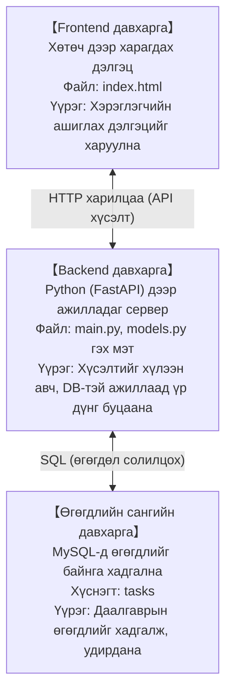
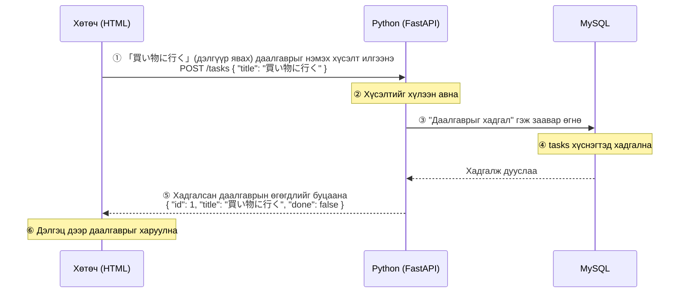

# Нэмэлт хичээл: Даалгавар удирдах систем бүтээцгээе

> 🇯🇵 Эх хувь (япон хэлээр): [00_概要とシステム設計.md](<../../1年生_前期_ITシステム基礎/番外編/00_概要とシステム設計.md>) <!-- original-ja-link -->

## Энэ удаагийн зорилго
- HTML + Python + MySQL гэсэн 3 давхаргат бүтэцтэй системийг ойлгох
- Python ашиглан backend хэрэгжүүлж чаддаг болох
- Frontend (HTML) ба backend (Python) API-аар дамжин хэрхэн холбогддогийг ойлгох

---

## 1. Юу бүтээх вэ

**Даалгавар удирдах апп (Todo апп)**

```
┌─────────────────────────────────────────┐
│           タスク管理アプリ               │
│                                         │
│  [ やること一覧 ]                        │
│  □ 買い物に行く        [完了] [削除]    │
│  ☑ 宿題を終わらせる   [完了] [削除]    │
│  □ 部屋を掃除する      [完了] [削除]    │
│                                         │
│  新しいタスク: [____________] [追加]    │
└─────────────────────────────────────────┘
```

Хийж чадах зүйлс:
- Даалгаврын жагсаалтыг харуулах
- Шинэ даалгавар нэмэх
- Даалгаврыг дууссан/дуусаагүй төлөвт шилжүүлэх
- Даалгавар устгах

---

## 2. Системийн ерөнхий дүр зураг

Энэ удаа бүтээх систем нь **3 давхаргаас** бүрдэнэ.



### Харилцааны урсгал (жишээ: даалгавар нэмэх үед)



---

## 3. Ашиглах технологи

| Үүрэг | Технологи | Тайлбар |
|------|------|------|
| Frontend | HTML + JavaScript | Хөтөч дээр харагдах дэлгэц |
| Backend | Python + FastAPI | API сервер |
| DB холболт | SQLAlchemy | Python-оос MySQL-тэй ажиллах сан (library) |
| Өгөгдлийн сан | MySQL | Өгөгдөл хадгалах программ хангамж |

### FastAPI-г сонгосон шалтгаан

- Энгийн бөгөөд анхлан суралцагч ч уншихад хялбар код бичиж болно
- `http://localhost:8000/docs`-ийг нээхэд л API-г турших дэлгэц автоматаар үүснэ
- Python-ы классыг (OOP) ашиглахад тохиромжтойгоор зохиогдсон

---

## 4. Фолдерын бүтэц

```
my_todo_app/
├── main.py          ← Аппыг эхлүүлэх файл (entry point)
├── database.py      ← MySQL-тэй холбогдох тохиргоо
├── models.py        ← Өгөгдлийн сангийн хүснэгтийн тодорхойлолт (классаар бичнэ)
├── schemas.py       ← API-н өгөгдлийн хэлбэрийн тодорхойлолт (классаар бичнэ)
├── routers/
│   └── tasks.py     ← Даалгавартай холбоотой API чиглүүлэлт
└── static/
    └── index.html   ← Frontend-ийн HTML файл
```

---

## 5. Орчин бэлтгэх

### MySQL бэлтгэх

MySQL суулгах, өгөгдлийн сан үүсгэх алхам нь үйлдлийн системээс (OS) хамаарч өөр өөр.
→ **[01_MySQL環境構築.md](./01_MySQL環境構築.md)**-ийг харна уу.

### Python багц суулгах

#### Mac

Mac дээр `pip3 install`-ийг шууд ажиллуулбал дараах алдаа гарна:
```
error: externally-managed-environment
```

**Виртуал орчин (venv)** үүсгэсний дараа суулгана уу.

```bash
# Төслийн фолдер дотор ажиллуулна
python3 -m venv venv

# Виртуал орчныг идэвхжүүлнэ (prompt-д (venv) гарч ирвэл OK)
source venv/bin/activate

# Идэвхжүүлсний дараа суулгана
pip install fastapi uvicorn sqlalchemy pymysql
```

#### Windows

Windows дээр шууд суулгаж болно.

```cmd
pip install fastapi uvicorn sqlalchemy pymysql
```

Виртуал орчин ашиглахыг хүсвэл (ашиглахыг зөвлөж байна):

```cmd
python -m venv venv
venv\Scripts\activate
pip install fastapi uvicorn sqlalchemy pymysql
```

| Багц | Үүрэг |
|-----------|------|
| `fastapi` | Вэб API фреймворк |
| `uvicorn` | FastAPI-г ажиллуулах сервер |
| `sqlalchemy` | Python-оос DB-тэй ажиллах сан (library) |
| `pymysql` | Python-оос MySQL-тэй холбогдох драйвер |

### Виртуал орчин гэж юу вэ?

```
Виртуал орчин = Зөвхөн тухайн төсөлд зориулсан Python-ы сав

Системийн нийтийн Python           Төсөлд зориулсан Python
(хөндөж болохгүй)                  (багцыг чөлөөтэй суулгаж болно)
      │                              │
      │  python3 -m venv venv (Mac)  │
      │  python -m venv venv (Win)   │
      └──────────────────────────→  venv/
                                      ├── bin/      (Mac)
                                      ├── Scripts/  (Windows)
                                      └── lib/...
```

Нэг удаа үүсгэсний дараа **терминал нээх бүрдээ идэвхжүүлэх** шаардлагатай:

```bash
source venv/bin/activate   # Mac
```
```cmd
venv\Scripts\activate      # Windows
```

### Серверийг эхлүүлэх арга

**Mac (виртуал орчныг идэвхжүүлсний дараа эхлүүлнэ):**
```bash
source venv/bin/activate
uvicorn main:app --reload
```

**Windows (виртуал орчингүй үед):**
```cmd
uvicorn main:app --reload
```

Эхлүүлсний дараа хөтчөөр дараахыг нээнэ:
- Аппын дэлгэц: `http://localhost:8000`
- API баримт бичиг: `http://localhost:8000/docs`

---

## 6. Суралцах дараалал

| Алхам | Материал | Агуулга |
|---------|------|------|
| 1 | 01_MySQL環境構築 | MySQL суулгах, DB үүсгэх |
| 2 | 02_Python_OOP入門 | Класс гэж юу вэ, яагаад ашигладаг вэ |
| 3 | 03_FastAPI入門 | API серверийн үндсийг бүтээх |
| 4 | 04_データベース連携 | MySQL-тэй холбож өгөгдөл хадгалах |
| 5 | 05_CRUD_API実装 | Жагсаалт, нэмэх, шинэчлэх, устгахыг хэрэгжүүлэх |
| 6 | 06_フロントエンド連携 | HTML дэлгэцээс API дуудах |

---

> Дараагийн алхам → [01_MySQL環境構築.md](./01_MySQL環境構築.md)
