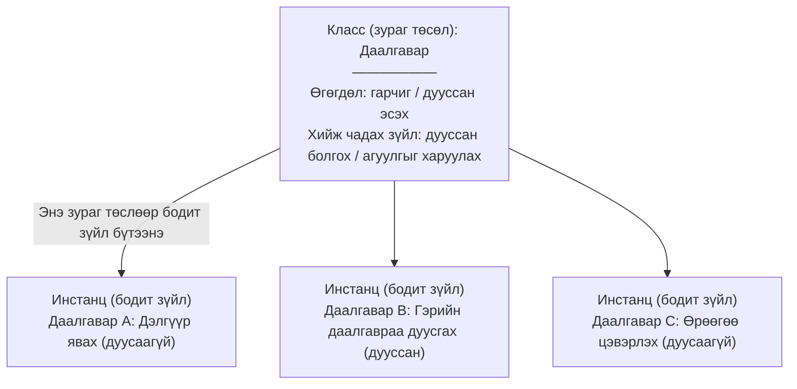

# Python объект хандалтат програмчлалын танилцуулга

> 🇯🇵 Эх хувь (япон хэлээр): [02_Python_OOP入門.md](<../../1年生_前期_ITシステム基礎/番外編/02_Python_OOP入門.md>) <!-- original-ja-link -->

## Энэ удаагийн зорилго
- "Класс" ба "инстанц"-ын ялгааг тайлбарлаж чаддаг болох
- `__init__` методын үүргийг ойлгох
- Класс ашиглан өгөгдөл ба боловсруулалтыг нэг дор нэгтгэж чаддаг болох

---

## 1. Объект хандалтат програмчлал гэж юу вэ?

Програм бичихдээ **хоорондоо холбоотой өгөгдөл ба боловсруулалтыг нэг дор нэгтгэх** сэтгэлгээ юм.

### Жишээгээр ойлгох: "Зураг төсөл" ба "Бодит зүйл"



**Класс** = зураг төсөл (зөвхөн нэг л байна)
**Инстанц** = зураг төслөөс бүтээсэн бодит зүйл (хэдийг ч хамаагүй бүтээж болно)

---

## 2. Класс бичиж үзье

### Алхам 1: Хамгийн энгийн класс

```python
# Классын тодорхойлолт
class Task:
    pass  # одоохондоо юу ч байхгүй
```

```python
# Инстанц үүсгэнэ
task1 = Task()  # Task классаас инстанц үүсгэнэ
task2 = Task()  # дахиад нэгийг үүсгэж болно

print(task1)  # <__main__.Task object at 0x...>
print(task2)  # <__main__.Task object at 0x...> ← өөр инстанц
```

---

### Алхам 2: Өгөгдөлтэй болгох (`__init__`)

`__init__` нь **инстанц үүсгэх үед автоматаар дуудагддаг тусгай метод** юм.
Үүнийг "конструктор" (constructor) гэж ч нэрлэдэг.

```python
class Task:
    # Инстанц үүсгэх үед автоматаар дуудагдана
    def __init__(self, title):
        # self = тухайн инстанцыг өөрийг нь заана
        self.title = title       # гарчгийг хадгална
        self.done = False        # эхэндээ дуусаагүй

# Инстанц үүсгэнэ (энэ үед __init__ дуудагдана)
task1 = Task("買い物に行く")
task2 = Task("宿題を終わらせる")

# Инстанцын өгөгдөлд хандана
print(task1.title)  # 買い物に行く
print(task1.done)   # False
print(task2.title)  # 宿題を終わらせる
```

**Гол санаа: `self` гэж юу вэ?**
```
task1 = Task("買い物に行く")
          ↑
    Энэ инстанц (task1) нь self болно

self.title = title
→ task1.title = "買い物に行く" гэсэнтэй адил утгатай
```

---

### Алхам 3: Метод нэмэх

Метод гэдэг нь **класс дотор тодорхойлсон функц** юм.

```python
class Task:
    def __init__(self, title):
        self.title = title
        self.done = False

    # Дууссан болгох метод
    def complete(self):
        self.done = True
        print(f"「{self.title}」を完了にしました！")

    # Агуулгыг харуулах метод
    def show(self):
        status = "☑" if self.done else "□"
        print(f"{status} {self.title}")
```

```python
# Ашиглаж үзье
task1 = Task("買い物に行く")
task2 = Task("宿題を終わらせる")

task1.show()      # □ 買い物に行く
task2.show()      # □ 宿題を終わらせる

task2.complete()  # 「宿題を終わらせる」を完了にしました！

task1.show()      # □ 買い物に行く
task2.show()      # ☑ 宿題を終わらせる
```

---

## 3. Класс ашиглаагүй хувилбартай харьцуулах

**Класс ашиглахгүй бол:**

```python
# Өгөгдөл тарамдаж, удирдахад хэцүү
title1 = "買い物に行く"
done1 = False

title2 = "宿題を終わらせる"
done2 = False

# Дууссан болгох боловсруулалтыг ч тус тусад нь бичих хэрэгтэй
done2 = True
print(f"「{title2}」を完了にしました！")

# Даалгавар нэмэгдэх тусам... title3, done3, title4, done4... гээд дуусахгүй
```

**Класс ашигласан бол:**

```python
# Өгөгдөл ба боловсруулалт нэг дор! Даалгавар нэмэгдсэн ч удирдахад хялбар
tasks = [
    Task("買い物に行く"),
    Task("宿題を終わらせる"),
    Task("部屋を掃除する"),
]

# Бүгдийг харуулна
for task in tasks:
    task.show()
```

---

## 4. Энэ удаагийн системд OOP ашиглах газрууд

OOP (объект хандалтат програмчлал)-ыг энэ удаагийн системийн **2 чухал хэсэгт** ашиглана.

### ① Өгөгдлийн сангийн хүснэгтийн тодорхойлолт (models.py)

```python
# Хүснэгт = класс, 1 мөр өгөгдөл = инстанц
class Task(Base):
    __tablename__ = "tasks"

    id = Column(Integer, primary_key=True)
    title = Column(String(200))
    done = Column(Boolean, default=False)
```

### ② API-н өгөгдлийн хэлбэрийн тодорхойлолт (schemas.py)

```python
# Хүсэлт/хариуны өгөгдлийн хэлбэрийг классаар илэрхийлнэ
class TaskCreate(BaseModel):
    title: str  # хүлээн авах өгөгдөл: зөвхөн гарчиг

class TaskResponse(BaseModel):
    id: int
    title: str
    done: bool  # буцаах өгөгдөл: id, гарчиг, дууссан эсэхийн туг (flag)
```

Класс ашигласнаар **ямар өгөгдөлтэй ажиллаж байгаа нь нэг харахад ойлгомжтой** код болно.

---

## 5. Дасгал хийж үзье

Дараах классыг гүйцээж бичээрэй.

```python
class Task:
    def __init__(self, title):
        self.title = title
        self.done = False

    def complete(self):
        # Энд "дууссан болгох" боловсруулалтыг бичнэ
        pass

    def show(self):
        # Энд "агуулгыг харуулах" боловсруулалтыг бичнэ
        pass

# Тест
t = Task("テスト用タスク")
t.show()     # □ テスト用タスク  гэж харагдах ёстой
t.complete()
t.show()     # ☑ テスト用タスク  гэж харагдах ёстой
```

---

> Өмнөх алхам → [01_MySQL環境構築.md](./01_MySQL環境構築.md)
> Дараагийн алхам → [03_FastAPI入門.md](./03_FastAPI入門.md)
