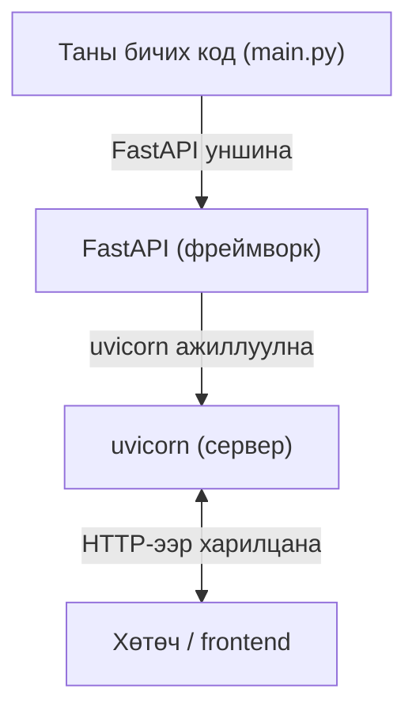
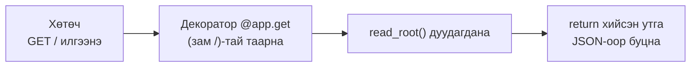

# FastAPI-ийн танилцуулга

> 🇯🇵 Эх хувь (япон хэлээр): [03_FastAPI入門.md](<../../1年生_前期_ITシステム基礎/番外編/03_FastAPI入門.md>) <!-- original-ja-link -->

## Энэ удаагийн зорилго
- FastAPI ашиглан энгийн API серверийг эхлүүлж чаддаг болох
- `@app.get` зэрэг декораторын утгыг ойлгох
- Swagger UI ашиглан хөтчөөс API-г туршиж чаддаг болох

---

## 1. FastAPI гэж юу вэ?

**FastAPI = Python ашиглан API сервер бүтээхэд зориулсан фреймворк**

Фреймворк гэдэг нь "түгээмэл хэрэглэгддэг функцуудыг нэгтгэсэн хэрэгтэй багажны хайрцаг" юм.



---

## 2. Hello World бүтээх

Эхлээд хамгийн энгийн API серверийг бүтээж үзье.

### main.py

```python
from fastapi import FastAPI

# FastAPI-ийн инстанц үүсгэнэ (аппликейшний үндсэн объект)
app = FastAPI()

# "/" руу хандах үеийн боловсруулалт
@app.get("/")
def read_root():
    return {"message": "Hello, World!"}
```

### Эхлүүлэх

**Windows / Mac аль алинд нь адил:**
```bash
uvicorn main:app --reload
```

```
INFO:     Uvicorn running on http://127.0.0.1:8000
INFO:     Application startup complete.
```

Хөтчөөр `http://localhost:8000`-ийг нээвэл:
```json
{"message": "Hello, World!"}
```

---

## 3. Декораторыг ойлгох

Кодонд гарч ирсэн `@app.get("/")`-ийг **декоратор** (decorator) гэнэ.

```python
@app.get("/")          # ← декоратор
def read_root():       # ← энэ функцэд "/ руу GET хүсэлт ирвэл дуудах" гэсэн тохиргоо хийж байна
    return {...}
```

Хүсэлт ирснээс хойш хариу буцах хүртэлх урсгал дараах байдалтай.



### HTTP метод ба декораторын харгалзаа

| Хийхийг хүссэн зүйл | HTTP метод | Декоратор |
|------------|-------------|-----------|
| Өгөгдөл авах | GET | `@app.get(...)` |
| Шинэ өгөгдөл үүсгэх | POST | `@app.post(...)` |
| Өгөгдөл шинэчлэх | PUT | `@app.put(...)` |
| Өгөгдөл устгах | DELETE | `@app.delete(...)` |

---

## 4. Замын параметр (URL-д утга оруулах)

```python
@app.get("/tasks/{task_id}")
def get_task(task_id: int):  # URL доторх {task_id} аргумент болж дамжин ирнэ
    return {"task_id": task_id, "title": "サンプルタスク"}
```

`http://localhost:8000/tasks/3` руу хандвал:
```json
{"task_id": 3, "title": "サンプルタスク"}
```

---

## 5. Swagger UI — API-г турших дэлгэц

FastAPI-ийн хэрэгтэй боломжуудын нэг нь **Swagger UI** юм.
Код бичихэд л **хөтчөөр API-г туршиж болох дэлгэц автоматаар үүснэ**.

`http://localhost:8000/docs`-ийг нээвэл дараах шиг дэлгэц гарч ирнэ:

```
┌────────────────────────────────────────────┐
│  FastAPI                                   │
│                                            │
│  GET  /        Hello World буцаана         │
│  ▼ Try it out                              │
│    [Execute]                               │
│                                            │
│  Response:                                 │
│  {"message": "Hello, World!"}              │
└────────────────────────────────────────────┘
```

**Хөгжүүлэлтийн явцад Swagger UI-аар ажиллагааг шалгах нь их тохиромжтой.**

---

## 6. Даалгавар удирдах API-ийн үндсэн бүтцийг байгуулах

Бодит системд зориулж, даалгавар удирдах API-ийн үндсэн бүтцийг байгуулна.

```python
# main.py
from fastapi import FastAPI
from fastapi.staticfiles import StaticFiles

app = FastAPI()

# static фолдер доторх HTML файлыг түгээх тохиргоо
app.mount("/static", StaticFiles(directory="static"), name="static")

# Үндсэн зам (/) руу хандвал index.html-ийг харуулна
from fastapi.responses import FileResponse

@app.get("/")
def read_index():
    return FileResponse("static/index.html")


# --- Даалгавартай холбоотой API (дараагийн алхмуудад гүйцээнэ) ---

@app.get("/tasks")
def get_tasks():
    # Даалгаврын жагсаалтыг буцаана (дараа нь DB-тэй холбоно)
    return []

@app.post("/tasks")
def create_task():
    # Даалгавар үүсгэнэ (дараа нь DB-тэй холбоно)
    return {"message": "タスクを作成しました"}

@app.put("/tasks/{task_id}")
def toggle_task(task_id: int):
    # Даалгаврын дууссан/дуусаагүй төлөвийг солино (дараа нь DB-тэй холбоно)
    return {"message": f"タスク {task_id} を更新しました"}

@app.delete("/tasks/{task_id}")
def delete_task(task_id: int):
    # Даалгавар устгана (дараа нь DB-тэй холбоно)
    return {"message": f"タスク {task_id} を削除しました"}
```

### Эхлүүлээд шалгах

**Windows / Mac аль алинд нь адил:**
```bash
uvicorn main:app --reload
```

`http://localhost:8000/docs`-ийг нээж, 4 эндпойнт харагдаж байгааг шалгаарай.

```
GET    /tasks      Даалгаврын жагсаалт авах
POST   /tasks      Даалгавар үүсгэх
PUT    /tasks/{id} Дууссан төлөвийг солих
DELETE /tasks/{id} Даалгавар устгах
```

---

## 7. Одоог хүртэлх гол санааг цэгцлэх

```
① FastAPI-ийн инстанц үүсгэнэ
   app = FastAPI()

② Декоратороор URL ба методыг заана
   @app.get("/tasks")

③ Түүний доорх функц бодит боловсруулалтыг гүйцэтгэнэ
   def get_tasks():
       return [...]

④ Функцийн return хийсэн утга JSON хэлбэрээр хариу болно
   return [{"id": 1, "title": "買い物"}]
   → Хөтөч рүү [{"id": 1, "title": "買い物"}] буцна
```

---

> Өмнөх алхам → [02_Python_OOP入門.md](./02_Python_OOP入門.md)
> Дараагийн алхам → [04_データベース連携.md](./04_データベース連携.md)
