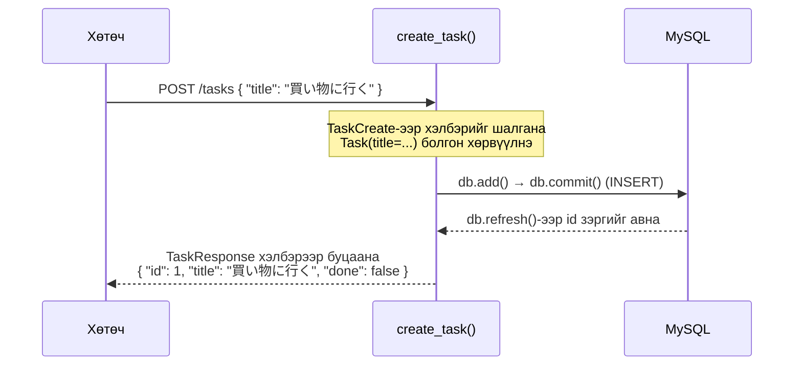

# CRUD API хэрэгжүүлэх

> 🇯🇵 Эх хувь (япон хэлээр): [05_CRUD_API実装.md](<../../1年生_前期_ITシステム基礎/番外編/05_CRUD_API実装.md>) <!-- original-ja-link -->

## Энэ удаагийн зорилго
- Pydantic схемийн классаар өгөгдлийн бүтцийг тодорхойлж чаддаг болох
- GET / POST / PUT / DELETE гэсэн 4 API-г хэрэгжүүлж чаддаг болох
- Swagger UI-аар API тус бүрийн ажиллагааг шалгаж чаддаг болох

---

## 1. CRUD гэж юу вэ?

**CRUD** = өгөгдөлтэй ажиллах 4 үндсэн үйлдлийн нэрийн эхний үсгүүд

| Үсэг | Үйлдэл | SQL | HTTP метод |
|------|------|-----|-------------|
| C | Create (үүсгэх) | INSERT | POST |
| R | Read (авах) | SELECT | GET |
| U | Update (шинэчлэх) | UPDATE | PUT |
| D | Delete (устгах) | DELETE | DELETE |

---

## 2. schemas.py — API-н өгөгдлийн хэлбэрийг тодорхойлох

**Pydantic (пайдантик)** нь класс ашиглан өгөгдлийн хэлбэрийг тодорхойлдог сан юм.
FastAPI-тай хослуулбал **хүсэлт/хариуны өгөгдлийг автоматаар шалгаж** өгдөг.

```python
# schemas.py

from pydantic import BaseModel

# Даалгавар үүсгэх үед хүлээн авах өгөгдөл
class TaskCreate(BaseModel):
    title: str  # зөвхөн гарчгийг хүлээн авна (id болон done-ийг сервер шийднэ)

# API-н хариуд буцаах өгөгдөл
class TaskResponse(BaseModel):
    id: int
    title: str
    done: bool

    # SQLAlchemy-ийн загварын объектыг шууд дамжуулах боломж олгох тохиргоо
    class Config:
        from_attributes = True
```

### Яагаад схемийг тусдаа файлд бичдэг вэ?

```
models.py  → өгөгдлийн сангийн хэлбэр (хэрхэн хадгалах)
schemas.py → API-н хэлбэр (ямар өгөгдөл хүлээн авч/буцаах)

Жишээ: даалгавар үүсгэх үед
  Хүлээн авах (TaskCreate): зөвхөн title
  Буцаах (TaskResponse):    id + title + done
  Хадгалах (Task model):    id + title + done (id автоматаар дугаарлагдана)
```

---

## 3. routers/tasks.py — 4 API-г хэрэгжүүлэх

```python
# routers/tasks.py

from fastapi import APIRouter, Depends, HTTPException
from sqlalchemy.orm import Session
from database import get_db
from models import Task
from schemas import TaskCreate, TaskResponse

# Router = URL-уудын цуглуулга (энд /tasks-тай холбоотой API-г нэгтгэнэ)
router = APIRouter(prefix="/tasks", tags=["tasks"])
```

---

### R — Даалгаврын жагсаалт авах (GET /tasks)

```python
# ⚠️ "/" биш, "" гэж бичнэ ("/" гэж бичвэл /tasks хаягаас /tasks/ руу дахин чиглүүлнэ)
@router.get("", response_model=list[TaskResponse])
def get_tasks(db: Session = Depends(get_db)):
    """Бүх даалгаврыг авч буцаана"""
    tasks = db.query(Task).all()  # SELECT * FROM tasks
    return tasks
```

**`Depends(get_db)` гэж юу вэ?**
```
db: Session = Depends(get_db)
↑
"get_db функцийн үр дүнг (DB session) db-д дамжуулаарай"
гэсэн утгатай. API дуудагдах бүрт DB-тэй холболтыг бэлдэж өгнө.
```

---

### C — Даалгавар үүсгэх (POST /tasks)

```python
@router.post("", response_model=TaskResponse)
def create_task(task_in: TaskCreate, db: Session = Depends(get_db)):
    """Шинэ даалгавар үүсгэнэ"""
    # Хүлээн авсан өгөгдлийг (TaskCreate) Task загварын инстанц болгон хөрвүүлнэ
    new_task = Task(title=task_in.title)

    db.add(new_task)    # DB-д нэмэх бэлтгэл
    db.commit()         # DB-д хадгална (INSERT ажиллана)
    db.refresh(new_task)  # DB автоматаар тохируулсан id зэргийг авна
    return new_task
```

POST /tasks дуудагдах үеийн урсгалыг зургаар үзүүлбэл дараах байдалтай.



---

### U — Дууссан төлөвийг солих (PUT /tasks/{task_id})

```python
@router.put("/{task_id}", response_model=TaskResponse)
def toggle_task(task_id: int, db: Session = Depends(get_db)):
    """Даалгаврын дууссан/дуусаагүй төлөвийг солино"""
    # Тухайн даалгаврыг авна
    task = db.query(Task).filter(Task.id == task_id).first()

    # Даалгавар олдохгүй бол 404 алдаа
    if task is None:
        raise HTTPException(status_code=404, detail="タスクが見つかりません")

    # done-ийг эсрэгээр нь солино (True → False, False → True)
    task.done = not task.done

    db.commit()         # DB-д хадгална (UPDATE ажиллана)
    db.refresh(task)
    return task
```

---

### D — Даалгавар устгах (DELETE /tasks/{task_id})

```python
@router.delete("/{task_id}")
def delete_task(task_id: int, db: Session = Depends(get_db)):
    """Даалгаврыг устгана"""
    task = db.query(Task).filter(Task.id == task_id).first()

    if task is None:
        raise HTTPException(status_code=404, detail="タスクが見つかりません")

    db.delete(task)     # устгах бэлтгэл
    db.commit()         # DB-ээс устгана (DELETE ажиллана)
    return {"message": f"タスク '{task.title}' を削除しました"}
```

---

## 4. main.py-д router бүртгэх

```python
# main.py (бэлэн хувилбар)

from fastapi import FastAPI
from fastapi.staticfiles import StaticFiles
from fastapi.responses import FileResponse
from database import engine, Base
import models
from routers import tasks  # ← нэмсэн

# Хүснэгтийг автоматаар үүсгэнэ
Base.metadata.create_all(bind=engine)

app = FastAPI()

# Router бүртгэнэ (/tasks доорх API-ууд идэвхжинэ)
app.include_router(tasks.router)  # ← нэмсэн

app.mount("/static", StaticFiles(directory="static"), name="static")

@app.get("/")
def read_index():
    return FileResponse("static/index.html")
```

---

## 5. Файлын бүтэц (одоогийн байдлаар)

```
my_todo_app/
├── main.py         ← router бүртгэлийг нэмсэн
├── database.py     ← DB холболтын тохиргоо
├── models.py       ← Task хүснэгтийн тодорхойлолт
├── schemas.py      ← ★ Энэ удаа үүсгэсэн: өгөгдлийн хэлбэрийн тодорхойлолт
├── routers/
│   ├── __init__.py ← хоосон файл (фолдерыг Python багц гэж таниулна)
│   └── tasks.py    ← ★ Энэ удаа үүсгэсэн: CRUD API
└── static/
    └── index.html  ← дараагийн алхамд үүсгэнэ
```

`routers/__init__.py` нь хоосон файл байхад OK:

**Windows:**
```cmd
type nul > routers\__init__.py
```

**Mac:**
```bash
touch routers/__init__.py
```

---

## 6. Swagger UI-аар ажиллагааг шалгах

**Windows / Mac аль алинд нь адил:**
```bash
uvicorn main:app --reload
```

`http://localhost:8000/docs`-ийг нээж шалгана.

**Шалгах алхам (POST → GET → PUT → DELETE дарааллаар):**

1. **POST /tasks** дээр дарна → `Try it out` → Request body-д оруулна:
   ```json
   {"title": "買い物に行く"}
   ```
   → `Execute` → Response-д `{"id": 1, "title": "買い物に行く", "done": false}` буцаж ирэх ёстой

2. **GET /tasks** дээр дарна → `Try it out` → `Execute`
   → Үүсгэсэн даалгавар жагсаалтаар буцаж ирэх ёстой

3. **PUT /tasks/{task_id}** дээр дарна → `task_id`-д `1` гэж оруулна → `Execute`
   → `"done": true` болж өөрчлөгдөх ёстой

4. **DELETE /tasks/{task_id}** дээр дарна → `task_id`-д `1` гэж оруулна → `Execute`
   → Устгасан тухай мессеж буцаж ирэх ёстой

---

> Өмнөх алхам → [04_データベース連携.md](./04_データベース連携.md)
> Дараагийн алхам → [06_フロントエンド連携.md](./06_フロントエンド連携.md)
