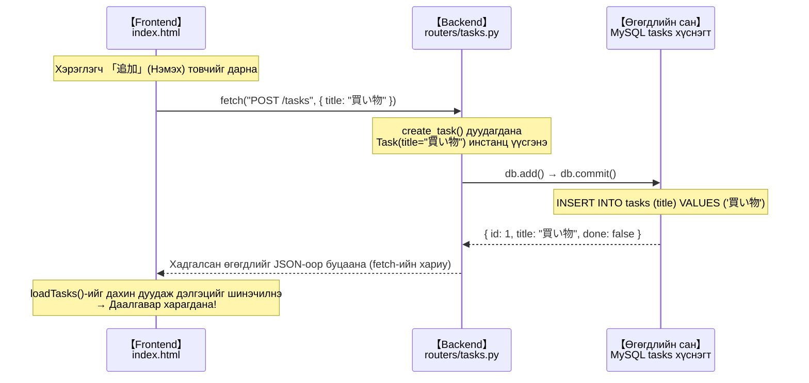

# Frontend-тэй холбох (HTML + JavaScript)

> 🇯🇵 Эх хувь (япон хэлээр): [06_フロントエンド連携.md](<../../1年生_前期_ITシステム基礎/番外編/06_フロントエンド連携.md>) <!-- original-ja-link -->

## Энэ удаагийн зорилго
- `fetch()` ашиглан Python API-г дуудаж чаддаг болох
- API-ийн хариуг дэлгэц дээр харуулж чаддаг болох (DOM-той ажиллах)
- Даалгавар нэмэх, дууссан/дуусаагүй төлөвийг солих, устгахыг дэлгэцээс хийж чаддаг болох

---

## 1. SPA (Single Page Application) гэж юу вэ?

Энэ удаа бүтээх frontend нь **SPA** хэлбэртэй байна.

```
Уламжлалт вэб сайт (хуудас шилждэг)
  Үйлдэл хийх бүрт хуудас бүхэлдээ дахин ачаалагдана
  Хуудас A → Хуудас B → Хуудас C ...

SPA (Single Page Application)
  Нэг HTML файл дотор JavaScript дэлгэцийг динамикаар өөрчилнө
  Хуудас дахин ачаалагдахгүй → хурдан ажиллах мэдрэмж
```

Энэ удаа **зөвхөн index.html гэсэн 1 файлаар** бүгд хийгдэнэ.

---

## 2. Фолдер бэлтгэх

**Windows:**
```cmd
mkdir static
type nul > static\index.html
```

**Mac:**
```bash
mkdir static
touch static/index.html
```

---

## 3. index.html — Бэлэн код

```html
<!DOCTYPE html>
<html lang="ja">
<head>
  <meta charset="UTF-8">
  <meta name="viewport" content="width=device-width, initial-scale=1.0">
  <title>タスク管理アプリ</title>
  <style>
    body {
      font-family: Arial, sans-serif;
      max-width: 600px;
      margin: 40px auto;
      padding: 0 20px;
      background: #f5f5f5;
    }
    h1 { color: #333; }

    /* Даалгавар нэмэх форм */
    .add-form {
      display: flex;
      gap: 8px;
      margin-bottom: 20px;
    }
    .add-form input {
      flex: 1;
      padding: 8px;
      font-size: 16px;
      border: 1px solid #ccc;
      border-radius: 4px;
    }
    .add-form button {
      padding: 8px 16px;
      background: #4CAF50;
      color: white;
      border: none;
      border-radius: 4px;
      cursor: pointer;
      font-size: 16px;
    }

    /* Даалгаврын жагсаалт */
    .task-list { list-style: none; padding: 0; }
    .task-item {
      display: flex;
      align-items: center;
      gap: 8px;
      background: white;
      padding: 12px;
      margin-bottom: 8px;
      border-radius: 4px;
      box-shadow: 0 1px 3px rgba(0,0,0,0.1);
    }
    .task-title { flex: 1; font-size: 16px; }
    .task-title.done {
      text-decoration: line-through;
      color: #999;
    }
    .btn-done {
      padding: 4px 12px;
      background: #2196F3;
      color: white;
      border: none;
      border-radius: 4px;
      cursor: pointer;
    }
    .btn-delete {
      padding: 4px 12px;
      background: #f44336;
      color: white;
      border: none;
      border-radius: 4px;
      cursor: pointer;
    }
  </style>
</head>
<body>

  <h1>タスク管理アプリ</h1>

  <!-- Даалгавар нэмэх форм -->
  <div class="add-form">
    <input type="text" id="newTaskInput" placeholder="新しいタスクを入力...">
    <button onclick="addTask()">追加</button>
  </div>

  <!-- Даалгаврын жагсаалт (JavaScript-ээр өөрчилнө) -->
  <ul class="task-list" id="taskList">
    <!-- Даалгаврууд энд харагдана -->
  </ul>

  <script>
    // ============================================================
    // API-ийн үндсэн URL (Python серверийн хаяг)
    // ============================================================
    const API_URL = "http://localhost:8000";

    // ============================================================
    // R — Даалгаврын жагсаалтыг авч дэлгэц дээр харуулах
    // ============================================================
    async function loadTasks() {
      // fetch()-ээр GET хүсэлт илгээнэ
      const response = await fetch(`${API_URL}/tasks`);
      const tasks = await response.json();  // Хариуг JSON болгон хөрвүүлнэ

      // Даалгаврын жагсаалтыг эхлээд цэвэрлэнэ
      const taskList = document.getElementById("taskList");
      taskList.innerHTML = "";

      // Даалгавар бүрт <li> үүсгэж нэмнэ
      tasks.forEach(task => {
        const li = document.createElement("li");
        li.className = "task-item";
        li.innerHTML = `
          <span class="task-title ${task.done ? 'done' : ''}">${task.title}</span>
          <button class="btn-done" onclick="toggleTask(${task.id})">
            ${task.done ? '未完了に戻す' : '完了'}
          </button>
          <button class="btn-delete" onclick="deleteTask(${task.id})">削除</button>
        `;
        taskList.appendChild(li);
      });
    }

    // ============================================================
    // C — Даалгавар нэмэх
    // ============================================================
    async function addTask() {
      const input = document.getElementById("newTaskInput");
      const title = input.value.trim();

      // Юу ч оруулаагүй бол юу ч хийхгүй
      if (!title) return;

      // fetch()-ээр POST хүсэлт илгээнэ
      await fetch(`${API_URL}/tasks`, {
        method: "POST",
        headers: {
          "Content-Type": "application/json"  // JSON илгээж байгааг мэдэгдэнэ
        },
        body: JSON.stringify({ title: title })  // JavaScript объект → JSON тэмдэгт мөр
      });

      // Оруулах талбарыг цэвэрлээд жагсаалтыг дахин ачаална
      input.value = "";
      loadTasks();
    }

    // ============================================================
    // U — Даалгаврын дууссан/дуусаагүй төлөвийг солих
    // ============================================================
    async function toggleTask(taskId) {
      // fetch()-ээр PUT хүсэлт илгээнэ
      await fetch(`${API_URL}/tasks/${taskId}`, {
        method: "PUT"
      });

      loadTasks();  // Жагсаалтыг дахин ачаална
    }

    // ============================================================
    // D — Даалгавар устгах
    // ============================================================
    async function deleteTask(taskId) {
      // fetch()-ээр DELETE хүсэлт илгээнэ
      await fetch(`${API_URL}/tasks/${taskId}`, {
        method: "DELETE"
      });

      loadTasks();  // Жагсаалтыг дахин ачаална
    }

    // ============================================================
    // Enter товчийг дарж даалгавар нэмэх боломжтой болгох
    // ============================================================
    document.getElementById("newTaskInput").addEventListener("keydown", function(e) {
      if (e.key === "Enter") {
        addTask();
      }
    });

    // Хуудсыг нээх үед даалгаврын жагсаалтыг ачаална
    loadTasks();
  </script>

</body>
</html>
```

---

## 4. Кодын чухал хэсгүүдийн тайлбар

### `fetch()`-ийн үндсэн хэв загвар

```javascript
// GET (өгөгдөл авах)
const response = await fetch("http://localhost:8000/tasks");
const data = await response.json();

// POST (өгөгдөл илгээх)
await fetch("http://localhost:8000/tasks", {
  method: "POST",
  headers: { "Content-Type": "application/json" },
  body: JSON.stringify({ title: "買い物" })
});

// PUT (шинэчлэх)
await fetch("http://localhost:8000/tasks/1", {
  method: "PUT"
});

// DELETE (устгах)
await fetch("http://localhost:8000/tasks/1", {
  method: "DELETE"
});
```

### `async / await` гэж юу вэ?

```javascript
// API-тай харилцах нь "цаг шаарддаг үйлдэл" учраас
// үр дүнг хүлээн авах хүртэл хүлээх хэрэгтэй

async function loadTasks() {         // async = энэ функц асинхрон үйлдэл агуулна
  const response = await fetch(...); // await = энд үр дүн ирэх хүртэл хүлээнэ
  const tasks = await response.json();
  // ↑ response.json() ч бас цаг шаарддаг тул await хэрэгтэй
}
```

### DOM удирдлага (дэлгэцийг өөрчлөх)

```javascript
// DOM = HTML-ийн элементүүдийг JavaScript-ээр удирдах механизм

// id="taskList" гэсэн элементийг авна
const taskList = document.getElementById("taskList");

// Агуулгыг цэвэрлэнэ
taskList.innerHTML = "";

// Шинэ элемент үүсгэж нэмнэ
const li = document.createElement("li");
li.innerHTML = `<span>${task.title}</span>`;
taskList.appendChild(li);
```

---

## 5. Ажиллагааг шалгах

### Эхлүүлэх

**Windows / Mac аль алинд нь адил:**
```bash
uvicorn main:app --reload
```

`http://localhost:8000`-ийг хөтчөөр нээнэ.

### Шалгах алхам

1. **Даалгавар нэмэх**
   - Оруулах талбарт 「買い物に行く」(дэлгүүрт явах) гэж бичээд 「追加」(Нэмэх) товчийг дарна
   - Жагсаалтад харагдаж байгаа эсэх

2. **Дууссан болгох**
   - 「完了」(Дууссан) товчийг дарна
   - Гарчиг дундуураа зураастай болсон эсэх

3. **Устгах**
   - 「削除」(Устгах) товчийг дарна
   - Жагсаалтаас алга болж байгаа эсэх

4. **Хуудсыг дахин ачаалах (F5)**
   - Өгөгдөл хэвээр үлдсэн байгаа эсэх (MySQL-д хадгалагдсан учраас)

---

## 6. Систем бэлэн боллоо! Бүх урсгалын тойм



---

> Өмнөх алхам → [05_CRUD_API実装.md](./05_CRUD_API実装.md)
> Дараагийн алхам → [07_コードリーディング.md](./07_コードリーディング.md)
> Эхнээс нь харах → [00_概要とシステム設計.md](./00_概要とシステム設計.md)
