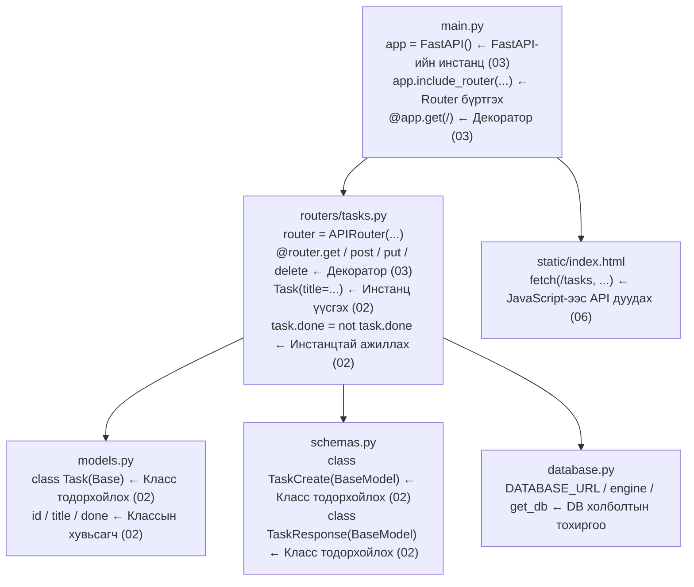

# Код унших — Шалгах эх кодоор сурсан зүйлээ бататгах

> 🇯🇵 Эх хувь (япон хэлээр): [07_コードリーディング.md](<../../1年生_前期_ITシステム基礎/番外編/07_コードリーディング.md>) <!-- original-ja-link -->

## Энэ удаагийн зорилго
- `02_Python_OOP入門`-д сурсан класс бодит кодын хаана ашиглагдаж байгааг тайлбарлаж чаддаг болох
- `03_FastAPI入門`-д сурсан декоратор бодит кодын хаана ашиглагдаж байгааг тайлбарлаж чаддаг болох
- 5 файл хоорондоо хэрхэн холбогддогийг ойлгох

---

## Файлуудыг унших дараалал

```
① models.py     ← OOP (класс)-ын нэгдсэн жишээ
② schemas.py    ← OOP (класс)-ын нэгдсэн жишээ
③ main.py       ← FastAPI (декоратор)-ын нэгдсэн жишээ
④ routers/tasks.py ← OOP ба FastAPI хоёулаа гарч ирнэ
⑤ database.py   ← Холболтын тохиргоо (лавлах зорилгоор)
```

---

## ① models.py-г унших

```python
from sqlalchemy import Column, Integer, String, Boolean
from database import Base

class Task(Base):
    __tablename__ = "tasks"

    id    = Column(Integer, primary_key=True, index=True)
    title = Column(String(200), nullable=False)
    done  = Column(Boolean, default=False)
```

### 02_OOP入門-тэй харьцуулах нь

**`class Task` → Класс тодорхойлох (02-ын 1-р алхамд сурсан)**

```
02-т сурсан бичих арга      Бодит код
─────────────────────    ──────────────────────
class Task:              class Task(Base):
    pass                     __tablename__ = "tasks"
```

`(Base)`-г **удамшил** гэдэг. `Base` гэдэг классын боломжуудыг өвлөн авч `Task` классыг үүсгэж байна.
«SQLAlchemy-ийн бүх боломжийг ашиглах тохиргоо» гэж ойлгоорой.

---

**`id / title / done` → Классын хувьсагч (инстанцын агуулдаг өгөгдөл)**

02-ын `Task` класст `self.title`, `self.done`-г конструктор дотор тодорхойлсон.
`models.py`-д SQLAlchemy-ийн `Column()`-г ашиглан яг ижил зүйлийг хийж байна.

```
02-т сурсан бичих арга          Бодит код (models.py)
─────────────────────────    ──────────────────────────────────
class Task:                  class Task(Base):
    def __init__(self):
        self.title = ...         title = Column(String(200))
        self.done = False        done  = Column(Boolean, default=False)
```

Бичих арга нь өөр боловч «**класс ямар өгөгдөл агуулахыг**» тодорхойлж байгаа нь адилхан.

---

**Инстанц үүсгэж буй хэсэг (routers/tasks.py-аас)**

```python
# Task классаас инстанц үүсгэнэ (02-ын 2-р алхамтай адилхан!)
new_task = Task(title=task_in.title)
#          ↑ Task класс   ↑ title-д утга дамжуулна
```

02-ын дасгалтай харьцуулбал:
```python
# 02-ын дасгал                    Бодит код
task1 = Task("買い物に行く")   new_task = Task(title="買い物に行く")
```

Хийж буй зүйл нь яг адилхан.

---

## ② schemas.py-г унших

```python
from pydantic import BaseModel

class TaskCreate(BaseModel):
    title: str

class TaskResponse(BaseModel):
    id: int
    title: str
    done: bool

    class Config:
        from_attributes = True
```

### 02_OOP入門-тэй харьцуулах нь

**2 класс тодорхойлогдсон → Зориулалт нь өөр**

```
Классын нэр      Үүрэг                       Инстанц үүсэх үе
────────────    ─────────────────────    ──────────────────────────────
TaskCreate      POST хүсэлтийг хүлээн авна   Хөтөч дээр «Нэмэх» дарагдах үед
TaskResponse    Хариу буцаана                API үр дүнг буцаах үед
```

**`title: str` → Төрлийн тайлбартай (type annotation) классын хувьсагч**

02-т `self.title = title` гэж бичсэн боловч
Pydantic класст `title: str` гэж бичихэд л «title бол тэмдэгт мөр» гэж тодорхойлж чадна.

```python
# 02-ын бичих арга (энгийн класс)       schemas.py-ийн бичих арга (Pydantic класс)
def __init__(self, title):         class TaskCreate(BaseModel):
    self.title = title                 title: str   ← 1 мөрөөр бичиж болно!
```

**`class Config` → Класс доторх класс**

Класс дотор өөр класс бичиж болно.
Энд SQLAlchemy-ийн загварын объектыг шууд дамжуулж болохоор болгох тохиргоог бичсэн байна.

---

## ③ main.py-г унших

```python
from fastapi import FastAPI
from fastapi.staticfiles import StaticFiles
from fastapi.responses import FileResponse
from database import engine, Base
import models
from routers import tasks

Base.metadata.create_all(bind=engine)

app = FastAPI()

app.include_router(tasks.router)

app.mount("/static", StaticFiles(directory="static"), name="static")

@app.get("/")
def read_index():
    return FileResponse("static/index.html")
```

### 03_FastAPI入門-тэй харьцуулах нь

**`app = FastAPI()` → FastAPI-ийн инстанц үүсгэх (03-т сурсан)**

```
03-т сурсан                Бодит код
─────────────────────    ──────────────────────
app = FastAPI()           app = FastAPI()   ← Яг адилхан!
```

---

**`@app.get("/")` → Декоратор (03-т сурсан)**

```python
@app.get("/")          # ← «/ руу GET хүсэлт ирвэл энэ функцийг дуудна»
def read_index():
    return FileResponse("static/index.html")
```

03-ын Hello World-тэй харьцуулбал:
```
03-ын дасгал                         Бодит код
─────────────────────────────────   ──────────────────────────────────
@app.get("/")                        @app.get("/")
def read_root():                     def read_index():
    return {"message": "Hello!"}         return FileResponse("static/index.html")
```

Зөвхөн `return`-ий агуулга л өөр бөгөөд декораторын хэрэглээ нь яг адилхан.

---

**`app.include_router(tasks.router)` → Шинээр гарч ирж буй: router**

03-т бүх endpoint-ийг `main.py`-д бичиж байсан.
Бодит системд даалгавартай холбоотой API-г `routers/tasks.py`-д нэгтгэн бичиж,
`main.py`-д «энэ router-ийг ашиглана» гэж бүртгэдэг.

```
03-ын үндсэн бүтэц (бүгдийг main.py-д бичнэ)   Бодит систем (файлуудыг салгана)
─────────────────────────────────   ──────────────────────────────────
@app.get("/tasks")                   routers/tasks.py-д бичнэ
@app.post("/tasks")                       ↓
@app.put("/tasks/{id}")              main.py-д бүртгэнэ
@app.delete("/tasks/{id}")           app.include_router(tasks.router)
```

**Яагаад файлуудыг салгадаг вэ?**
→ Даалгавар, хэрэглэгч, бараа зэрэгтэй холбоотой боломжууд нэмэгдэх үед бүгдийг 1 файлд бичвэл уншихад хэцүү болдог учраас.

---

**`Base.metadata.create_all(bind=engine)` → Хүснэгтийг автоматаар үүсгэх**

Апп асах бүрд «tasks хүснэгт байхгүй бол үүсгэнэ» гэдгийг автоматаар гүйцэтгэнэ.
`models.py`-ийн `Task` классыг үндэслэн хүснэгт үүсгэнэ.

---

## ④ routers/tasks.py-г унших

OOP (02) ба FastAPI (03) хоёулаа гарч ирдэг хамгийн чухал файл юм.

```python
from fastapi import APIRouter, Depends, HTTPException
from sqlalchemy.orm import Session
from database import get_db
from models import Task
from schemas import TaskCreate, TaskResponse

router = APIRouter(prefix="/tasks", tags=["tasks"])
```

**`router = APIRouter(...)` → app-тай адил, router-т зориулсан инстанц**

```
main.py             routers/tasks.py
────────────────    ──────────────────────────────
app = FastAPI()     router = APIRouter(prefix="/tasks")
@app.get("/")       @router.get("")
```

`prefix="/tasks"`-ийн утга: энэ router-ийн декоратор дээр бичсэн URL-ийн өмнө `/tasks` автоматаар залгагдана.

```
@router.get("")   →  Бодит URL нь /tasks
@router.get("/{task_id}")  →  Бодит URL нь /tasks/{task_id}
```

---

### GET /tasks — Жагсаалт авах

```python
@router.get("", response_model=list[TaskResponse])
def get_tasks(db: Session = Depends(get_db)):
    return db.query(Task).all()
```

**`@router.get("")` → Декоратор (03-т сурсан)**
`router`-т хавсаргаснаар `/tasks` руу ирэх GET хүсэлтийг хүлээн авна.

**`response_model=list[TaskResponse]` → Хариуны хэлбэрийг заах**
`schemas.py`-ийн `TaskResponse` классын жагсаалтыг буцаана гэж зарлаж байна.

**`Depends(get_db)` → Шинээр гарч ирж буй: хамаарлын тарилга (dependency injection)**
«`get_db` функцийн үр дүнг (DB-тэй холболт) `db`-д дамжуулаарай» гэсэн FastAPI-ийн механизм юм.
API дуудагдах бүрд DB-тэй холболтыг автоматаар бэлдэж өгнө.

**`db.query(Task).all()` → Task классын бүх инстанцыг авах**
```
db.query(Task).all()
             ↑
         OOP-ийн Task классыг зааж өгнө
         → tasks хүснэгтийн бүх мөрийг Task инстанцуудын жагсаалт болгон авна
```

---

### POST /tasks — Даалгавар үүсгэх

```python
@router.post("", response_model=TaskResponse)
def create_task(task_in: TaskCreate, db: Session = Depends(get_db)):
    new_task = Task(title=task_in.title)  # ← OOP! Инстанц үүсгэнэ
    db.add(new_task)
    db.commit()
    db.refresh(new_task)
    return new_task
```

**`task_in: TaskCreate` → schemas.py-ийн класс энд гарч ирнэ**
Хөтчөөс илгээсэн JSON автоматаар `TaskCreate` инстанц болон хувирна.

```
Хөтчийн илгээх өгөгдөл      FastAPI автоматаар хувиргана
────────────────────    ──────────────────────────────
{"title": "買い物"}  →  task_in = TaskCreate(title="買い物")
                                             ↑ task_in.title-ээр авч болно
```

**`new_task = Task(title=task_in.title)` → OOP (02-ын 2-р алхамтай адилхан)**

```
02-ын дасгал                      Бодит код
─────────────────────────────    ──────────────────────────────
task1 = Task("買い物に行く")       new_task = Task(title=task_in.title)
```

Инстанц үүсгэж, өгөгдөл хадгалуулж байгаа нь яг л OOP юм.

---

### PUT /tasks/{task_id} — Дууссан төлөвийг солих

```python
@router.put("/{task_id}", response_model=TaskResponse)
def toggle_task(task_id: int, db: Session = Depends(get_db)):
    task = db.query(Task).filter(Task.id == task_id).first()

    if task is None:
        raise HTTPException(status_code=404, detail="タスクが見つかりません")

    task.done = not task.done   # ← OOP! Инстанцын өгөгдлийг өөрчилнө
    db.commit()
    db.refresh(task)
    return task
```

**`/{task_id}` → Замын параметр (path parameter) (03-т сурсан)**

```
03-ын дасгал                       Бодит код
─────────────────────────────     ──────────────────────────────
@app.get("/tasks/{task_id}")       @router.put("/{task_id}")
def get_task(task_id: int):        def toggle_task(task_id: int, ...):
```

URL-д агуулагдах тоо (жишээ нь: `/tasks/3`) `task_id = 3` болж дамжиж ирнэ.

**`task.done = not task.done` → Инстанцын өгөгдлийг шууд өөрчлөх**

```
Авсан task инстанцын done-г эсрэгээр нь сэлгэнэ
task.done нь False → not False → True  (дуусаагүй → дууссан)
task.done нь True  → not True  → False (дууссан → дуусаагүй)
```

---

### DELETE /tasks/{task_id} — Устгах

```python
@router.delete("/{task_id}")
def delete_task(task_id: int, db: Session = Depends(get_db)):
    task = db.query(Task).filter(Task.id == task_id).first()

    if task is None:
        raise HTTPException(status_code=404, detail="タスクが見つかりません")

    db.delete(task)
    db.commit()
    return {"message": f"タスク '{task.title}' を削除しました"}
```

**`raise HTTPException(status_code=404, ...)` → Алдаа буцаах**

`task` олдоогүй үед (`is None`) хөтөч рүү 404 алдаа буцаана.
`raise` бол «энэ алдааг яг одоо үүсгэ» гэсэн Python-ы бичлэг (синтакс) юм.

---

## ⑤ Бүхэлдээ хэрхэн холбогддог вэ



---

## Дүгнэлт: 02, 03-т сурсан зүйлс хэрхэн ашиглагдаж байна вэ

| Сурсан агуулга | Материал | Бодит код |
|-----------|------|-------------|
| `class КлассынНэр:`-аар класс тодорхойлох | 02 | `models.py`-ийн `Task`, `schemas.py`-ийн `TaskCreate` гэх мэт |
| `инстанц = КлассынНэр(аргумент)` | 02 | `new_task = Task(title=...)` |
| Инстанцын өгөгдлийг өөрчлөх | 02 | `task.done = not task.done` |
| `app = FastAPI()` | 03 | `main.py`-ийн 1-р мөр |
| `@app.get(...)` декоратор | 03 | `@router.get("") / @router.post("") гэх мэт` |
| `/{параметр}` замын параметр | 03 | `@router.put("/{task_id}")` |

---

> Өмнөх алхам → [06_フロントエンド連携.md](./06_フロントエンド連携.md)
> Шалгах эх код → [検証/todo_app/](./検証/todo_app/)
