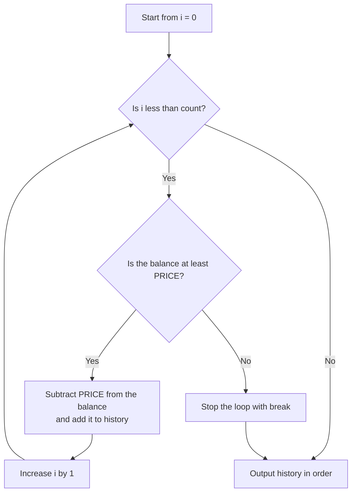
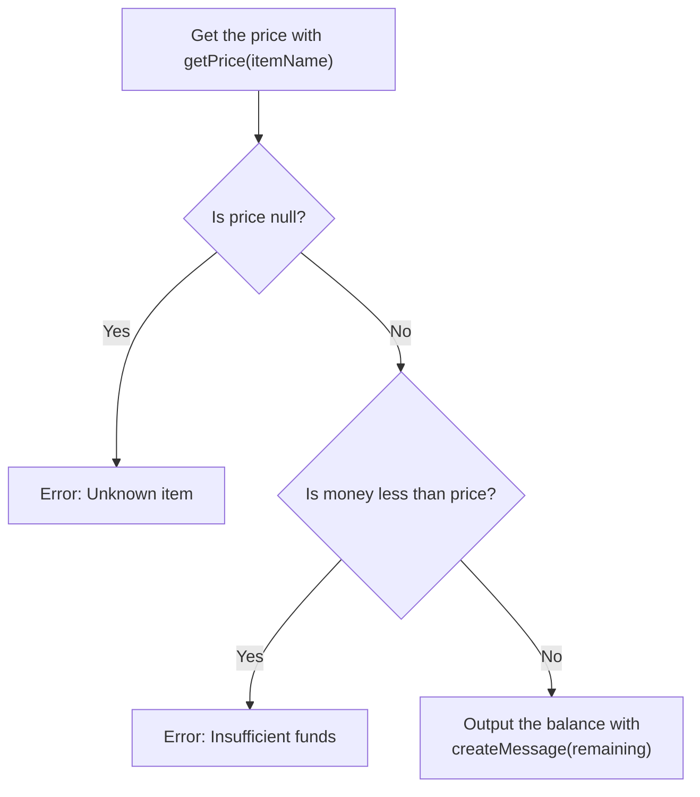

> 🇯🇵 Original (Japanese version): [2026_04_21_演習.md](<../../1年生_前期_ITシステム基礎/2026_04_21/2026_04_21_演習.md>) <!-- original-ja-link -->


---

## Comprehensive Exercise: Building a Vending Machine Program

### [STEP 1] Basics of Variables and Constants

**Requirements:**
- Define the product price as the constant `PRICE` (150).
- Read the "amount inserted" from standard input as a number.
- Calculate the "remaining balance" by subtracting the price from the amount inserted, and output `Remaining: [number]`.

JavaScript

```
const reader = require('readline').createInterface({
  input: process.stdin,
  output: process.stdout
});

const lines = [];
reader.on('line', (line) => {
  lines.push(line);
});

reader.on('close', () => {
  const PRICE = 150;
  let money = Number(lines[0]); // Input from line 1
  
  let remaining = money - PRICE;
  console.log(`Remaining: ${remaining}`);
});
```

---

### [STEP 2] Branching with if Statements

**Requirements:**
- If the amount inserted is less than `PRICE`, output `Error: Insufficient funds` and stop.
- Output the change only when there is enough money.

JavaScript

```
reader.on('close', () => {
  const PRICE = 150;
  let money = Number(lines[0]);

  if (money < PRICE) {
    console.log("Error: Insufficient funds");
  } else {
    let remaining = money - PRICE;
    console.log(`Remaining: ${remaining}`);
  }
});
```

---

### [STEP 3] Arrays and for Loops (Buying Multiple Items)

**Requirements:**
- Line 1 of the input gives the "amount inserted," and line 2 gives the "number of bottles to buy."
- Each time one bottle is bought, calculate the remaining balance and add it to the array `history`.
- If the remaining balance becomes insufficient partway through, stop the loop at that point.
- Finally, output the contents of the array one by one using a loop.

Here is how the purchase loop works.



JavaScript

```
reader.on('close', () => {
  let money = Number(lines[0]);
  const count = Number(lines[1]);
  const PRICE = 150;
  const history = [];

  // Purchase loop
  for (let i = 0; i < count; i++) {
    if (money >= PRICE) {
      money -= PRICE;
      history.push(money);
    } else {
      break;
    }
  }

  // Output the array contents with a loop (for loop version)
  for (let i = 0; i < history.length; i++) {
    // Access each element of the array with history[i]
    console.log(`Step ${i + 1}: ${history[i]}`);
  }
});
```


```
reader.on('close', () => {
  let money = Number(lines[0]);
  const count = Number(lines[1]);
  const PRICE = 150;
  const history = [];

  for (let i = 0; i < count; i++) {
    if (money >= PRICE) {
      money -= PRICE;
      history.push(money);
    } else {
      break;
    }
  }

  // Output the array contents with a loop
  history.forEach((rem, index) => {
    console.log(`Step ${index + 1}: ${rem}`);
  });
});
```

---

### [STEP 4] Refactoring: Multi-Way Branching with switch Statements

**Requirements:**

- Line 1 of the input gives the "amount inserted," and line 2 gives the "product name (Coke, Water, Coffee)."
- Use a `switch` statement to set the price based on the product name.
    - Coke: 150, Water: 100, Coffee: 120
    - Anything else: output `Error: Unknown item`.

JavaScript

```
reader.on('close', () => {
  let money = Number(lines[0]);
  const itemName = lines[1]; // Product name
  let price = 0;

  // Multi-way branching with if / else if
  if (itemName === "Coke") {
    price = 150;
  } else if (itemName === "Water") {
    price = 100;
  } else if (itemName === "Coffee") {
    price = 120;
  } else {
    // When none of the conditions match (equivalent to default in switch)
    console.log("Error: Unknown item");
    return; 
  }

  // Check whether the purchase can be made
  if (money >= price) {
    console.log(`Remaining: ${money - price}`);
  } else {
    console.log("Error: Insufficient funds");
  }
});
```

```
reader.on('close', () => {
  let money = Number(lines[0]);
  const itemName = lines[1]; // Line 2: product name
  let price = 0;

  switch (itemName) {
    case "Coke":
      price = 150;
      break;
    case "Water":
      price = 100;
      break;
    case "Coffee":
      price = 120;
      break;
    default:
      console.log("Error: Unknown item");
      return; // End processing
  }

  if (money >= price) {
    console.log(`Remaining: ${money - price}`);
  } else {
    console.log("Error: Insufficient funds");
  }
});
```

---

### [STEP 5] Final Refactoring: Using Functions

### [STEP 5] Refactoring: Functions and Template Literals

**Requirements:**
- Create a function `getPrice(name)` that returns the price for a product name.
- Create a function `createMessage(remaining)` that calculates the remaining balance after purchase and returns a string.
- Reorganize the main process using these functions.

Here is how the main process makes its decisions.



JavaScript

```
// Function that determines the price
const getPrice = (name) => {
  switch (name) {
    case "Coke":   return 150;
    case "Water":  return 100;
    case "Coffee": return 120;
    default:       return null;
  }
};

// Function that creates the message (template literal)
const createMessage = (remaining) => `Result: Remaining balance is ${remaining} yen.`;

reader.on('close', () => {
  const money = Number(lines[0]);
  const itemName = lines[1];
  
  const price = getPrice(itemName);

  if (price === null) {
    console.log("Error: Unknown item");
  } else if (money < price) {
    console.log("Error: Insufficient funds");
  } else {
    const remaining = money - price;
    console.log(createMessage(remaining));
  }
});
```

---

### 💡 Teaching Points for Class

- **Be aware of asynchronous processing:** Explain that if you write code outside `reader.on('close', ...)`, it runs before the input is complete and causes an error.
    
- **Array indexes:** It's important to make students aware of the order in which input is stored, as in `lines[0]` and `lines[1]`.
    
- **Why trim() is needed:** It isn't included in this code, but input can sometimes contain extra whitespace, so it would be helpful to teach students to write `lines.push(line.trim());` in practice.