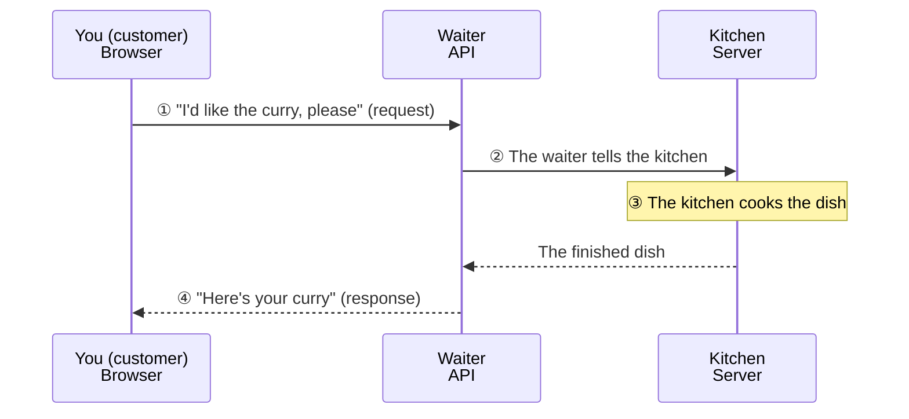
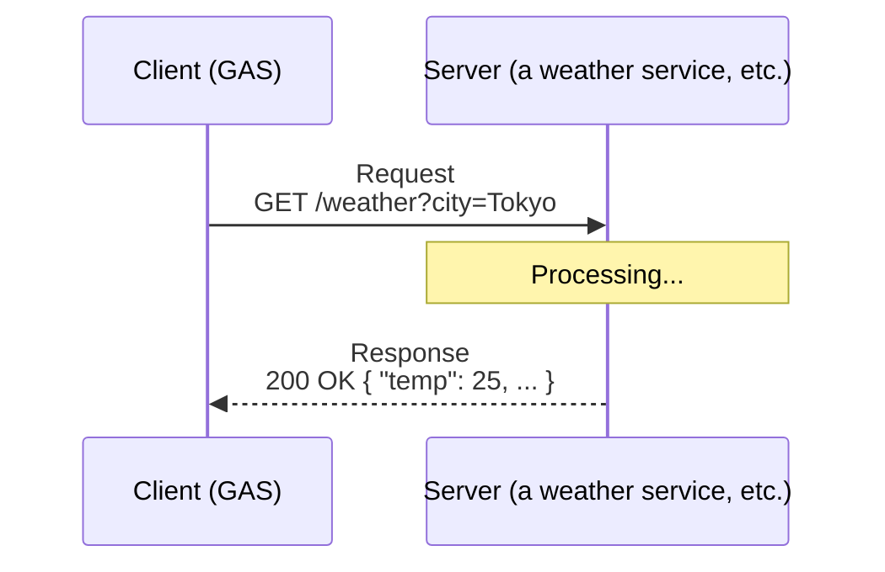
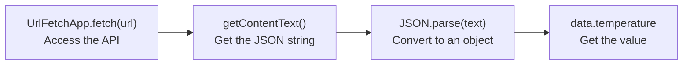

# What Is an API? — Requests, Responses, and JSON

> 🇯🇵 Original (Japanese version): [20260512_API説明資料.md](<../../1年生_前期_ITシステム基礎/2026_05_12/20260512_API説明資料.md>) <!-- original-ja-link -->

## Today's Goals
- You can explain what an API is in your own words
- You understand the concept of HTTP "requests and responses"
- You can read and understand JSON data
- You can call an external API with GAS's `UrlFetchApp`

---

## 1. What Is an API?

**API (Application Programming Interface) = a point of contact that lets apps talk to each other**

### An everyday example

Let's use a restaurant as an example.



You don't need to know how the kitchen (server) works behind the scenes.  
You just place your order through the waiter (API).

---

## 2. HTTP Requests and Responses



**Types of requests:**
| Method | Meaning | Example |
|---------|------|-----|
| GET | You want to get data | Fetching the weather |
| POST | You want to send or create data | Submitting a form |
| PUT | You want to update data | Changing your profile |
| DELETE | You want to delete data | Deleting a post |

**Response status codes:**
| Code | Meaning |
|--------|------|
| 200 | OK (success) |
| 404 | Not Found (could not be found) |
| 500 | Internal Server Error (server error) |

---

## 3. JSON — A Format for Exchanging Data

API data mostly comes in **JSON (JavaScript Object Notation)** format.

```json
{
  "city": "Tokyo",
  "weather": "晴れ",
  "temperature": 25.5,
  "humidity": 60,
  "forecast": [
    { "date": "2024-01-15", "temp": 24 },
    { "date": "2024-01-16", "temp": 22 },
    { "date": "2024-01-17", "temp": 27 }
  ]
}
```

Its syntax is almost the same as a JavaScript object's. You can apply what you learned in Lesson 08 directly!

---

## 4. Calling an External API with GAS

There are 4 steps to getting the data out.



```javascript
function callApi() {
  // UrlFetchApp.fetch(URL) = access the given URL and get data
  const url = "https://api.example.com/data";
  
  const response = UrlFetchApp.fetch(url);
  
  // Get the response content as a string
  const text = response.getContentText();
  console.log(text);  // The JSON string is displayed
  
  // Convert the JSON string to an object (we learned this in Lesson 08!)
  const data = JSON.parse(text);
  console.log(data.temperature);  // → 25.5
}
```

---

## 5. Try Using a Public API

### Example: Open-Meteo (a free weather API, no API key needed)

```javascript
function getWeather() {
  // Get weather data by specifying Tokyo's latitude and longitude
  const url = "https://api.open-meteo.com/v1/forecast?latitude=35.6762&longitude=139.6503&current_weather=true";
  
  // Send a request to the API
  const response = UrlFetchApp.fetch(url);
  
  // Get the response in JSON format
  const json = JSON.parse(response.getContentText());
  
  // current_weather contains the current weather data
  const weather = json.current_weather;
  
  console.log("気温: " + weather.temperature + "℃");
  console.log("風速: " + weather.windspeed + " km/h");
  
  // Convert some weather codes to Japanese descriptions
  const weatherCodes = {
    0: "快晴",
    1: "晴れ",
    2: "一部曇り",
    3: "曇り",
    61: "弱い雨",
    63: "適度な雨",
    65: "強い雨",
  };
  
  const weatherText = weatherCodes[weather.weathercode] || "不明";
  console.log("天気: " + weatherText);
}
```

---

## 6. Writing the API Response to a Sheet

```javascript
function weatherToSheet() {
  const sheet = SpreadsheetApp.getActiveSpreadsheet().getActiveSheet();
  
  // Get weather data from the API
  const url = "https://api.open-meteo.com/v1/forecast?latitude=35.6762&longitude=139.6503&current_weather=true";
  const response = UrlFetchApp.fetch(url);
  const data = JSON.parse(response.getContentText());
  const weather = data.current_weather;
  
  // Get the current time
  const now = new Date();
  const timeStr = Utilities.formatDate(now, "Asia/Tokyo", "yyyy/MM/dd HH:mm");
  
  // Write to the row after the last row
  const nextRow = sheet.getLastRow() + 1;
  sheet.getRange(nextRow, 1).setValue(timeStr);
  sheet.getRange(nextRow, 2).setValue(weather.temperature);
  sheet.getRange(nextRow, 3).setValue(weather.windspeed);
  
  console.log("天気データを記録しました！");
}
```

---

## Summary

| Term                       | Meaning                |
| ------------------------ | ----------------- |
| API                      | A point of contact that lets apps talk to each other      |
| Request                    | A message from the client to the server asking for something  |
| Response                    | The server's reply to the client  |
| JSON                     | A format used for exchanging data     |
| `UrlFetchApp.fetch(url)` | Accesses a URL in GAS |
| `JSON.parse(str)`        | Converts a JSON string to an object |

---

## Next Time (Lesson 14)

We'll do an exercise that uses public APIs for data such as weather and exchange rates to automatically record data in a spreadsheet.
