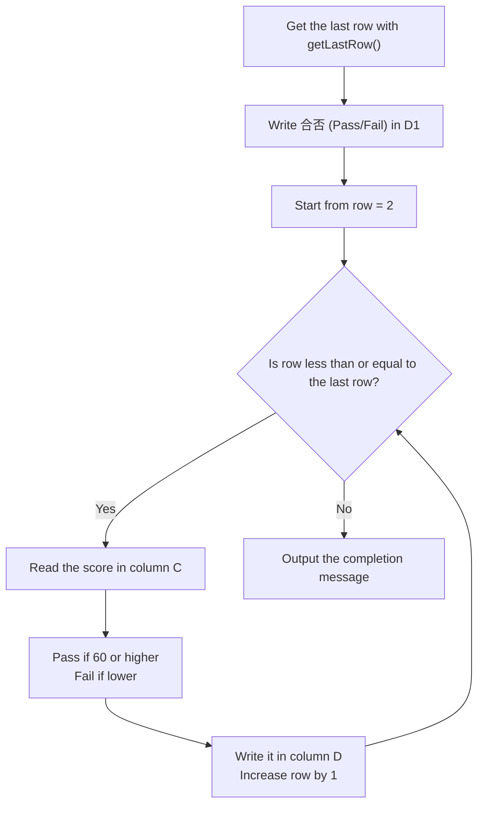

# Exercises

> 🇯🇵 Original (Japanese version): [20260512_演習回答.md](<../../1年生_前期_ITシステム基礎/2026_05_12/20260512_演習回答.md>) <!-- original-ja-link -->

## Preparation: Create a Spreadsheet

1. Create a new Google spreadsheet
2. Name the spreadsheet "GAS演習"
3. Open "Extensions" → "Apps Script"

---

## Exercise 1: Write Information into Cells

### Problem

> **Estimated time: 10–15 minutes**

Let's use GAS to create a function that writes your self-introduction into the spreadsheet.

**What to do:**

1. Create a function named `jikoshokaSheet`
2. Get the current sheet into a variable named `sheet` (see Chapter 3 of the handout)
3. Write a value into each cell as shown in the table below

| Cell | What to write |
|------|------------|
| A1 | The string `"自己紹介"` (Self-introduction) |
| B1 | **Your name** (e.g. `"田中太郎"`) |
| A2 | The string `"年齢"` (Age) |
| B2 | **Your age** (a number, without quotes) |

4. **On top of that**, try using A3–B4 to add any information you like (hobbies, hometown, etc.)

> **Hint:** To write into a cell, use `getRange("A1").setValue(value)` (Chapter 3 of the handout)

**Run the function and check that the information was written to the sheet**

### Answer

```javascript
function jikoshokaSheet() {
  const sheet = SpreadsheetApp.getActiveSpreadsheet().getActiveSheet();
  
  // Write "自己紹介" in A1
  sheet.getRange("A1").setValue("自己紹介");
  
  // Write your name in B1 (← change this)
  sheet.getRange("B1").setValue("田中太郎");
  
  // Write "年齢" in A2 and your age as a number in B2
  sheet.getRange("A2").setValue("年齢");
  sheet.getRange("B2").setValue(18);
  
  // Try adding A3, B3, A4, and B4 yourself too
}
```

---

## Exercise 2: Write a Grade Table All at Once

### Problem

> **Estimated time: 20–30 minutes**

Writing one cell at a time is a lot of work. This time, let's use **a 2D array and `setValues()`** to create a function that writes a grade table all at once.

**What to do:**

1. Create a function named `seisekiTable`
2. First, **clear the whole sheet** (use `clearContents()`)
3. Write the headers `"番号"`, `"名前"`, `"点数"` (Number, Name, Score) in row 1
   - Write the **2D array** `[["番号", "名前", "点数"]]` with `setValues()`
   - Use `getRange(1, 1, 1, 3)` to specify "1 row × 3 columns, starting from row 1, column 1" (Chapter 5 of the handout)
4. From row 2 onward, write the data for the following 5 students

| Number | Name | Score |
|------|------|------|
| 1 | 田中太郎 | 85 |
| 2 | 鈴木花子 | 72 |
| 3 | 山田次郎 | 91 |
| 4 | 佐藤三郎 | 68 |
| 5 | 伊藤美咲 | 78 |

   - Prepare the data as a 2D array and write it with `getRange(2, 1, number of data rows, number of data columns)`
5. Make the header row (row 1) **bold** with a **gray background color** (`"#CCCCCC"`) (Chapter 7 of the handout)

> **Hint:** You can get the number of rows with `data.length` and the number of columns with `data[0].length`

### Answer

```javascript
function seisekiTable() {
  const sheet = SpreadsheetApp.getActiveSpreadsheet().getActiveSheet();
  
  // Clear the sheet (erase the previous data)
  sheet.clearContents();
  
  // Header row
  const header = [["番号", "名前", "点数"]];
  sheet.getRange(1, 1, 1, 3).setValues(header);
  
  // Data rows (5 students)
  const data = [
    [1, "田中太郎", 85],
    [2, "鈴木花子", 72],
    [3, "山田次郎", 91],
    [4, "佐藤三郎", 68],
    [5, "伊藤美咲", 78],
  ];
  
  // Write starting from row 2
  sheet.getRange(2, 1, data.length, data[0].length).setValues(data);
  
  // Make the header bold
  sheet.getRange(1, 1, 1, 3).setFontWeight("bold");
  sheet.getRange(1, 1, 1, 3).setBackground("#CCCCCC");
}
```

---

## Exercise 3: Read and Process Cell Values

### Problem

> **Estimated time: 30–40 minutes**

**Work on this after running Exercise 2.**

Let's create a function that reads the scores from the grade table you made in Exercise 2, automatically decides "pass/fail," and writes the result in column D.

**What to do:**

1. Create a function named `readAndProcess`

2. Use `getLastRow()` to get the number of the last row that contains data (Chapter 6 of the handout)

3. Write the header `"合否"` (Pass/Fail) in row 1 of column D (column 4)
   - Use `getRange(1, 4)` to specify "row 1, column 4"

4. Use a `for` loop to process each row from row 2 to the last row
   - Read the score in column C (column 3) of each row with `getValue()`
   - Decide **`"合格"` (pass) if the score is 60 or higher**, and **`"不合格"` (fail) if it's lower**
     - Use the ternary operator `score >= 60 ? "合格" : "不合格"`
   - Write the result in column D (column 4) with `setValue()`

5. After the loop finishes, output `console.log("合否判定が完了しました！")`

> **Hint:** You can specify the row and column as numbers with `getRange(row number, column number)` (Chapter 4 of the handout)

Here is the flow of the process as a diagram.



**After running it, check that pass/fail is shown in column D**

### Answer

```javascript
function readAndProcess() {
  const sheet = SpreadsheetApp.getActiveSpreadsheet().getActiveSheet();
  
  // Run this code after running Exercise 2
  
  // Read the data from row 2 to the last row
  const lastRow = sheet.getLastRow();
  
  // Write "合否" in column D (column 4)
  // Header
  sheet.getRange(1, 4).setValue("合否");
  
  for (let row = 2; row <= lastRow; row++) {
    // Read the score in column C (column 3)
    const score = sheet.getRange(row, 3).getValue();
    
    // Pass if 60 or higher, fail if lower
    const result = score >= 60 ? "合格" : "不合格";
    
    // Write it in column D
    sheet.getRange(row, 4).setValue(result);
  }
  
  console.log("合否判定が完了しました！");
}
```

---

## Exercise 4: Format the Table

### Problem

> **Estimated time: 15–20 minutes**

**Work on this after running Exercise 3.**

Let's read the "合否" (Pass/Fail) column you wrote in Exercise 3 and add a **background color** to the pass and fail rows, so the grade table shows the results at a glance.

**What to do:**

1. Create a function named `colorFormat`
2. Use `getLastRow()` to get the last row number
3. Use a `for` loop to process each row from row 2 to the last row
   - Read the value in column D (column 4) with `getValue()`
   - If the value is `"合格"` (pass), set the background color of that row (columns 1–4) to **light blue** `"#CCE5FF"`
   - If the value is `"不合格"` (fail), set the background color of that row to **light orange** `"#FFE5CC"`
   - To specify the width of one row, use `getRange(row number, 1, 1, 4)` ("1 row × 4 columns, starting at column 1 of the specified row")

> **Checkpoint:** After running it, it worked if the rows that passed are blue and the rows that failed are orange

### Answer

```javascript
function colorFormat() {
  const sheet = SpreadsheetApp.getActiveSpreadsheet().getActiveSheet();
  const lastRow = sheet.getLastRow();
  
  for (let row = 2; row <= lastRow; row++) {
    const result = sheet.getRange(row, 4).getValue();
    
    if (result === "合格") {
      // Make rows that passed light blue
      sheet.getRange(row, 1, 1, 4).setBackground("#CCE5FF");
    } else {
      // Make rows that failed light orange
      sheet.getRange(row, 1, 1, 4).setBackground("#FFE5CC");
    }
  }
}
```
