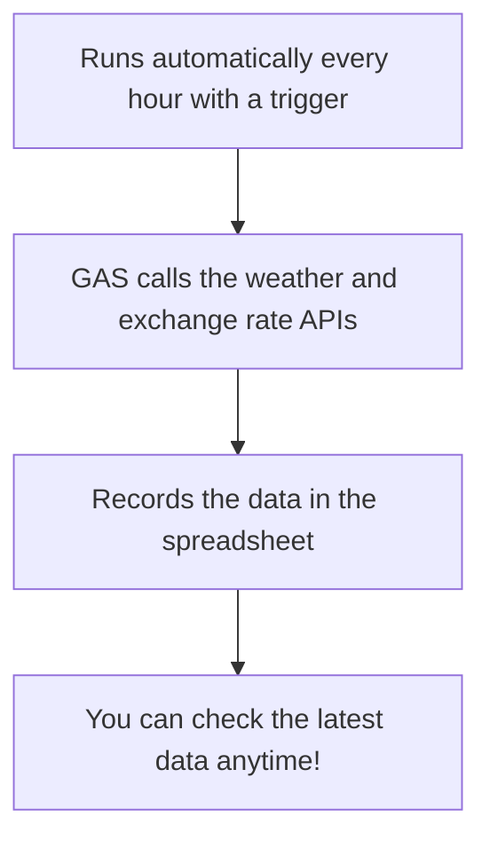

# GAS + API Exercise — Automatically Recording Weather and Exchange Rate Data in a Sheet

> 🇯🇵 Original (Japanese version): [20260519.md](<../../1年生_前期_ITシステム基礎/2026_05_19/20260519.md>) <!-- original-ja-link -->

## Today's Goals
- You can call a public API and get data
- You can automatically record the data you get in a spreadsheet
- You will complete an automation tool that works with triggers

---

## 1. What We'll Build Today



---

## 2. Exchange Rate API (ExchangeRate-API)

This is an exchange rate API you can use for free.

```javascript
function getExchangeRate() {
  // Get the exchange rates from dollars to each currency
  // base=USD → how many yen, euros, etc. one dollar is worth
  const url = "https://open.er-api.com/v6/latest/USD";
  
  const response = UrlFetchApp.fetch(url);
  const data = JSON.parse(response.getContentText());
  
  // data.rates contains the rate for each currency
  const jpyRate = data.rates.JPY;   // Dollar → yen
  const eurRate = data.rates.EUR;   // Dollar → euro
  const gbpRate = data.rates.GBP;   // Dollar → pound
  
  console.log(`1ドル = ${jpyRate}円`);
  console.log(`1ドル = ${eurRate}ユーロ`);
  console.log(`1ドル = ${gbpRate}ポンド`);
  
  return { JPY: jpyRate, EUR: eurRate, GBP: gbpRate };
}
```

---

## 3. Weather API (Open-Meteo)

```javascript
function getWeatherData() {
  // Tokyo's weather (review of Lesson 13)
  const url = "https://api.open-meteo.com/v1/forecast"
    + "?latitude=35.6762"
    + "&longitude=139.6503"
    + "&current_weather=true"
    + "&hourly=temperature_2m,precipitation_probability";
  
  const response = UrlFetchApp.fetch(url);
  const data = JSON.parse(response.getContentText());
  
  const current = data.current_weather;
  return {
    temperature: current.temperature,
    windspeed: current.windspeed,
    weathercode: current.weathercode
  };
}
```

---

## 4. Putting It All Together: A System That Automatically Records Data in a Spreadsheet

```javascript
// Write the headers in row 1 of the sheet (run only once at the start)
function setupHeader() {
  const sheet = SpreadsheetApp.getActiveSpreadsheet().getActiveSheet();
  sheet.clearContents();
  
  const headers = [["記録日時", "気温(℃)", "風速(km/h)", "1ドル(円)", "1ドル(ユーロ)"]];
  sheet.getRange(1, 1, 1, headers[0].length).setValues(headers);
  sheet.getRange(1, 1, 1, headers[0].length).setFontWeight("bold");
  sheet.getRange(1, 1, 1, headers[0].length).setBackground("#4A90D9");
  sheet.getRange(1, 1, 1, headers[0].length).setFontColor("#FFFFFF");
  
  console.log("ヘッダーを設定しました");
}

// Main function that runs on a schedule (set up a trigger to run it)
function recordData() {
  const sheet = SpreadsheetApp.getActiveSpreadsheet().getActiveSheet();
  
  // Current time
  const now = new Date();
  const timeStr = Utilities.formatDate(now, "Asia/Tokyo", "yyyy/MM/dd HH:mm");
  
  // Get the weather data
  let temperature = "取得失敗";
  let windspeed = "取得失敗";
  
  try {
    const weatherUrl = "https://api.open-meteo.com/v1/forecast?latitude=35.6762&longitude=139.6503&current_weather=true";
    const weatherRes = UrlFetchApp.fetch(weatherUrl);
    const weatherData = JSON.parse(weatherRes.getContentText());
    temperature = weatherData.current_weather.temperature;
    windspeed = weatherData.current_weather.windspeed;
  } catch (e) {
    // Don't stop the program even if an error occurs
    console.log("天気取得エラー: " + e.message);
  }
  
  // Get the exchange rate data
  let jpyRate = "取得失敗";
  let eurRate = "取得失敗";
  
  try {
    const fxUrl = "https://open.er-api.com/v6/latest/USD";
    const fxRes = UrlFetchApp.fetch(fxUrl);
    const fxData = JSON.parse(fxRes.getContentText());
    jpyRate = Math.round(fxData.rates.JPY * 100) / 100;  // Round to 2 decimal places
    eurRate = Math.round(fxData.rates.EUR * 10000) / 10000;
  } catch (e) {
    console.log("為替取得エラー: " + e.message);
  }
  
  // Append after the last row
  const nextRow = sheet.getLastRow() + 1;
  const newData = [[timeStr, temperature, windspeed, jpyRate, eurRate]];
  sheet.getRange(nextRow, 1, 1, newData[0].length).setValues(newData);
  
  console.log(`データを記録しました: ${timeStr}`);
}
```

---

## 5. How to Use It

**First-time setup:**
1. Run `setupHeader()` once
2. Set up a trigger
3. After that, data is collected automatically!

**Checking that it works:**
- Run `recordData()` manually a few times and check that new rows are added

---

## Summary: Phase 3 Complete!

| What we learned | Summary |
|-----------|-------|
| SpreadsheetApp | Reading and writing cells |
| for loop | Processing every row automatically |
| Trigger | Running automatically based on time or events |
| GmailApp | Sending emails automatically |
| UrlFetchApp | Getting data from external APIs |
| JSON.parse | Converting a JSON string to an object |

---