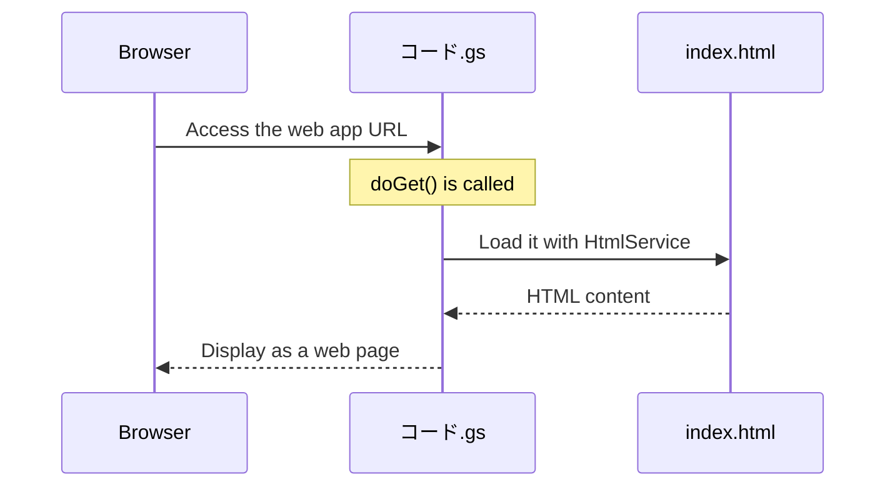

# HTML Basics — Tags, Structure, and Forms

> 🇯🇵 Original (Japanese version): [20260519_html.md](<../../1年生_前期_ITシステム基礎/2026_05_19/20260519_html.md>) <!-- original-ja-link -->

## Today's Goals
- Write the basic structure of an HTML page
- Use common tags with confidence
- Build forms
- Display a web page with the GAS HTML Service

---

## 1. What Is HTML?

**HTML (HyperText Markup Language) = the language that builds the "skeleton" of a web page**

```
Parts of a web page:
├── HTML → structure and content (bones and flesh)
├── CSS  → appearance (clothes and makeup)
└── JS   → behavior (muscles)
```

---

## 2. Basic Structure

```html
<!DOCTYPE html>
<html lang="ja">
<head>
  <!-- The head contains configuration information for the browser. It is not displayed on the page -->
  <meta charset="UTF-8">
  <title>ページタイトル</title>  <!-- shown on the browser tab -->
</head>
<body>
  <!-- Whatever you write inside body is shown on screen -->
  <h1>見出し1</h1>
  <p>段落テキスト</p>
</body>
</html>
```

---

## 3. Commonly Used Tags

### Headings and Paragraphs

```html
<h1>大見出し（一番大きい）</h1>
<h2>中見出し</h2>
<h3>小見出し</h3>
<p>段落テキスト。改行は自動。</p>
<br>  <!-- forced line break -->
<hr>  <!-- horizontal line -->
```

### Links and Images

```html
<!-- Links -->
<a href="https://google.com">Google へ</a>
<a href="page2.html">次のページ</a>          <!-- within the same site -->
<a href="https://google.com" target="_blank">新しいタブで開く</a>

<!-- Images -->

<!-- alt = alternative text shown when the image can't be displayed -->
```

### Lists

```html
<!-- Unordered list (ul = unordered list) -->
<ul>
  <li>りんご</li>
  <li>みかん</li>
  <li>ぶどう</li>
</ul>

<!-- Ordered list (ol = ordered list) -->
<ol>
  <li>手を洗う</li>
  <li>野菜を切る</li>
  <li>炒める</li>
</ol>
```

### Tables

```html
<table border="1">
  <thead>
    <tr>
      <th>名前</th>   <!-- th = header cell (bold, centered) -->
      <th>点数</th>
    </tr>
  </thead>
  <tbody>
    <tr>
      <td>田中太郎</td>   <!-- td = data cell -->
      <td>85</td>
    </tr>
    <tr>
      <td>鈴木花子</td>
      <td>72</td>
    </tr>
  </tbody>
</table>
```

### div and span (Grouping)

```html
<!-- div = a block-level container for grouping content (stacked vertically) -->
<div class="box">
  <h2>タイトル</h2>
  <p>内容</p>
</div>

<!-- span = an inline container for grouping content (flows horizontally) -->
<p>テキストの<span style="color: red;">一部だけ</span>を変える</p>
```

---

## 4. Forms

Forms are the parts that accept input from users.

```html
<form action="" method="post">
  <!-- Text input -->
  <label for="namae">名前：</label>
  <input type="text" id="namae" name="namae" placeholder="名前を入力">
  
  <br>
  
  <!-- Email input -->
  <label for="email">メール：</label>
  <input type="email" id="email" name="email">
  
  <br>
  
  <!-- Number input -->
  <label for="age">年齢：</label>
  <input type="number" id="age" name="age" min="0" max="150">
  
  <br>
  
  <!-- Select box -->
  <label for="grade">学年：</label>
  <select id="grade" name="grade">
    <option value="1">1年生</option>
    <option value="2">2年生</option>
    <option value="3">3年生</option>
  </select>
  
  <br>
  
  <!-- Text area (multiple lines) -->
  <label for="comment">コメント：</label>
  <textarea id="comment" name="comment" rows="4" cols="40"></textarea>
  
  <br>
  
  <!-- Submit button -->
  <button type="submit">送信する</button>
</form>
```

---

## 5. Displaying a Web Page with the GAS HTML Service

You can publish a web page using GAS!

**File structure (create these in the GAS editor):**
- `コード.gs` (the main GAS file)
- `index.html` (the HTML file to display)

**コード.gs:**
```javascript
// Function for publishing as a web app
// Called when someone accesses the URL
function doGet() {
  // Load and display index.html
  return HtmlService.createHtmlOutputFromFile("index")
    .setTitle("私のWebページ");
}
```

**index.html:**
```html
<!DOCTYPE html>
<html lang="ja">
<head>
  <meta charset="UTF-8">
  <title>GASのWebページ</title>
</head>
<body>
  <h1>こんにちは！GAS HTML サービス</h1>
  <p>これはGASで表示したWebページです。</p>
  
  <ul>
    <li>スプレッドシートのデータを表示できる</li>
    <li>フォームの送信を受け取れる</li>
    <li>インターネットで公開できる</li>
  </ul>
</body>
</html>
```

When you visit the published URL, the page is displayed through the following sequence of steps.



**How to publish it as a web app:**
1. "Deploy" → "New deployment"
2. Type: select "Web app"
3. Who has access: "Anyone"
4. "Deploy" → a URL is issued!

---

## Summary

| Tag | Purpose |
|------|------|
| `<h1>`–`<h6>` | Headings |
| `<p>` | Paragraph |
| `<a href="">` | Link |
| `` | Image |
| `<ul>` / `<ol>` / `<li>` | Lists |
| `<table>` / `<tr>` / `<td>` | Tables |
| `<form>` | Form (accepts input) |
| `<input>` / `<button>` | Input fields and buttons |
| `<div>` / `<span>` | Grouping |

---
