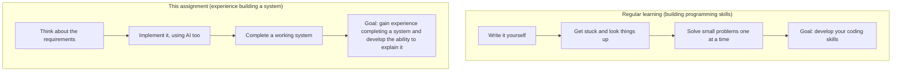
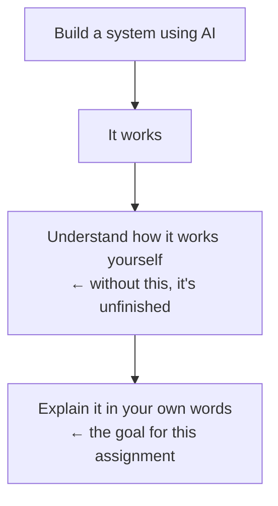

# Purpose of This Course — Looking Back on the Final Assignment

> 🇯🇵 Original (Japanese version): [授業の趣旨_まとめ.md](<../1年生_前期_ITシステム基礎/授業の趣旨_まとめ.md>) <!-- original-ja-link -->

The presentations are already over, but I want to explain once more what I intended with this assignment.
Some of you may have heard the presentations and wondered, "Were we really allowed to use AI?" or "Didn't we have to write the code ourselves?" This also answers those questions.

---

## 1. The Most Important Message of This Course

I believe programming is not something you can learn just by reading or listening to explanations — **the only way to learn it is to write code and build things yourself**.

As a concrete way to do that, I recommend using the skill checks on the learning site **paiza**, in this order:

```
[ Rank D ]  ──── solve lots of them ────▶ [ Rank C ]
 Practice basic syntax and           Take on slightly harder
 problem-solving by writing code     problems to build applied skills
```

Even after this assignment is over, this remains the standard path for anyone who wants to improve their actual programming skills.

---

## 2. Where This Assignment Fits

This final assignment had a slightly different aim from the learning method above.



- **Using AI was allowed**
- The focus was not "Can you write correct code entirely by hand?" but **the experience itself of actually building one system from scratch**

In other words, this assignment was not practice in writing code line by line yourself. It put priority on the experience of organizing requirements and turning them into something that works, with help from AI.

---

## 3. Why Explaining It in the Presentation Was Required

The "explanation in the presentation" requirement in the submission rules is the most important part of this assignment.



Even if you built the system with AI, I expect you to be able to **explain in your own words**:

- What you built it for
- How it works
- Which parts of the code you improved or adjusted yourself

The point of this requirement is not to let AI build it and call it done, but to make sure you understand how the finished product works well enough to explain it.

---

## 4. For Those Who Want to Write Their Own Code

Because AI was allowed this time, some of you seem to have wondered, "Does that mean we're expected to use AI?"

That is not the case. **If you want to write the code yourself, go right ahead.** I evaluate based on "what you can do," so whether you wrote the code yourself or used AI, if it meets the requirements and you can explain it yourself, it is evaluated the same way.

In fact, if you seriously want to improve your programming skills, there is no way around the experience of writing code yourself, getting stuck, and looking things up — like the paiza Rank D → C practice mentioned in Section 1. Allowing AI this time does not mean you can stop learning that way.

---

## 5. AI and the Reality of Development

The way this assignment worked is also meant to be close to how development is actually done in the workplace.

```
┌─────────────────────────────────────────────────────┐
│  Rough initial implementation                       │ ← often handled by AI
└──────────────────────────┬──────────────────────────┘
                           ▼
┌─────────────────────────────────────────────────────┐
│  Investigating bugs and making detailed fixes       │
│  Understanding how it works and explaining it       │ ← handled by people (you)
└─────────────────────────────────────────────────────┘
```

In today's development workplaces, this division of responsibilities is becoming more common:

- It is becoming common to leave the rough initial implementation to AI
- Meanwhile, people handle investigating bugs, making detailed fixes, and understanding and explaining how things work

Part of the reason I designed the assignment as "build it with AI, then explain it yourself at the end" was to let you experience how development works today.

---

## Summary

- The standard path to improving your programming skills is writing code yourself, getting stuck, and looking things up (paiza Rank D → C)
- This assignment was on a separate track from that path, aimed at "the experience of finishing a whole system, even with AI's help"
- Whether you built it with AI or wrote it yourself, it is evaluated the same. What matters is being able to explain it in your own words at the end
- This experience also reflects how development is carried out in workplaces today
