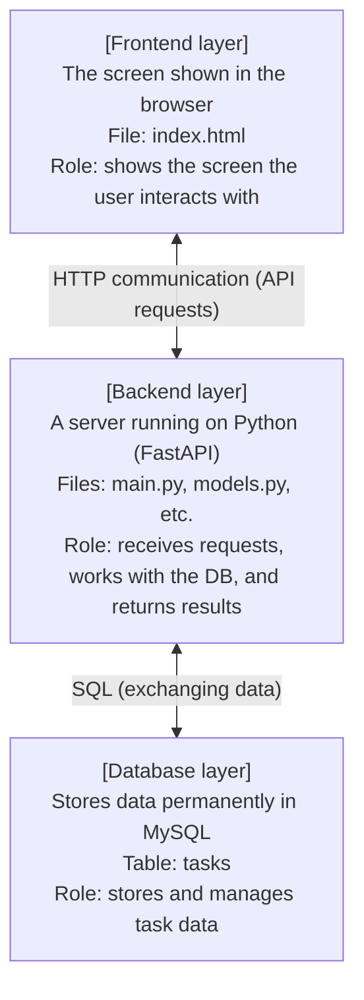
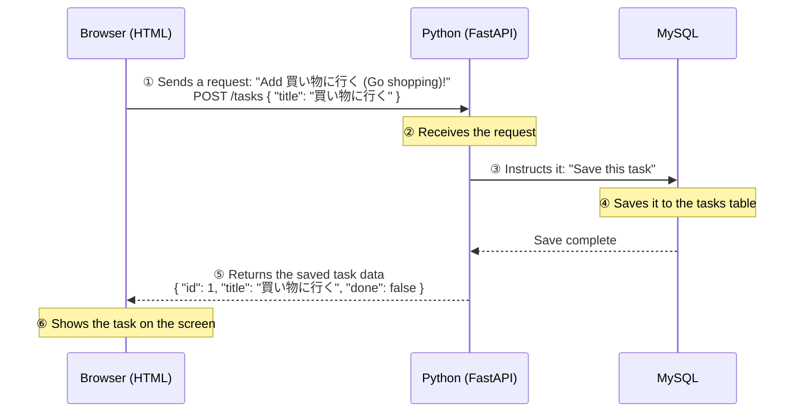

# Extra Lesson: Let's Build a Task Management System

> 🇯🇵 Original (Japanese version): [00_概要とシステム設計.md](<../../1年生_前期_ITシステム基礎/番外編/00_概要とシステム設計.md>) <!-- original-ja-link -->

## Goals for This Lesson
- Understand a three-tier system made of HTML + Python + MySQL
- Implement a backend in Python
- Understand how the frontend (HTML) and backend (Python) work together through an API

---

## 1. What Are We Building?

**A task management app (a to-do app)**

```
┌─────────────────────────────────────────┐
│           Task Management App           │
│                                         │
│  [ To-Do List ]                         │
│  □ Go shopping         [Done] [Delete]  │
│  ☑ Finish homework     [Done] [Delete]  │
│  □ Clean my room       [Done] [Delete]  │
│                                         │
│  New task: [____________] [Add]         │
└─────────────────────────────────────────┘
```

What it can do:
- Show a list of tasks
- Add new tasks
- Toggle tasks between done and not done
- Delete tasks

---

## 2. The Big Picture of the System

The system we'll build is made up of **three layers**.



### How Communication Flows (Example: Adding a Task)



---

## 3. Technologies Used

| Role | Technology | Description |
|------|------|------|
| Frontend | HTML + JavaScript | The screen shown in the browser |
| Backend | Python + FastAPI | API server |
| DB connection | SQLAlchemy | A library for working with MySQL from Python |
| Database | MySQL | Software that stores data |

### Why We Chose FastAPI

- You can write simple code that's easy to read, even for beginners
- Just open `http://localhost:8000/docs` and an API testing page is generated automatically
- It's designed so you naturally use Python classes (OOP)

---

## 4. Folder Structure

```
my_todo_app/
├── main.py          ← the file that starts the app (entry point)
├── database.py      ← settings for connecting to MySQL
├── models.py        ← database table definitions (written as classes)
├── schemas.py       ← API data format definitions (written as classes)
├── routers/
│   └── tasks.py     ← API routing for tasks
└── static/
    └── index.html   ← the frontend HTML file
```

---

## 5. Setting Up the Environment

### Preparing MySQL

The steps for installing MySQL and creating a database differ depending on your OS.
→ See **[01_MySQL環境構築.md](./01_MySQL環境構築.md)**.

### Installing Python Packages

#### Mac

On Mac, running `pip3 install` directly gives you the following error:
```
error: externally-managed-environment
```

Create a **virtual environment (venv)** first, then install.

```bash
# Run inside your project folder
python3 -m venv venv

# Activate the virtual environment (you should see (venv) in your prompt)
source venv/bin/activate

# Install after activating
pip install fastapi uvicorn sqlalchemy pymysql
```

#### Windows

On Windows, you can install directly.

```cmd
pip install fastapi uvicorn sqlalchemy pymysql
```

If you want to use a virtual environment (recommended):

```cmd
python -m venv venv
venv\Scripts\activate
pip install fastapi uvicorn sqlalchemy pymysql
```

| Package | Role |
|-----------|------|
| `fastapi` | Web API framework |
| `uvicorn` | The server that runs FastAPI |
| `sqlalchemy` | A library for working with the DB from Python |
| `pymysql` | A driver for connecting to MySQL from Python |

### What Is a Virtual Environment?

```
Virtual environment = an isolated Python environment for your project

System-wide Python               Project-only Python
(don't touch it)                 (install packages freely)
      │                              │
      │  python3 -m venv venv (Mac)  │
      │  python -m venv venv (Win)   │
      └──────────────────────────→  venv/
                                      ├── bin/      (Mac)
                                      ├── Scripts/  (Windows)
                                      └── lib/...
```

Once you've created it, you need to **activate it every time you open a terminal**:

```bash
source venv/bin/activate   # Mac
```
```cmd
venv\Scripts\activate      # Windows
```

### How to Start the Server

**Mac (activate the virtual environment, then start):**
```bash
source venv/bin/activate
uvicorn main:app --reload
```

**Windows (without a virtual environment):**
```cmd
uvicorn main:app --reload
```

After it starts, open the following in your browser:
- App screen: `http://localhost:8000`
- API docs: `http://localhost:8000/docs`

---

## 6. How to Proceed

| Step | Material | Content |
|---------|------|------|
| 1 | 01_MySQL環境構築 | Install MySQL and create the DB |
| 2 | 02_Python_OOP入門 | What classes are and why we use them |
| 3 | 03_FastAPI入門 | Build the basics of an API server |
| 4 | 04_データベース連携 | Connect to MySQL and save data |
| 5 | 05_CRUD_API実装 | Implement listing, adding, updating, and deleting tasks |
| 6 | 06_フロントエンド連携 | Call the API from an HTML page |

---

> Next step → [01_MySQL環境構築.md](./01_MySQL環境構築.md)
