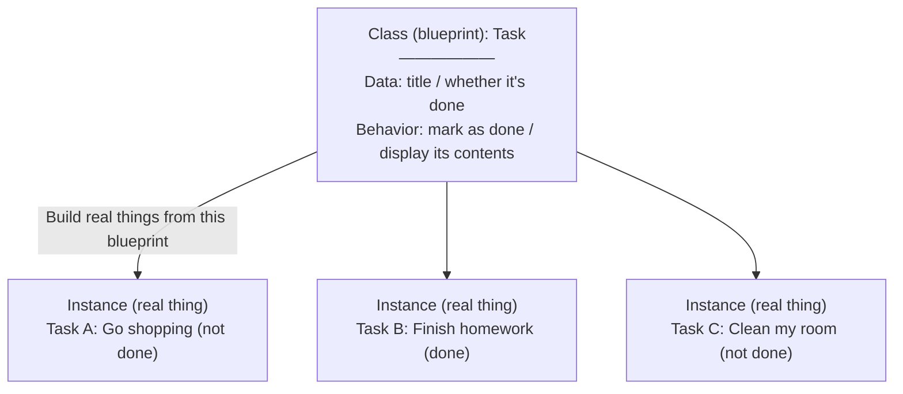

# Introduction to Object-Oriented Python

> 🇯🇵 Original (Japanese version): [02_Python_OOP入門.md](<../../1年生_前期_ITシステム基礎/番外編/02_Python_OOP入門.md>) <!-- original-ja-link -->

## Goals for This Lesson
- Explain the difference between a "class" and an "instance"
- Understand the role of the `__init__` method
- Use classes to bundle data and behavior together

---

## 1. What Is Object-Oriented Programming?

Object-oriented programming is an approach to programming in which you **bundle related data and behavior together**.

### Understanding It Through a Metaphor: "Blueprint" and "Real Thing"



**Class** = the blueprint (there is only one)
**Instance** = a real thing built from the blueprint (you can make as many as you like)

---

## 2. Let's Write a Class

### Step 1: The Simplest Class

```python
# Define a class
class Task:
    pass  # nothing here yet
```

```python
# Create instances
task1 = Task()  # create an instance from the Task class
task2 = Task()  # you can make another one

print(task1)  # <__main__.Task object at 0x...>
print(task2)  # <__main__.Task object at 0x...> ← a different instance
```

---

### Step 2: Giving It Data (`__init__`)

`__init__` is a **special method that is called automatically when an instance is created**.
It's also called a "constructor."

```python
class Task:
    # Called automatically when an instance is created
    def __init__(self, title):
        # self = refers to "this instance itself"
        self.title = title       # save the title
        self.done = False        # not done at first

# Create instances (__init__ is called at this point)
task1 = Task("買い物に行く")
task2 = Task("宿題を終わらせる")

# Access the instance's data
print(task1.title)  # 買い物に行く
print(task1.done)   # False
print(task2.title)  # 宿題を終わらせる
```

**Key point: What is `self`?**
```
task1 = Task("買い物に行く")
          ↑
    This instance (task1) is passed as self

self.title = title
→ means the same as task1.title = "買い物に行く"
```

---

### Step 3: Adding Methods

A method is a **function defined inside a class**.

```python
class Task:
    def __init__(self, title):
        self.title = title
        self.done = False

    # Method that marks the task as done
    def complete(self):
        self.done = True
        print(f"「{self.title}」を完了にしました！")

    # Method that shows the contents
    def show(self):
        status = "☑" if self.done else "□"
        print(f"{status} {self.title}")
```

```python
# Let's try it
task1 = Task("買い物に行く")
task2 = Task("宿題を終わらせる")

task1.show()      # □ 買い物に行く
task2.show()      # □ 宿題を終わらせる

task2.complete()  # 「宿題を終わらせる」を完了にしました！

task1.show()      # □ 買い物に行く
task2.show()      # ☑ 宿題を終わらせる
```

---

## 3. Comparing Code With and Without Classes

**Without classes:**

```python
# The data is scattered and hard to manage
title1 = "買い物に行く"
done1 = False

title2 = "宿題を終わらせる"
done2 = False

# You also have to write the "mark as done" logic separately
done2 = True
print(f"「{title2}」を完了にしました！")

# As the number of tasks grows... title3, done3, title4, done4... it never ends
```

**With classes:**

```python
# Data and behavior are bundled together! Easy to manage even as the number of tasks grows
tasks = [
    Task("買い物に行く"),
    Task("宿題を終わらせる"),
    Task("部屋を掃除する"),
]

# Show them all
for task in tasks:
    task.show()
```

---

## 4. Where OOP Is Used in This System

OOP (object-oriented programming) is used in **two important places** in this system.

### ① Database Table Definitions (models.py)

```python
# Table = class, one row of data = instance
class Task(Base):
    __tablename__ = "tasks"

    id = Column(Integer, primary_key=True)
    title = Column(String(200))
    done = Column(Boolean, default=False)
```

### ② API Data Format Definitions (schemas.py)

```python
# Express the request/response data format as classes
class TaskCreate(BaseModel):
    title: str  # data received: just the title

class TaskResponse(BaseModel):
    id: int
    title: str
    done: bool  # data returned: id, title, and done flag
```

Using classes makes it **easy to see at a glance what kind of data your code handles**.

---

## 5. Let's Practice

Complete the following class.

```python
class Task:
    def __init__(self, title):
        self.title = title
        self.done = False

    def complete(self):
        # Write the "mark as done" logic here
        pass

    def show(self):
        # Write the "show the contents" logic here
        pass

# Test
t = Task("テスト用タスク")
t.show()     # should print □ テスト用タスク
t.complete()
t.show()     # should print ☑ テスト用タスク
```

---

> Previous step → [01_MySQL環境構築.md](./01_MySQL環境構築.md)
> Next step → [03_FastAPI入門.md](./03_FastAPI入門.md)
