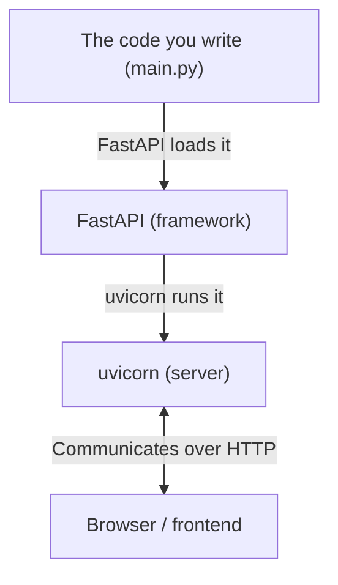
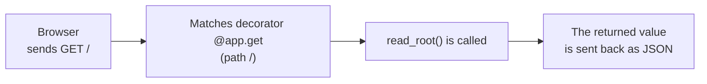

# Introduction to FastAPI

> 🇯🇵 Original (Japanese version): [03_FastAPI入門.md](<../../1年生_前期_ITシステム基礎/番外編/03_FastAPI入門.md>) <!-- original-ja-link -->

## Goals for This Lesson
- Start a simple API server with FastAPI
- Understand what decorators like `@app.get` mean
- Test an API from the browser with Swagger UI

---

## 1. What Is FastAPI?

**FastAPI = a framework for building API servers in Python**

A framework is "a handy toolbox that bundles commonly used features."



---

## 2. Building Hello World

First, let's build the simplest possible API server.

### main.py

```python
from fastapi import FastAPI

# Create a FastAPI instance (the core of the app)
app = FastAPI()

# What happens when "/" is accessed
@app.get("/")
def read_root():
    return {"message": "Hello, World!"}
```

### Start It

**Windows / Mac (same for both):**
```bash
uvicorn main:app --reload
```

```
INFO:     Uvicorn running on http://127.0.0.1:8000
INFO:     Application startup complete.
```

Open `http://localhost:8000` in your browser and you'll see:
```json
{"message": "Hello, World!"}
```

---

## 3. Understanding Decorators

The `@app.get("/")` in the code is called a **decorator**.

```python
@app.get("/")          # ← decorator
def read_root():       # ← calls this function when a GET request to / arrives
    return {...}
```

Here's the flow from when a request arrives until the response is returned.



### HTTP Methods and Their Decorators

| What you want to do | HTTP method | Decorator |
|------------|-------------|-----------|
| Get data | GET | `@app.get(...)` |
| Create new data | POST | `@app.post(...)` |
| Update data | PUT | `@app.put(...)` |
| Delete data | DELETE | `@app.delete(...)` |

---

## 4. Path Parameters (Putting Values in the URL)

```python
@app.get("/tasks/{task_id}")
def get_task(task_id: int):  # the {task_id} in the URL is passed in as an argument
    return {"task_id": task_id, "title": "サンプルタスク"}
```

Access `http://localhost:8000/tasks/3` and you'll see:
```json
{"task_id": 3, "title": "サンプルタスク"}
```

---

## 5. Swagger UI — A Page for Testing Your API

One of FastAPI's handy features is **Swagger UI**.
When you write your API code, **a page for testing your API in the browser is generated automatically**.

Open `http://localhost:8000/docs` and you'll see a page like this:

```
┌────────────────────────────────────────────┐
│  FastAPI                                   │
│                                            │
│  GET  /        Returns Hello World         │
│  ▼ Try it out                              │
│    [Execute]                               │
│                                            │
│  Response:                                 │
│  {"message": "Hello, World!"}              │
└────────────────────────────────────────────┘
```

**During development, Swagger UI is a handy way to check that things work.**

---

## 6. Building the Skeleton of the Task Management API

Working toward the real system, let's build the skeleton of the task management API.

```python
# main.py
from fastapi import FastAPI
from fastapi.staticfiles import StaticFiles

app = FastAPI()

# Configure the app to serve HTML files from the static folder
app.mount("/static", StaticFiles(directory="static"), name="static")

# Show index.html when the root (/) is accessed
from fastapi.responses import FileResponse

@app.get("/")
def read_index():
    return FileResponse("static/index.html")


# --- Task-related APIs (we'll finish these in later steps) ---

@app.get("/tasks")
def get_tasks():
    # Return the list of tasks (connect to the database later)
    return []

@app.post("/tasks")
def create_task():
    # Create a task (connect to the database later)
    return {"message": "タスクを作成しました"}

@app.put("/tasks/{task_id}")
def toggle_task(task_id: int):
    # Toggle a task between done and not done (connect to the database later)
    return {"message": f"タスク {task_id} を更新しました"}

@app.delete("/tasks/{task_id}")
def delete_task(task_id: int):
    # Delete a task (connect to the database later)
    return {"message": f"タスク {task_id} を削除しました"}
```

### Start It and Check

**Windows / Mac (same for both):**
```bash
uvicorn main:app --reload
```

Open `http://localhost:8000/docs` and check that the four endpoints are shown.

```
GET    /tasks      Get the task list
POST   /tasks      Create a task
PUT    /tasks/{id} Toggle completion status
DELETE /tasks/{id} Delete a task
```

---

## 7. Key Points So Far

```
① Create a FastAPI instance
   app = FastAPI()

② Specify the URL and method with a decorator
   @app.get("/tasks")

③ The function below it does the actual work
   def get_tasks():
       return [...]

④ The value returned by the function becomes the JSON response
   return [{"id": 1, "title": "買い物"}]
   → [{"id": 1, "title": "買い物"}] is returned to the browser
```

---

> Previous step → [02_Python_OOP入門.md](./02_Python_OOP入門.md)
> Next step → [04_データベース連携.md](./04_データベース連携.md)
