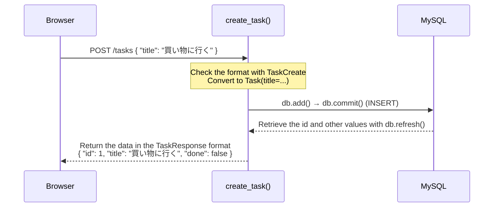

# Implementing the CRUD API

> 🇯🇵 Original (Japanese version): [05_CRUD_API実装.md](<../../1年生_前期_ITシステム基礎/番外編/05_CRUD_API実装.md>) <!-- original-ja-link -->

## Goals for This Lesson
- Define data formats with Pydantic schema classes
- Implement four APIs: GET / POST / PUT / DELETE
- Check how each API works in Swagger UI

---

## 1. What Is CRUD?

**CRUD** = the four basic operations for working with data

| Letter | Operation | SQL | HTTP method |
|------|------|-----|-------------|
| C | Create | INSERT | POST |
| R | Read | SELECT | GET |
| U | Update | UPDATE | PUT |
| D | Delete | DELETE | DELETE |

---

## 2. schemas.py — Defining the API's Data Formats

**Pydantic** is a library for defining data formats using classes.
When combined with FastAPI, it **automatically validates request/response data** for you.

```python
# schemas.py

from pydantic import BaseModel

# Data received when creating a task
class TaskCreate(BaseModel):
    title: str  # only receive the title (the server decides id and done)

# Data returned in the API response
class TaskResponse(BaseModel):
    id: int
    title: str
    done: bool

    # Setting that lets you pass a SQLAlchemy model object directly
    class Config:
        from_attributes = True
```

### Why Write Schemas in a Separate File?

```
models.py  → the shape of the database (how data is stored)
schemas.py → the shape of the API (what data is received/returned)

Example: when creating a task
  Received (TaskCreate):  title only
  Returned (TaskResponse): id + title + done
  Stored (Task model):     id + title + done (id is generated automatically)
```

---

## 3. routers/tasks.py — Implementing the Four APIs

```python
# routers/tasks.py

from fastapi import APIRouter, Depends, HTTPException
from sqlalchemy.orm import Session
from database import get_db
from models import Task
from schemas import TaskCreate, TaskResponse

# Router = a group of URLs (here, it groups the APIs related to /tasks)
router = APIRouter(prefix="/tasks", tags=["tasks"])
```

---

### R — Get the Task List (GET /tasks)

```python
# ⚠️ Use "" instead of "/" (with "/", /tasks gets redirected to /tasks/)
@router.get("", response_model=list[TaskResponse])
def get_tasks(db: Session = Depends(get_db)):
    """Get all tasks and return them"""
    tasks = db.query(Task).all()  # SELECT * FROM tasks
    return tasks
```

**What is `Depends(get_db)`?**
```
db: Session = Depends(get_db)
↑
It means "please pass the result of the get_db function (a DB session) into db."
It prepares the DB connection every time the API is called.
```

---

### C — Create a Task (POST /tasks)

```python
@router.post("", response_model=TaskResponse)
def create_task(task_in: TaskCreate, db: Session = Depends(get_db)):
    """Create a new task"""
    # Convert the received data (TaskCreate) into a Task model instance
    new_task = Task(title=task_in.title)

    db.add(new_task)    # prepare to add it to the DB
    db.commit()         # save to the DB (runs INSERT)
    db.refresh(new_task)  # get the id and other values the DB set automatically
    return new_task
```

Here's a diagram of the flow when POST /tasks is called.



---

### U — Toggle Task Completion (PUT /tasks/{task_id})

```python
@router.put("/{task_id}", response_model=TaskResponse)
def toggle_task(task_id: int, db: Session = Depends(get_db)):
    """Toggle a task between done and not done"""
    # Get the target task
    task = db.query(Task).filter(Task.id == task_id).first()

    # Return a 404 error if the task isn't found
    if task is None:
        raise HTTPException(status_code=404, detail="タスクが見つかりません")

    # Flip done (True → False, False → True)
    task.done = not task.done

    db.commit()         # save to the DB (runs UPDATE)
    db.refresh(task)
    return task
```

---

### D — Delete a Task (DELETE /tasks/{task_id})

```python
@router.delete("/{task_id}")
def delete_task(task_id: int, db: Session = Depends(get_db)):
    """Delete a task"""
    task = db.query(Task).filter(Task.id == task_id).first()

    if task is None:
        raise HTTPException(status_code=404, detail="タスクが見つかりません")

    db.delete(task)     # prepare to delete it
    db.commit()         # delete from the DB (runs DELETE)
    return {"message": f"タスク '{task.title}' を削除しました"}
```

---

## 4. Registering the Router in main.py

```python
# main.py (finished version)

from fastapi import FastAPI
from fastapi.staticfiles import StaticFiles
from fastapi.responses import FileResponse
from database import engine, Base
import models
from routers import tasks  # ← added

# Create tables automatically
Base.metadata.create_all(bind=engine)

app = FastAPI()

# Register the router (enables the APIs under /tasks)
app.include_router(tasks.router)  # ← added

app.mount("/static", StaticFiles(directory="static"), name="static")

@app.get("/")
def read_index():
    return FileResponse("static/index.html")
```

---

## 5. File Structure (So Far)

```
my_todo_app/
├── main.py         ← router registration already added
├── database.py     ← DB connection settings
├── models.py       ← Task table definition
├── schemas.py      ← ★ created in this lesson: data format definitions
├── routers/
│   ├── __init__.py ← empty file (makes Python recognize the folder as a package)
│   └── tasks.py    ← ★ created in this lesson: CRUD API
└── static/
    └── index.html  ← created in the next step
```

`routers/__init__.py` can be an empty file:

**Windows:**
```cmd
type nul > routers\__init__.py
```

**Mac:**
```bash
touch routers/__init__.py
```

---

## 6. Testing the APIs in Swagger UI

**Windows / Mac (same for both):**
```bash
uvicorn main:app --reload
```

Open `http://localhost:8000/docs` to test the APIs.

**Steps to check (in the order POST → GET → PUT → DELETE):**

1. Click **POST /tasks** → `Try it out` → enter in the Request body:
   ```json
   {"title": "買い物に行く"}
   ```
   → `Execute` → the response should be `{"id": 1, "title": "買い物に行く", "done": false}`

2. Click **GET /tasks** → `Try it out` → `Execute`
   → the task you created should be returned in the list

3. Click **PUT /tasks/{task_id}** → enter `1` for `task_id` → `Execute`
   → it should change to `"done": true`

4. Click **DELETE /tasks/{task_id}** → enter `1` for `task_id` → `Execute`
   → a deletion message should be returned

---

> Previous step → [04_データベース連携.md](./04_データベース連携.md)
> Next step → [06_フロントエンド連携.md](./06_フロントエンド連携.md)
