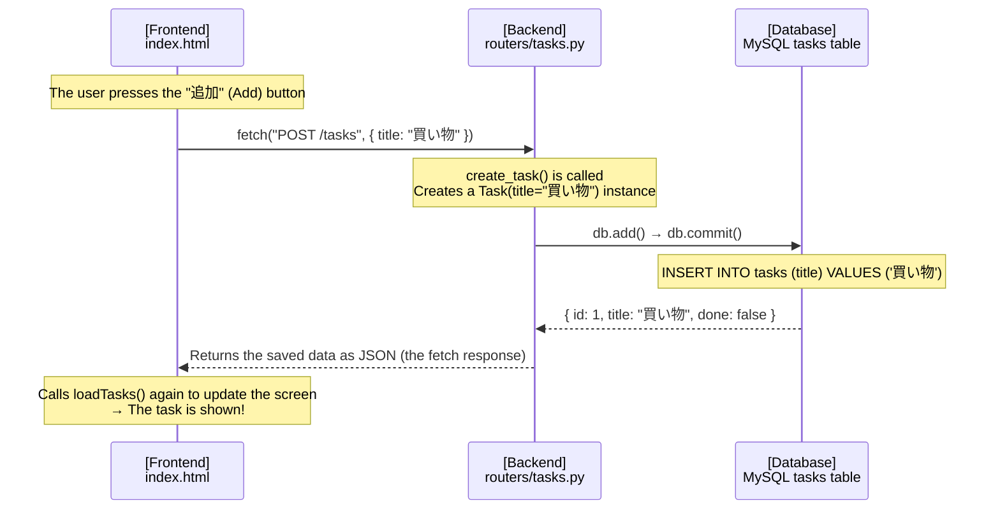

# Connecting the Frontend (HTML + JavaScript)

> 🇯🇵 Original (Japanese version): [06_フロントエンド連携.md](<../../1年生_前期_ITシステム基礎/番外編/06_フロントエンド連携.md>) <!-- original-ja-link -->

## Goals for This Lesson
- Call the Python API using `fetch()`
- Display the API response on the screen (DOM manipulation)
- Add tasks, toggle their completion status, and delete them from the screen

---

## 1. What Is an SPA (Single-Page Application)?

The frontend we'll build this time uses an approach called an **SPA**.

```
Traditional website (with page transitions)
  The whole page reloads every time you do something
  Page A → Page B → Page C ...

SPA (single-page application)
  A single HTML file, with JavaScript dynamically updating the page
  No page reloads → feels fast and responsive
```

This time, everything fits in **just one file: index.html**.

---

## 2. Preparing the Folder

**Windows:**
```cmd
mkdir static
type nul > static\index.html
```

**Mac:**
```bash
mkdir static
touch static/index.html
```

---

## 3. index.html — Finished Code

```html
<!DOCTYPE html>
<html lang="ja">
<head>
  <meta charset="UTF-8">
  <meta name="viewport" content="width=device-width, initial-scale=1.0">
  <title>タスク管理アプリ</title>
  <style>
    body {
      font-family: Arial, sans-serif;
      max-width: 600px;
      margin: 40px auto;
      padding: 0 20px;
      background: #f5f5f5;
    }
    h1 { color: #333; }

    /* Form for adding tasks */
    .add-form {
      display: flex;
      gap: 8px;
      margin-bottom: 20px;
    }
    .add-form input {
      flex: 1;
      padding: 8px;
      font-size: 16px;
      border: 1px solid #ccc;
      border-radius: 4px;
    }
    .add-form button {
      padding: 8px 16px;
      background: #4CAF50;
      color: white;
      border: none;
      border-radius: 4px;
      cursor: pointer;
      font-size: 16px;
    }

    /* Task list */
    .task-list { list-style: none; padding: 0; }
    .task-item {
      display: flex;
      align-items: center;
      gap: 8px;
      background: white;
      padding: 12px;
      margin-bottom: 8px;
      border-radius: 4px;
      box-shadow: 0 1px 3px rgba(0,0,0,0.1);
    }
    .task-title { flex: 1; font-size: 16px; }
    .task-title.done {
      text-decoration: line-through;
      color: #999;
    }
    .btn-done {
      padding: 4px 12px;
      background: #2196F3;
      color: white;
      border: none;
      border-radius: 4px;
      cursor: pointer;
    }
    .btn-delete {
      padding: 4px 12px;
      background: #f44336;
      color: white;
      border: none;
      border-radius: 4px;
      cursor: pointer;
    }
  </style>
</head>
<body>

  <h1>タスク管理アプリ</h1>

  <!-- Form for adding tasks -->
  <div class="add-form">
    <input type="text" id="newTaskInput" placeholder="新しいタスクを入力...">
    <button onclick="addTask()">追加</button>
  </div>

  <!-- Task list (rewritten by JavaScript) -->
  <ul class="task-list" id="taskList">
    <!-- Tasks are shown here -->
  </ul>

  <script>
    // ============================================================
    // Base URL of the API (the Python server's address)
    // ============================================================
    const API_URL = "http://localhost:8000";

    // ============================================================
    // R — Get the task list and show it on the screen
    // ============================================================
    async function loadTasks() {
      // Send a GET request with fetch()
      const response = await fetch(`${API_URL}/tasks`);
      const tasks = await response.json();  // parse the response body as JSON

      // Clear the task list first
      const taskList = document.getElementById("taskList");
      taskList.innerHTML = "";

      // Create and add one <li> for each task
      tasks.forEach(task => {
        const li = document.createElement("li");
        li.className = "task-item";
        li.innerHTML = `
          <span class="task-title ${task.done ? 'done' : ''}">${task.title}</span>
          <button class="btn-done" onclick="toggleTask(${task.id})">
            ${task.done ? '未完了に戻す' : '完了'}
          </button>
          <button class="btn-delete" onclick="deleteTask(${task.id})">削除</button>
        `;
        taskList.appendChild(li);
      });
    }

    // ============================================================
    // C — Add a task
    // ============================================================
    async function addTask() {
      const input = document.getElementById("newTaskInput");
      const title = input.value.trim();

      // Do nothing if nothing was entered
      if (!title) return;

      // Send a POST request with fetch()
      await fetch(`${API_URL}/tasks`, {
        method: "POST",
        headers: {
          "Content-Type": "application/json"  // tell the server we're sending JSON
        },
        body: JSON.stringify({ title: title })  // JavaScript object → JSON string
      });

      // Clear the input field and reload the list
      input.value = "";
      loadTasks();
    }

    // ============================================================
    // U — Toggle a task between done and not done
    // ============================================================
    async function toggleTask(taskId) {
      // Send a PUT request with fetch()
      await fetch(`${API_URL}/tasks/${taskId}`, {
        method: "PUT"
      });

      loadTasks();  // reload the list
    }

    // ============================================================
    // D — Delete a task
    // ============================================================
    async function deleteTask(taskId) {
      // Send a DELETE request with fetch()
      await fetch(`${API_URL}/tasks/${taskId}`, {
        method: "DELETE"
      });

      loadTasks();  // reload the list
    }

    // ============================================================
    // Let users add a task with the Enter key too
    // ============================================================
    document.getElementById("newTaskInput").addEventListener("keydown", function(e) {
      if (e.key === "Enter") {
        addTask();
      }
    });

    // Load the task list when the page opens
    loadTasks();
  </script>

</body>
</html>
```

---

## 4. Key Points in the Code

### The Basic Patterns of `fetch()`

```javascript
// GET (get data)
const response = await fetch("http://localhost:8000/tasks");
const data = await response.json();

// POST (send data)
await fetch("http://localhost:8000/tasks", {
  method: "POST",
  headers: { "Content-Type": "application/json" },
  body: JSON.stringify({ title: "買い物" })
});

// PUT (update)
await fetch("http://localhost:8000/tasks/1", {
  method: "PUT"
});

// DELETE (delete)
await fetch("http://localhost:8000/tasks/1", {
  method: "DELETE"
});
```

### What Is `async / await`?

```javascript
// Talking to an API "takes time,"
// so you need to wait until you get the result

async function loadTasks() {         // async = this function contains asynchronous work
  const response = await fetch(...); // await = wait here until the result arrives
  const tasks = await response.json();
  // ↑ response.json() also takes time, so it needs await too
}
```

### DOM Manipulation (Updating the Page)

```javascript
// DOM = the mechanism for working with HTML elements from JavaScript

// Get the element with id="taskList"
const taskList = document.getElementById("taskList");

// Clear its contents
taskList.innerHTML = "";

// Create a new element and add it
const li = document.createElement("li");
li.innerHTML = `<span>${task.title}</span>`;
taskList.appendChild(li);
```

---

## 5. Checking That It Works

### Start It

**Windows / Mac (same for both):**
```bash
uvicorn main:app --reload
```

Open `http://localhost:8000` in your browser.

### Steps to Check

1. **Add a task**
   - Type "買い物に行く" (Go shopping) in the input field and click the "追加" (Add) button
   - It should appear in the list

2. **Mark it as done**
   - Click the "完了" (Done) button
   - The title should get a strikethrough

3. **Delete it**
   - Click the "削除" (Delete) button
   - It should disappear from the list

4. **Reload the page (F5)**
   - The data should still be there (because it's saved in MySQL)

---

## 6. The System Is Complete! Summary of the Whole Flow



---

> Previous step → [05_CRUD_API実装.md](./05_CRUD_API実装.md)
> Next step → [07_コードリーディング.md](./07_コードリーディング.md)
> Start from the beginning → [00_概要とシステム設計.md](./00_概要とシステム設計.md)
