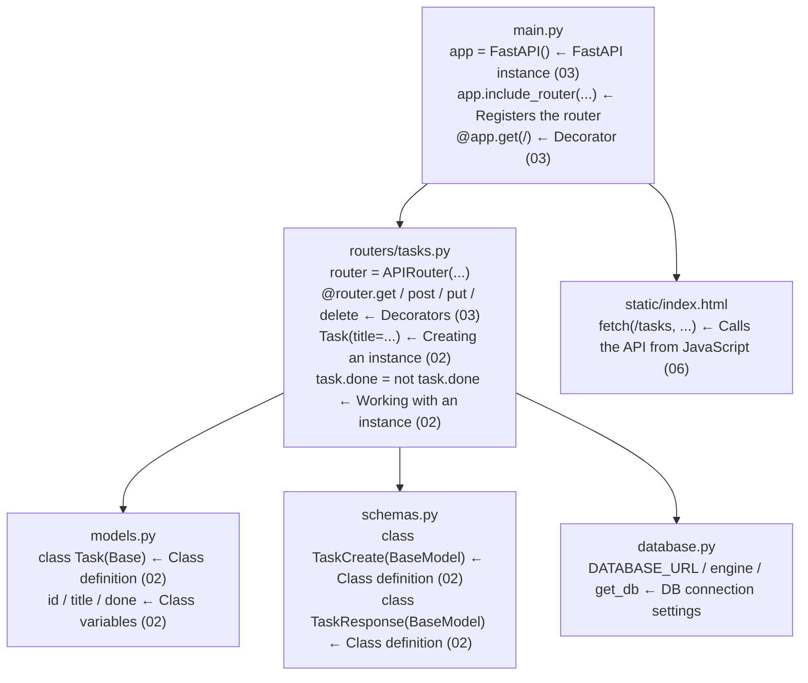

# Code Reading — Reviewing What You Learned with the Sample Source

> 🇯🇵 Original (Japanese version): [07_コードリーディング.md](<../../1年生_前期_ITシステム基礎/番外編/07_コードリーディング.md>) <!-- original-ja-link -->

## Goals for This Session
- Be able to explain where the classes you learned about in `02_Python_OOP入門` are used in real code
- Be able to explain where the decorators you learned about in `03_FastAPI入門` are used in real code
- Understand how the 5 files connect to each other

---

## Order of Files to Read

```
① models.py     ← Everything you learned about OOP (classes)
② schemas.py    ← Everything you learned about OOP (classes)
③ main.py       ← Everything you learned about FastAPI (decorators)
④ routers/tasks.py ← Both OOP and FastAPI appear here
⑤ database.py   ← Connection settings (for reference)
```

---

## ① Reading models.py

```python
from sqlalchemy import Column, Integer, String, Boolean
from database import Base

class Task(Base):
    __tablename__ = "tasks"

    id    = Column(Integer, primary_key=True, index=True)
    title = Column(String(200), nullable=False)
    done  = Column(Boolean, default=False)
```

### How It Connects to 02_OOP入門

**`class Task` → Defining a class (learned in 02, Step 1)**

```
What you learned in 02    Real code
─────────────────────    ──────────────────────
class Task:              class Task(Base):
    pass                     __tablename__ = "tasks"
```

`(Base)` is called **inheritance**. The `Task` class inherits the features of the `Base` class.
Think of it as "a setting that lets you use all of SQLAlchemy's features."

---

**`id / title / done` → Class variables (the data each instance holds)**

In the `Task` class from 02, you defined `self.title` and `self.done` in the constructor.
`models.py` does the same thing using SQLAlchemy's `Column()`.

```
What you learned in 02          Real code (models.py)
─────────────────────────    ──────────────────────────────────
class Task:                  class Task(Base):
    def __init__(self):
        self.title = ...         title = Column(String(200))
        self.done = False        done  = Column(Boolean, default=False)
```

The way it is written is different, but both define "**what data the class holds**."

---

**Where an instance is created (from routers/tasks.py)**

```python
# Create an instance from the Task class (same as Step 2 in 02!)
new_task = Task(title=task_in.title)
#          ↑ Task class   ↑ pass a value to title
```

Compare it with the exercise in 02:
```python
# Exercise in 02                 Real code
task1 = Task("買い物に行く")   new_task = Task(title="買い物に行く")
```

It is doing exactly the same thing.

---

## ② Reading schemas.py

```python
from pydantic import BaseModel

class TaskCreate(BaseModel):
    title: str

class TaskResponse(BaseModel):
    id: int
    title: str
    done: bool

    class Config:
        from_attributes = True
```

### How It Connects to 02_OOP入門

**Two classes are defined → each has a different purpose**

```
Class name       Role                       When the instance is created
────────────    ─────────────────────    ──────────────────────────────
TaskCreate      Receives the POST request  When "Add" is clicked in the browser
TaskResponse    Returns the response       When the API returns a result
```

**`title: str` → A class variable with a type annotation**

In 02 you wrote `self.title = title`,
but in a Pydantic class, writing `title: str` defines `title` as a string.

```python
# How you wrote it in 02 (regular class)  How schemas.py writes it (Pydantic class)
def __init__(self, title):         class TaskCreate(BaseModel):
    self.title = title                 title: str   ← Just one line!
```

**`class Config` → A class inside a class**

You can write another class inside a class.
Here, it holds a setting that lets you pass a SQLAlchemy model object directly.

---

## ③ Reading main.py

```python
from fastapi import FastAPI
from fastapi.staticfiles import StaticFiles
from fastapi.responses import FileResponse
from database import engine, Base
import models
from routers import tasks

Base.metadata.create_all(bind=engine)

app = FastAPI()

app.include_router(tasks.router)

app.mount("/static", StaticFiles(directory="static"), name="static")

@app.get("/")
def read_index():
    return FileResponse("static/index.html")
```

### How It Connects to 03_FastAPI入門

**`app = FastAPI()` → Creating a FastAPI instance (learned in 03)**

```
What you learned in 03    Real code
─────────────────────    ──────────────────────
app = FastAPI()           app = FastAPI()   ← Exactly the same!
```

---

**`@app.get("/")` → A decorator (learned in 03)**

```python
@app.get("/")          # ← "When a GET request comes to /, call this function"
def read_index():
    return FileResponse("static/index.html")
```

Compare it with Hello World from 03:
```
Exercise in 03                       Real code
─────────────────────────────────   ──────────────────────────────────
@app.get("/")                        @app.get("/")
def read_root():                     def read_index():
    return {"message": "Hello!"}         return FileResponse("static/index.html")
```

Only what `return` gives back is different; the decorator is used in exactly the same way.

---

**`app.include_router(tasks.router)` → New: routers**

In 03, you wrote all the endpoints in `main.py`.
In a real system, the task-related APIs are grouped together in `routers/tasks.py`,
and `main.py` registers them by saying "use this router."

```
Skeleton from 03 (all in main.py)     Real system (split into files)
─────────────────────────────────   ──────────────────────────────────
@app.get("/tasks")                   Write in routers/tasks.py
@app.post("/tasks")                       ↓
@app.put("/tasks/{id}")              Register in main.py
@app.delete("/tasks/{id}")           app.include_router(tasks.router)
```

**Why split it into separate files?**
→ As you add more features such as tasks, users, and products, putting everything in one file makes it hard to read.

---

**`Base.metadata.create_all(bind=engine)` → Creating tables automatically**

Every time the app starts, it automatically "creates the tasks table if it doesn't exist."
It creates the table based on the `Task` class in `models.py`.

---

## ④ Reading routers/tasks.py

This is the most important file, where both OOP (02) and FastAPI (03) appear.

```python
from fastapi import APIRouter, Depends, HTTPException
from sqlalchemy.orm import Session
from database import get_db
from models import Task
from schemas import TaskCreate, TaskResponse

router = APIRouter(prefix="/tasks", tags=["tasks"])
```

**`router = APIRouter(...)` → A router instance, similar to `app`**

```
main.py             routers/tasks.py
────────────────    ──────────────────────────────
app = FastAPI()     router = APIRouter(prefix="/tasks")
@app.get("/")       @router.get("")
```

What `prefix="/tasks"` means: `/tasks` is automatically added in front of the URL you write in this router's decorators.

```
@router.get("")   →  The actual URL is /tasks
@router.get("/{task_id}")  →  The actual URL is /tasks/{task_id}
```

---

### GET /tasks — Get the List

```python
@router.get("", response_model=list[TaskResponse])
def get_tasks(db: Session = Depends(get_db)):
    return db.query(Task).all()
```

**`@router.get("")` → A decorator (learned in 03)**
Attaching it to `router` makes it handle GET requests to `/tasks`.

**`response_model=list[TaskResponse]` → Specifying the shape of the response**
This declares that the response is a list of `TaskResponse` instances from `schemas.py`.

**`Depends(get_db)` → New: dependency injection**
This is a FastAPI feature that means "pass the result of the `get_db` function (a DB connection) to `db`."
Every time the API is called, it automatically prepares the connection to the DB for you.

**`db.query(Task).all()` → Get all Task instances**
```
db.query(Task).all()
             ↑
         Specifies the OOP Task class
         → Gets every row in the tasks table as a list of Task instances
```

---

### POST /tasks — Create a Task

```python
@router.post("", response_model=TaskResponse)
def create_task(task_in: TaskCreate, db: Session = Depends(get_db)):
    new_task = Task(title=task_in.title)  # ← OOP! Create an instance
    db.add(new_task)
    db.commit()
    db.refresh(new_task)
    return new_task
```

**`task_in: TaskCreate` → The class from schemas.py appears here**
The JSON sent from the browser is automatically converted into a `TaskCreate` instance.

```
Data the browser sends      FastAPI converts it automatically
────────────────────    ──────────────────────────────
{"title": "買い物"}  →  task_in = TaskCreate(title="買い物")
                                             ↑ You can get it with task_in.title
```

**`new_task = Task(title=task_in.title)` → OOP (same as Step 2 in 02)**

```
Exercise in 02                    Real code
─────────────────────────────    ──────────────────────────────
task1 = Task("買い物に行く")       new_task = Task(title=task_in.title)
```

Creating an instance and having it hold data: this is exactly what OOP is.

---

### PUT /tasks/{task_id} — Toggle Completion Status

```python
@router.put("/{task_id}", response_model=TaskResponse)
def toggle_task(task_id: int, db: Session = Depends(get_db)):
    task = db.query(Task).filter(Task.id == task_id).first()

    if task is None:
        raise HTTPException(status_code=404, detail="タスクが見つかりません")

    task.done = not task.done   # ← OOP! Change the instance's data
    db.commit()
    db.refresh(task)
    return task
```

**`/{task_id}` → A path parameter (learned in 03)**

```
Exercise in 03                     Real code
─────────────────────────────     ──────────────────────────────
@app.get("/tasks/{task_id}")       @router.put("/{task_id}")
def get_task(task_id: int):        def toggle_task(task_id: int, ...):
```

The number in the URL (for example, `/tasks/3`) is passed in as `task_id = 3`.

**`task.done = not task.done` → Changing the instance's data directly**

```
Toggle the done value of the retrieved task instance
If task.done is False → not False → True  (not done → done)
If task.done is True  → not True  → False (done → not done)
```

---

### DELETE /tasks/{task_id} — Delete

```python
@router.delete("/{task_id}")
def delete_task(task_id: int, db: Session = Depends(get_db)):
    task = db.query(Task).filter(Task.id == task_id).first()

    if task is None:
        raise HTTPException(status_code=404, detail="タスクが見つかりません")

    db.delete(task)
    db.commit()
    return {"message": f"タスク '{task.title}' を削除しました"}
```

**`raise HTTPException(status_code=404, ...)` → Returning an error**

When `task` is not found (`is None`), it returns a 404 error to the browser.
`raise` is Python syntax that means "raise this error right now."

---

## ⑤ How Everything Fits Together



---

## Summary: How What You Learned in 02 and 03 Is Used

| What you learned | Material | Real code |
|-----------|------|-------------|
| Define a class with `class ClassName:` | 02 | `Task` in `models.py`, `TaskCreate` in `schemas.py`, etc. |
| `instance = ClassName(arguments)` | 02 | `new_task = Task(title=...)` |
| Change an instance's data | 02 | `task.done = not task.done` |
| `app = FastAPI()` | 03 | Line 1 of `main.py` |
| The `@app.get(...)` decorator | 03 | `@router.get("") / @router.post("") etc.` |
| `/{parameter}` path parameters | 03 | `@router.put("/{task_id}")` |

---

> Previous step → [06_フロントエンド連携.md](./06_フロントエンド連携.md)
> Sample source → [検証/todo_app/](./検証/todo_app/)
