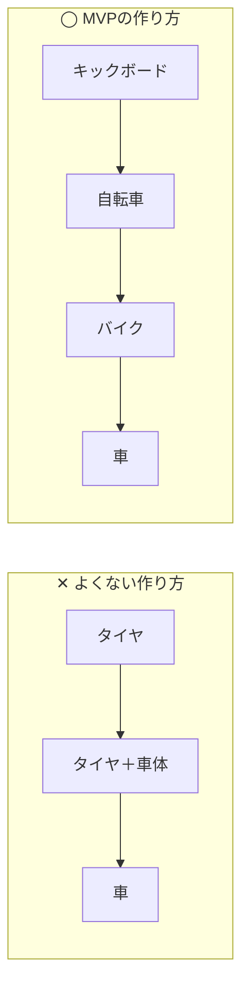
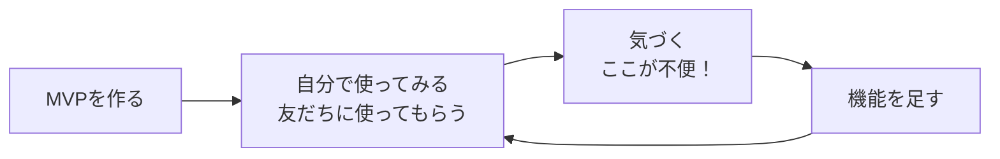
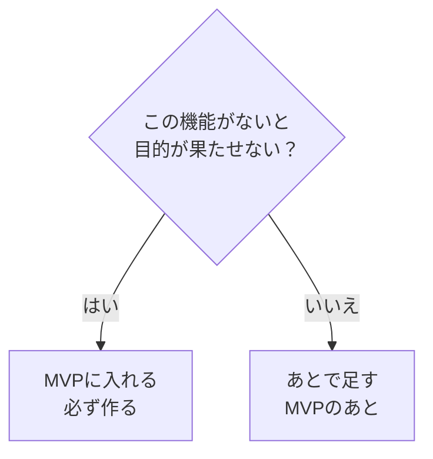
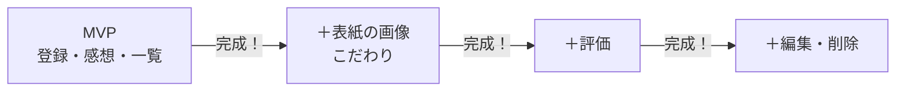
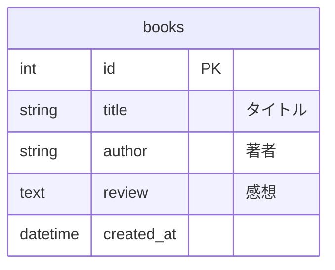

# MVP：まず「最小限で使えるもの」を完成させよう

## 1. MVPとは

前回、[まず小さく作る](../2026_10_09/2026_10_09_資料1.md#まず小さく作る) という話をしました。
この「小さく作ったもの」には名前があります。それが **MVP** です。

| 略す前 | 意味 |
|-------|------|
| **M**inimum | 最小限の |
| **V**iable | 使える・成り立つ |
| **P**roduct | 製品・アプリ |

つまり MVP は、**「これだけあれば使える」という最小限のアプリ** のことです。
実際の会社でも、新しいサービスを作るときは、まず MVP を作って公開し、使う人の反応を見ながら育てていきます。

> 💡 **たとえるなら「カレーライス」**
> カレーの MVP は「ごはん＋ルー」です。これだけで **ちゃんとカレーとして食べられます**。
> トンカツ・チーズ・福神漬けは、あとからトッピングすればいいもの。
> 逆に、トッピングだけたくさんあって **ルーがない** と、カレーとして食べられません。

---

## 2. MVPのよくあるかんちがい

MVP は「作りかけ」ではありません。**小さくても、ちゃんと使える** ことが大事です。



| | ✕ よくない作り方 | ◯ MVPの作り方 |
|---|---|---|
| 1回目 | タイヤだけ → **移動できない** | キックボード → **移動できる！** |
| 2回目 | タイヤ＋車体 → **まだ移動できない** | 自転車 → **もっと速く移動できる** |
| 途中で時間切れになったら | **何も使えない** | **使えるものが手元に残る** |

- ✕ のほうは、最後まで作り切らないと **1回も使えません**
- ◯ のほうは、どの段階で終わっても **「移動する」という目的は果たせます**

アプリでも同じです。「ログイン画面だけ完璧」「デザインだけ完璧」で、**肝心の機能が動かない** のは ✕ のパターンです。

---

## 3. なぜMVPから作るの？

### ① 完成しないまま終わるのを防げる

自由制作でいちばん多い失敗は、**機能を詰めこみすぎて、完成しないまま終わる** ことです。
MVP を先に作っておけば、**どこで時間切れになっても「動くアプリ」が手元に残ります**。

### ② 早く使ってみると、本当に必要なものがわかる

作る前に考えた「あったらいいな」は、実際に使ってみると **いらなかった** ということがよくあります。
逆に、使ってみて初めて「これがないと不便！」と気づく機能もあります。



### ③ ポートフォリオとして、まず「見せられる」状態になる

就職活動で提出するとき、**未完成のアプリ** は見せにくいです。
MVP ができていれば、いつでも **「動くもの」として提出できる状態** になります。
こだわりは、その上に **少しずつ積み上げていけば** OK です。

---

## 4. MVPの決め方

### ステップ1：アプリの目的を1文で書く

まず、**「誰が」「何をするための」アプリか** を1文で書きます。

```
〇〇な人が、△△するためのアプリ
```

| アプリ | 目的（1文） |
|-------|-----------|
| 読書記録 | 本が好きな人が、**読んだ本と感想を記録して見返す** ためのアプリ |
| 筋トレ記録 | 筋トレをしている人が、**毎日のメニューと回数を記録する** ためのアプリ |
| 部活の出欠表 | 部活のマネージャーが、**練習の出欠をまとめる** ためのアプリ |

> この1文の **太字の部分** が、アプリの「ルー」です。ここができなければ、アプリとして成り立ちません。

### ステップ2：作りたい機能を全部書き出す

思いつく機能を、遠慮せずに **全部** 書き出します。ここではまだ、できるかどうかは考えなくて大丈夫です。

**読書記録アプリの例**

- 本を登録する（タイトル・著者）
- 感想を書く
- 評価（星1〜5）をつける
- 登録した本を一覧で見る
- 本を編集・削除する
- 表紙の画像を表示する
- 本を検索する
- ジャンルで分ける
- ログイン機能
- 友だちと本をシェアする
- 読んだ冊数をグラフにする

### ステップ3：「ないと目的が果たせない？」で分ける

書き出した機能を1つずつ見て、**「これがなかったら、目的（ステップ1の1文）が果たせない？」** と自分に聞きます。



**読書記録アプリの例**（目的：読んだ本と感想を記録して見返す）

| 機能 | ないと目的が果たせない？ | 分類 |
|------|-------------------|------|
| 本を登録する（タイトル・著者） | はい（記録できない） | **MVP** |
| 感想を書く | はい（感想を記録できない） | **MVP** |
| 登録した本を一覧で見る | はい（見返せない） | **MVP** |
| 評価（星1〜5）をつける | いいえ（感想があれば記録できる） | あとで |
| 本を編集・削除する | いいえ（なくても記録・見返しはできる） | あとで |
| 表紙の画像を表示する | いいえ | あとで |
| 本を検索する | いいえ（冊数が少ないうちは一覧で十分） | あとで |
| ジャンルで分ける | いいえ | あとで |
| ログイン機能 | いいえ（自分だけで使うなら不要） | あとで |
| 友だちと本をシェアする | いいえ | あとで |
| 読んだ冊数をグラフにする | いいえ | あとで |

> 💡 **MVP の機能は 3つ前後が目安** です。5つ以上になったら、「本当に、ないと目的が果たせない？」ともう一度聞いてみましょう。

> ⚠️ **ログイン機能は、MVPに入れないことが多い**
> ログインはむずかしく時間もかかるのに、**アプリの目的そのものではない** ことがほとんどです。
> まずはログインなしで動くものを作り、必要になったらあとで足しましょう。

### ステップ4：「あとで足す」に順番をつける

「あとで足す」機能に、**作りたい順番** をつけます。
ここで大切にしたいのが、前回話した **自分のこだわり** です。

| 順番 | 機能 | 理由 |
|-----|------|------|
| 1 | 表紙の画像を表示する | **本棚みたいに見せたい**（いちばんのこだわり） |
| 2 | 評価（星1〜5）をつける | おすすめの本がひと目でわかる |
| 3 | 本を編集・削除する | まちがえたときに直したい |
| 4 | ジャンルで分ける | 冊数が増えてきたら必要 |
| … | … | … |



こだわりの機能は **MVPのすぐあと** に作るのがおすすめです。
MVP だけではほかの人と似たアプリになりがちですが、こだわりが入ることで **「自分だけのアプリ」** になります。

---

## 5. MVPのテーブルを考える

テーブルも、**MVP に必要な列だけ** から始めます。列は、あとからマイグレーション（Supabase なら管理画面）で足せます。



評価（`rating`）や表紙の画像（`image_url`）は、その機能を作るときに足せば大丈夫です。

